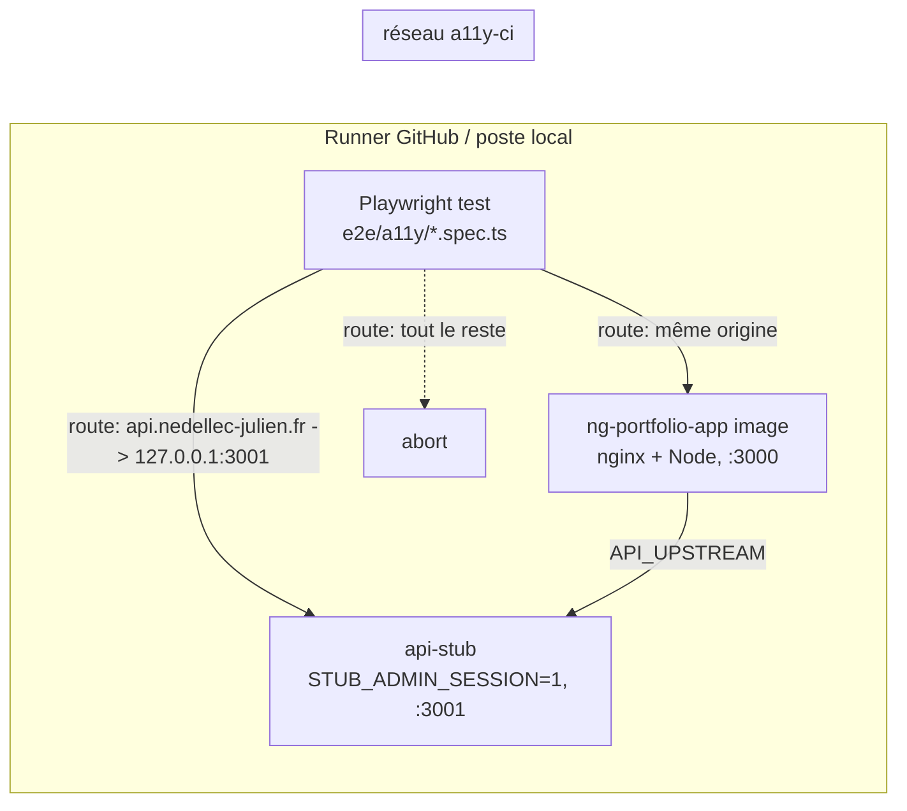

# 023 — AXE automatisé

## Description

### Objectif

Demande du propriétaire : « AXE automatisé ». WCAG AA (règle de CLAUDE.md : « WCAG AA, doit passer
AXE ») vérifié **automatiquement à chaque PR**, au lieu d'une vérification manuelle par les revues.

### Exigence (contrat)

1. Chaque PR exécute axe-core sur le **rendu réel** du site (l'image Docker que Dokploy déploie,
   servie contre la doublure `ci/api-stub`), dans un vrai navigateur, contraste compris.
2. Périmètre : pages publiques (accueil, `/about`, `/projects`, fiche projet, `/blog`, article,
   `/offres` et ses deux pages, mentions légales, confidentialité, 404, `/login`) en thème **clair et
   sombre** ; états interactifs clés (menu mobile ouvert, menu admin mobile ouvert, dialogue de
   confirmation de suppression) ; pages admin principales (tableau de bord, projets et leur éditeur,
   articles et leur éditeur, parcours, CV, messages, audience, réglages) via la session simulée de la
   doublure, **avec données** (pas en état d'erreur).
3. Règles WCAG 2.0, 2.1 et 2.2 niveaux A et AA ; **zéro violation**, aucune exception silencieuse.
4. Un échec se lit sans relancer : règle, impact, élément, lien d'aide, page, thème, dans le log et
   dans un artefact.
5. Une commande locale rejoue exactement l'audit de la CI.
6. Aucune requête ne part vers la production pendant l'audit.

### Constat (2026-10-11, `master` `2cb06f9`)

1. Aucun outil axe ni Playwright dans `package.json` ; `project-profile.md` : « Projet de test
   visuel : aucun ». Pas de règles `templateAccessibility` d'angular-eslint non plus.
   > **Correction du 2026-10-11 (revue de code)** : ce dernier point est faux. `eslint.config.js`
   > active déjà `angular.configs.templateAccessibility` sur les `*.html`, et les templates inline y
   > passent par `processor: angular.processInlineTemplates` : le lint a11y des templates tourne déjà
   > dans `pnpm lint`.
2. **happy-dom ne permet pas `color-contrast`** (vérifié) : axe-core 4.14 dans happy-dom 20.9 classe
   un texte `#bbb` sur `#fff` en *incomplete* (`error-occurred` : « Cannot read properties of null
   (reading 'canvas') Skipping color-contrast rule »), alors que `button-name` et `image-alt` sont
   bien détectés. Pas de mise en page non plus (`target-size`, recouvrement). `@axe-core/vitest`
   n'existe pas sur npm. Détail et sources : ADR-0025.
3. Le navigateur appelle `https://api.nedellec-julien.fr/api` en dur (`shared/api/api-config.ts`) :
   sans interception, un audit de l'image lirait la production et y posterait (`analytics`).
4. La doublure ne sert pas les lectures admin : `/api/blog/posts/admin`, `/api/contact/messages`,
   `/api/contact/messages/unread-count`, `/api/analytics/stats/{overview,chart,metrics,active,projects,articles,articles-read,cta,events,cv-downloads}`
   répondent 404 (relevé par page lors de l'audit, `/api/config` aussi, sans effet visible).
5. **Audit exploratoire** (outillage ponctuel dans le scratchpad, rien installé au repo) : image
   construite depuis `2cb06f9`, doublure `STUB_ADMIN_SESSION=1`, Chromium 145 *headless shell*,
   `@axe-core/playwright` 4.13.0, tags `wcag2a wcag2aa wcag21a wcag21aa wcag22aa`, réseau fermé
   (production redirigée vers la doublure, tiers coupés), `reducedMotion: reduce`. **52 analyses,
   0 violation**, 2 min en séquentiel :

   | Scénario | Clair | Sombre |
   |---|---|---|
   | 13 pages publiques (dont 404 et `/login`) | 0 | 0 |
   | Menu mobile ouvert (390 px) | 0 | 0 |
   | 11 pages admin | 0 (dont 4 en état d'erreur, cf. 4) | 0 |
   | Dialogue de confirmation ouvert (`<dialog open>` vérifié) | 0 | 0 |

   Contrôles de validité : thème appliqué (`html.app-dark` et fond `oklch(0.145 …)` en sombre),
   contenu de la doublure rendu, `color-contrast` évalué sur 36 à 172 nœuds par page, et un texte
   `#ccc` sur `#fff` injecté est bien attrapé. Résultats *incomplete* (revue humaine, non bloquants) :
   - `color-contrast` sur les flèches décoratives `aria-hidden` des cartes d'offre (`/`, `/offres`,
     menu ouvert) : « contenu uniquement non textuel », sans objet ;
   - `color-contrast` sur la description du dialogue de confirmation : fond indéterminable
     (recouvrement par le `::backdrop`), à vérifier une fois ;
   - `aria-required-children` sur un `<ul>` de l'éditeur de projet (`/admin/projects/p-temoin`) :
     liste vide, à identifier.

### Hors périmètre

- Couche axe dans les tests Vitest (rejetée, ADR-0025) ; tests clavier et de focus (restent dans les
  specs composant).
- Règles `best-practice` d'axe, Firefox et WebKit, régression visuelle.
- Pages 2FA, création de compte, éditeurs secondaires (galerie en cours d'envoi, aperçu d'article).
- Correction de la skill `angular-accessibility` (plugin hors dépôt) : signalée au propriétaire.

## Plan technique

### Décision d'architecture (ADR-0025)

Un seul niveau d'audit : **Playwright + `@axe-core/playwright`, Chromium, contre l'image Docker de
CI et la doublure**, pas d'axe dans Vitest (happy-dom aveugle au contraste et à la mise en page).
Tags `wcag2a wcag2aa wcag21a wcag21aa wcag22aa` (`wcag21a` ajouté, sinon les règles A de 2.1 ne
tournent pas). Zéro violation, ni `disableRules` ni `exclude` ni baseline : toute exception future
passe par un amendement de l'ADR. *Incomplete* listés, non bloquants.

### Architecture



- **Pile** : `ci/a11y-stack.sh up|down`, unique source pour la CI et le poste. `up` crée le réseau
  `a11y-ci`, lance la doublure (`STUB_ADMIN_SESSION=1`, publiée sur `127.0.0.1:3001`) et l'image
  (tag passé en argument, défaut `ng-portfolio-app:a11y`, `API_UPSTREAM=http://api-stub:3000`,
  publiée sur `127.0.0.1:3000`), attend `/healthz` (30 s), échoue sinon avec les logs des deux
  conteneurs. `down` arrête et retire le réseau, idempotent.
- **Fixture Playwright** (`e2e/a11y/a11y-test.ts`, `test.extend`) — seul point qui touche au réseau,
  au thème, à la session et à axe :
  - options de fixture `theme: 'light' | 'dark'` et `adminSession: boolean` ;
  - `context` surchargé : `addInitScript` pose `j-ned:theme` (et `auth:session=1` si
    `adminSession`) avant tout script de la page ; `colorScheme` aligné sur `theme` ;
  - `context.route('**/*')` : origine `A11Y_BASE_URL` → `continue` ; hôte
    `api.nedellec-julien.fr` → requête rejouée vers `A11Y_STUB_URL` (même méthode, chemin, query,
    corps), réponse `fulfill` ; tout le reste → `abort`, noté dans une liste attachée au test ;
  - `expectNoA11yViolations(page, ready)` : attend `ready` visible, lance
    `new AxeBuilder({ page }).withTags(WCAG_TAGS).analyze()`, attache le JSON complet
    (`testInfo.attach`, violations, *incomplete*, *passes*), puis `expect(violations, formatViolations(...)).toEqual([])`.
- **Politique** (`e2e/a11y/axe-policy.ts`) : `WCAG_TAGS` (tuple `readonly` des 5 tags) et rien
  d'autre ; pas de liste d'exceptions (YAGNI, politique zéro).
- **Formatage** (`e2e/a11y/format-violations.ts`) : fonction pure `AxeResults['violations']` →
  texte, une ligne par nœud : `[impact] rule-id — help — cible CSS — helpUrl`, entête
  `page · thème · état`. C'est ce texte qui apparaît dans le log CI et le rapport HTML.
- **Scénarios** (`e2e/a11y/scenarios.ts`) : données `readonly`, un objet par page (`path`,
  `ready` = `data-testid` d'un élément **chargé**, jamais un squelette). Les specs itèrent
  `for (const theme of THEMES) for (const s of PUBLIC_PAGES)` pour générer un test nommé par page
  et thème (un échec isole une page, un thème).
- **Attente** : repère `ready` explicite ; jamais `networkidle` (déconseillé par Playwright) ni
  `waitForTimeout`. Pour les pages admin, `ready` vise la liste ou le formulaire rempli, ce qui
  garantit que l'audit porte sur l'état avec données.

### Fichiers à créer / modifier

| Fichier | Rôle |
|---|---|
| `e2e/playwright.config.ts` | `testDir: './a11y'`, `use.baseURL` = `A11Y_BASE_URL` (défaut `http://127.0.0.1:3000`), viewport 1280 x 900, `reducedMotion: 'reduce'`, `screenshot: 'only-on-failure'`, `trace: 'retain-on-failure'`, `retries: 0`, `workers: process.env.CI ? 2 : undefined`, `forbidOnly: !!process.env.CI`, reporters `list` + `html` (`open: 'never'`, `playwright-report/`) ; un seul projet `chromium` |
| `e2e/tsconfig.json` | TS strict, `types: ['node']`, `noEmit`, inclut `e2e/**/*.ts` ; hors `tsconfig.app/spec` |
| `e2e/a11y/a11y-test.ts` | fixture (réseau fermé, thème, session, `expectNoA11yViolations`) |
| `e2e/a11y/axe-policy.ts` | `WCAG_TAGS` |
| `e2e/a11y/format-violations.ts` | formateur pur du message d'échec |
| `e2e/a11y/scenarios.ts` | `THEMES`, `PUBLIC_PAGES`, `ADMIN_PAGES` (chemin + repère) |
| `e2e/a11y/harness.spec.ts` | test témoin : la gate attrape une violation injectée |
| `e2e/a11y/public-pages.spec.ts` | pages publiques x 2 thèmes |
| `e2e/a11y/interactive-states.spec.ts` | menu mobile, menu admin mobile, dialogue de confirmation x 2 thèmes |
| `e2e/a11y/admin-pages.spec.ts` | pages admin x 2 thèmes, `adminSession: true` |
| `ci/a11y-stack.sh` | démarrage / arrêt de la pile (CI et local) |
| `ci/api-stub/server.mjs` | lectures admin (sous `ADMIN_SESSION`) ; `/api/blog/posts/admin` testé **avant** l'expression du slug |
| `ci/api-stub/fixtures/contact-messages.json`, `analytics-stats.json` | données admin ; `analytics-stats.json` indexé par segment (`overview`, `chart`, …), formes prises dans les types `infra` des gateways `http-contact` et `http-analytics` |
| `ci/api-stub/fixtures/blog-posts.json` | ajout d'un brouillon (la liste admin montre les deux statuts) |
| `.github/workflows/ci.yml` | job `a11y` |
| `package.json` | devDeps exactes `@playwright/test` `1.63.0`, `@axe-core/playwright` `4.13.0` ; scripts `a11y` (`playwright test -c e2e/playwright.config.ts`), `a11y:typecheck` (`tsc -p e2e/tsconfig.json`) ; `format`/`format:check` étendus à `e2e/**/*.ts` |
| `angular.json` | `lintFilePatterns` + `e2e/**/*.ts` |
| `.gitignore` | `/playwright-report`, `/test-results` |
| `.dockerignore` | `e2e`, `playwright-report`, `test-results` (un changement de test n'invalide pas la couche de build de l'image) |
| `.claude/project-profile.md` | « Projet de test visuel » : `e2e/a11y` (Playwright, Chromium), commande `pnpm a11y` |
| `CLAUDE.md` | section Commandes : `ci/a11y-stack.sh up` puis `pnpm a11y` |

Versions : `@playwright/test` 1.63.0 (publiée le 2026-09-04 ; 1.64.0 du 2026-10-07 a moins de deux
semaines), `@axe-core/playwright` 4.13.0 (2026-08-11, dépend de `axe-core` ~4.13.0, pas d'ajout
direct d'`axe-core`). Exactes, sans `^` : une montée d'axe change le jeu de règles et passe par une
PR dédiée. `pnpm.onlyBuiltDependencies` reste `[esbuild]` : aucun script d'installation de
Playwright ne s'exécute, le navigateur s'installe par commande explicite.

### Modèles de données

```ts
type Theme = 'light' | 'dark';
type PageScenario = { readonly path: string; readonly ready: string }; // ready = data-testid
type A11yOptions = { readonly theme: Theme; readonly adminSession: boolean };
```

`WCAG_TAGS` en tuple `as const`. Les fixtures JSON de la doublure suivent les types des réponses
API déjà déclarés dans `src/app/features/*/infra` (aucun nouveau type dans `src/`).

### Réactivité / état partagé

Sans objet (aucun code applicatif). Côté test : une fixture Playwright (pas de module d'état global),
contexte navigateur neuf par test.

### Intégration CI (job `a11y`)

```yaml
a11y:
  name: Accessibilité (axe, Chromium, image Docker)
  runs-on: ubuntu-latest
  timeout-minutes: 20
  steps:
    - checkout ; pnpm/action-setup ; setup-node 22 (cache pnpm) ; pnpm install --frozen-lockfile
    - pnpm a11y:typecheck
    - pnpm exec playwright install --with-deps --only-shell chromium   # pas de cache (doc Playwright)
    - setup-buildx ; build-push-action (load: true, tags: ng-portfolio-app:a11y, cache-from: type=gha)  # pas de cache-to : un seul écrivain, le job docker
    - ci/a11y-stack.sh up ng-portfolio-app:a11y
    - pnpm a11y            # env CI=1
    - if: failure() -> docker logs des deux conteneurs ; upload-artifact playwright-report/ + test-results/ (retention 14 j)
    - if: always()  -> ci/a11y-stack.sh down
```

Parallèle au job `docker` (pas de `needs`), estimé 4 à 6 min : installation ~1 min, *headless shell*
~1 min, image depuis le cache GHA ~1 à 2 min (complète si le cache est froid), 54 analyses ~1 à
2 min avec 2 workers (2 min mesurées en séquentiel avec attentes fixes). Le smoke du job `docker`
est inchangé.

Commande locale (identique) :

```bash
pnpm exec playwright install --only-shell chromium   # une fois
docker build -t ng-portfolio-app:a11y . && ci/a11y-stack.sh up
pnpm a11y            # rapport : pnpm exec playwright show-report
ci/a11y-stack.sh down
```

### Tranches

- **Tranche 1 — la gate attrape une violation sur la page d'accueil** : pile (`a11y-stack.sh`),
  config, fixture complète (réseau fermé, thème, formatage, pièce jointe), `scenarios.ts` limité à
  `/` ; deux tests : `/` en clair sans violation, et le **témoin** (`harness.spec.ts`) qui injecte un
  texte `#ccc` sur `#fff` et un `<button>` vide dans `main` puis vérifie que l'analyse renvoie
  `color-contrast` et `button-name` et que le message formaté cite page, thème, règle et cible. Job
  CI `a11y` ajouté **non bloquant** (`continue-on-error: true`). Dépendances, scripts,
  `.gitignore`, `.dockerignore`, `lintFilePatterns`, `format`.
- **Tranche 2 — toutes les pages publiques dans les deux thèmes, menu mobile ouvert** :
  `PUBLIC_PAGES` (13 pages), `public-pages.spec.ts` (26 tests), menu mobile à 390 px dans
  `interactive-states.spec.ts` (clic sur le bouton nommé « Ouvrir le menu », repère : la
  `nav` « Navigation mobile » visible), clair et sombre.
- **Tranche 3 — les pages admin avec données, menu admin et dialogue de confirmation** : routes et
  fixtures admin de la doublure (sous `STUB_ADMIN_SESSION`), `ADMIN_PAGES` (11 pages, repère = liste
  ou formulaire chargé), `admin-pages.spec.ts` (22 tests), menu admin mobile (`admin-menu-button`)
  et dialogue (`admin-project-delete` puis `dialog[open]`) dans `interactive-states.spec.ts`.
- **Tranche 4 — corrections avant gate bloquante** : corriger **à la source** toute violation révélée
  par les tranches 2 et 3 (à l'audit du 2026-10-11 : aucune sur les pages vues ; les pages admin à
  données n'avaient pas été vues), une PR `fix(a11y)` par cause, jamais d'exception. Revue humaine
  des trois familles d'*incomplete* du Constat 5 : identifier le `<ul>` vide de l'éditeur de projet
  (rendre la liste conditionnelle ou retirer un `role="list"` sur liste vide), mesurer une fois le
  contraste de la description du dialogue sur son fond réel (formule WCAG posée dans la Verify, pas
  estimée), consigner que les flèches `aria-hidden` sont sans objet. Si zéro violation et zéro
  correction : tranche close par la seule Verify (compte rendu des 54 analyses).
- **Tranche 5 — gate bloquante et documentation** : retrait de `continue-on-error`, artefact en
  échec, mise à jour profil et CLAUDE.md ; le propriétaire ajoute le check « Accessibilité (axe,
  Chromium, image Docker) » aux checks requis de `master` (réglage GitHub, hors code).

### Consignes pour `qa`

- RED de la tranche 1 : le test témoin et la page d'accueil échouent tant que la fixture n'existe
  pas (import manquant, puis assertion), prouvé par le output de `pnpm a11y` et `pnpm a11y:typecheck`.
- RED des tranches 2 et 3 : les nouveaux tests échouent sur `ready` introuvable ou scénario absent ;
  pour la tranche 3, les pages admin échouent d'abord sur leur repère de données (doublure sans
  route), ce qui prouve que l'audit ne passe pas sur un état d'erreur.
- `data-testid` uniquement pour les repères ; un repère manquant dans un template est un ajout de
  `data-testid` (seul changement applicatif admis, hors tranche 4).
- `pnpm test` reste inchangé : aucun fichier `e2e/` n'est sous `src/`.

### Risques & inconnues

- Faux positifs de contraste pendant une transition (vue, fondu) : couverts par
  `reducedMotion: 'reduce'` et le repère `ready` ; si un test oscille, c'est un défaut d'attente à
  corriger, pas un `retry`.
- Couverture partielle par nature : axe ne juge ni l'ordre de focus, ni le clavier, ni la pertinence
  d'un `alt` (doc Playwright) ; la gate ne remplace pas les tests composant ni la revue.
- La skill `angular-accessibility` cite `@axe-core/vitest` (inexistant) et un contraste testable « si
  le DS est câblé » en Vitest : faux sous happy-dom (Constat 2) ; correction côté plugin.

### Décisions à arbitrer par le propriétaire

> **Arbitré le 2026-10-11 par le propriétaire : les trois recommandations sont retenues** (navigateur réel seul, pas d'axe dans Vitest ; gate bloquante à la fin de cette PR, tranche 5 ; règles `templateAccessibility` d'angular-eslint dans une spec séparée ensuite).

1. **Niveau unique en navigateur, sans axe dans Vitest.** Recommandation : oui (ADR-0025) ; la couche
   Vitest ne verrait pas le contraste, principale régression vécue (#208, #210).
2. **Gate bloquante dès la tranche 5 (check requis sur `master`)**, ou non bloquante quelques PR pour
   observer la stabilité. Recommandation : bloquante dès la tranche 5 ; l'audit exploratoire est à
   zéro violation et l'audit est déterministe (réseau fermé, `retries: 0`).
3. **Règles `templateAccessibility` d'angular-eslint** en complément bon marché (alt, label,
   éléments interactifs) dans une spec séparée. Recommandation : oui, après cette spec, pour attraper
   au lint ce qu'axe ne voit qu'au rendu des pages couvertes.
   > **Note du 2026-10-11 (revue de code)** : arbitrage 3 **sans objet (déjà actif)**. Les règles
   > `templateAccessibility` sont déjà appliquées par `pnpm lint` (cf. correction du Constat 1) ;
   > aucune spec séparée à ouvrir.

## Plan de test

## Implémentation

### Écarts au plan (justifiés)

- **Fixture** : trois fonctions au lieu d'une. `visit(path)` charge la page, vérifie le thème appliqué
  (`html.app-dark` présent en sombre, absent en clair) puis fait défiler la page par demi-écrans
  jusqu'en bas et revient en haut : sans cela, les blocs `@defer (on viewport)` (accueil, pied de
  page des routes CSR) restaient des squelettes et n'étaient pas audités. `analyzeA11y(ready, state)`
  attend le repère, lance axe, attache le JSON et annote les *incomplete* ; `expectNoA11yViolations`
  l'enveloppe et échoue avec le message formaté. Le témoin consomme `analyzeA11y` (même chemin que
  la gate) sans échouer.
- **Réseau fermé, deux niveaux** : routes Playwright comme prévu (origine → `continue`,
  `api.nedellec-julien.fr` → rejouée sur la doublure par `route.fetch`, reste → `abort`), avec en-têtes
  CORS posés sur la réponse rejouée (l'admin lit l'API en `withCredentials` depuis une autre origine)
  et pré-vol `OPTIONS` répondu localement. En dessous, `--host-resolver-rules=MAP * ~NOTFOUND` au
  lancement de Chromium : aucun nom d'hôte hors `127.0.0.1`/`localhost` ne se résout, ce qui couvre
  aussi les `preconnect`/`dns-prefetch` vers l'API de production qu'aucune route n'intercepte.
- **État admin vérifié** : avant l'analyse d'une page admin, `[data-testid$="-loading"]`,
  `load-error` et `toast` doivent être absents (`ADMIN_PENDING_OR_FAILED`) : une page en squelette,
  en erreur ou sous un toast ne passe pas la gate.
- **`cv.json`** : la doublure sert un CV (au lieu de `null`) pour auditer `/admin/cv` avec données ;
  les pages publiques sont donc auditées avec le bouton « Télécharger le CV » présent. Smoke `docker`
  rejouée : inchangée.
- **Repères ajoutés** (`data-testid` seuls) : `header-menu-toggle`, `mobile-nav` (en-tête),
  `not-found-title` (404), `login-form` (connexion), `drawer-panel` (`shared/ui/drawer`, repère du
  menu admin ouvert).
- **Repères retenus** : accueil `home-contact-form` (dernier bloc différé), `/projects`
  `projects-case-studies` (la doublure n'a qu'un projet `production`), article `blog-content` ; admin :
  `overview-message`, `admin-projects-list`, `admin-project-public-link`, `form-section`,
  `admin-posts-list`, `admin-post-preview-link`, `admin-profile-paragraph-row`, `admin-cv-current`,
  `admin-messages-list`, `tally-row`, `settings-session`.
- **CI** : `actions/upload-artifact@v7` (v7.0.0 du 2026-02-26), les autres actions alignées sur les
  jobs existants.
- **CLAUDE.md** non modifié par l'implémentation : patch proposé au propriétaire (section Commandes).

## Journal des tranches

- **Tranche 1 — la gate attrape une violation sur la page d'accueil** : GREEN 2 passed / 2 total (`pnpm a11y`), `pnpm a11y:typecheck` exit 0 · refactor : journal réseau replié dans la surcharge de `context` (fixture vide refusée par `no-empty-pattern`) ; `simplify` non invocable en sous-agent, passe manuelle (noms, exports à un site retirés, pas de wrapper)
- **Tranche 2 — toutes les pages publiques dans les deux thèmes, menu mobile ouvert** : GREEN 29 passed / 29 total · refactor : aucun
- **Tranche 3 — les pages admin avec données, menu admin et dialogue de confirmation** : GREEN 55 passed / 55 total · refactor : lecture des statistiques de la doublure réduite à un index par segment puis par `type`
- **Tranche 4 — corrections avant gate bloquante** : GREEN 4024 passed / 4024 total (`pnpm test`), 55 passed / 55 total (`pnpm a11y`) · refactor : aucun
- **Tranche 5 — gate bloquante et documentation** : GREEN 55 passed / 55 total (`CI=1 pnpm a11y`, 2 workers) · refactor : filet DNS ajouté sous les routes, viewport dupliqué retiré de la configuration

## Verify

Captures (scratchpad de session) : `verify-023-light_.png`, `verify-023-dark_admin_audience.png`,
`verify-023-dark_admin_projects_p-temoin.png`, `verify-023-light_blog_article-temoin.png`.

### Tranche 1 — 2026-10-11, PASS

1. `pnpm add -D -E @playwright/test@1.63.0 @axe-core/playwright@4.13.0` (lockfile : +47 lignes,
   aucune autre entrée touchée) ; `pnpm exec playwright install --only-shell chromium` (Chrome
   Headless Shell 153, révision 1243).
2. `docker build -t ng-portfolio-app:a11y .` exit 0 ; `ci/a11y-stack.sh up` ⇒ « Pile a11y prête ».
3. `pnpm a11y` ⇒ `2 passed`, exit 0 : `/` en clair sans violation (`color-contrast` évalué sur 167
   nœuds) et témoin (`button-name` sur `button[data-testid="harness-unnamed-button"]`,
   `color-contrast` sur `p[data-testid="harness-low-contrast"]`).
4. Échec lisible sans relance (spec jetable, supprimée ensuite) : la gate sort en 1 avec
   `/ · light · page : 2 violation(s) WCAG`, puis une ligne par nœud
   `[critical] button-name — Buttons must have discernible text — button[data-testid=…] — https://dequeuniversity.com/rules/axe/4.13/button-name?application=playwright`,
   capture d'écran et JSON axe en pièces jointes.

### Tranche 2 — 2026-10-11, PASS

1. RED : contre l'image précédente (sans repères), 6 échecs sur `getByTestId('not-found-title')`,
   `getByTestId('login-form')` et le menu mobile, clair et sombre ; 23 passed.
2. Image reconstruite, pile relancée : `29 passed`, exit 0. Contraste évalué sur 37 à 169 nœuds par
   page ; thème vérifié par la fixture à chaque test.

### Tranche 3 — 2026-10-11, PASS

1. RED : doublure sans routes admin, 12 échecs (`overview-message`, `admin-posts-list`,
   `admin-messages-list`, `tally-row` introuvables ; `load-error` présent sur l'éditeur d'article ;
   menu admin bloqué sur la vue d'ensemble), 16 passed.
2. Routes admin (`/api/blog/posts/admin` avant l'expression du slug, `/api/contact/messages`,
   `/unread-count`, `/api/analytics/stats/<segment>` indexé par `type` pour `metrics` et `events`) et
   fixtures (3 messages dont 2 non lus, statistiques réalistes, un brouillon, un CV) : `55 passed`,
   exit 0. 22 pages admin auditées sans squelette, sans erreur ni toast ; 23 lectures distinctes
   rejouées sur la doublure (toutes en `GET`).

### Tranche 4 — 2026-10-11, PASS

**Violations** : aucune sur les 54 analyses. **Résultats *incomplete*** (revue humaine) :

1. `aria-required-children` sur `ul[data-testid="admin-gallery-list"][role="list"]` de l'éditeur de
   projet, vide quand le projet n'a aucune capture. **Corrigé à la source** en TDD : test
   `admin-project-gallery.spec.ts` (« la liste n'existe qu'avec des éléments », 0 et 1 capture) rouge
   (`list: true, emptyLists: 1` reçu), puis liste rendue sous `@if (gallery().length > 0)` : 49 passed
   sur le fichier. Après reconstruction, l'*incomplete* a disparu des deux thèmes.
2. `color-contrast` sur la description du dialogue de confirmation (« fond indéterminable,
   recouvrement partiel »). **Mesuré une fois** sur le fond réel : texte et fond lus par
   `getComputedStyle`, convertis en sRGB par un canevas, luminance relative
   L = 0,2126 R + 0,7152 G + 0,0722 B (composantes linéarisées), ratio (L1 + 0,05) / (L2 + 0,05). Le
   `<dialog>` porte un fond opaque, le `::backdrop` (`oklab(0 0 0 / 0.6)`) est dessous.
   Clair : `oklch(0.438 0.013 56)` = rgb(88, 80, 75), L = 0,0832, sur `oklch(0.97 0.008 87)` =
   rgb(247, 245, 239), L = 0,9131 ⇒ **7,23:1**. Sombre : `oklch(0.704 0.011 286)` = rgb(159, 159, 166),
   L = 0,3492, sur `oklch(0.145 0.003 286)` = rgb(10, 10, 11), L = 0,0031 ⇒ **7,52:1**. Texte 14 px,
   400 : AA exige 4,5:1, tenu (AAA aussi). Sans correction.
3. `color-contrast` sur les flèches `→` `aria-hidden="true"` des cartes d'offre (`/`, `/offres`, menu
   ouvert) : axe les classe « contenu uniquement non textuel » ; décoratives et hors arbre
   d'accessibilité, le nom du lien est porté par son texte. **Sans objet.**

### Tranche 5 — 2026-10-11, PASS

Gates, codes de sortie lus :

| Commande | Résultat |
|---|---|
| `pnpm install --frozen-lockfile` | exit 0 |
| `pnpm test; echo exit=$?` | 229 fichiers, 4024 passed, exit 0 |
| `pnpm lint` | « All files pass linting », exit 0 (inclut `e2e/**/*.ts`) |
| `pnpm run format:check` | exit 0 (inclut `e2e/**/*.ts`) |
| `pnpm a11y:typecheck` | exit 0 |
| `pnpm run build --configuration production` | exit 0, CSP hachée sur 9 pages |
| `docker build -t ng-portfolio-app:a11y .` | exit 0 ; une modification sous `e2e/` laisse `COPY . .` et le build en `CACHED` |
| Job `a11y` rejoué (`ci/a11y-stack.sh up` · `CI=1 pnpm a11y` · `down`) | `Running 55 tests using 2 workers`, `55 passed (1.1m)`, exit 0 ; aucun conteneur ni réseau `a11y` restant |
| Smoke du job `docker` rejouée (bloc YAML extrait) | exit 0 avec les nouvelles fixtures |

Réseau : sur les 55 tests, une seule requête coupée (`https://giscus.app/client.js`), toutes les
lectures de `api.nedellec-julien.fr` rejouées sur la doublure en `GET`, aucune écriture vers l'API de
production ; les seules `POST` reçues par la doublure sont `/api/analytics/track` (relais nginx même
origine). Résolution DNS coupée vérifiée : `https://api.nedellec-julien.fr/api/projects` et
`https://giscus.app/client.js` ⇒ `net::ERR_NAME_NOT_RESOLVED`.

Console (4 pages capturées) : une 404 `http://127.0.0.1:3000/api/config` sur chaque page (antérieure,
`main.ts` lit `/api/config` en local et nginx ne le relaie pas ; Sentry reste donc inactif pendant
l'audit) et `ERR_BLOCKED_BY_CLIENT` pour Giscus sur l'article (coupure voulue). Aucune autre erreur.

Reste au propriétaire : ajouter le check « Accessibilité (axe, Chromium, image Docker) » aux checks
requis de `master` (réglage GitHub).

### Reprise après revue — 2026-10-11, PASS

- Témoin : chaque règle liée à son élément (`button-name` sur `harness-unnamed-button`,
  `color-contrast` sur `harness-low-contrast`, un nœud chacun). Passe (exit 0) ; échoue (exit 1) si
  le bouton n'est plus injecté (`unnamed: 0`) ou si le texte devient `#000` (`lowContrast: 0`),
  fichier restauré à l'identique.
- Pied de page `@defer (on viewport)` (absent des routes admin) : pages publiques et menu mobile
  attendent `footer-legal` après le défilement, avant l'analyse ; `/login` et la 404 (rendues côté
  client) passent donc en rendu complet.
- `pnpm a11y:typecheck` exit 0, `pnpm lint` exit 0, `pnpm run format:check` exit 0, `pnpm test`
  4024 passed exit 0, `CI=1 pnpm a11y` : `Running 55 tests using 2 workers`, `55 passed`, exit 0.

## Review code

**Verdict** : REJECTED
**Gates CI locaux** : tests ✅ (`pnpm test` exit 0, 229 fichiers, 4024 passed) / lint ✅ (`pnpm lint` exit 0, inclut `e2e/**/*.ts`) / build ✅ (`pnpm run build --configuration production` exit 0, CSP sur 9 pages) ; `pnpm install --frozen-lockfile` exit 0 ; `pnpm a11y:typecheck` exit 0 ; `pnpm run format:check` exit 0
**Checks mécaniques** : checker non vendoré (`.claude/checks/` absent) : auto-checks joués à la main ; motif d'archéologie du profil : 3 hits, tous des globs `/**` (`angular.json`, `package.json`), levés ; aucune U+00A0/U+202F littérale ajoutée ; `export default` seul dans `e2e/playwright.config.ts` (exigé par Playwright)
**Warnings de gate** : aucun
**Rendu compilé** : N/A (aucun composant à sélecteur attribut touché ; galerie vérifiée par l'audit)
**Preuve de verify runtime** : ✅ (Verify tranches 1 à 5, rejouée : image reconstruite, `ci/a11y-stack.sh up`, `CI=1 pnpm a11y` 55 passed exit 0 ; doublure : 23 lectures distinctes en `GET`, seules `POST` = `/api/analytics/track`, aucune 404)
**Score de mutation** : N/A (profil sans outil)
**Conventions Angular 20+** : ✅
**Cross-platform** : ✅
**Tests** : ✅
**Sécurité** : ✅
**Alignement spec** : ❌

Contre-épreuve : bouton icône sans nom injecté dans `page-not-found.ts`, image reconstruite, `CI=1 pnpm a11y` exit 1, 2 failed (`/does-not-exist` clair et sombre), message `/does-not-exist · light · page : 1 violation(s) WCAG` puis `[critical] button-name — Buttons must have discernible text — .mt-4 — https://dequeuniversity.com/rules/axe/4.13/button-name?application=playwright`. Fichier restauré, `git diff HEAD` et `git status` identiques octet pour octet à l'état d'avant.

**Tests notables** :
- ⚠️ `e2e/a11y/harness.spec.ts:27-31` : `injectedTargets.length >= 2` ne lie pas chaque règle à son élément (deux nœuds sur une seule règle passeraient). Suggestion : assert par paire règle → cible `harness-…`.
- ✨ `e2e/a11y/admin-pages.spec.ts:15-16` : repère de données plus absence de `-loading`/`load-error`/`toast` : l'audit ne peut pas porter sur un état d'erreur.
- ✨ `admin-project-gallery.spec.ts:243-259` : `it.each` 0/1 capture, correction prouvée en RED puis GREEN.

**Risque résiduel** (advisory, § 8) :
- profil absent : livraison et monitoring non renseignés ; aucun état persistant touché.
- non couvert par la gate : le pied de page `@defer (on viewport)` (`src/app/app.ts:29`) des routes CSR (admin, `/login`) peut être audité en placeholder selon le timing (aucun repère ne l'attend) ; couvert en rendu complet sur les pages SSR.

**Points à corriger** (documentation seulement, sévérité mineure) :
1. `specs/023-axe-automatise.md:38` (Constat 1) et `:265`/`:272` (arbitrage 3) : faux. `eslint.config.js:67` active déjà `angular.configs.templateAccessibility`, appliqué aussi aux templates inline via `processor: angular.processInlineTemplates` (`eslint.config.js:33`). L'arbitrage « règles templateAccessibility dans une spec séparée » repose sur une prémisse fausse : corriger le Constat et marquer l'arbitrage 3 sans objet. Précision : `.claude/project-profile.md` ne dit rien de `templateAccessibility` ; l'erreur est dans la spec, pas dans le profil. Ajouter une ligne au profil (section lint) pour le dire.
2. `.claude/project-profile.md:205-207` : la phrase réécrite par le diff garde « nginx sert le dossier `browser` prérendu (pas de serveur SSR à la requête) », périmé depuis ADR-0024 (pages rendues à la requête par Node) ; et « Job `a11y` (requis) » est faux tant que le propriétaire n'a pas ajouté le check requis. Corriger les deux.
