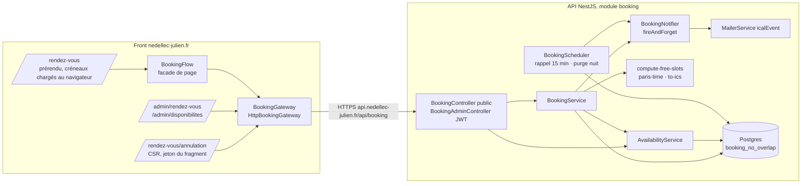

# 024 — Prise de rendez-vous

## Description

### Objectif

Demande du propriétaire (2026-10-12) : « j'aimerai ajouter a mon portfolio https://nedellec-julien.fr/ une
prise de RDV via agenda comme j'ai implémenter sur coachingLife […] a peut pret mais de manière plus
professionelle et efficace et en parfaite harmonie avec ce qui existe déja ! »

Un visiteur réserve lui-même l'**appel de cadrage de 30 min** déjà promis par la section Méthode
(« Cadrer · jour 1 · 30 min ») et la FAQ (« un cadrage gratuit de 30 minutes »), sans échange d'emails.

### Arbitrages du propriétaire (2026-10-12)

1. **Confirmation immédiate** : le créneau est bloqué dès la réservation (pas de demande « en attente »).
2. **Visio ou téléphone au choix du visiteur** : visio = lien unique généré par rendez-vous (Jitsi, sans
   compte côté visiteur) ; téléphone = le propriétaire appelle au numéro donné.
3. **Un seul type** : « Appel de cadrage · 30 min ».
4. **Disponibilités gérées dans l'admin** (plages hebdomadaires + fermetures), **sans** synchronisation
   Google Agenda.

### Exigence (contrat)

1. **Aucune double réservation possible**, y compris sous requêtes concurrentes : garantie par la base de
   données, pas seulement par le code applicatif.
2. Les créneaux libres sont **calculés par le serveur** (seule source de vérité) ; le front n'en recopie
   pas les règles. Un créneau absent du calcul est refusé à la création.
3. Les heures sont justes toute l'année : instants stockés en UTC, règles exprimées à l'heure de Paris,
   changements d'heure (25/10/2026, 28/03/2027) couverts par des tests.
4. Le visiteur reçoit un email de confirmation avec une invitation `.ics`, le lien de visio (ou la mention
   téléphone) et un **lien d'annulation** ; un **rappel** la veille. Le propriétaire reçoit la même
   invitation, qui arrive dans son agenda. Toute annulation (visiteur ou propriétaire) prévient l'autre
   partie avec un `.ics` d'annulation.
5. Règles : créneaux de 30 min, départ toutes les 30 min, 15 min de battement autour d'un rendez-vous,
   réservation au plus tard 24 h avant, au plus 21 jours à l'avance, au plus 2 rendez-vous à venir par
   email.
6. Anti-abus : champ piège (honeypot), limitation de débit par IP, plafond par email.
7. RGPD : aucune donnée personnelle dans la lecture publique des créneaux, mention sous le formulaire,
   page `confidentialite` à jour, purge des rendez-vous 6 mois après leur date, téléphone masqué dans les
   logs.
8. Page publique `/rendez-vous` dans la grammaire du site (cartouche, ligne de cote, `appButton`,
   Archivo + Plex Mono), points d'entrée depuis l'accueil sans remplacer les CTA existants, page
   d'annulation, deux écrans d'admin (Rendez-vous, Disponibilités).
9. WCAG AA : contrôles natifs (groupes de radios), erreurs annoncées, focus géré à la confirmation ;
   zéro violation au job `a11y` sur les nouvelles pages.

### Constat (2026-10-12, front `master` `ba92887`, API `master` `33f2d7b`)

1. Le front n'a aucune prise de rendez-vous ; seule trace : `/booking` dans `src/prerender-routes.txt`,
   fichier non branché (déjà relevé périmé par la spec 006).
2. L'API a eu un module `bookings`, supprimé le 2026-05-21 (`0c823b4`) : stockage `date` + `start_time`
   en texte, sans contrainte anti-chevauchement. Tables supprimées par `drizzle/0009_brave_annihilus.sql`.
3. L'API n'a ni bibliothèque de dates, ni génération `.ics`, ni honeypot ; le `MailerService` n'accepte pas
   de pièce jointe ; tout est en UTC (`TZ=UTC` dans les tests).
4. Coaching Life (`/home/j-ned/Projects/Coaching Life/coaching-life`) sert de **référence fonctionnelle,
   pas de code à copier** : son audit (`specs/001-intake-audit-repo.md`) relève la double réservation
   possible (F001, corrigée seulement dans la branche non mergée `fix/f001-booking-server-validation`,
   dont l'idée de contrainte d'exclusion et `paris-time.ts` sont reprises), des horaires codés en dur, des
   dates en texte, ni `.ics` ni annulation ni rappel, et des manques a11y (F023-F025, F033).

### Hors périmètre

- Synchronisation d'un agenda externe (Google, Outlook).
- Plusieurs types de rendez-vous, rendez-vous payants, replanification en un clic (le visiteur annule et
  réserve à nouveau).
- Réglage des règles du point 5 depuis l'admin (constantes documentées, YAGNI).

## Plan technique

### Décision d'architecture (ADR-0026)

Instants UTC (`timestamptz`), règles hebdomadaires en heure murale de Paris converties par `Intl`
sans bibliothèque (heure inexistante ignorée, heure répétée proposée une fois, la plus tôt). Le
serveur calcule seul les créneaux et renvoie toute la fenêtre réservable. Double réservation
interdite en base par `EXCLUDE USING gist (tstzrange(starts_at, ends_at, '[)') WITH &&) WHERE
(status = 'confirmed')`, sans extension (`btree_gist` n'est requise que pour mêler une égalité
scalaire au chevauchement). Créations sérialisées par `pg_advisory_xact_lock` pour que le battement
et le plafond par email tiennent aussi sous concurrence. Jeton d'annulation haché SHA-256, transmis
dans le fragment du lien puis dans un corps `POST`. Cf. ADR-0026.

**Corrections apportées au plan approuvé** (arbitrages inchangés) :

1. **Verrou consultatif ajouté** : la contrainte d'exclusion ne couvre que le chevauchement strict ;
   deux réservations concurrentes de 10:00 et 10:30 (battement violé) ou trois du même email
   (plafond dépassé) passaient toutes. Le recalcul sous verrou ferme ces deux courses.
2. **`GET bookings/cancel/:token` remplacé par `POST bookings/cancel/preview { token }`, et lien
   `/rendez-vous/annulation#<jeton>`** : pino journalise `req.url` à chaque requête, et
   `trackedPath` (front) envoie la query string au suivi d'audience. Un jeton dans le chemin ou la
   query string finirait dans les logs et la base d'audience ; le fragment n'est jamais transmis et
   `req.body.token` est déjà masqué.
3. **`GET slots` sans `from`/`to`** : la fenêtre entière (≤ 21 jours) pèse environ 20 Ko ; des
   bornes obligeraient le front à connaître l'horizon pour désactiver « semaine suivante », soit une
   règle recopiée (Exigence 2).
4. **nginx doit changer pour `/rendez-vous/annulation`** (pas pour `/rendez-vous`). Le prérendu
   `/rendez-vous` est servi par `location /` (`try_files $uri $uri/index.html`) : rien à faire. En
   revanche une route `RenderMode.Client` hors de la regex `^/(login|two-factor|admin)(/|$)` tombe
   dans `location /`, ne trouve aucun fichier et reçoit `error_page 404 /index.csr.html` : la page
   s'afficherait avec un **statut 404**. Une location dédiée sert la coquille CSR en 200 avec
   `X-Robots-Tag: noindex, nofollow` (le `noindex` demandé, posé là où un robot le lit sans
   exécuter de JavaScript ; `Seo` ne sait pas émettre de `robots`).
5. **`MailerService.sendMail` gagne `icalEvent`** (option native de nodemailer 10 : alternative
   `text/calendar` + pièce jointe `invite.ics`) plutôt qu'un champ `attachments` générique : c'est la
   forme que Gmail et Outlook reconnaissent comme invitation.
6. **Suivi de l'envoi par `trackContactSubmit('booking')`** au lieu d'un `trackBookingSubmit` : un
   nouveau type d'événement toucherait le DTO, les agrégats et l'écran Audience de l'API ;
   l'emplacement `booking` passe déjà la regex `CONTACT_PLACEMENT` (`/^[a-z0-9_-]{1,64}$/`). Ajout de
   `'booking'` à `ContactPlacement` et de son libellé dans `audience-conversions-view.ts`.
7. **Raison d'échec `limit-reached` ajoutée** au résultat front (plafond par email) et `server`
   séparé de `network` (5xx vs statut 0), sur le modèle de `toSubmissionError` du contact.
8. **Destinataire propriétaire partagé** : `CONTACT_RECIPIENT` (privé à `contact.service.ts`) devient
   `OWNER_EMAIL` dans `src/mailer/mailer.constants.ts`, importé par le contact et le booking.
9. **`PUBLIC_SITE_URL`** ajoutée à l'env de l'API (défaut `https://nedellec-julien.fr`) : l'API n'a
   aucune URL du site pour construire le lien d'annulation.

### Architecture



**API**
- `BookingController` (`@Controller('booking')`, public) et `BookingAdminController`
  (`@Controller('booking')`, `@UseGuards(JwtAuthGuard)` au niveau classe, `@ApiBearerAuth()`).
- `BookingService` : créneaux, création, aperçu et annulation visiteur, liste et annulation admin.
  Ne compose aucun email : il passe au `BookingNotifier` la ligne et, à la création, le jeton en clair.
- `AvailabilityService` : lecture et écriture des plages et fermetures ; fournit au calcul les
  entrées `(rules, closures)`.
- Logique pure, sans Nest ni base : `booking-policy.ts`, `paris-time.ts`, `compute-free-slots.ts`,
  `to-ics.ts`, `cancel-token.ts`, `video-room-url.ts`.
- `BookingNotifier` : charge les gabarits (`loadTemplate`/`renderTemplate`, échappement déjà
  garanti), produit les `.ics`, appelle `MailerService.sendMail`. Toujours appelé en
  `fireAndForget` **après le commit** : un SMTP en panne ne fait pas échouer une réservation, le
  rendez-vous reste visible dans l'admin.
- `BookingScheduler` : deux `@Cron` + `@Sentry.SentryCron`, sur le modèle
  d'`analytics-aggregator.service.ts`.

**Création (`POST bookings`)**, dans `db.transaction(async (tx) => …)` :
1. `website` (champ piège) non vide → réponse 201 de même forme, rien d'écrit ni d'envoyé, log
   `warn` sans donnée personnelle.
2. `select pg_advisory_xact_lock(hashtext('booking:create'))`.
3. Plafond : rendez-vous `confirmed`, `ends_at > now`, `lower(email) = lower(:email)` ≥ 2 → 422
   `booking_limit_reached`.
4. Lectures sous verrou (plages, fermetures, rendez-vous confirmés de la fenêtre), puis
   `computeFreeSlots`. `startsAt` présent → suite ; absent mais en conflit avec un rendez-vous
   confirmé (battement compris) → 409 `slot_taken` ; absent sans conflit → 422 `slot_unavailable`.
5. Insertion (`ends_at` = `starts_at` + 30 min calculé serveur, `cancel_token_hash`, `video_url`
   si visio, `phone` seulement si téléphone). Erreur `23P01` → 409 `slot_taken` (dernier recours).
6. Après commit : `fireAndForget(notifier.bookingConfirmed(row, token))`.

**Front**
- `/rendez-vous` : `RenderMode.Prerender`. Le prérendu contient en-tête, fiche et squelette ; les
  créneaux ne sont **jamais** demandés au rendu serveur : `rxResource({ params: () => (isBrowser ?
  true : undefined), stream })` (patron `isPlatformBrowser(inject(PLATFORM_ID))` de
  `project-detail.ts`). `params` à `undefined` laisse la ressource `idle` : aucune requête au build
  (qui n'a pas d'API), donc aucune réponse à mettre en transfer cache. `/booking` **n'entre pas** dans
  `PUBLIC_READ_PATHS` (des créneaux sérialisés dans le HTML seraient périmés). Le template rend le
  même squelette en `idle` et en `loading` : pas d'écart d'hydratation.
- `/rendez-vous/annulation` : `RenderMode.Client`, jeton lu dans `ActivatedRoute.fragment`.
  `anchorScrolling` cherchera un élément d'id égal au jeton, sans effet.
- Admin : pages `admin/rendez-vous` et `admin/disponibilites` sous `ADMIN_ROUTES`.
- **Landmarks** : les pages sont imbriquées dans le shell, qui possède `banner`, `main` et
  `contentinfo` ; aucune page de la feature n'émet `<header>`, `<main>` ni `<footer>`.
- **Frontière facade / présentation (page `/rendez-vous`)** :
  - `BookingFlow` (`pages/booking/booking-flow.ts`, facade instance-scopée par
    `providers: [BookingFlow]` du composant page, sans suffixe `Store`) : possède la ressource des
    créneaux, la sélection, le modèle et le `form()` Signal Forms, l'issue de l'envoi ; coordonne
    l'I/O. Aucune dépendance DOM.
  - Dérivations pures dans `domain/` : `groupSlotsByDay`, `groupDaysByWeek`, formateurs Paris.
  - Sous-composants dumb listés plus bas : la page ne garde que la mise en page et la glue.

### Contrat d'API (préfixe `/api/booking`)

Corps d'erreur : forme du `HttpExceptionFilter` existant, `{ statusCode, error, message, path,
timestamp }` ; le code métier est dans `error` (exceptions levées avec
`new ConflictException({ error: 'slot_taken', message })`). Instants : ISO 8601 UTC (`…Z`). Dates de
fermeture : `YYYY-MM-DD` (date de Paris). Les DTO portent `@ApiProperty` comme `src/contact/dto`.

| Méthode, route | Accès, throttle | Corps / query | Réponse |
|---|---|---|---|
| `GET slots` | public, `@PublicReadThrottle()` | — | 200 `{ timeZone: 'Europe/Paris', slots: [{ startsAt, endsAt }] }` trié, `Cache-Control: no-store` |
| `POST bookings` | public, `@BookingCreateThrottle()` (5 / 10 min / IP) | `CreateBookingDto` | 201 `{ id, startsAt, endsAt, format, videoUrl }` ; 400 validation ; 409 `slot_taken` ; 422 `slot_unavailable` \| `booking_limit_reached` ; 429 |
| `POST bookings/cancel/preview` | public, limite globale | `{ token }` | 200 `{ startsAt, endsAt, format, status, cancellable }` ; 404 `booking_not_found` |
| `POST bookings/cancel` | public, limite globale | `{ token }` | 200 `{ status: 'cancelled' }` (idempotent, aucun email au second appel) ; 404 `booking_not_found` ; 409 `cancel_too_late` (`now >= startsAt`) |
| `GET availability/rules` | admin | — | 200 `{ data: [{ weekday, startMinute, endMinute }] }` trié jour puis début |
| `PUT availability/rules` | admin | `{ rules: AvailabilityRuleDto[] }` | 200 `{ data }` ; 400 validation ou `rules_overlap` ; remplacement dans une transaction (`delete` + `insert`) |
| `GET availability/closures` | admin | — | 200 `{ data: [{ id, startsOn, endsOn, reason }] }`, `endsOn >= aujourd'hui (Paris)`, trié |
| `POST availability/closures` | admin | `{ startsOn, endsOn, reason? }` | 201 fermeture ; 400 si `endsOn < startsOn` |
| `DELETE availability/closures/:id` | admin, `ParseUUIDPipe` | — | 204 ; 404 |
| `GET bookings?scope=upcoming\|past` | admin | `ListBookingsQueryDto` (`@IsIn`) | 200 `{ data: AdminBooking[] }` ; `upcoming` = `ends_at > now` trié croissant, `past` = sinon, décroissant ; les deux statuts |
| `GET bookings/upcoming-count` | admin | — | 200 `{ count }` (`confirmed`, `ends_at > now`) |
| `PATCH bookings/:id/cancel` | admin, `ParseUUIDPipe` | `{ reason? }` (≤ 500) | 200 `AdminBooking` (idempotent) ; 404 ; 409 `cancel_too_late` |

`CreateBookingDto` (ValidationPipe global `whitelist` + `forbidNonWhitelisted` : le champ piège
**doit** être déclaré) :

| Champ | Validation |
|---|---|
| `startsAt` | `@IsISO8601({ strict: true })` |
| `name` | `@IsString() @IsNotEmpty() @MaxLength(200)` |
| `email` | `@IsEmail() @MaxLength(320)` |
| `format` | `@IsIn(['video', 'phone'])` |
| `phone` | `@ValidateIf((o) => o.format === 'phone') @IsString() @Matches(/^\+?[0-9][0-9 .-]{5,19}$/)` ; ignoré (non stocké) en visio |
| `company` | `@IsOptional() @IsString() @MaxLength(200)` |
| `message` | `@IsString() @IsNotEmpty() @MaxLength(1000)` |
| `website` | `@IsOptional() @IsString() @MaxLength(200)` (piège) |

`token` (aperçu, annulation) : `@Matches(/^[A-Za-z0-9_-]{43}$/)`. `AvailabilityRuleDto` :
`weekday` `@IsInt() @Min(1) @Max(7)`, `startMinute` / `endMinute` `@IsInt() @Min(0) @Max(1440)
@IsDivisibleBy(30)`, `endMinute > startMinute` vérifié au service avec le non-chevauchement par jour
(`rules_overlap`) ; `rules` `@ValidateNested({ each: true }) @Type(() => AvailabilityRuleDto)
@ArrayMaxSize(50)`.

`AdminBooking` : `{ id, startsAt, endsAt, name, email, phone, company, message, format, videoUrl,
status, cancelledAt, cancelledBy, cancelReason, reminderSentAt, createdAt }` (jamais
`cancelTokenHash`).

### Modèles de données

**API — `src/database/schema/booking.ts`** (ajouté au barrel `index.ts` : import, `export *`, entrée
de `schema`), style `contact-messages.ts` / `projects.ts` (texte + `check`, pas de `pgEnum`) :

- `availability_rule` : `id uuid pk default gen_random_uuid()`, `weekday smallint not null`,
  `start_minute smallint not null`, `end_minute smallint not null`, `...timestamps()` ; checks
  `availability_rule_weekday_check` (`weekday between 1 and 7`), `availability_rule_range_check`
  (`start_minute >= 0 and end_minute <= 1440 and end_minute > start_minute`).
- `availability_closure` : `id uuid pk`, `starts_on date not null` (`mode: 'string'`),
  `ends_on date not null`, `reason text`, `created_at` ; check `availability_closure_range_check`
  (`ends_on >= starts_on`).
- `booking` : `id uuid pk`, `starts_at timestamptz not null`, `ends_at timestamptz not null`,
  `name text not null`, `email text not null`, `phone text`, `company text`, `message text not null`,
  `format text not null`, `video_url text`, `status text not null default 'confirmed'`,
  `cancel_token_hash text not null` (unique `booking_cancel_token_hash_unique`), `cancelled_at
  timestamptz`, `cancelled_by text`, `cancel_reason text`, `reminder_sent_at timestamptz`,
  `...timestamps()` ; index `booking_starts_at_idx` ; checks :
  - `booking_range_check` : `ends_at > starts_at` ;
  - `booking_format_check` : `format in ('video', 'phone')` ;
  - `booking_status_check` : `status in ('confirmed', 'cancelled')` ;
  - `booking_video_check` : `(format = 'video') = (video_url is not null)` ;
  - `booking_phone_check` : `format <> 'phone' or phone is not null` ;
  - `booking_cancel_check` : `(status = 'cancelled') = (cancelled_at is not null)` et
    `cancelled_by is null or cancelled_by in ('visitor', 'owner')`.
- Types `Booking`, `NewBooking`, `AvailabilityRule`, `AvailabilityClosure` (`$inferSelect` /
  `$inferInsert`).

**Migrations** (`drizzle/`) :
- `0022_booking.sql` : `pnpm db:generate --name booking` (tables, checks, index).
- `0023_booking_no_overlap.sql` : `pnpm drizzle-kit generate --custom --name booking_no_overlap`
  (entrée de journal créée par drizzle-kit), contenu écrit à la main :

  ```sql
  -- Deux rendez-vous confirmés ne se chevauchent jamais ; un rendez-vous annulé libère son créneau.
  ALTER TABLE "booking" ADD CONSTRAINT "booking_no_overlap"
    EXCLUDE USING gist (tstzrange("starts_at", "ends_at", '[)') WITH &&)
    WHERE ("status" = 'confirmed');
  ```

  Aucune `CREATE EXTENSION`. Table neuve : aucune donnée existante à contrôler avant la migration
  (lancée par `pnpm db:migrate` au démarrage du conteneur API).

**API — politique** (`src/booking/booking-policy.ts`) :

```ts
export const BOOKING_POLICY = {
  timeZone: 'Europe/Paris',
  slotMinutes: 30,
  stepMinutes: 30,
  bufferMinutes: 15,
  minNoticeHours: 24,
  maxAdvanceDays: 21,
  maxUpcomingPerEmail: 2,
  reminderLeadHours: 24,
  reminderMinCreatedAheadHours: 30,
  retentionMonths: 6,
} as const satisfies BookingPolicy;
```

- Créneau candidat : pour chaque date de Paris de `date(now)` à `date(now + 21 j)`, chaque plage du
  jour ISO, chaque `m` de `startMinute` au pas de 30 tant que `m + 30 <= endMinute` ;
  `start = parisWallTimeToUtc(date, m)` (`null` → ignoré), `end = start + 30 min` (durée absolue).
- Libre si : `start >= now + 24 h`, `start <= now + 21 j`, date de Paris de `start` hors de toute
  fermeture `[startsOn, endsOn]`, et aucun rendez-vous confirmé `b` tel que
  `b.startsAt - 15 min < end && start < b.endsAt + 15 min`. Résultat dédoublonné par instant, trié.
- `paris-time.ts` : `parisWallTimeToUtc(date: string, minuteOfDay: number): Date | null` (deux
  candidats +01:00 / +02:00, retenus si le formatage `Intl` `en-CA`, `hourCycle: 'h23'`,
  `timeZone: 'Europe/Paris'` redonne date et minute ; le plus tôt gagne), `toParisDate(instant)`,
  `isoWeekday(date)`, `formatParisLong(instant)` (« lundi 19 octobre 2026 à 09:00 », pour les
  emails). Formateurs créés une fois au niveau module.
- `cancel-token.ts` : `createCancelToken(): { token: string; hash: string }`
  (`randomBytes(32).toString('base64url')`, 43 caractères ; `sha256` hex, 64 caractères) et
  `hashCancelToken(token)`.
- `video-room-url.ts` : `videoRoomUrl(base: string, random: Buffer): string` →
  `${base sans / final}/nedellec-${16 caractères [a-z0-9]}`. L'aléa est injecté (pur, testable).
- `src/common/utils.ts` : la marche dans la chaîne `cause` d'`isUniqueViolation` devient une fonction
  interne partagée ; ajout d'`isExclusionViolation(err, constraintHint?)` (`code === '23P01'`).

**Front — `features/booking/domain/models/`** (`type` immuables, unions) :

```ts
type BookingFormat = 'video' | 'phone';
type BookingSlot = { readonly startsAt: string; readonly endsAt: string };
type BookingSlotOption = BookingSlot & { readonly timeLabel: string };          // « 09:00 »
type BookingDay = { readonly date: string; readonly label: string;               // « lundi 19 octobre »
                    readonly shortLabel: string; readonly slots: readonly BookingSlotOption[] };
type BookingWeek = { readonly key: string; readonly label: string; readonly days: readonly BookingDay[] };
type BookingRequest = { readonly startsAt: string; readonly name: string; readonly email: string;
  readonly format: BookingFormat; readonly phone: string | null; readonly company: string | null;
  readonly message: string; readonly website: string };
type BookingConfirmation = { readonly id: string; readonly startsAt: string; readonly endsAt: string;
  readonly format: BookingFormat; readonly videoUrl: string | null };
type BookingFailureReason = 'slot-taken' | 'slot-unavailable' | 'limit-reached' | 'rate-limited'
  | 'invalid' | 'network' | 'server';
type BookingSubmission = { readonly success: true; readonly data: BookingConfirmation }
  | { readonly success: false; readonly reason: BookingFailureReason };
type BookingCancelPreview = { readonly startsAt: string; readonly endsAt: string;
  readonly format: BookingFormat; readonly status: 'confirmed' | 'cancelled'; readonly cancellable: boolean };
type BookingCancelFailure = 'not-found' | 'too-late' | 'network' | 'server';
type IsoWeekday = 1 | 2 | 3 | 4 | 5 | 6 | 7;
type AvailabilityRule = { readonly weekday: IsoWeekday; readonly startMinute: number; readonly endMinute: number };
type AvailabilityClosure = { readonly id: string; readonly startsOn: string; readonly endsOn: string;
  readonly reason: string | null };
type AdminBooking = { /* champs AdminBooking du contrat */ };
```

Résultats de l'aperçu, de l'annulation, des écritures admin : Result pattern
`{ success: true; data } | { success: false; reason }` produit par la gateway (aucune exception pour un
échec métier). Types API (DTO bruts) isolés dans `infra/booking-api.types.ts` ; adapters purs
`toBookingSlot`, `toBookingConfirmation`, `toCancelPreview`, `toAdminBooking`, `toAvailabilityRule`,
`toAvailabilityClosure` dans `infra/booking.adapter.ts`. Validation runtime des réponses HTTP non
vérifiée (profil : aucune lib côté front).

### Fichiers à créer / modifier

**API (`/home/j-ned/Projects/Portfolio/nest-portfolio-app`, branche `feat/booking`)**

| Fichier | Rôle |
|---|---|
| `src/database/schema/booking.ts` | trois tables, checks, index, types |
| `src/database/schema/index.ts` | barrel : import, `export *`, `schema` |
| `drizzle/0022_booking.sql`, `drizzle/meta/0022_snapshot.json`, `_journal.json` | générés |
| `drizzle/0023_booking_no_overlap.sql`, `_journal.json` | migration custom (contrainte) |
| `src/booking/booking.module.ts` | imports `MailerModule` ; providers et deux contrôleurs |
| `src/booking/booking.controller.ts` | routes publiques |
| `src/booking/booking-admin.controller.ts` | routes admin (`JwtAuthGuard` de classe) |
| `src/booking/booking.service.ts` | créneaux, création sous verrou, aperçu, annulations, listes |
| `src/booking/availability.service.ts` | plages (remplacement transactionnel), fermetures |
| `src/booking/booking-notifier.service.ts` | emails + `.ics` |
| `src/booking/booking-scheduler.service.ts` | crons rappel et purge |
| `src/booking/booking-policy.ts` | `BOOKING_POLICY` + type |
| `src/booking/paris-time.ts` | heure murale de Paris ⇄ instant |
| `src/booking/compute-free-slots.ts` | calcul pur des créneaux libres + `overlapsBooking` |
| `src/booking/to-ics.ts` | VCALENDAR RFC 5545 |
| `src/booking/cancel-token.ts` | jeton + empreinte |
| `src/booking/video-room-url.ts` | lien de visio |
| `src/booking/dto/create-booking.dto.ts`, `cancel-token.dto.ts`, `owner-cancel-booking.dto.ts`, `availability-rule.dto.ts`, `replace-availability-rules.dto.ts`, `create-closure.dto.ts`, `list-bookings-query.dto.ts` | DTO class-validator + Swagger |
| `src/booking/mail-templates/booking-confirmation.html`, `booking-notification.html`, `booking-cancelled.html`, `booking-reminder.html` | gabarits inline (style des gabarits contact) ; copiés par l'asset `**/mail-templates/**/*.html` déjà déclaré dans `nest-cli.json` |
| `src/booking/*.spec.ts`, `src/booking/booking.integration.spec.ts` | tests (rôle de `qa`) |
| `src/mailer/mailer.service.ts` | `SendMailOptions.icalEvent?: { method: 'REQUEST' \| 'CANCEL'; content: string }` transmis à nodemailer (`{ method, content, filename: 'invitation.ics' }`) |
| `src/mailer/mailer.constants.ts` | `OWNER_EMAIL` |
| `src/contact/contact.service.ts` | importe `OWNER_EMAIL` (retire `CONTACT_RECIPIENT`) |
| `src/common/utils.ts` | `isExclusionViolation`, marche `cause` partagée |
| `src/common/throttle.ts` | `BOOKING_CREATE_THROTTLE` (`{ default: { limit: 5, ttl: 600_000 } }`) + `BookingCreateThrottle()` |
| `src/config/env.schema.ts` | `PUBLIC_SITE_URL` (`z.string().url().default('https://nedellec-julien.fr')`), `BOOKING_VIDEO_URL_BASE` (`z.string().url().default('https://meet.jit.si')`) |
| `src/config/app-config.service.ts` | getters `publicSiteUrl`, `bookingVideoUrlBase` |
| `src/app.module.ts` | `BookingModule` ; redact `req.body.phone`, `req.body.email` (défense en profondeur : le sérialiseur `req` n'écrit pas le corps aujourd'hui) |
| `README.md` | variables d'env, endpoints `booking`, ligne `CONTACT_RECIPIENT` → `OWNER_EMAIL`, crons |

**Front (`/home/j-ned/Projects/Portfolio/ng-portfolio-app`, branche `feat/024-prise-de-rendez-vous`)**

| Fichier | Rôle |
|---|---|
| `src/app/features/booking/domain/models/booking.model.ts` | types publics (créneau, demande, confirmation, résultats) |
| `src/app/features/booking/domain/models/booking-admin.model.ts` | `AdminBooking`, `AvailabilityRule`, `AvailabilityClosure`, `IsoWeekday` |
| `src/app/features/booking/domain/gateways/booking.gateway.ts` | `abstract class BookingGateway` (patron `ContactGateway`, une impl HTTP + le stub) |
| `src/app/features/booking/domain/paris-format.ts` | formateurs `Intl` `fr-FR` / `Europe/Paris` créés une fois : clé de date, libellés jour, heure, date longue |
| `src/app/features/booking/domain/group-slots-by-day.ts` | `groupSlotsByDay(slots): readonly BookingDay[]` |
| `src/app/features/booking/domain/group-days-by-week.ts` | `groupDaysByWeek(days): readonly BookingWeek[]` (semaine ISO, lundi) |
| `src/app/features/booking/domain/booking-copy.static-data.ts` | textes de page, lignes de fiche, message par `BookingFailureReason` et par échec d'annulation, mention RGPD |
| `src/app/features/booking/infra/booking-api.types.ts` | DTO bruts |
| `src/app/features/booking/infra/booking.adapter.ts` | adapters purs |
| `src/app/features/booking/infra/http-booking.gateway.ts` | `HttpBookingGateway` ; `silentErrors()` sur toutes les requêtes (la page affiche ses propres erreurs) ; `toBookingFailure(err)` ; compteur à venir partagé + `invalidateUpcomingCount()` (patron `unreadCount$`) |
| `src/app/features/booking/testing/stub-booking-gateway.ts`, `booking-builders.ts` | doublure et builders |
| `src/app/features/booking/booking.routes.ts` | `BOOKING_ROUTES` : `''` → `Booking` (title, `data.seo`, BreadcrumbList), `'annulation'` → `BookingCancellation` |
| `src/app/features/booking/pages/booking/booking.ts` | page smart : mise en page, fiche, étapes, états |
| `src/app/features/booking/pages/booking/booking-flow.ts` | facade de page |
| `src/app/features/booking/application/booking-day-picker.ts` | radios des jours de la semaine affichée, boutons semaine précédente / suivante (`aria-disabled` aux bornes) |
| `src/app/features/booking/application/booking-time-picker.ts` | radios des créneaux du jour, liées par `[formField]` au champ `startsAt` (patron radios d'`admin-post-form.ts`), erreur du champ |
| `src/app/features/booking/application/booking-details-fields.ts` | champs coordonnées (entrée `FieldTree`, patron `admin-pair-rows`), champ piège |
| `src/app/features/booking/application/booking-summary.ts` | récapitulatif (jour, heure, format) |
| `src/app/features/booking/application/booking-confirmation.ts` | écran de succès, focus sur son titre (`afterNextRender({ write })`) |
| `src/app/features/booking/pages/booking-cancellation/booking-cancellation.ts` | aperçu puis confirmation d'annulation |
| `src/app/app.routes.ts` | route `rendez-vous` (`loadChildren`) |
| `src/app/app.routes.server.ts` | `rendez-vous` Prerender, `rendez-vous/annulation` Client ; commentaire étendu aux routes Client |
| `src/app/app.config.ts` | `{ provide: BookingGateway, useClass: HttpBookingGateway }` |
| `src/server/feeds/sitemap.ts` | `/rendez-vous` (`monthly`, `0.6`) |
| `Dockerfile` | location `^/rendez-vous/annulation/?$` : coquille CSR 200 + `X-Robots-Tag` |
| `.github/workflows/ci.yml` | smoke docker : `/rendez-vous` 200 ; `/rendez-vous/annulation` 200 avec `X-Robots-Tag: noindex` |
| `src/app/features/analytics/domain/models/analytics.types.ts` | `ContactPlacement` + `'booking'` |
| `src/app/features/admin/application/audience-conversions-view.ts` | libellé `booking` → « Prise de rendez-vous » |
| `src/app/features/home/domain/home-hero.static-data.ts` | `HOME_HERO_CTA_LABELS.booking` |
| `src/app/features/home/application/home-hero-section.ts` | lien texte sous les CTA, output `bookingOpened` |
| `src/app/features/home/pages/home/home.ts` | `trackCtaClick('home_hero_booking', …)` |
| `src/app/features/home/domain/models/home-pitch.model.ts`, `home-pitch.static-data.ts` | étape `frame` : `link?: { label; href }` ; réponse FAQ `application-price` mentionnant la réservation en ligne |
| `src/app/features/home/application/home-method.ts` | lien de l'étape (`RouterLink`) |
| `src/app/features/contact/application/contact-form.ts` | encart « Préférez en parler ? Réservez 30 min » sous les coordonnées |
| `src/app/layout/components/footer/footer.static-data.ts`, `footer.ts` | lien de la colonne Contact |
| `src/app/pages/privacy-policy.ts` | section « Prise de rendez-vous », date de mise à jour |
| `src/prerender-routes.txt` | supprimé (non branché, cite un `/booking` inexistant) |
| `src/app/shared/icons/icon-map.ts`, `public/icons/sprite.svg`, `sprite-version.ts` | `calendar` (`calendar-days`), `video` ; `pnpm icons:build` |
| `src/app/features/admin/admin.routes.ts` | `rendez-vous`, `disponibilites` (`canDeactivate: [unsavedChangesGuard]`) |
| `src/app/features/admin/application/admin-nav-groups.ts` | groupe « Rendez-vous » : `bookings` (compteur, suffixe « à venir »), `availability` |
| `src/app/features/admin/pages/admin-layout/admin-layout.ts` | compteur `getUpcomingCount()` |
| `src/app/features/admin/application/admin-bookings-view.ts` | vue pure (filtres À venir / Passés, lignes, libellés) |
| `src/app/features/admin/application/components/admin-booking-row.ts` | ligne de rendez-vous |
| `src/app/features/admin/pages/admin-bookings/admin-bookings.ts` | liste + annulation avec motif (`app-confirm-dialog`) |
| `src/app/features/admin/application/availability-draft.ts` | `toAvailabilityDraft`, `toAvailabilityRules`, minutes ⇄ `HH:MM` |
| `src/app/features/admin/application/components/admin-availability-rows.ts` | lignes jour / début / fin, ajout et retrait par `value.update` |
| `src/app/features/admin/application/components/admin-closures.ts` | liste, ajout, suppression des fermetures |
| `src/app/features/admin/pages/admin-availability/admin-availability.ts` | `DocumentDraft` des plages + barre d'enregistrement + fermetures |
| `e2e/a11y/scenarios.ts`, `interactive-states.spec.ts` | pages et états du parcours |
| `ci/api-stub/server.mjs`, `ci/api-stub/fixtures/booking-admin.json`, `booking-availability.json` | routes booking de la doublure |

### Réactivité / état

- **`BookingFlow`** (facade de page, aucune donnée partagée hors de l'écran : pas de store) :
  - `_slots = rxResource({ params: () => (this._isBrowser ? true : undefined), stream: () =>
    gateway.getSlots() })` ; `days = computed(groupSlotsByDay)`, `weeks = computed(groupDaysByWeek)` ;
    `state = computed(() => loadState(...))`, avec `idle` rendu comme `loading`.
  - `weekIndex = linkedSignal` (borné aux semaines disponibles) ; `selectedDate = linkedSignal({
    source: days, computation })` : remis à `null` si le jour n'existe plus après rechargement.
  - `_model = signal<BookingDraft>(EMPTY_BOOKING)` (défauts non `null` : `startsAt: ''`,
    `format: 'video'`, `phone: ''`, `company: ''`, `website: ''`) ;
    `form = form(this._model, schema, { submission: { action, onInvalid: focusFirstInvalid } })`.
    Schéma : `required(startsAt, { message: 'Choisissez un horaire' })`, nom (requis, 2 à 200),
    email (requis, `pattern` du contact, ≤ 320), `required(phone, { when: ({ valueOf }) =>
    valueOf(path.format) === 'phone', message })` + `pattern` téléphone, entreprise ≤ 200, message
    requis 10 à 1000.
  - `selectDay(date)` remet `startsAt` à `''` (`_model.update`, nouvelle référence).
  - `outcome = signal<BookingOutcome | null>` : `{ kind: 'confirmed', confirmation, email }` ou
    `{ kind: 'failed', reason }` ; lu en lecture seule (`asReadonly()`).
  - Action d'envoi : payload copié champ par champ (`phone` à `null` en visio, `company` vide →
    `null`) ; succès → `outcome` confirmé + `analytics.trackContactSubmit('booking')` ;
    `slot-taken` → `_slots.reload()`, `startsAt` remis à `''`, coordonnées conservées, message dans
    la région `role="status"`, focus sur le titre de l'étape Heure (`tabindex="-1"`) ; autres échecs
    → message seul.
  - Bouton d'envoi désactivé **seulement** sur `form().submitting()`.
- **Page d'annulation** : `token = toSignal(route.fragment)` ; `preview = rxResource({ params:
  token, stream })` (pas de jeton → état « lien invalide » sans requête) ; `cancelling` / `result`
  en signaux locaux ; succès → focus sur le titre du message.
- **Admin** : patron `admin-messages` (`rxResource`, `loadState`, `@switch`). Plages :
  `DocumentDraft<readonly AvailabilityRule[], AvailabilityDraft>` (une section TOC `weekly`),
  `canLeave()` et `warnBeforeUnload` comme `admin-profile.ts` ; fermetures en ressource séparée,
  écritures immédiates (hors brouillon). Annulation admin → `invalidateUpcomingCount()`.
- Immutabilité : modèles `readonly`, aucune mutation en place, signaux exposés en lecture seule.

### Tranches

Commandes : API `pnpm test -- src/booking; echo $?` puis `pnpm test; echo $?`, `pnpm lint`,
`pnpm build`. Front `pnpm test -- --include='src/app/features/booking/**/*.spec.ts'; echo $?`, puis
`pnpm test; echo $?`, `pnpm lint`. Le code de sortie fait foi, pas le résumé (rejets non gérés).
Postgres jetable des tests d'intégration :
`podman run --rm -d --name booking-it -e POSTGRES_PASSWORD=it -p 55432:5432 docker.io/postgres:17-alpine`,
puis `BOOKING_IT_DATABASE_URL=postgres://postgres:it@127.0.0.1:55432/postgres pnpm test -- booking.integration`.

**API (PR 1, `nest-portfolio-app`)**

- **A1 — les créneaux libres sont justes toute l'année** : schéma des trois tables, migration
  `0022_booking`, `booking-policy.ts`, `paris-time.ts`, `compute-free-slots.ts`,
  `AvailabilityService` (lecture), `BookingService.getSlots`, `GET slots`, `BookingModule` câblé.
  Vérifiable : unitaires purs verts (DST compris, sous `TZ=UTC` **et**
  `TZ=Pacific/Kiritimati pnpm test -- src/booking`) ; `pnpm db:migrate` sur la base jetable ;
  contrôle ICU dans l'image :
  `podman run --rm docker.io/node:24-alpine node -e "console.log(new Intl.DateTimeFormat('fr-FR',{timeZone:'Europe/Paris',timeStyle:'short'}).format(new Date('2026-10-25T01:30:00Z')))"`
  doit afficher `02:30`.
- **A2 — une réservation est confirmée, jamais en double** : migration `0023_booking_no_overlap`,
  `CreateBookingDto`, création sous verrou, 409 / 422, champ piège, `BookingCreateThrottle`, plafond,
  `cancel-token.ts`, `video-room-url.ts`, `BOOKING_VIDEO_URL_BASE`, `isExclusionViolation`.
  Vérifiable : unitaires (`createMockDb`) ; intégration sur Postgres réel (cas listés aux consignes).
- **A3 — invitations et annulation par le visiteur** : `to-ics.ts`, `icalEvent` du mailer,
  `OWNER_EMAIL`, `PUBLIC_SITE_URL`, `BookingNotifier` (confirmation visiteur, notification
  propriétaire, annulation des deux côtés), `POST bookings/cancel/preview`, `POST bookings/cancel`.
  Vérifiable : unitaires ; manuel Mailpit (`pnpm mail:up`) : réserver, deux emails reçus, `.ics`
  importé dans Google Agenda (compte du propriétaire **et** compte tiers), annulation par le lien,
  deux emails `CANCEL`, événement retiré des deux agendas.
- **A4 — l'admin gère plages, fermetures et rendez-vous** : `BookingAdminController`,
  `AvailabilityService` (écritures, `rules_overlap`), listes, compteur, annulation propriétaire
  (motif, emails `CANCEL` au visiteur **et** au propriétaire).
- **A5 — rappel la veille et purge** : `BookingScheduler` ; rappel `*/15 * * * *` UTC
  (`SentryCron('booking-reminders', …)`), purge `30 3 * * *` UTC
  (`SentryCron('booking-purge', …)`) ; redact pino ; README. Rappel : réclamation atomique
  `update booking set reminder_sent_at = now() where status = 'confirmed' and reminder_sent_at is
  null and starts_at > now() and starts_at <= now() + interval '24 hours' and created_at <=
  starts_at - interval '30 hours' returning *`, puis envoi (au plus une fois : un envoi raté est
  journalisé, pas rejoué). Purge : `delete from booking where ends_at < now() - interval '6 months'`.

**Front (PR 2, après déploiement de l'API)**

- **F1 — la gateway parle le contrat de l'API** : modèles, `BookingGateway`, `HttpBookingGateway`,
  adapters, `paris-format.ts`, `groupSlotsByDay`, `groupDaysByWeek`, stub, builders, câblage
  `app.config.ts`. Vérifiable : `HttpTestingController` sur chaque route et chaque statut d'erreur.
- **F2a — le visiteur choisit un jour et une heure** : routes (`app.routes.ts`,
  `app.routes.server.ts`, `booking.routes.ts`), sitemap, page `Booking`, `BookingFlow` (ressource,
  sélection, semaines), fiche, `booking-day-picker`, `booking-time-picker`, états chargement /
  erreur (`app-load-error` + Réessayer) / vide (lien vers le contact). Vérifiable : specs composant ;
  `pnpm run build --configuration production` produit `dist/angular-portfolio-app/browser/rendez-vous/index.html`
  sans créneau ni requête au build.
- **F2b — le visiteur réserve** : formulaire Signal Forms (champs, validation croisée du téléphone,
  champ piège, mention RGPD), récapitulatif, envoi, messages par raison, parcours 409, écran de
  confirmation et focus, `ContactPlacement` `booking` + libellé Audience.
- **F3 — le visiteur annule par le lien** : page `BookingCancellation`, location nginx, smoke
  docker. Vérifiable : specs ; `docker build -t ng-portfolio-app:local .` puis
  `curl -sI http://127.0.0.1:3000/rendez-vous/annulation` → `200` et `X-Robots-Tag: noindex, nofollow`.
- **F4 — points d'entrée et confidentialité** : hero, étape Cadrer, encart contact, pied de page,
  FAQ, page `confidentialite`, icônes, suppression de `src/prerender-routes.txt`.
- **F5a — l'admin voit et annule les rendez-vous** : route, entrée de navigation et compteur,
  `admin-bookings-view`, `admin-booking-row`, page `AdminBookings`, dialogue avec motif.
- **F5b — l'admin règle ses disponibilités** : route avec garde, `availability-draft`,
  `admin-availability-rows`, `admin-closures`, page `AdminAvailability`.
- **F6 — zéro violation axe sur les nouvelles pages** : doublure (créneaux **générés relativement à
  l'heure courante** dans `server.mjs`, pas en fixture, sinon périmés ; `POST bookings`,
  `cancel/preview`, `cancel` ; lectures admin sous `STUB_ADMIN_SESSION`, testées avant le 405 des
  méthodes non-GET), scénarios `/rendez-vous` (repère `booking-day-picker`),
  `/rendez-vous/annulation#<jeton de 43 caractères>` (repère `booking-cancel-preview`),
  `/admin/rendez-vous` (`admin-bookings-list`), `/admin/disponibilites` (`admin-availability-rules`) ;
  états interactifs : jour et heure choisis, formulaire soumis vide (erreurs affichées), écran de
  confirmation, dialogue d'annulation admin. Vérifiable : `docker build -t ng-portfolio-app:a11y .
  && ci/a11y-stack.sh up && pnpm a11y; echo $?`.

Découpage de F2 et F5 en a/b (le plan approuvé listait F1 à F6) : chacune des deux tranches
d'origine dépassait un rouge et un vert raisonnables ; chaque demi-tranche est verte sans la
suivante.

### Consignes pour `qa`

- **Domaine pur sans TestBed ni Nest** (`paris-time`, `compute-free-slots`, `to-ics`,
  `cancel-token`, `video-room-url`, `groupSlotsByDay`, `groupDaysByWeek`, `paris-format`,
  `availability-draft`, `admin-bookings-view`).
- **DST, `it.each`** (valeurs vérifiées le 2026-10-12 avec `Intl` sous Node) :

  | Date de Paris, heure | Instant attendu |
  |---|---|
  | 2026-10-19 (lundi) 09:00 | `2026-10-19T07:00:00Z` |
  | 2026-10-26 (lundi) 09:00 | `2026-10-26T08:00:00Z` |
  | 2027-03-22 (lundi) 09:00 | `2027-03-22T08:00:00Z` |
  | 2027-03-29 (lundi) 09:00 | `2027-03-29T07:00:00Z` |
  | 2026-10-25 (dimanche) 02:30 | `2026-10-25T00:30:00Z` (heure répétée : la plus tôt) |
  | 2026-10-25 03:00 | `2026-10-25T02:00:00Z` |
  | 2027-03-28 (dimanche) 02:30 | `null` (heure inexistante) |
  | 2027-03-28 03:00 | `2027-03-28T01:00:00Z` |

  `computeFreeSlots` avec une plage dimanche `0`–`1440` : 48 créneaux le 2026-10-25 (aucun à
  `01:00Z` ni `01:30Z`), 46 le 2027-03-28. `now` est un paramètre : aucune horloge dans le pur.
- **Politique, `it.each`** : préavis (23 h 59 refusé, 24 h accepté), horizon (21 j accepté,
  au-delà refusé), battement (rendez-vous 10:00–10:30 → 09:30 et 10:30 exclus, 09:00 et 11:00
  libres), fermeture inclusive aux deux bornes, rendez-vous annulé ignoré, plage `09:00–10:00` →
  09:00 et 09:30 seulement (un départ à 10:00 finirait hors plage).
- **Concurrence (intégration, Postgres réel, `describe.skip` sans `BOOKING_IT_DATABASE_URL`,
  patron `profile-portrait.integration.spec.ts`)** : 10 `create()` simultanés sur le même créneau →
  exactement 1 succès, 9 `ConflictException` `slot_taken`, 1 ligne en base ; 10:00 et 10:30
  simultanés → 1 succès (battement sous verrou) ; 3 créneaux distincts, même email (casse
  différente) → 2 succès, 1 `booking_limit_reached` ; insertion SQL directe d'un chevauchement
  confirmé → `23P01` ; même chevauchement avec une ligne `cancelled` → accepté ; annuler libère le
  créneau. Pool `postgres` `max ≥ 10`. `MailerService` doublé.
- **`.ics`** : CRLF partout, aucune ligne > 75 octets UTF-8 (nom accentué long : repli sans couper
  un caractère multioctet), échappement `\\`, `;`, `,`, saut de ligne, `UID` stable entre `REQUEST` et
  `CANCEL`, `SEQUENCE` 0 puis 1, `DTSTART`/`DTEND` en `Z`.
- **Jeton** : 43 caractères `[A-Za-z0-9_-]`, empreinte hex de 64, seule l'empreinte est insérée ;
  le jeton en clair n'apparaît dans aucun appel de log (`Logger` espionné).
- **Champ piège** : `website` non vide → 201, aucune insertion, aucun email.
- **Front, gateway** : `it.each` statut → raison (`0` network, `400` invalid, `409` slot-taken,
  `422` + `slot_unavailable`, `422` + `booking_limit_reached`, `429` rate-limited, `500`/`503`
  server) ; `verify()` en `afterEach`.
- **Front, prérendu** : avec `{ provide: PLATFORM_ID, useValue: 'server' }`, `getSlots` n'est jamais
  appelé et le squelette est rendu.
- **Front, parcours** : changer de jour vide l'heure ; formulaire soumis vide → erreurs sous les
  champs touchés, focus sur le premier invalide, aucun appel ; téléphone requis seulement en format
  téléphone (`aria-required` suit) ; 409 → créneaux rechargés, coordonnées conservées, heure vide,
  message dans `booking-status` ; succès → `booking-confirmation-heading` focalisé,
  `trackContactSubmit('booking')` appelé une fois. Zoneless : jamais `fakeAsync`, `await
  fixture.whenStable()`.
- **`data-testid`** (seuls sélecteurs) : `booking-fiche`, `booking-slots-loading`, `load-error`,
  `booking-empty`, `booking-day-picker`, `booking-day-option`, `booking-week-previous`,
  `booking-week-next`, `booking-week-label`, `booking-time-picker`, `booking-time-option`,
  `booking-time-heading`, `booking-start-error`, `booking-name`, `booking-email`,
  `booking-format-video`, `booking-format-phone`, `booking-phone`, `booking-company`,
  `booking-message`, `booking-website`, `booking-privacy-notice`, `booking-summary`,
  `booking-submit`, `booking-status`, `booking-confirmation`, `booking-confirmation-heading`,
  `booking-cancel-preview`, `booking-cancel-confirm`, `booking-cancel-result`,
  `booking-cancel-invalid`, `hero-booking-link`, `home-method-step-link`, `contact-booking-link`,
  `footer-booking-link`, `admin-bookings-list`, `admin-booking-row`, `admin-booking-cancel`,
  `admin-booking-reason`, `admin-availability-rules`, `admin-availability-rule-*`,
  `admin-closures-list`, `admin-closure-delete`. Erreurs de champ : `<testid>-error` (patron
  `app-field-error`).

### Risques & inconnues

- **meet.jit.si exige la connexion de l'organisateur** (Google, GitHub ou Facebook) pour ouvrir la
  salle : sans le propriétaire, le visiteur attend dans le hall. Le propriétaire rejoint le lien en
  premier ; `BOOKING_VIDEO_URL_BASE` permet de basculer vers un Jitsi auto-hébergé sans code.
- **Ordre de déploiement** (CLAUDE.md item 10) : PR API mergée, conteneur API déployé (migrations
  0022 et 0023 jouées au démarrage), `curl https://api.nedellec-julien.fr/api/booking/slots` → 200 ;
  le propriétaire saisit ses plages dans l'admin, **puis** merge du front. Sinon `/rendez-vous`
  affiche l'erreur de chargement (404) ou l'état vide.
- **Copie du propriétaire** : une invitation `REQUEST` dont le destinataire est aussi `ORGANIZER`
  peut être affichée sans être ajoutée par Google Agenda ; vérifié à la main en A3. Repli si besoin :
  `METHOD:PUBLISH` pour la copie propriétaire uniquement (même `UID`), à acter en A3.
- **Anti-abus borné** : le plafond par email se contourne avec plusieurs adresses ; au pire 5
  réservations par IP et 10 min. Le propriétaire annule depuis l'admin (le visiteur est prévenu).
- **Fermeture posée sur des rendez-vous existants** : ils restent confirmés ; l'admin les annule à
  la main (pas d'annulation en cascade, hors périmètre).
- `AdminLayout` passe de 7 à 8 collaborateurs injectés (seuil advisory 6, non bloquant).

### Décisions à arbitrer par le propriétaire

> **Arbitré le 2026-10-13 par le propriétaire** : les deux recommandations sont retenues (battement de
> 15 min, suivant possible 1 h après ; pas de rappel sous 30 h).

1. **Battement de 15 min sur une grille de 30 min** : un rendez-vous à 10:00 rend indisponibles
   09:30 et 10:30, le suivant possible est 11:00 (tout battement entre 1 et 30 min a le même effet
   sur cette grille). Recommandation : garder (la règle écrite, et une marge réelle entre deux
   appels). Si l'intention était « 10:00 puis 10:45 », il faut un pas de 15 min.
2. **Pas de rappel pour une réservation faite moins de 30 h avant le rendez-vous** : réservée à
   24 h 05, elle recevrait sinon le rappel quelques minutes après la confirmation. Recommandation :
   garder le seuil de 30 h (`reminderMinCreatedAheadHours`).
3. **« 1er » pour le premier du mois sur la page publique** (arbitré le 2026-10-13) : « dimanche 1er
   novembre », « dim. 1er », « Semaine du 1er février », « dimanche 1er novembre 2026 à 09:00 »,
   cohérent avec l'admin (`withFirstOfMonth`). Les emails de l'API (`formatParisLong`) écrivent encore
   « 1 novembre » : hors de cette PR front.

## Plan de test

### Tranche A1 — les créneaux libres sont justes toute l'année

API `nest-portfolio-app`, branche `feat/booking`, fichiers sous `src/booking/` (66 tests, 6 suites,
builders partagés `booking-test-builders.ts` : `anAvailabilityRule`, `anAvailabilityClosure`,
`aBooking`, typés sur `AvailabilityRule`, `AvailabilityClosure`, `Booking` du barrel `schema`).

Signatures figées par les tests (non précisées au plan) :
`computeFreeSlots({ now, rules, closures, bookings }): readonly { startsAt: Date; endsAt: Date }[]`
(les rendez-vous portent `status`, un `cancelled` est ignoré par le calcul) ;
`AvailabilityService.listRules()` et `listClosures()` (terminateur Drizzle `orderBy`, fermetures
filtrées sur `endsOn >= date de Paris du jour`) ; `BookingService` injecte `DRIZZLE` et
`AvailabilityService`, lit les rendez-vous de la fenêtre (terminateur `where`) ;
`getSlots(): Promise<{ timeZone: 'Europe/Paris'; slots: { startsAt: string; endsAt: string }[] }>`
(chaînes `toISOString()`).

| Fichier | Tests | Scénario | Assertions clés |
|---|---|---|---|
| `booking-policy.spec.ts` | 1 | constante de politique | `toEqual` exact de `BOOKING_POLICY` (golden) |
| `paris-time.spec.ts` | 13 | `parisWallTimeToUtc` : table DST des consignes + minuit / 23:30 du 25/10, 02:00 répété, 01:30 et 02:00 du 28/03 | instant ISO exact ou `null` |
| | 6 | `toParisDate` aux bords des deux jours de bascule | date `YYYY-MM-DD` de Paris |
| | 5 | `isoWeekday` | 1 à 7, dimanche = 7 |
| | 4 | `formatParisLong` | « lundi 19 octobre 2026 à 09:00 », heure répétée, lendemain du trou |
| `compute-free-slots.spec.ts` | 3 | plage dimanche 0–1440 : 25/10/2026, 28/03/2027 ; durée | 48 (sans `01:00Z`/`01:30Z`), 46 (`00:30Z` suivi de `01:00Z`) ; 30 min absolues |
| | 2 | préavis | 24 h pile proposé, 23 h 59 refusé |
| | 4 | horizon | 21 j pile proposé, 21 j + 30 min refusé, triangulé à 09:30 ; bornes min/max = now + 24 h / now + 21 j |
| | 8 | battement | RDV 10:00–10:30 → 09:30, 10:00, 10:30 exclus, 09:00 et 11:00 libres ; liste exacte ; bornes semi-ouvertes (RDV 10:15–10:45 → 09:30 et 11:00 libres) ; RDV annulé ignoré |
| | 7 | fermetures | inclusive aux deux bornes ; jugée sur la date de Paris (plage jeudi 00:00–01:00 = mercredi 23:00Z) |
| | 3 | plages | 09:00–10:00 → 09:00 et 09:30 ; tri et dédoublonnage ; aucune plage → `[]` |
| `availability.service.spec.ts` | 3 | lecture | `listRules` rend les lignes ; `listClosures` filtre sur `2026-10-25` à 22:30Z et `2026-10-26` à 23:30Z (date de Paris, pas UTC) |
| `booking.service.spec.ts` | 5 | `getSlots` (horloge simulée) | réponse exacte `{ timeZone, slots }` avec battement ; annulé non bloquant ; préavis depuis l'heure courante ; aucune donnée personnelle sérialisée ; vide |
| `booking.controller.spec.ts` | 2 | `GET /booking/slots` (supertest, ValidationPipe de `main.ts`) | 200, corps du service, `Cache-Control: no-store` ; aucune garde, `PublicReadThrottle` (120 / 60 s) |

Indépendance au fuseau du processus : prouvée par le rejeu `TZ=Pacific/Kiritimati pnpm test --
src/booking` prescrit par la tranche (changer `process.env.TZ` dans un test n'a pas d'effet sous
Jest, vérifié). Non couverts par un test automatique en A1 : schéma et migration `0022`
(`pnpm db:migrate` sur la base jetable), câblage `BookingModule` dans `AppModule` (`pnpm build`
et démarrage), contrôle ICU dans l'image ; `overlapsBooking` est laissé à A2, qui l'utilise.

Sortie condensée (`pnpm test -- src/booking; echo $?`) :

```
FAIL src/booking/booking-policy.spec.ts      Cannot find module './booking-policy'
FAIL src/booking/paris-time.spec.ts          Cannot find module './paris-time'
FAIL src/booking/compute-free-slots.spec.ts  Cannot find module './compute-free-slots'
FAIL src/booking/availability.service.spec.ts Cannot find module './availability.service'
FAIL src/booking/booking.service.spec.ts     Cannot find module './availability.service'
FAIL src/booking/booking.controller.spec.ts  Cannot find module './booking.controller'
Test Suites: 6 failed, 6 total
EXIT 1
```

`pnpm test; echo $?` : `Test Suites: 6 failed, 1 skipped, 47 passed` ; `Tests: 5 skipped, 897
passed` ; exit 1 ; les seuls échecs sont les six suites `src/booking`. `tsc --noEmit` : seules
erreurs nouvelles TS2307 (modules absents) et TS2305 (`Booking`, `AvailabilityRule`,
`AvailabilityClosure` absents du barrel) ; prettier vert ; eslint ne signale que des cascades de
types non résolus.

Tous les tests de cette tranche échouent à ce stade (RED confirmé via la commande test du profil
le 2026-10-13 16:32, 6 failed / 6 total suites, 66 tests écrits non collectés). Nature : module
applicatif introuvable à l'import (aucune erreur de harnais) ; le GREEN doit créer
`booking-policy.ts`, `paris-time.ts`, `compute-free-slots.ts`, `availability.service.ts`,
`booking.service.ts`, `booking.controller.ts` et les types du schéma.

### Tranche A2 — une réservation est confirmée, jamais en double

API `nest-portfolio-app`, branche `feat/booking` (sur `06a96dc`), 111 tests dans 9 fichiers. Builder
ajouté : `booking-request-test-builder.ts` (`aBookingRequest`, typé `CreateBookingDto`), séparé de
`booking-test-builders.ts` pour que les suites A1 qui l'importent restent vertes tant que le DTO
n'existe pas.

Signatures figées par les tests (non précisées au plan) :
- `BookingService.create(dto: CreateBookingDto)` → `{ id, startsAt, endsAt, format, videoUrl }`
  (chaînes ISO, rien d'autre) ; `BookingService` injecte aussi `AppConfigService`
  (`bookingVideoUrlBase`), salle tirée par `videoRoomUrl(base, randomBytes(16))`.
- Dans `db.transaction(tx)` : `tx.execute(sql\`select pg_advisory_xact_lock(hashtext('booking:create'))\`)`
  avant toute lecture (rendez-vous **et** `availability.listRules/listClosures`) ; puis, sur `tx`,
  le plafond en premier (terminateur `where`, résultat `[{ count }]`), puis les rendez-vous
  confirmés de la fenêtre (terminateur `where`), puis `tx.insert(bookings).values(…).returning()`.
  Aucune lecture ni écriture de rendez-vous sur la connexion partagée.
- Exceptions : `UnprocessableEntityException({ error: 'booking_limit_reached' | 'slot_unavailable', message })`,
  `ConflictException({ error: 'slot_taken', message })` ; toute autre erreur d'insertion remonte
  telle quelle.
- Champ piège : réponse de même forme sans verrou, lecture ni écriture, même pour un créneau
  indisponible (un robot n'apprend rien) : `id` UUID aléatoire, `startsAt` normalisé, `endsAt` +30 min,
  `format` demandé, `videoUrl` générée sur la base (visio) ou `null` ; un seul `warn`, sans valeur saisie.
- `videoRoomUrl(base, random)` : aléa de 16 octets, chaque octet influe sur la salle ;
  `isExclusionViolation(err, constraintHint?)` exporté de `common/utils.ts`.

| Fichier | Tests | Scénario | Assertions clés |
|---|---|---|---|
| `dto/create-booking.dto.spec.ts` | 35 | validation avec `whitelist` + `forbidNonWhitelisted` | visio, téléphone, champ piège rempli acceptés ; champ inconnu rejeté ; 14 entrées invalides → la seule propriété en erreur ; 4 bornes acceptées (200, 1000, décalage `+01:00`) ; téléphone requis en format téléphone, 4 numéros acceptés, 5 refusés, non contrôlé en visio |
| `cancel-token.spec.ts` | 6 | jeton et empreinte | 43 car. `[A-Za-z0-9_-]`, 32 octets décodés, empreinte hex 64 = `hashCancelToken(token)`, deux jetons distincts ; SHA-256 de référence (`abc`, chaîne vide) |
| `video-room-url.spec.ts` | 8 | salle de visio | `…/nedellec-[a-z0-9]{16}` pour trois aléas extrêmes ; barre finale non doublée ; base avec chemin ; déterministe ; deux aléas (dont dernier octet seul) → deux salles |
| `booking.service.spec.ts` (`BookingService.create`) | 29 | création, horloge simulée, transaction doublée par un second `createMockDb` | confirmation exacte ; valeurs insérées (fin +30 min, salle sur la base configurée, empreinte, `phone` `null` en visio, `company` `null`) ; téléphone gardé sans salle ; deux créations → salles et empreintes distinctes ; instant `+01:00` comparé comme instant ; jeton absent des logs (fenêtres de 43 car. hachées comparées à l'empreinte insérée) ; verrou SQL exact, avant toute lecture, sur `tx` ; plafond 2 et 3 → 422 sans insertion, 0 et 1 → insertion, plafond prioritaire ; 409 `slot_taken` (même instant, battement avant/après, hors grille en conflit) ; 422 `slot_unavailable` (hors grille, avant la plage, jour sans plage, jour fermé, préavis 23 h 30) ; 23P01 → 409 ; autre erreur remontée ; champ piège (forme, format téléphone, aucun accès base, un `warn` sans donnée), champ piège vide → insertion |
| `booking.controller.spec.ts` (`POST bookings`) | 9 | supertest, `ValidationPipe` et `HttpExceptionFilter` de `main.ts` | 201 corps exact, demande transmise ; champ piège jusqu'au service ; 400 sans appel (champ inconnu, téléphone manquant, instant non ISO) ; 409 / 422 / 422 avec `statusCode`, `error` métier, `path` ; aucune garde, throttle 5 / 600 000 ms |
| `common/utils.spec.ts` (`isExclusionViolation`) | 11 | marche dans `cause` | brute, enveloppée une et deux fois ; indice de contrainte juste / faux ; 23505, sans code, `null`, chaîne refusés ; 23P01 non pris pour une unicité |
| `config/env.validation.spec.ts` | 3 | `BOOKING_VIDEO_URL_BASE` | défaut `https://meet.jit.si`, valeur fournie gardée, non-URL rejetée |
| `config/app-config.service.spec.ts` | 1 | getter | `bookingVideoUrlBase` rend la valeur de l'env |
| `booking.integration.spec.ts` | 9 | Postgres réel (`describe.skip` sans `BOOKING_IT_DATABASE_URL`), pool `max: 20`, plages 00:00–24:00 tous les jours | migration `0023_booking_no_overlap` au journal et contrainte `x` en base ; 10 créations simultanées → 1 succès, 9 `slot_taken`, 1 ligne ; 12:00 et 12:30 UTC simultanés → 1 succès, `slot_taken` ; 3 créneaux, même email en trois casses → 2 succès, `booking_limit_reached`, 2 lignes ; chevauchement confirmé en SQL direct → `isExclusionViolation(…, 'booking_no_overlap')` ; plages adjacentes acceptées (`[)`) ; chevauchement d'une ligne annulée accepté ; annuler libère le créneau ; champ piège → aucune ligne |

Adaptation mécanique : `booking.service.spec.ts` (suite A1) — 1 site, provider `AppConfigService`
ajouté au module de test, aucune valeur attendue modifiée.

Non couverts par un test automatique : `MailerService` (aucun email en A2, notifier en A3 : le
doublage prévu aux consignes viendra avec lui, et le module de test de l'intégration gagnera ce
provider) ; câblage `AppConfigModule` dans `BookingModule` (`pnpm build` et démarrage).
`@MaxLength(320)` de l'email n'est pas testable : `@IsEmail` refuse déjà toute adresse de plus de
319 caractères (partie locale ≤ 64, domaine ≤ 254). Les deux tests d'intégration « plages adjacentes »
et « ligne annulée » sont verts avant la contrainte (aucune contrainte ne refuse) : ils gardent la
forme `[)` et la clause `WHERE status = 'confirmed'` de la migration une fois posée.

Sortie condensée (`pnpm test -- src/booking; echo $?`) :

```
FAIL src/booking/video-room-url.spec.ts           Cannot find module './video-room-url'
FAIL src/booking/cancel-token.spec.ts             Cannot find module './cancel-token'
FAIL src/booking/dto/create-booking.dto.spec.ts   Cannot find module './create-booking.dto'
FAIL src/booking/booking.service.spec.ts          29 × TypeError: service.create is not a function (5 tests A1 verts)
FAIL src/booking/booking.controller.spec.ts       8 × expect(...).toBe (404 au lieu de 201/400/409/422), 1 × toBeDefined (route absente) ; 2 tests A1 verts
Test Suites: 5 failed, 1 skipped, 4 passed, 9 of 10 total
Tests:       38 failed, 9 skipped, 66 passed, 113 total
EXIT 1
```

Intégration (`docker run … postgres:17-alpine` sur 55433,
`BOOKING_IT_DATABASE_URL=… pnpm test -- booking.integration; echo $?`) : `Tests: 7 failed, 2 passed,
9 total`, exit 1 ; 5 × `service.create is not a function`, 1 × `isExclusionViolation is not a
function`, 1 × `toContain` (`0023_booking_no_overlap` absent du journal) ; verts : plages adjacentes,
ligne annulée.

`pnpm test; echo $?` : `Test Suites: 8 failed, 2 skipped, 49 passed` ; `Tests: 52 failed, 14 skipped,
964 passed` ; exit 1 ; seuls échecs : les fichiers ci-dessus plus `utils.spec.ts` (10 ×
`isExclusionViolation is not a function`), `env.validation.spec.ts` (3 × `toMatchObject` / `toThrow`)
et `app-config.service.spec.ts` (1 × `toBe`) ; les 66 tests A1 et toutes les suites existantes
restent verts. `tsc --noEmit` : seules erreurs nouvelles TS2307 (`cancel-token`, `video-room-url`,
`dto/create-booking.dto`), TS2305 (`isExclusionViolation`), TS2339 (`create`,
`bookingVideoUrlBase`) ; les erreurs TS2345 préexistantes (`analytics`, `auth`, `profile`) sont
inchangées. Prettier vert ; eslint ne signale que des cascades de types non résolus.

Tous les tests de cette tranche échouent à ce stade (RED confirmé via la commande test du profil
le 2026-10-13 16:55, 52 failed / 1030 total, plus 3 suites non chargées et 7 failed / 9 total en
intégration). Nature : module ou membre applicatif absent (`Cannot find module`, `is not a
function`) et assertions d'HTTP, d'env et de journal de migrations ; aucune erreur de harnais. Le
GREEN doit créer `cancel-token.ts`, `video-room-url.ts`, `dto/create-booking.dto.ts`,
`BookingService.create`, la route `POST bookings`, `BOOKING_CREATE_THROTTLE` /
`BookingCreateThrottle`, `isExclusionViolation`, `BOOKING_VIDEO_URL_BASE` + getter et
`drizzle/0023_booking_no_overlap.sql`.

### Tranche A3 — invitations et annulation par le visiteur

API `nest-portfolio-app`, branche `feat/booking` (sur `01b2f4c`), 103 tests neufs dans 8 fichiers.

Signatures figées par les tests (non précisées au plan) :
- `toIcs(event)` (`src/booking/to-ics.ts`), `event = { method: 'REQUEST' | 'CANCEL', uid, stamp, startsAt,
  endsAt, summary, description, location, organizer: { name, email }, attendee: { name, email } }` ;
  `SEQUENCE` (0 / 1) et `STATUS` (`CONFIRMED` / `CANCELLED`) **dérivés de la méthode** ; `UID` = id brut ;
  `METHOD` avant `BEGIN:VEVENT`, `END:VEVENT` juste avant `END:VCALENDAR` (pas de `VTIMEZONE`) ; `CN`
  entre guillemets s'il contient `,` `;` `:` ; repli « plein » (une ligne de 76 octets donne 75 + ` a`).
- `MailerService.sendMail({ …, icalEvent?: { method, content } })` → nodemailer reçoit
  `icalEvent: { method, content, filename: 'invitation.ics' }`.
- `BookingNotifier` (`booking-notifier.service.ts`) injecte `MailerService` et `AppConfigService`
  (`publicSiteUrl`, barre finale non doublée) ; `bookingConfirmed(row, token)` et
  `bookingCancelled(row)` envoient chacun deux emails (visiteur, `contact@nedellec-julien.fr`) avec la même
  invitation (`REQUEST` puis `CANCEL`, `DTSTAMP` = horloge à l'envoi), sujet et corps datés par
  `formatParisLong` ; un échec d'envoi est rejeté vers l'appelant. Le jeton n'apparaît que dans le
  corps de l'email du visiteur : ni email propriétaire, ni `.ics`, ni log.
- `BookingService` injecte `BookingNotifier` ; `create` appelle `bookingConfirmed(ligne insérée,
  jeton)` après la transaction, sans l'attendre, échec journalisé (`Logger.error`, message contenant
  l'id). `previewCancellation(token)` → `{ startsAt, endsAt, format, status, cancellable }`
  (`cancellable` = confirmé et `now < startsAt`) ; `cancelByVisitor(token)` → `{ status: 'cancelled' }`.
  Lecture `db.select().from(bookings).where(eq(cancelTokenHash, hash))` (terminateur `where`), puis
  `db.update(bookings).set({ status, cancelledAt: now, cancelledBy: 'visitor' }).where(id et status
  'confirmed').returning()` ; ligne rendue → `bookingCancelled(ligne)` sans attente ; aucune ligne
  (annulation concurrente) → 200 sans email ; déjà annulé → 200 sans écriture ni email, **avant** le
  contrôle d'heure ; `now >= startsAt` → `ConflictException({ error: 'cancel_too_late' })` ; inconnu →
  `NotFoundException({ error: 'booking_not_found' })`.
- Contrôleur : `POST bookings/cancel/preview` et `POST bookings/cancel` répondent **200** (pas le 201
  par défaut de Nest), corps `{ token }` (`@Matches(/^[A-Za-z0-9_-]{43}$/)`), aucune garde ni throttle
  propre.
- `OWNER_EMAIL` : constante (`mailer.constants.ts`) comme le plan le décide ; les tests assertent le
  destinataire `contact@nedellec-julien.fr`, pas le symbole.

| Fichier | Tests | Scénario | Assertions clés |
|---|---|---|---|
| `to-ics.spec.ts` | 32 | VCALENDAR pur | structure et ordre ; `UID`, `SEQUENCE:0`, `STATUS:CONFIRMED`, `DTSTAMP`/`DTSTART`/`DTEND` en `Z` (3 instants dont DST, millisecondes tronquées) ; `ORGANIZER` exact, `ATTENDEE` mailto + `CN` (3 cas entre guillemets) ; `CANCEL` → `SEQUENCE:1`, `STATUS:CANCELLED`, même `UID` et dates ; CRLF partout ; ligne de 75 octets non repliée, 76 repliée en deux ; 8 descriptions (accents, `€`, émojis, décalées d'1 à 3 octets) → chaque ligne ≤ 75 octets, ni `U+FFFD` ni surrogate isolé, dépliage exact ; continuation à une espace ; échappement `\\ ; , \n` (CRLF compris, `:` intact) sur DESCRIPTION, SUMMARY, LOCATION |
| `booking-notifier.service.spec.ts` | 16 | emails et invitations | deux destinataires ; date de Paris en français dans sujet et corps (hiver, été) ; lien `…/rendez-vous/annulation#<jeton>` au visiteur, barre finale non doublée ; jeton absent de l'email propriétaire, des `.ics` et des logs, y compris sur échec SMTP (rejeté) ; visio → lien et `LOCATION:<url>` ; téléphone → numéro, `LOCATION` avec le numéro, sans lien ; coordonnées et message au propriétaire ; échappement HTML ; `REQUEST` complet ; annulation : deux emails `CANCEL`/`SEQUENCE:1`/`STATUS:CANCELLED`, sans lien d'annulation, nom échappé |
| `booking.service.spec.ts` (notification de `create`) | 8 | `fireAndForget` | ligne insérée + jeton dont `hashCancelToken` = empreinte insérée ; appel après la transaction ; confirmation rendue sans attendre un envoi bloqué ; échec journalisé avec l'id sans le jeton ; champ piège puis vraie réservation → une seule notification ; plafond, 409, 23P01 → aucune (3 gardes vertes avant GREEN) |
| `booking.service.spec.ts` (`previewCancellation`) | 8 | aperçu | réponse exacte ; recherche par empreinte (paramètres SQL), jamais par le jeton ; annulé / commence à l'instant / commencé → non annulable, 1 ms avant → annulable ; 404 ; jeton hors logs |
| `booking.service.spec.ts` (`cancelByVisitor`) | 14 | annulation | `set` exact, mise à jour gardée par id + `confirmed` ; `bookingCancelled(ligne annulée)` après l'`update`, sans attente, échec journalisé sans jeton ; déjà annulé (même passé) → 200 sans écriture ni email ; course perdue → 200 sans email ; 409 `cancel_too_late` (à l'instant, commencé, terminé) ; 1 ms avant → annulé ; 404 sans écriture ; jeton hors logs |
| `booking.controller.spec.ts` | 18 | supertest, deux routes | 400 sans appel (42 et 44 caractères, `+`, absent, champ inconnu) ; 404 / 409 avec `error` métier et `path` sans jeton ; aucune garde ni throttle propre ; 200 et corps exacts, jeton lu dans le corps |
| `mailer/mailer.service.spec.ts` | 2 | `icalEvent` | `REQUEST` et `CANCEL` transmis avec `filename: 'invitation.ics'` |
| `config/env.validation.spec.ts` + `app-config.service.spec.ts` | 4 | `PUBLIC_SITE_URL` | défaut `https://nedellec-julien.fr`, valeur gardée, non-URL rejetée ; getter `publicSiteUrl` |
| `booking.integration.spec.ts` | 1 | Postgres réel | réservation, annulation par `cancelByVisitor(jeton reçu par le notifier)`, nouvelle réservation au même horaire réussie, ligne `cancelled` / `visitor` / `cancelledAt`, 2 lignes, une notification d'annulation |

Adaptation mécanique : `booking.service.spec.ts` (2 modules de test A1/A2) et
`booking.integration.spec.ts` (1) — `useMocker` qui fournit un double de `BookingNotifier` reconnu par
nom de classe (le module n'existe pas encore : un import ferait tomber les suites A1/A2) et lève sur
toute autre dépendance ; `booking.controller.spec.ts` — 2 doubles ajoutés à `booking`. Aucune valeur
attendue modifiée.

Sweep : `contact@nedellec-julien.fr` / `CONTACT_RECIPIENT` dans les tests → seul
`contact.service.spec.ts` (littéral, inchangé, reste vert après le passage à `OWNER_EMAIL`).
Fire-and-forget vidé par 10 micro-tâches (`setImmediate` est simulé par les fake timers de ces
suites). Assertions vérifiées contre une implémentation de référence jetable (`to-ics`, notifier,
méthodes du service : 32, 16 et 64 verts, intégration 10 verts), supprimée avant la preuve.

Non couverts par un test automatique : rendu dans Gmail / Outlook / Google Agenda (manuel Mailpit
prévu), copie propriétaire en `REQUEST` (repli `PUBLISH` à acter au manuel), câblage
`BookingNotifier` dans `BookingModule` (`pnpm build` et démarrage), retrait de `CONTACT_RECIPIENT`.

Sortie condensée (`pnpm test -- src/booking; echo $?`) :

```
FAIL src/booking/to-ics.spec.ts                   Cannot find module './to-ics'
FAIL src/booking/booking-notifier.service.spec.ts Cannot find module './booking-notifier.service'
FAIL src/booking/booking.service.spec.ts          22 × TypeError: service.cancelByVisitor / previewCancellation is not a function, 5 × toHaveBeenCalledTimes (0 au lieu de 1) ; 37 verts (34 A1/A2 + 3 gardes)
FAIL src/booking/booking.controller.spec.ts       18 × toBe / toEqual / toBeDefined (404 au lieu de 200/400/409, route absente) ; 11 A1/A2 verts
Test Suites: 4 failed, 1 skipped, 7 passed, 11 of 12 total
Tests:       45 failed, 10 skipped, 156 passed, 211 total
EXIT 1
```

Intégration (`docker run … postgres:17-alpine` sur 55433) : `Tests: 1 failed, 9 passed, 10 total`,
exit 1 ; échec `expect(notifier.bookingConfirmed).toHaveBeenCalledTimes(1)` (0 appel) ; les 9 cas A2
restent verts.

`pnpm test; echo $?` : `Test Suites: 7 failed, 2 skipped, 52 passed` ; `Tests: 51 failed, 15 skipped,
1068 passed, 1134 total` ; exit 1 ; seuls échecs : les quatre suites ci-dessus plus
`env.validation.spec.ts` (3), `app-config.service.spec.ts` (1), `mailer.service.spec.ts` (2) ; les
1065 tests verts d'A2 le restent. `tsc --noEmit` : seules erreurs nouvelles TS2307 (`to-ics`,
`booking-notifier.service`), TS2339 (`cancelByVisitor`, `previewCancellation`, `publicSiteUrl`),
TS2353 (`icalEvent`) ; TS2345 préexistantes inchangées. Prettier vert ; eslint ne signale que des
cascades de types non résolus.

Tous les tests de cette tranche échouent à ce stade (RED confirmé via la commande test du profil
le 2026-10-13 17:18, 51 failed / 1134 total, plus 2 suites non chargées (48 tests) et 1 failed / 10
total en intégration). Nature : module ou membre applicatif absent et assertions d'appel, d'HTTP et
d'env ; aucune erreur de harnais. Trois gardes « aucune notification sur échec » sont vertes avant le
GREEN par construction. Le GREEN doit créer `to-ics.ts`, `booking-notifier.service.ts` et ses gabarits,
`icalEvent` du mailer, `OWNER_EMAIL`, `PUBLIC_SITE_URL` + getter, `CancelTokenDto`,
`previewCancellation`, `cancelByVisitor`, l'appel du notifier dans `create` et les deux routes.

### Tranche A4 — l'admin gère plages, fermetures et rendez-vous

API `nest-portfolio-app`, branche `feat/booking` (sur `26152d5`), 110 tests unitaires neufs dans 4 fichiers
plus 4 tests d'intégration. Builder ajouté : `anAdminBooking` (`booking-test-builders.ts`, typé
`AdminBooking` importé en type de `booking.service.ts`, instants en chaînes ISO).

Signatures figées par les tests (non précisées au plan) :
- `BookingAdminController` (`booking-admin.controller.ts`) : `@UseGuards(JwtAuthGuard)` de classe,
  métadonnée exactement `[JwtAuthGuard]` ; injecte `AvailabilityService` et `BookingService`. Les huit
  routes du contrat. Le contrôleur **projette** : plages → `{ weekday, startMinute, endMinute }`,
  fermetures → `{ id, startsOn, endsOn, reason }` (le service rend des lignes complètes) ; enveloppe
  `{ data }` sauf `POST closures` (fermeture seule, 201), `upcoming-count` (`{ count }` du service) et
  `PATCH cancel` (`AdminBooking` du service, 200). `DELETE` → 204 sans corps. Aucun throttle asserté.
- DTO (validation HTTP, `ValidationPipe` de `main.ts`) : règles du contrat (`weekday` entier 1-7,
  minutes 0-1440 multiples de 30, `@ArrayMaxSize(50)`, champ inconnu imbriqué refusé, liste vide
  acceptée) ; fermeture : dates `YYYY-MM-DD` **calendaires** (`2026-02-30`, mois 13, instant ISO,
  `24/12/2026` refusés), `reason` facultatif **≤ 500** (borne absente du plan, alignée sur le motif
  d'annulation) ; `scope` requis, `@IsIn(['upcoming', 'past'])`, paramètre inconnu refusé ; `reason`
  d'annulation facultatif ≤ 500 ; `ParseUUIDPipe` sur les deux `:id`.
- `AvailabilityService.replaceRules(rules)` : `end <= start` → `BadRequestException` (code libre) et
  chevauchement le même jour (adjacent accepté) → `BadRequestException({ error: 'rules_overlap' })`,
  tous deux **avant** toute transaction ; sinon dans `db.transaction(tx)` : `tx.delete(availabilityRules)`
  puis `tx.insert(availabilityRules).values([...])` (aucun insert pour `[]`), rien sur la connexion
  partagée ; rend les plages triées jour puis début.
- `createClosure({ startsOn, endsOn, reason? })` : `values({ startsOn, endsOn, reason })` exact, motif
  absent ou vide → `null`, fin = début acceptée, fin < début → `BadRequestException` sans insertion ;
  rend la ligne `returning()`. `deleteClosure(id)` : `delete … where id … returning()`, aucune ligne →
  `NotFoundException` (code libre), sinon `undefined`.
- `BookingService.listBookings(scope)` → `AdminBooking[]` (instants ISO, `null` gardés, ni
  `cancelTokenHash` ni `updatedAt`) ; terminateur `orderBy` ; `upcoming` : `"ends_at" > now`, `"starts_at"
  asc` ; `past` : `"ends_at" <= now`, `"starts_at" desc` ; aucun filtre de statut.
  `countUpcoming()` → `{ count }` (terminateur `where`, `status = 'confirmed'` et `ends_at > now`).
- `cancelByOwner(id, reason?)` → `AdminBooking` : lecture `where id` ; inconnu → 404
  `booking_not_found` ; déjà annulé (même passé) → sa ligne inchangée, sans écriture ni email, motif non
  écrasé, **avant** le contrôle d'heure ; `now >= startsAt` → 409 `cancel_too_late` ; sinon `set({ status,
  cancelledAt: now, cancelledBy: 'owner', cancelReason: motif || null })` gardé par id + `confirmed`,
  `bookingCancelled(ligne annulée)` en `fireAndForget` (échec journalisé avec l'id) ; course perdue
  (`returning()` vide) → ligne **relue** par id (troisième appel de `where`) rendue, sans email.
- `BookingNotifier.bookingCancelled(row)` inchangé en signature, décliné sur `row.cancelledBy` : avec
  motif, les deux emails contiennent `Motif` et le motif échappé ; sans motif (ou annulation visiteur),
  aucun ne contient `Motif` ; l'email de chaque destinataire diffère entre annulation visiteur et
  propriétaire ; l'email propriétaire d'une annulation propriétaire ne contient pas « a annulé son
  rendez-vous » (attribution au visiteur) ; `CANCEL` / `SEQUENCE:1` aux deux, sans lien d'annulation.

| Fichier | Tests | Scénario | Assertions clés |
|---|---|---|---|
| `booking-admin.controller.spec.ts` | 58 | supertest, garde remplacée, `ValidationPipe` et `HttpExceptionFilter` de `main.ts` | garde de classe `[JwtAuthGuard]` ; 8 routes déclarées ; corps exacts projetés ; demande transmise ; 400 sans appel (10 plages invalides, 4 corps invalides, 8 fermetures invalides, 3 query, 3 annulations invalides) ; bornes 50 plages / 500 caractères acceptées ; `rules_overlap`, 404, 409 `booking_not_found` / `cancel_too_late` avec `error` et `path` ; 204 sans corps |
| `availability.service.spec.ts` (écriture) | 20 | `replaceRules`, `createClosure`, `deleteClosure` (transaction doublée par un second `createMockDb`) | suppression avant insertion sur `tx`, rien sur `db` ; tri ; liste vide ; 4 chevauchements → `rules_overlap` sans transaction ; adjacent et autre jour acceptés ; fin ≤ début refusée ; motif `null` ; fin < début refusée ; suppression par id (paramètres SQL) ; 404 |
| `booking.service.spec.ts` (administration) | 23 | horloge simulée | lignes admin exactes ; filtre, tri, sans statut (SQL rendu) ; liste vide ; compteur et sa condition ; `set` du propriétaire ; réponse sans empreinte ; motif `null` ; lecture et garde par id ; notification après `update`, sans attente, échec journalisé ; déjà annulé ×2 ; 409 ×3, 1 ms avant → annulé ; 404 ; course perdue |
| `booking-notifier.service.spec.ts` (annulation propriétaire) | 9 | emails et invitations | deux `CANCEL` du même UID datés ; motif dans les deux, échappé ; pas de `Motif` sans motif ni pour le visiteur ; rédaction différente par destinataire ; pas d'attribution au visiteur ; pas de lien d'annulation |
| `booking.integration.spec.ts` | 4 | Postgres réel | plages remplacées → créneaux tous à 10:00/10:30 puis 14:00/14:30 de Paris, 7 lignes ; chevauchement refusé, bloc intact ; annulation propriétaire : motif, `owner`, une notification, même horaire réservable ; listes `upcoming` (croissant, annulé compris) / `past` (décroissant) et compteur 1 |

Adaptation mécanique : `booking.integration.spec.ts` — 1 site (`availability = module.get(AvailabilityService)`
ajouté au `beforeAll`), aucune valeur attendue modifiée.

Sweep : écart A3 (intro propriétaire rédigée pour le visiteur) couvert par les tests du notifier ;
aucun test existant n'encode `cancelledBy: 'visitor'` comme seule valeur possible hors des cas visiteur.
Assertions vérifiées contre une implémentation de référence jetable (contrôleur, DTO, méthodes, notifier,
gabarit : 373 verts sous `src/booking`, intégration 14 verts), supprimée avant la preuve.

Non couverts par un test automatique : câblage de `BookingAdminController` dans `BookingModule`
(`pnpm build` et démarrage), `@ApiBearerAuth`, rendu Mailpit de l'annulation propriétaire (manuel).

Sortie condensée (`pnpm test -- src/booking; echo $?`) :

```
FAIL src/booking/booking-admin.controller.spec.ts  Cannot find module './booking-admin.controller'
FAIL src/booking/availability.service.spec.ts      20 × TypeError: service.replaceRules / createClosure / deleteClosure is not a function ; 3 A1 verts
FAIL src/booking/booking.service.spec.ts           23 × TypeError: service.listBookings / countUpcoming / cancelByOwner is not a function ; A1-A3 verts
FAIL src/booking/booking-notifier.service.spec.ts  5 × toContain / not.toContain / not.toEqual ; 4 gardes vertes, 16 A3 verts
Test Suites: 4 failed, 1 skipped, 8 passed, 12 of 13 total
Tests:       48 failed, 14 skipped, 253 passed, 315 total
EXIT 1
```

Intégration (`docker run … postgres:17-alpine` sur 55433) : `Tests: 4 failed, 10 passed, 14 total`,
exit 1 ; `availability.replaceRules is not a function` ×2, `service.cancelByOwner is not a function` ×2 ;
les 10 cas A2-A3 restent verts.

`pnpm test; echo $?` : `Test Suites: 4 failed, 2 skipped, 56 passed` ; `Tests: 48 failed, 19 skipped,
1171 passed, 1238 total` ; exit 1 ; seuls échecs : les quatre suites ci-dessus. `tsc --noEmit` : seules
erreurs nouvelles TS2307 (`booking-admin.controller`), TS2305 (`AdminBooking`), TS2339 (méthodes
absentes) ; TS2345 préexistantes inchangées. Prettier vert ; eslint ne signale que des cascades de
types non résolus (`no-unsafe-*`).

Tous les tests de cette tranche échouent à ce stade (RED confirmé via la commande test du profil
le 2026-10-13 17:38, 48 failed / 1238 total, plus 1 suite non chargée (58 tests) et 4 failed / 14 total
en intégration). Nature : module ou membre applicatif absent et assertions de contenu d'email ; aucune
erreur de harnais. Quatre gardes du notifier sont vertes avant le GREEN par construction. Le GREEN doit
créer `booking-admin.controller.ts` et ses DTO, `replaceRules`, `createClosure`, `deleteClosure`,
`listBookings`, `countUpcoming`, `cancelByOwner`, le type `AdminBooking`, la déclinaison propriétaire de
`bookingCancelled` (et du gabarit) et le câblage dans `BookingModule`.

### Tranche A5 — rappel la veille et purge

API `nest-portfolio-app`, branche `feat/booking` (sur `e293fcc`), 33 tests unitaires neufs dans 3 fichiers
plus 14 tests d'intégration dans un fichier neuf.

Signatures figées par les tests (non précisées au plan) :
- `BookingScheduler` (`booking-scheduler.service.ts`) injecte `DRIZZLE` et `BookingNotifier`. Deux méthodes :
  `sendReminders()` (`@Cron('*/15 * * * *', { timeZone: 'UTC' })`, `SentryCron('booking-reminders', {
  schedule: { type: 'crontab', value: '*/15 * * * *' }, timezone: 'UTC', … })`) et `purgeExpired()` (`30 3 * *
  *` UTC, `SentryCron('booking-purge', …)`, même rythme). Autres options libres (`checkinMargin`,
  `maxRuntime`, `name`).
- Rappel : **une seule** requête `db.update(bookings).set({ reminderSentAt })` (seule clé posée, valeur non
  nulle) `.where(…).returning()`, sans `select` préalable ; la condition porte `"status" = 'confirmed'`,
  `"reminder_sent_at" is null`, `"starts_at"` et `"created_at"` (fenêtre exacte du plan prouvée en
  intégration). La ligne rendue (camelCase, `reminderSentAt` posé) va à
  `BookingNotifier.bookingReminder(row)` ; `sendReminders()` attend tous les envois et se résout même si
  l'un échoue ; chaque échec → un `Logger.error` contenant l'id, **sans** nom, email, téléphone, lien de
  visio, empreinte, **ni le message de l'erreur** (une erreur SMTP cite souvent le destinataire) ; la
  réclamation n'est jamais défaite (aucune autre écriture).
- Purge : `db.delete(bookings).where("ends_at" < now - 6 mois).returning(…)`, sans filtre de statut ; borne
  écrite `interval '6 months'` en SQL ou instant JS équivalent ; un seul `Logger.log` contenant le nombre de
  lignes supprimées (0 compris).
- `BookingNotifier.bookingReminder(row: Booking): Promise<void>` : un seul email, au visiteur ; sujet et
  corps datés par `formatParisLong` ; lien de visio ou numéro ; ni `/rendez-vous/annulation` ni
  `cancelTokenHash` (sujet, corps, invitation éventuelle) ; échappement ; échec rejeté à l'appelant.
  `.ics` libre.
- `LOG_REDACT_PATHS` exporté de `src/common/log-redact.ts` (liste de `redact` de pino, extraite d'`app.module.ts`
  qui la consomme) : les huit chemins existants plus `req.body.phone` et `req.body.email`. Écart au plan : la
  liste inline de `useFactory` n'est pas testable sans démarrer `AppModule`.

| Fichier | Tests | Scénario | Assertions clés |
|---|---|---|---|
| `booking-scheduler.service.spec.ts` | 13 | planification, rappel, purge (`createMockDb`, horloge `2026-10-13T03:30Z`, `@sentry/nestjs` doublé pour lire `SentryCron`) | métadonnées `@Cron` exactes et `SentryCron` (nom, crontab, UTC) pour les deux méthodes ; une `update(bookings)`, aucun `select`, `set` = `{ reminderSentAt }` avant tout envoi ; SQL rendu (statut, `reminder_sent_at is null`, `starts_at`, `created_at`) ; un rappel par ligne réclamée, aucun sans ligne ; échec : les autres partent, résolution, un `error` avec l'id sans PII ni message, aucune écriture de plus ; aucun log de PII ; purge sur `bookings` par `ends_at`, sans statut, borne de six mois ; nombre journalisé (11, 0) |
| `booking-notifier.service.spec.ts` (`bookingReminder`) | 8 | email de rappel | visiteur seul ; date de Paris (hiver, été) dans sujet et corps ; visio → lien ; téléphone → numéro sans visio ; ni lien d'annulation ni empreinte ; nom échappé ; échec rejeté |
| `common/log-redact.spec.ts` | 12 | vrai `pino` avec `LOG_REDACT_PATHS` | 11 chemins masqués (`phone`, `email`, `token`, mots de passe, `code`, `refreshToken`, `authorization`, `cookie`, `set-cookie`) ; `url` et champ non sensible lisibles, aucun `[Redacted]` |
| `booking-scheduler.integration.spec.ts` | 14 | Postgres réel, base dédiée `booking_scheduler_it` recréée (la suite A2-A4 vide `booking` en parallèle), pool `max: 10` | RDV dans 23 h réservé il y a 2 j + deux passages concurrents → un rappel ; trois RDV + deux passages concurrents → chacun une fois ; second passage → pas de nouveau rappel ; ligne complète (`phone`, `reminderSentAt` `Date`) ; réservé 25 h avant → jamais, `reminder_sent_at` nul ; 31 h avant → rappelé, 29 h avant → non ; annulé, dans 25 h, commencé → non ; envoi raté → marqué, pas rejoué ; purge 7 mois supprimé / 5 mois gardé ; 6 mois ± 7 j ; annulé de 7 mois supprimé, à venir gardé |

Sweep : `reminderSentAt` / `reminder_sent_at` dans les tests → builders (`null` par défaut) et
`anAdminBooking`, aucun invariant à recaler ; `redact` → aucun test existant ; aucun test n'appelle
`ScheduleModule` ni ne compte les providers de `BookingModule`. `pnpm test -- booking.integration` ne
charge pas le nouveau fichier : commande d'intégration complète `pnpm test -- booking.integration
booking-scheduler.integration`. Assertions vérifiées contre une implémentation de référence jetable
(scheduler, `bookingReminder`, `LOG_REDACT_PATHS` : 392 verts sous `src/booking` + `log-redact`, intégration
28 verts), supprimée avant la preuve ; mutant « `select` puis `update` par ligne » tué par le test des trois
RDV concurrents et par la ligne complète (le test à un RDV seul ne le tue pas à coup sûr : course).

Non couverts par un test automatique : câblage de `BookingScheduler` dans `BookingModule` et de
`LOG_REDACT_PATHS` dans `app.module.ts` (`pnpm build` et démarrage), déclenchement réel par
`ScheduleModule`, check-in Sentry, rendu Mailpit du rappel, README (crons, purge).

Sortie condensée (`pnpm test -- src/booking; echo $?`) :

```
FAIL src/booking/booking-scheduler.service.spec.ts      Cannot find module './booking-scheduler.service'
FAIL src/booking/booking-scheduler.integration.spec.ts  Cannot find module './booking-scheduler.service'
FAIL src/booking/booking-notifier.service.spec.ts       8 × TypeError: notifier.bookingReminder is not a function ; 25 A3/A4 verts
Test Suites: 3 failed, 1 skipped, 11 passed, 14 of 15 total
Tests:       8 failed, 14 skipped, 359 passed, 381 total
EXIT 1
```

Intégration (`docker run … postgres:17-alpine` sur 55433) : `pnpm test -- booking.integration` →
`Tests: 14 passed, 14 total`, exit 0 (A2-A4 verts) ; `pnpm test -- booking-scheduler.integration` →
`Cannot find module './booking-scheduler.service'`, exit 1.

`pnpm test; echo $?` : `Test Suites: 4 failed, 2 skipped, 59 passed` ; `Tests: 8 failed, 19 skipped, 1277
passed, 1304 total` ; exit 1 ; seuls échecs : les trois suites ci-dessus et `log-redact.spec.ts` (`Cannot find
module './log-redact'`) ; les 1277 tests verts d'A4 le restent. `tsc --noEmit` : seules erreurs nouvelles
TS2307 (`booking-scheduler.service`, `log-redact`) et TS2339 (`bookingReminder`) ; TS2345 préexistantes
inchangées. Prettier vert ; eslint ne signale que des cascades de types non résolus (`no-unsafe-*`).

Tous les tests de cette tranche échouent à ce stade (RED confirmé via la commande test du profil
le 2026-10-13 17:58, 8 failed / 1304 total, plus 3 suites non chargées (39 tests)). Nature : module ou membre
applicatif absent ; aucune erreur de harnais. Le GREEN doit créer `booking-scheduler.service.ts`,
`bookingReminder` et le gabarit `booking-reminder.html`, `src/common/log-redact.ts` consommé par
`app.module.ts`, le provider dans `BookingModule` et la section README.

### Tranche F1 — la gateway parle le contrat de l'API

Front, branche `feat/024-prise-de-rendez-vous`, 103 tests : 102 dans 5 fichiers neufs, 1 ajouté à
`src/app/app.config.spec.ts`. DTO figés sur le code API réel (`booking.controller.ts`,
`booking-admin.controller.ts`, types `SlotsResponse`, `BookingConfirmation`, `CancellationPreview`,
`AdminBooking` de `booking.service.ts`, `HttpExceptionFilter` : code métier dans `error`).

**Squelettes de signature (patron des specs 020/021).** Le builder `@angular/build:unit-test` compile
toutes les specs en un seul bundle : un module absent fait échouer le build entier (`Could not resolve`,
TS2307, vérifié par sonde), aucun test ne tourne. Pour que le rouge tombe sur une assertion, F1 pose :
les types complets (`booking.model.ts`, `booking-admin.model.ts`, `booking-api.types.ts`), le port
`BookingGateway`, et des corps neutres que le GREEN remplace : formateurs de `paris-format.ts` rendant
`''`, `groupSlotsByDay` / `groupDaysByWeek` rendant `[]`, adapters rendant des valeurs vides,
`HttpBookingGateway` (`@Injectable()`) dont chaque méthode rend `NEVER` (aucune requête). Aucun ne fait
passer un test de comportement. Doublures de test : `testing/booking-builders.ts` (builders domaine et
DTO, `anApiErrorBody(status, error)`), `testing/stub-booking-gateway.ts` (sous-classe du port, patron
`stub-profile-gateway.ts`, non testé).

Signatures figées par les tests (non précisées au plan) :
- `paris-format.ts` : `toParisDateKey(instant): string` (`YYYY-MM-DD` de Paris),
  `formatParisTime(instant)` (« 09:00 », jamais « 24:00 »), `formatParisDateTime(instant)` (« lundi 19
  octobre 2026 à 09:00 », même forme que `formatParisLong` de l'API), `formatDayLabel(dateKey)`
  (« lundi 19 octobre »), `formatDayShortLabel(dateKey)` (« lun. 19 ») ; les libellés de jour prennent une
  **date de Paris**, pas un instant (la semaine doit nommer un lundi sans créneau).
- `groupDaysByWeek` : `key` = date du lundi ISO, `label` = « Semaine du 19 octobre » (lundi, même s'il n'a
  aucun créneau) ; aucune semaine vide n'est émise entre deux semaines réservables ; les jours sont rendus
  tels quels (même référence d'égalité).
- Résultats : `BookingResult<T, R> = { success: true; data: T } | { success: false; reason: R }` ;
  `BookingSubmission`, `BookingCancelPreviewResult`, `BookingCancelResult` (`data: null`),
  `BookingAdminResult<T>` avec `BookingAdminFailure = 'overlap' | 'invalid' | 'not-found' | 'too-late' |
  'network' | 'server'` ; `BookingScope = 'upcoming' | 'past'` ; `NewAvailabilityClosure = Omit<AvailabilityClosure, 'id'>`.
- Port : `getSlots()`, `createBooking(request)`, `previewCancellation(token)`, `cancelBooking(token)`,
  `getBookings(scope)`, `getUpcomingCount()` + `invalidateUpcomingCount()`,
  `cancelBookingAsOwner(id, reason | null)`, `getAvailabilityRules()`, `replaceAvailabilityRules(rules)`,
  `getClosures()`, `createClosure(closure)`, `deleteClosure(id)`. Lectures : erreur propagée (la page
  affiche `load-error`) ; écritures : Result. Toutes les requêtes portent `SKIP_ERROR_TOAST` (la première
  requête du compteur au moins).
- Corps envoyés : `BookingRequest` tel quel (`phone`/`company` à `null` acceptés par
  `@ValidateIf`/`@IsOptional`), `{ token }`, `{ reason }`, `{ rules }`, `{ startsOn, endsOn, reason }`.

| Fichier | Tests | Scénario | Assertions clés |
|---|---|---|---|
| `domain/paris-format.spec.ts` | 9 | `toParisDateKey` : 23:59 / minuit en été et en hiver, bords des deux jours de bascule | date de Paris exacte |
| | 7 | `formatParisTime` : été, hiver, minuit, 02:30 répété, 03:00 après, 01:30 puis 03:00 au trou de mars | heure murale exacte |
| | 3 | `formatParisDateTime` | « lundi 19 octobre 2026 à 09:00 », passage de minuit, lendemain du trou |
| | 5 + 4 | `formatDayLabel`, `formatDayShortLabel` (jours de bascule, 1er du mois, 1er janvier) | libellé exact |
| `domain/group-slots-by-day.spec.ts` | 1 | aucun créneau | `[]` (garde-fou, vert sur le squelette) |
| | 1 | deux créneaux d'un matin | `toEqual` exact du `BookingDay` (date, libellés, `timeLabel`) |
| | 2 | de part et d'autre de minuit de Paris, été et hiver | coupure sur la date de Paris |
| | 1 | même date UTC, après minuit de Paris | les trois créneaux rejoignent le 20 |
| | 2 | 25/10/2026 (`00:30Z`, `02:00Z`) et 28/03/2027 (`00:30Z`, `01:00Z`) | un jour, « 02:30, 03:00 » / « 01:30, 03:00 » |
| | 1 | jours non consécutifs | ordre conservé, aucun jour vide inventé |
| `domain/group-days-by-week.spec.ts` | 1 | aucun jour | `[]` (garde-fou, vert sur le squelette) |
| | 1 | deux jours de la même semaine | `toEqual` exact, jours inchangés |
| | 5 | dimanche puis lundi, à cheval sur deux mois, sur deux années, semaine du changement d'heure, semaine vide intercalée | clés et libellés des lundis |
| `infra/booking.adapter.spec.ts` | 9 | six adapters : champ en trop ignoré (`timeZone`, `cancelTokenHash`), visio / téléphone, aperçu annulé, plage dimanche 0–1440, motif `null` | `toEqual` exact |
| `infra/http-booking.gateway.spec.ts` | 1 | `GET slots` | `GET` silencieux, enveloppe retirée |
| | 2 | `POST bookings` visio et téléphone | corps = demande, succès adapté |
| | 10 | `it.each` statut → raison : `0` network, `400` invalid, `409 slot_taken`, `422 slot_unavailable`, `422 booking_limit_reached`, `429` rate-limited, `500`/`502`/`503` server, `404` server | `{ success: false, reason }` exact |
| | 2 + 9 | aperçu et annulation par jeton : `POST` silencieux `{ token }` ; `404`, `400` (jeton malformé) → not-found, `409 cancel_too_late` → too-late, `0`, `5xx` | Result exact |
| | 4 + 4 | lectures admin (`?scope=upcoming\|past`, plages, fermetures) ; `500` propagé sur les quatre lectures | liste adaptée ; `'error'`, jamais `[]` |
| | 4 | compteur : nombre nu, une requête pour deux lecteurs, `invalidateUpcomingCount` relance, échec non mis en cache | `[2, 2]`, `[2, 1]`, relance 1 |
| | 4 + 10 | écritures admin : `PATCH …/cancel { reason }`, `PUT rules { rules }`, `POST closures`, `DELETE closures/:id` (204) ; `404`, `409 cancel_too_late`, `400 rules_overlap` → overlap, `400` → invalid, `0`, `5xx` | Result exact |
| `app.config.spec.ts` (ajout) | 1 | port résolu | `BookingGateway` → instance de `HttpBookingGateway` |

Sortie condensée (`pnpm test --include='src/app/features/booking/**/*.spec.ts'; echo $?`) :

```
Test Files  5 failed (5)
     Tests  100 failed | 2 passed (102)
EXIT 1
```

La commande prescrite par la tranche (`pnpm test -- --include=…`) sort en erreur sous pnpm 10
(`Unknown option ""` : pnpm transmet le `--` à `ng test`) ; forme exécutée : `pnpm test --include=…`.

`pnpm test; echo $?` (après `pnpm exec ng cache clean` et `rm -rf node_modules/.vite`) :
`Test Files 6 failed | 230 passed (236)` ; `Tests 101 failed | 4050 passed (4151)` ; exit 1. Seuls fichiers
en échec : les cinq specs neuves et le test ajouté à `app.config.spec.ts` (les trois tests existants du
fichier restent verts) ; aucune régression. Typecheck et Prettier verts (le build du bundle de test passe) ;
`eslint` sur les fichiers touchés : exit 0 ; grep d'archéologie : aucun résultat.

Tous les tests de cette tranche échouent à ce stade (RED confirmé via la commande test du profil
le 2026-10-13 18:45, 101 failed / 4151 total ; 2 garde-fous « aucun créneau / aucun jour » verts sur le
squelette). Nature : tous les échecs sont des `AssertionError` (valeur neutre du squelette) ou
« Expected one matching request … found none » (`HttpBookingGateway` n'émet aucune requête) ; aucune
erreur de harnais, aucun délai dépassé. Le GREEN remplace les corps neutres, câble
`{ provide: BookingGateway, useClass: HttpBookingGateway }` dans `app.config.ts`, et peut ajuster la
forme interne des squelettes (pas les signatures publiques, figées par les tests).

### Tranche F2a — le visiteur choisit un jour et une heure

Front, branche `feat/024-prise-de-rendez-vous` (sur `1afaeac`), 44 tests neufs : 35 dans 4 fichiers
neufs de la feature, 5 dans `src/app/app.routes.booking.spec.ts`, 4 ajoutés à des suites existantes.

**Limite F2a / F2b.** Le choix de l'heure passe par `[formField]` (plan) : F2a pose donc `form()` sur un
modèle réduit à `startsAt` ; le schéma (requis, coordonnées, téléphone), la soumission, l'erreur
`booking-start-error`, `booking-time-heading` et le récapitulatif restent à F2b. `selectDay` vide
`startsAt` dès F2a (Consignes : « changer de jour vide l'heure »).

**Squelettes de signature** (même raison qu'en F1, un bundle unique) : `booking-copy.static-data.ts`
(`BOOKING_FICHE` vide), `booking.routes.ts` (`BOOKING_ROUTES = []`), `BookingFlow` (signaux constants,
méthodes sans effet, `state` constant à `'error'` pour qu'aucun test d'état ne passe par hasard),
`Booking`, `BookingDayPicker`, `BookingTimePicker` (entrées et sorties, gabarit vide). Doublure ajoutée :
`testing/radio-label.ts` (`radioLabel` : texte du `<label>` du radio hors `aria-hidden`, happy-dom ne
calculant pas le nom accessible ; `radiosOf` : radios natifs portant le `data-testid`).

Décision du propriétaire appliquée (2026-10-13, « 1er ») : changement de contrat des formateurs de F1,
pas une adaptation mécanique ; quatre valeurs attendues de `paris-format.spec.ts` passent à « 1er »
et deux cas sont ajoutés. Le GREEN ne peut pas importer `admin/application/with-first-of-month.ts`
depuis `booking/domain` (règle de dépendance) : déplacement vers `shared/format/` ou équivalent.

Signatures figées par les tests (non précisées au plan) :
- `BookingFlow` (`@Injectable()`, fourni par `providers: [BookingFlow]` de `Booking`) : `state:
  Signal<LoadState>` (`idle` et `loading` → `'loading'`), `weeks`, `currentWeek: Signal<BookingWeek |
  null>`, `hasPreviousWeek`, `hasNextWeek`, `showPreviousWeek()`, `showNextWeek()` (sans effet aux
  bornes), `selectedDate: Signal<string | null>`, `selectedDay: Signal<BookingDay | null>`,
  `selectDay(date)`, `reloadSlots()`, `form.startsAt` (`FieldTree<string>`, `''` par défaut). Semaine
  affichée bornée après rechargement. Arbitrage du propriétaire (2026-10-13, après le GREEN) : changer
  de semaine conserve jour et heure ; au rechargement, un jour disparu repasse à `null` **et** l'heure à
  `''` ; une heure disparue (jour présent) repasse à `''` ; jour et heure présents sont gardés.
- `BookingDayPicker` : entrées `week` (requise), `selectedDate`, `hasPrevious`, `hasNext` ; sorties
  `daySelected` (date), `previousWeek`, `nextWeek`. Radios natifs `booking-day-option` (testid sur
  l'`input`, `value` = date, nom = libellé long), un seul `fieldset` dont la `legend` est le libellé de
  semaine ; boutons `type="button"` nommés « Semaine précédente » / « Semaine suivante », `aria-disabled="true"`
  aux bornes (jamais `disabled` natif) et sans émission.
- `BookingTimePicker` : entrées `day` et `field` (`FieldTree<string>`) ; radios `booking-time-option`
  (`value` = instant, nom = heure de Paris), `legend` = libellé du jour ; couvert par la page.
- Page : `booking-time-picker` absent tant qu'aucun jour n'est choisi ; état vide avec un bouton
  `booking-empty-contact` (testid ajouté à la liste) qui appelle `SectionScroller.scrollTo('contact')`,
  patron du pied de page ; un seul `h1`, aucun `header`/`main`/`footer`.
- Route : `rendez-vous` en `loadChildren` vers `BOOKING_ROUTES`, `''` → `Booking` portant `title` (suffixe
  « | Julien Nédellec ») et `data.seo` (même titre, `url`, `type: 'website'`, description de 70 à 160
  caractères, fil d'Ariane « Accueil » › « Prendre rendez-vous ») ; `rendez-vous` en `Prerender` ;
  sitemap `/rendez-vous` juste après `/blog`, `monthly`, `0.6`.
- Copie proposée, figée en golden (à relire par le propriétaire) : `BOOKING_FICHE` = « Appel de cadrage
  · 30 min » ; Durée « 30 min », Format « Visio ou téléphone », Tarif « Gratuit », Fuseau « Heure de Paris ».

| Fichier | Tests | Scénario | Assertions clés |
|---|---|---|---|
| `pages/booking/booking-flow.spec.ts` | 5 | chargement : serveur, en cours, vide, deux semaines, erreur puis relance | `getSlots` jamais appelé et `'loading'` au serveur ; 1 appel en cours ; `'empty'` ; `'ready'`, clés et libellés ; `'error'` puis 2 appels et `'ready'` |
| | 5 | navigation de semaine | aller-retour avec les deux bornes ; sans effet au-delà de la dernière et de la première ; jour et heure conservés à l'aller et au retour ; semaine ramenée à la seule restante après rechargement |
| | 5 | sélection | jour choisi avec ses heures et sans heure ; changer de jour vide `startsAt` ; jour disparu → jour `null` et heure `''` ; heure seule disparue → jour gardé, heure `''` ; jour et heure gardés |
| `application/booking-day-picker.spec.ts` | 7 | composant dumb | radios (nom, valeur, non cochés) ; groupe : même `name`, un `fieldset`, `legend` = semaine ; seul le jour choisi coché ; clic → `daySelected` ; boutons actifs → une émission chacun ; bornes → `aria-disabled`, focusables, aucune émission ; noms des boutons |
| `pages/booking/booking.spec.ts` | 2 | prérendu et chargement | serveur : fiche + `booking-slots-loading`, 0 appel ; squelette du navigateur en attente identique (`outerHTML`) à celui du serveur |
| | 1 | fiche | titre et lignes du cartouche = `BOOKING_FICHE` |
| | 3 | états | `load-error` puis Réessayer → 2 appels, jours affichés ; vide sans sélecteurs ; contact → `scrollTo('contact')` |
| | 5 | parcours | première semaine, pas d'heure ; heures du jour (nom, valeur, `legend`) ; heure cochée ; changer de jour puis revenir → aucune heure cochée ; semaine suivante, bornes `aria-disabled` |
| | 1 | structure | un `h1`, aucun repère |
| `domain/booking-copy.static-data.spec.ts` | 1 | golden | `toEqual` de `BOOKING_FICHE` |
| `domain/paris-format.spec.ts` (contrat « 1er ») | 3 modifiés + 1 ajouté | `formatDayLabel` 1/11 et 1/1, `formatDayShortLabel` 1/11, `formatParisDateTime` 1/11 | « dimanche 1er novembre », « vendredi 1er janvier », « dim. 1er », « dimanche 1er novembre 2026 à 09:00 » |
| `domain/group-days-by-week.spec.ts` | 1 ajouté | semaine d'un lundi 1er | `2027-02-01`, « Semaine du 1er février » |
| `src/app/app.routes.booking.spec.ts` | 5 | route | `loadChildren` → `BOOKING_ROUTES` ; `/rendez-vous` → `Booking` ; titre et SEO ; description ; fil d'Ariane |
| `src/app/app.routes.server.spec.ts` | 1 ajouté (`it.each`) | rendu | `rendez-vous` en `Prerender` |
| `src/server/feeds/sitemap.spec.ts` | 2 adaptés + 1 ajouté | sitemap | ordre avec `/rendez-vous` après `/blog` ; 8 pages statiques + offres ; entrée `monthly` `0.6` |

Balayage de recalibration (le sitemap gagne une page statique) : `grep` de `7 + OFFERS`, `/blog\``,
`confidentialite` et `mentions-legales` sur `src/**/*.spec.ts` ; seuls `sitemap.spec.ts` (ordre, compte) et
`app.routes.server.spec.ts` encodaient la liste ; `footer.spec.ts` (liens du pied de page) relève de F4.
Balayage « 1er » : `1 novembre`, `1 janvier`, `dim. 1'`, `Semaine du` sur `src/app/features/booking`.

Non couverts par un test automatique : `PUBLIC_READ_PATHS` sans `/booking` (aucune requête au rendu
serveur, prouvé par le test de prérendu) ; `dist/angular-portfolio-app/browser/rendez-vous/index.html`
produit sans requête au build (`pnpm run build --configuration production`, vérification du GREEN) ;
`booking-time-picker` sans spec isolé (rendu et liaison prouvés par la page).

Sortie condensée (`pnpm test --include='src/app/features/booking/**/*.spec.ts'; echo $?`) :

```
Test Files  6 failed | 3 passed (9)
     Tests  38 failed | 99 passed (137)
EXIT 1
```

`pnpm test; echo $?` (après `pnpm exec ng cache clean` et `rm -rf node_modules/.vite`) :
`Test Files 9 failed | 232 passed (241)` ; `Tests 47 failed | 4146 passed (4193)` ; exit 1. Échecs :
`booking-flow.spec.ts` 13, `booking.spec.ts` 12, `booking-day-picker.spec.ts` 7, `app.routes.booking.spec.ts`
5, `paris-format.spec.ts` 4, `sitemap.spec.ts` 3, `booking-copy.static-data.spec.ts` 1,
`group-days-by-week.spec.ts` 1, `app.routes.server.spec.ts` 1 ; les 102 tests de F1 non touchés et toutes
les autres suites restent verts. Typecheck et Prettier verts (le bundle de test se construit) ; `eslint`
sur les fichiers touchés : exit 0 ; grep d'archéologie : aucun résultat dans les fichiers écrits.

Tous les tests de cette tranche échouent à ce stade (RED confirmé via la commande test du profil
le 2026-10-13 19:04, 47 failed / 4193 total). Nature : 47 `AssertionError` (valeur neutre des
squelettes, page vide, route et sitemap absents) ; aucune erreur de harnais, aucun délai dépassé.

Reprise après le GREEN (2026-10-13 19:20, sur demande de la session) : le test « slots on their way »
dépassait 5 s une fois la ressource réelle en place (une `rxResource` en chargement garde une
`PendingTask`, `whenStable()` ne se résout jamais avec `NEVER`) : le `flush()` de
`booking-flow.spec.ts` borne désormais l'attente par une macro-tâche, comme `settleBounded`, assertion
inchangée. Arbitrage ci-dessus figé : 1 test ajouté (semaine changée, jour et heure conservés), 1 test
ajouté (heure seule disparue), 2 tests renforcés (jour disparu : heure `''` ; jour gardé : heure gardée).
Ces cas sont verts contre l'implémentation GREEN existante (elle appliquait déjà l'arbitrage) : pas de
RED à rendre. Ciblée : `Test Files 9 passed (9)`, `Tests 139 passed (139)`, exit 0 ; `pnpm test` (cache
vidé) : `Test Files 241 passed (241)`, `Tests 4195 passed (4195)`, exit 0 ; `eslint` du fichier : exit 0.

### Tranche F2b — le visiteur réserve

Front, branche `feat/024-prise-de-rendez-vous` (sur `46ab9e6`), 60 tests neufs : 30 dans
`booking-flow.spec.ts`, 27 dans `booking.spec.ts`, 2 dans `booking-copy.static-data.spec.ts`, 1 ligne
ajoutée à l'`it.each` de `audience-conversions-view.spec.ts`. Aucun spec isolé pour
`booking-details-fields`, `booking-summary`, `booking-confirmation` : composants de présentation,
rendu, liaisons et focus prouvés par la page.

**Squelettes de signature** (bundle unique, comme en F1/F2a) : `BookingFlow` reçoit le modèle complet à
défauts non `null` (sans schéma), `outcome` constant à `null`, `submitBooking()` sans effet ;
`booking-copy.static-data.ts` reçoit `BOOKING_FORMAT_LABELS` et `BOOKING_FAILURE_MESSAGES` vides ;
`ContactPlacement` gagne `'booking'` (membre de type seul : le libellé Audience reste rouge).

Signatures figées par les tests (non précisées au plan) :
- `BookingFlow.form` : `FieldTree` de `{ startsAt, name, email, format, phone, company, message,
  website }`, défauts `''` sauf `format: 'video'`. Erreurs (`kind`) : `startsAt`, `name`, `email`,
  `message` requis ; `name` 2 à 200, `email` motif et ≤ 320, `company` ≤ 200, `message` 10 à 1000 ;
  `phone` requis **et** au motif de l'API (`/^\+?[0-9][0-9 .-]{5,19}$/`) **seulement** en format
  téléphone (un numéro malformé laissé en visio est ignoré, il n'est pas envoyé).
- `BookingFlow.submitBooking(): Promise<void>` (point d'entrée partagé avec `FormRoot`) ;
  `BookingFlow.outcome: Signal<BookingOutcome | null>`, `BookingOutcome` exporté de `booking-flow.ts` :
  `{ kind: 'confirmed', confirmation, email } | { kind: 'failed', reason }`.
- Payload : `phone` à `null` en visio, `company` vide → `null`, `website` transmis tel quel ;
  `trackContactSubmit('booking')` une fois, après `createBooking`, seulement sur succès.
- `slot-taken` **et** `slot-unavailable` (consigne de la session) : `getSlots` relancé, `startsAt` remis
  à `''` même si le créneau reste listé, jour et coordonnées gardés, focus sur `booking-time-heading`.
  Autres raisons : message seul, heure et coordonnées intactes, aucun rechargement ; un nouvel envoi
  reste possible. Une seule requête en vol (second `submitBooking` pendant l'envoi sans effet).
- Page : formulaire (`booking-form`) rendu dès l'état `ready`, avant tout choix ; `booking-start-error`
  unique et visible même sans jour choisi ; `booking-time-heading` est le titre de l'étape horaire
  présent quel que soit le jour (un jour peut disparaître au rechargement) ; récapitulatif absent tant
  qu'aucune heure n'est choisie ; région `booking-status` `role="status"` présente et vide avant envoi ;
  confirmation qui remplace le formulaire, titre focalisé.
- `data-testid` ajoutés à la liste : `booking-form`, `booking-summary-when`, `booking-summary-format`,
  `booking-confirmation-when`, `booking-confirmation-format`, `booking-confirmation-email`,
  `booking-confirmation-video`, et les erreurs `booking-{name,email,phone,company,message}-error`.
- Champs : `name` `text`/`name`, `email` `email`/`email`, `phone` `tel`/`tel`, `company`
  `text`/`organization`, `message` `textarea` ; chacun un seul `label[for]` ; `aria-required="true"` sur
  nom, email, message, et sur le téléphone seulement en format téléphone ; piège `tabindex="-1"`,
  `autocomplete="off"`, dans un ancêtre `aria-hidden="true"` ; un seul lien dans la mention RGPD,
  `/confidentialite`.

Copie proposée (golden pour les deux constantes, messages de schéma figés par les assertions de
page) : `BOOKING_FORMAT_LABELS` = « Visio », « Téléphone » ; `BOOKING_FAILURE_MESSAGES` (cf.
`booking-copy.static-data.spec.ts`, phrases complètes avec point final) ; erreurs de champ sans point
final, convention du site (`contact-form`, `password-change-form`), arbitré le 2026-10-13 :
« Choisissez un horaire », « Indiquez votre nom », « Indiquez votre email », « Décrivez votre besoin en
quelques mots », « Indiquez le numéro auquel vous joindre » ; libellé Audience « Prise de rendez-vous »
(plan). Pas d'`aria-live` supplémentaire sur la confirmation (arbitré : le focus sur son titre suffit).

| Fichier | Tests | Scénario | Assertions clés |
|---|---|---|---|
| `pages/booking/booking-flow.spec.ts` | 1 | défauts | valeur du brouillon et `kind` de chaque champ |
| | 9 | `it.each` borne acceptée / refusée (nom 2 et 200, email motif et 320, téléphone 6 chiffres et séparateurs, entreprise 200, message 10 et 1000) | `[[], true]` puis `[[kind], false]` |
| | 1 + 4 + 1 | téléphone : requis seulement en format téléphone (aller-retour) ; 4 numéros acceptés, vide refusé ; malformé ignoré en visio, refusé en téléphone | `kind` et validité à chaque étape |
| | 1 | envoi vide | aucun appel, `outcome` `null`, quatre champs requis touchés |
| | 3 | payload | visio : `phone`/`company` `null` ; téléphone avec entreprise ; champ piège transmis | `createBooking.mock.calls` exact (builder) |
| | 1 | succès | `outcome` confirmé (confirmation, email), `[['booking']]`, envoi avant suivi |
| | 5 + 2 | `it.each` échecs | message seul, valeur intacte, 1 requête de créneaux ; `slot-taken`/`slot-unavailable` : 2 requêtes, `startsAt` `''`, jour gardé, coordonnées gardées ; aucun suivi |
| | 1 + 1 | réessai après `network` ; double envoi pendant `NEVER` | 2 appels puis confirmé ; 1 appel, `submitting()` |
| `pages/booking/booking.spec.ts` | 6 | champs | types, `autocomplete`, labels ; radios de format (noms, coché, groupe) ; `aria-required` qui suit le format ; piège ; lien RGPD ; région de statut vide |
| | 1 | récapitulatif | absent sans heure ; « lundi 19 octobre 2026 à 09:00 », « Téléphone » |
| | 7 | envoi incomplet | sans jour → une `booking-start-error` ; jour sans heure → erreur et focus sur un `booking-time-option` ; erreur levée au choix de l'heure ; sans coordonnées → trois alertes exactes, focus `booking-name` ; `aria-invalid`/`aria-describedby` posés puis levés ; téléphone manquant → message et focus ; bouton actif |
| | 13 | envoi | demande saisie au DOM = `createBooking` ; bouton désactivé pendant l'envoi ; confirmation visio (focus, date, format, email, lien) ; confirmation téléphone sans lien ; `it.each` 7 raisons → `booking-status` = `BOOKING_FAILURE_MESSAGES[raison]` ; `slot-taken` → 2 requêtes, aucune heure cochée, coordonnées gardées, focus `booking-time-heading` ; réessai après `network` |
| `domain/booking-copy.static-data.spec.ts` | 2 | golden | `BOOKING_FORMAT_LABELS`, `BOOKING_FAILURE_MESSAGES` |
| `admin/application/audience-conversions-view.spec.ts` | 1 ligne ajoutée | libellé | `booking` → « Prise de rendez-vous » |

Adaptation mécanique : `booking-flow.spec.ts`, `booking.spec.ts` — 2 sites (`openFlow`, `renderPage`)
gagnent le fournisseur `AnalyticsGateway` (doublure partagée `stubAnalyticsGateway`) et des surcharges de
gateway facultatives, aucune valeur attendue modifiée.

Balayage du contrat `ContactPlacement` : `grep` de `ContactPlacement`, `trackContactSubmit` et
`contact_submit` sur `src/` ; seul `audience-conversions-view.spec.ts` énumère les emplacements nommés
(la gateway d'analytics transmet l'emplacement sans le connaître, ses tests `home`/`offer_*` restent
valides).

Non couverts par un test automatique : champ piège visuellement caché
(classe, non mesurable sous happy-dom, F6 en navigateur) ; aucun focus quand on soumet sans jour choisi
(aucun contrôle lié à `startsAt` : `focusFirstInvalid` ne déplace rien).

Sortie condensée (`pnpm test --include='src/app/features/booking/**/*.spec.ts'; echo $?`) :

```
Test Files  3 failed | 6 passed (9)
     Tests  59 failed | 139 passed (198)
EXIT 1
```

`pnpm test; echo $?` (après `pnpm exec ng cache clean` et `rm -rf node_modules/.vite`) :
`Test Files 4 failed | 237 passed (241)` ; `Tests 60 failed | 4195 passed (4255)` ; exit 1. Échecs :
`booking-flow.spec.ts` 30, `booking.spec.ts` 27, `booking-copy.static-data.spec.ts` 2,
`audience-conversions-view.spec.ts` 1 ; les 4195 tests verts avant la tranche le restent. Typecheck
vert (le bundle de test se construit) ; `pnpm run format:check` exit 0 ; `eslint` des fichiers touchés
exit 0 ; grep d'archéologie : aucun résultat.

Tous les tests de cette tranche échouent à ce stade (RED confirmé via la commande test du profil
le 2026-10-13 19:34, 60 failed / 4255 total). Nature : 60 `AssertionError` (squelette sans schéma ni
envoi, page sans formulaire, copie vide) ; aucune erreur de harnais, aucun délai dépassé (attentes de
page bornées par `settleBounded`, `flush()` borné dans la facade).

### Tranche F3 — le visiteur annule par le lien

Front, branche `feat/024-prise-de-rendez-vous` (sur `0074cb8`), 43 tests neufs : 33 dans
`pages/booking-cancellation/booking-cancellation.spec.ts` (neuf), 3 dans `src/server/nginx-config.spec.ts`
(neuf), 2 ajoutés à `booking-copy.static-data.spec.ts`, 2 à `app.routes.booking.spec.ts`, 2 à
`core/seo/seo.spec.ts`, 1 ligne à l'`it.each` des routes Client de `app.routes.server.spec.ts`.

**Squelettes de signature** (bundle unique, comme en F1/F2) : `BookingCancellation` (gabarit vide),
`BOOKING_CANCEL_NOTICES` et `BOOKING_CANCEL_FAILURE_MESSAGES` à valeurs vides (type
`BookingCancelNotice` exporté de `booking-copy.static-data.ts`), `SeoData.robots?: string` (champ de
type seul, `Seo` ne l'applique pas). La route `annulation`, l'entrée `RenderMode.Client` et la location
nginx restent à écrire.

Signatures figées par les tests (non précisées au plan) :
- Page montée par le vrai routeur (`RouterTestingHarness`, `/rendez-vous/annulation#<jeton>`) : le jeton
  vient du fragment. Jeton valide = `/^[A-Za-z0-9_-]{43}$/` (le `@Matches` de l'API) ; absent, vide, 42 ou
  44 caractères, `.` ou `=` → `booking-cancel-invalid`, aucun appel à `previewCancellation` ni
  `cancelBooking`.
- États exclusifs (un seul repère présent) : `booking-cancel-invalid`, `booking-cancel-loading`
  (`role="status"`), `load-error` (`network`/`server` à l'aperçu, Réessayer relance l'aperçu avec le même
  jeton), `booking-cancel-not-found`, `booking-cancel-preview`, `booking-cancel-result`.
- Aperçu : `booking-cancel-when` (`formatParisDateTime`, « 1er » compris), `booking-cancel-format`
  (`BOOKING_FORMAT_LABELS`) ; annulable → `booking-cancel-confirm` (`<button type="button">`, libellé
  « Annuler ce rendez-vous », désactivé seulement pendant l'envoi) ; non annulable → recap +
  `booking-cancel-unavailable` (`already-cancelled` si `status: 'cancelled'`, sinon `not-cancellable`),
  sans bouton ; `booking-cancel-home` (`routerLink` `/`) ; région `booking-cancel-status`
  `role="status"` présente et vide avant envoi.
- Confirmation : `cancelBooking(jeton)` ; deux clics avant rendu → une seule requête (garde dans le
  gestionnaire, pas seulement `disabled`) ; succès → `booking-cancel-result` remplace l'aperçu, titre
  `booking-cancel-result-heading` « Rendez-vous annulé » focalisé, `booking-cancel-book-again`
  (`routerLink` `/rendez-vous`) ; échec → `booking-cancel-status` = `BOOKING_CANCEL_FAILURE_MESSAGES[raison]`,
  aperçu conservé, bouton réoffert (actif) pour `network`/`server`, retiré pour `too-late`/`not-found`.
- Le jeton n'apparaît nulle part dans `document.documentElement.outerHTML` (aperçu, annulé, lien
  invalide). Le fragment n'est **pas** nettoyé de l'URL : le plan ne le prévoit pas (`toSignal(route.fragment)`
  le relirait vide) ; le `Referer` ne transporte jamais de fragment.
- Route : `annulation` dans `BOOKING_ROUTES` → `BookingCancellation`, `title` suffixé « | Julien
  Nédellec », `data.seo` au même titre, `url` **fixe** `${siteUrl}/rendez-vous/annulation` (sinon
  `initializeSeo` prend `urlAfterRedirects`, fragment compris : le jeton finirait dans le canonical et
  `og:url`), `robots: 'noindex, nofollow'`. `rendez-vous/annulation` en `RenderMode.Client` explicite.
- `Seo.applySeoData` : `robots` posé dans une balise `meta[name="robots"]` unique ; sans `robots`, retour à
  `index, follow` (valeur d'`index.html`), sinon une navigation client depuis l'annulation laisserait
  `noindex` sur la page suivante.
- nginx (lecture du `Dockerfile`) : location `~ ^/rendez-vous/annulation/?$` (guillemets tolérés)
  contenant `try_files /index.csr.html =404`, `add_header X-Robots-Tag "noindex, nofollow" always` et
  l'include `security-headers.conf` (un `add_header` de location annule ceux du `server`).

Copie proposée (golden, à relire par le propriétaire) : `BOOKING_CANCEL_NOTICES` = « Ce lien d’annulation
est incomplet. Ouvrez-le tel quel depuis votre email de confirmation. », « Ce rendez-vous est déjà annulé.
Le créneau a été libéré. », « Ce rendez-vous a commencé ou est passé : il ne peut plus être annulé en
ligne. » ; `BOOKING_CANCEL_FAILURE_MESSAGES` = `not-found` « Ce lien d’annulation ne correspond à aucun
rendez-vous. Vérifiez qu’il est complet ou écrivez-moi via le formulaire de contact. », `too-late` « Le
rendez-vous a commencé : il ne peut plus être annulé en ligne. », `network` et `server` comme la
réservation (`server` sans renvoi au contact). Libellés figés par assertion : « Annuler ce rendez-vous »,
« Rendez-vous annulé ».

| Fichier | Tests | Scénario | Assertions clés |
|---|---|---|---|
| `pages/booking-cancellation/booking-cancellation.spec.ts` | 6 + 1 | `it.each` lien invalide ; jeton valide | seul `booking-cancel-invalid`, avis exact, 0 appel ; `[[TOKEN]]` |
| | 1 + 2 + 1 + 1 | aperçu : en cours, annulable (visio 19/10, téléphone 1er/11), retour accueil, région de statut | squelette `role="status"` ; date, format, bouton `button` actif, libellé ; `href` `/` et URL `/` après clic ; `role="status"` vide |
| | 2 + 1 + 2 | déjà annulé / passé ; jeton inconnu ; `network`/`server` puis Réessayer | recap + avis sans bouton ; message `not-found` ; `load-error` puis 2 appels et aperçu |
| | 1 + 1 + 1 | confirmation : jeton transmis ; bouton pendant `NEVER` ; double clic avant rendu | `[[TOKEN]]` ; `false` puis `true` ; une requête |
| | 1 + 1 | succès ; « réserver un autre créneau » | seul `booking-cancel-result`, titre, focus ; `href` et URL `/rendez-vous` |
| | 4 + 1 | `it.each` refus `too-late`, `not-found`, `network`, `server` ; réessai après `network` | message exact, aperçu gardé, bouton selon la raison ; 2 appels puis annulé |
| | 3 + 3 | jeton privé ; structure (lien invalide, aperçu, annulé) | état affiché et jeton absent du document ; un `h1`, aucun repère |
| `domain/booking-copy.static-data.spec.ts` | 2 | golden | `BOOKING_CANCEL_NOTICES`, `BOOKING_CANCEL_FAILURE_MESSAGES` |
| `src/app/app.routes.booking.spec.ts` | 2 | route | `/rendez-vous/annulation#…` → `BookingCancellation` ; titre, `url` fixe, `robots` |
| `src/app/app.routes.server.spec.ts` | 1 ligne | rendu | `rendez-vous/annulation` en `Client` |
| `src/app/core/seo/seo.spec.ts` | 2 | `robots` | `noindex, nofollow` dans une seule balise ; retour à `index, follow` |
| `src/server/nginx-config.spec.ts` | 3 | location nginx | coquille CSR, `X-Robots-Tag`, en-têtes de sécurité |

Balayages : `BOOKING_ROUTES` n'est énuméré que par `app.routes.booking.spec.ts` ; `applySeoData` est
doublé dans `blog-detail.spec.ts` (arguments partiels, inchangés) ; la liste exacte du sitemap
(`sitemap.spec.ts`) exclut déjà `/rendez-vous/annulation`, aucun test ajouté. Non couverts par un test
automatique : smoke docker de `ci.yml` (`/rendez-vous/annulation` 200 avec `X-Robots-Tag`) et
`curl -sI` sur l'image, vérifications du GREEN ; scénario axe de la page (F6).

Sortie condensée (`pnpm test --include='src/app/features/booking/**/*.spec.ts'; echo $?`, cache vidé) :

```
Test Files  2 failed | 8 passed (10)
     Tests  35 failed | 198 passed (233)
EXIT 1
```

`pnpm test; echo $?` (après `pnpm exec ng cache clean` et `rm -rf node_modules/.vite`) :
`Test Files 6 failed | 237 passed (243)` ; `Tests 43 failed | 4255 passed (4298)` ; exit 1. Échecs :
`booking-cancellation.spec.ts` 33, `nginx-config.spec.ts` 3, `booking-copy.static-data.spec.ts` 2,
`app.routes.booking.spec.ts` 2, `seo.spec.ts` 2, `app.routes.server.spec.ts` 1 ; les 4255 tests verts avant
la tranche le restent. Typecheck vert (le bundle se construit) ; `pnpm run format:check` exit 0 ; `eslint`
des fichiers touchés exit 0 ; grep d'archéologie : seul `admin/**` (chemin de route existant).

Tous les tests de cette tranche échouent à ce stade (RED confirmé via la commande test du profil
le 2026-10-13 20:23, 43 failed / 4298 total). Nature : 43 `AssertionError` (page vide, copie vide, route
absente rattrapée en `null`, `Seo` sans `robots`, location nginx absente) ; aucune erreur de harnais,
aucun délai dépassé (attentes bornées par `settleBounded`).

### Tranche F4 — points d'entrée et confidentialité

Front, branche `feat/024-prise-de-rendez-vous` (sur `9ae654b`), 26 tests neufs + 6 tests existants recalés
sur le nouveau contrat (32 rouges), plus 8 lignes neuves des `it.each` éditoriaux (vertes : la nouvelle
source `CONTACT_BOOKING_INVITE` y est inscrite).

**Squelettes de signature** (types et données vides, aucun comportement) : `HomeHeroSection.bookingOpened =
output<void>()`, `HOME_HERO_CTA_LABELS.booking: ''`, `FOOTER_COPY.bookingLink: ''`, champ
`link?: { label; href }` sur les étapes de `HomeMethod` **et** sur les questions de `HomeFaq`
(`home-pitch.model.ts`), module neuf `features/contact/domain/contact-booking-invite.static-data.ts`
(`CONTACT_BOOKING_INVITE = { prompt: '', link: '' }`), inscrit dans `testing/editorial-sources.ts`
(typographie française et identité contrôlées).

Signatures figées par les tests (non précisées au plan) :
- Hero : `hero-booking-link` = `<a routerLink="/rendez-vous">` sans `appButton`, après `hero-cta-offers` ;
  les seuls `[appButton]` du premier écran restent `hero-cta-contact` puis `hero-cta-offers` (CTA
  inchangés) ; clic → URL `/rendez-vous`, `bookingOpened` une fois, ni contact ni offres. `Home` mesure
  `trackCtaClick('home_hero_booking', HOME_HERO_CTA_LABELS.booking)` sans défilement.
- Méthode : `HOME_METHOD.steps[frame].link = { label, href: '/rendez-vous' }`, aucune autre étape n'a de
  lien ; rendu `home-method-step-link` (un seul, `A`, dans la première `home-method-step`), clic →
  `/rendez-vous`. Pas de mesure (le lien `home-why-about-link`, de même nature, n'est pas mesuré).
- FAQ : `link` porté par la question `application-price` seule, réponse mentionnant la réservation en
  ligne ; `FaqList` (partagé) rend `faq-answer-link` dans le `<details>` de la question, **hors** du
  paragraphe `faq-answer` (le test existant compare son texte à `answer` seul) ; aucun lien sur les FAQ
  des offres (elles n'ont pas de `link`). Clic → `/rendez-vous`. Pas de mesure (`FaqList` n'a pas d'output).
- Contact : l'encart vit dans `ContactForm` (plan : « sous les coordonnées »), donc sur l'accueil **et** les
  pages d'offre ; `contact-booking` (texte `prompt` + `link`) après le dernier `contact-channel`, avant le
  `<form>`, hors du formulaire ; `contact-booking-link` `<a routerLink="/rendez-vous">` ; clic →
  `/rendez-vous` et `trackCtaClick('contact_booking_' + placement, CONTACT_BOOKING_INVITE.link)`
  (`contact_booking_home`, `contact_booking_offer_site-vitrine`, sur le patron `offer_request_<slug>`).
  Sur l'accueil, le lien est dans l'ancre `#contact`, rendu avec le bloc `@defer` (placeholder intact).
- Pied de page : `footer-booking-link` (`A`, `/rendez-vous`) dans la navigation Contact, entre
  `footer-contact-cta` et le premier `footer-social-link` ; clic → `/rendez-vous`,
  `trackCtaClick('footer_booking', FOOTER_COPY.bookingLink)`, pas de `scrollToRequestForm`.
- Confidentialité : `h2` « Prise de rendez-vous » entre « Formulaire de contact » et « Mesure d'audience »,
  trois paragraphes `privacy-booking-data`, `privacy-booking-recipients`, `privacy-booking-retention` sous ce
  titre ; paragraphe `privacy-audience-actions` étendu à la réservation (`trackContactSubmit('booking')`
  existe depuis F2b) ; mise à jour datée du 13 octobre 2026 (à recaler sur la date de merge si besoin) ; les
  droits restent dans « Vos droits ».
- Icônes : `calendar` → `solid/calendar-days`, `video` → `solid/video` (sources présentes dans
  `@fortawesome/fontawesome-free`) ; sprite et `SPRITE_VERSION` par `pnpm icons:build`, gardés par
  `pnpm icons:check`, pas par un test Vitest.

Copie proposée (golden, à relire par le propriétaire) : hero « ou réserver un appel de 30 min » (espace
insécable) ; étape Cadrer « Réserver l'appel de cadrage » ; FAQ « Après un cadrage gratuit de 30 minutes,
réservable en ligne, je vous envoie un devis ferme. Ce qui n'y figure pas fait l'objet d'un avenant que vous
validez avant. » + lien « Réserver le cadrage gratuit » ; encart « Préférez en parler ? » (insécable fine) +
« Réservez un appel de 30 min » ; pied de page « Réserver un appel de 30 min ». Confidentialité :
- « Pour réserver un appel de cadrage, vous indiquez votre nom, votre adresse e-mail, votre numéro de
  téléphone si vous choisissez d'être appelé, le nom de votre entreprise si vous le souhaitez et votre
  besoin. Ces informations servent uniquement à organiser l'appel : confirmation, invitation d'agenda, lien
  de visio, rappel la veille et annulation. Base légale : les mesures précontractuelles prises à votre
  demande. »
- « Elles sont enregistrées sur le serveur de l'éditeur, seul à les consulter, et transmises par e-mail à
  l'éditeur et à vous-même par son prestataire d'envoi d'e-mails ; la liste publique des créneaux n'en
  contient aucune. L'appel en visio a lieu sur Jitsi Meet, sans compte de votre côté. »
- « Chaque rendez-vous et ses informations sont supprimés automatiquement 6 mois après sa date, qu'il ait
  eu lieu ou ait été annulé. Vous pouvez l'annuler jusqu'à son début par le lien reçu dans l'e-mail de
  confirmation. »
- Audience : « … l'envoi réussi du formulaire de contact ou de la réservation d'un appel, … ».

| Fichier | Tests | Scénario | Assertions clés |
|---|---|---|---|
| `features/home/application/home-hero-section.spec.ts` | 4 | lien de réservation | `A` `/rendez-vous` sans `appButton` ; après les CTA, seuls `[appButton]` = contact, offres ; URL après clic ; `bookingOpened` ×1, autres ×0 |
| `features/home/domain/home-hero.static-data.spec.ts` | 1 recalé | golden | `HOME_HERO_CTA_LABELS` avec `booking` |
| `features/home/domain/home-pitch.static-data.spec.ts` | 2 + 1 recalé | données | lien de l'étape `frame` seule ; lien FAQ `application-price` seul ; réponse FAQ recalée |
| `features/home/pages/home/home.spec.ts` | 6 | page | `home_hero_booking` ×1 sans défilement ; `contact-booking-link` dans `#contact` ; lien de l'étape Cadrer et navigation ; lien de la FAQ dans le bon `<details>` et navigation |
| `features/contact/application/contact-form.spec.ts` | 3 + 2 | encart | texte, lien unique ; position (après coordonnées, avant/hors formulaire) ; navigation ; `it.each` placements `home` / `offer_site-vitrine` → `contact_booking_<placement>` |
| `features/contact/domain/contact-booking-invite.static-data.spec.ts` | 1 | golden | `CONTACT_BOOKING_INVITE` |
| `layout/components/footer/footer.spec.ts` | 2 + 1 recalé | colonne Contact | lien, nav Contact, ordre CTA < réservation < réseaux ; navigation + `footer_booking` ×1, pas de défilement ; golden `FOOTER_COPY` |
| `pages/legal-pages.spec.ts` | 4 + 3 recalés | confidentialité | 3 paragraphes exacts, sous le `h2` « Prise de rendez-vous » ; titres ; paragraphe audience ; date |
| `shared/icons/icon-map.spec.ts` | 2 | correspondance | `calendar`, `video` |

Balayages : ancien contrat (copie FAQ « cadrage gratuit de 30 minutes », « 11 octobre 2026 », « envoi
réussi du formulaire », `HOME_HERO_CTA_LABELS`, `FOOTER_COPY`) cherché dans `src`, `e2e`, `ci` : seules
occurrences hors des fichiers ci-dessus = `booking.routes.ts` (description SEO propre, inchangée) et la note
« Mesurées depuis le 11 octobre 2026 » d'Audience (sans lien). Suites adaptées (construction des entrées
seulement) : route `rendez-vous` ajoutée aux `provideRouter` de `home-hero-section.spec.ts`,
`home.spec.ts`, `contact-form.spec.ts`. Adaptation mécanique : 3 fichiers — 3 configurations de routeur
complétées, aucune valeur attendue modifiée. Non couverts par un test automatique : suppression de
`src/prerender-routes.txt` (vérifier l'absence serait un test d'archéologie), régénération du sprite
(`pnpm icons:check`), scénarios axe (F6).

Sortie condensée (`pnpm test --include='src/app/features/{home,booking,contact}/**/*.spec.ts'` + footer,
`pages`, `shared/icons`, `editorial-*`) : `Test Files 9 failed | 27 passed (36)`,
`Tests 32 failed | 751 passed (783)`, exit 1.

`pnpm test; echo $?` (après `pnpm exec ng cache clean` et `rm -rf node_modules/.vite`) :
`Test Files 9 failed | 235 passed (244)` ; `Tests 32 failed | 4300 passed (4332)` ; exit 1. Échecs :
`legal-pages.spec.ts` 7, `home.spec.ts` 6, `contact-form.spec.ts` 5, `home-hero-section.spec.ts` 4,
`home-pitch.static-data.spec.ts` 3, `footer.spec.ts` 3, `icon-map.spec.ts` 2,
`home-hero.static-data.spec.ts` 1, `contact-booking-invite.static-data.spec.ts` 1. 4298 verts avant la
tranche − 6 recalés + 8 lignes éditoriales neuves = 4300 verts : aucune régression. Typecheck vert ;
`pnpm run format:check` exit 0 ; `eslint` des fichiers touchés exit 0 ; grep d'archéologie : aucun hit.

Tous les tests de cette tranche échouent à ce stade (RED confirmé via la commande test du profil
le 2026-10-13 20:45, 32 failed / 4332 total). Nature : 32 `AssertionError` (liens absents, copie vide,
correspondances d'icônes absentes, section de confidentialité absente) ; aucune erreur de harnais.

## Journal des tranches

- **Tranche A1 — les créneaux libres sont justes toute l'année** : GREEN 66 passed / 66 total (`pnpm test -- src/booking`, exit 0, aussi sous `TZ=Pacific/Kiritimati`), commité `06a96dc` · refactor : aucun signalé au journal A1
- **Tranche A2 — une réservation est confirmée, jamais en double** : GREEN 153 passed / 153 total + 9 skipped (`pnpm test -- src/booking`, exit 0), intégration 9 passed / 9 total sur Postgres 17 réel (exit 0) · refactor : test de battement extrait de `computeFreeSlots` en `overlapsBooking` (partagé avec le 409), lecture des entrées du calcul factorisée entre `getSlots` et `create`, marche `cause` d'`isUniqueViolation` partagée avec `isExclusionViolation`
- **Tranche A3 — invitations et annulation par le visiteur** : GREEN 249 passed / 249 total + 10 skipped (`pnpm test -- src/booking`, exit 0, aussi sous `TZ=Pacific/Kiritimati`), intégration 10 passed / 10 total sur Postgres 17 réel (exit 0), 4 emails vérifiés dans Mailpit · refactor : gabarits regénérés au format compact des gabarits contact (Prettier les avait éclatés), paramètres `ATTENDEE` réduits à `CN` + `PARTSTAT` (ligne repliée inutilement)
- **Tranche A4 — l'admin gère plages, fermetures et rendez-vous** : GREEN 359 passed / 359 total + 14 skipped (`pnpm test -- src/booking`, exit 0, aussi sous `TZ=Pacific/Kiritimati`), intégration 14 passed / 14 total sur Postgres 17 réel (exit 0), application démarrée (`node dist/main.js`) : 8 routes admin mappées, 401 sans session, parcours admin complet et 4 emails dans Mailpit · refactor : `assertNotStarted` et `bookingNotFound` partagés entre annulation visiteur et propriétaire, `siteUrl()` du notifier partagé entre lien d'annulation et lien de réservation
- **Tranche A5 — rappel la veille et purge** : GREEN 380 passed / 380 total + 28 skipped (`pnpm test -- src/booking`, exit 0 ; 392 avec `log-redact`, aussi sous `TZ=Pacific/Kiritimati`), intégration 28 passed / 28 total sur Postgres 17 réel (exit 0), rappel rendu dans Mailpit (1 email, pas de second au repassage) · refactor : aucun ; `pnpm lint` exit 1 sur 2 erreurs du fichier de test `booking-scheduler.service.spec.ts` (non modifié, à corriger par `qa`)
- **Tranche F1 — la gateway parle le contrat de l'API** : GREEN 102 passed / 102 total (`pnpm test --include='src/app/features/booking/**/*.spec.ts'`, exit 0), suite complète 4151 passed / 4151 total (exit 0), `pnpm lint` exit 0, build production exit 0, non commité · refactor : champ `apiUrl` de la gateway renommé `bookingUrl` (il porte déjà le préfixe `/booking`)
- **Tranche F2a — le visiteur choisit un jour et une heure** : GREEN partiel 136 passed / 137 total (`pnpm test --include='src/app/features/booking/**/*.spec.ts'`, exit 1), suite complète 4192 passed / 4193 total (exit 1) : seul échec, délai dépassé du test « Given the slots are on their way » de `booking-flow.spec.ts` (contrat de test à revoir par `qa`, cf. `### F2a`) ; `pnpm lint` exit 0, build production exit 0, non commité · refactor : prédicat `offers` renommé `isOffered`
- **Tranche F2b — le visiteur réserve** : GREEN 198 passed / 198 total (`pnpm test --include='src/app/features/booking/**/*.spec.ts'`, exit 0), suite complète 4255 passed / 4255 total (exit 0), `pnpm lint` exit 0, build production exit 0, non commité · refactor : aucun (passe qualité manuelle sur le diff, `simplify` indisponible en sous-agent)
- **Tranche F3 — le visiteur annule par le lien** : GREEN 233 passed / 233 total (`pnpm test --include='src/app/features/booking/**/*.spec.ts'`, exit 0), suite complète 4298 passed / 4298 total (exit 0), `pnpm lint` exit 0, build production exit 0, image docker construite et smoke `curl` vert, non commité · refactor : constante `IDLE` à un seul site inlinée ; texte de la région `booking-cancel-status` passé sous `@if` (sans lui, l'espace du gabarit empêchait `empty:hidden` : marge vide sous l'aperçu, constaté au navigateur)
- **Tranche F4 — points d'entrée et confidentialité** : GREEN 4332 passed / 4332 total (`pnpm test`, exit 0), `pnpm lint` exit 0, `pnpm icons:check` exit 0, build production exit 0, non commité · refactor : hauteurs du placeholder de la méthode recalées sur la section rendue (le lien de l'étape Cadrer l'allonge de 31 à 53 px selon la largeur)

### A1

GREEN le 2026-10-13, API `nest-portfolio-app` branche `feat/booking`, non commité. Tests de `qa`
inchangés.

**Fichiers**
- Créés : `src/database/schema/booking.ts` (trois tables, checks, index, types `AvailabilityRule`,
  `AvailabilityClosure`, `Booking`, `NewBooking`), `drizzle/0022_booking.sql`,
  `drizzle/meta/0022_snapshot.json` (`pnpm db:generate --name booking`, nommé directement
  `0022_booking`), `src/booking/booking-policy.ts`, `paris-time.ts`, `compute-free-slots.ts`,
  `availability.service.ts`, `booking.service.ts`, `booking.controller.ts`, `booking.module.ts`.
- Modifiés : `src/database/schema/index.ts` (import, `export *`, `schema`),
  `drizzle/meta/_journal.json` (entrée 22), `src/app.module.ts` (`BookingModule`).

**Écarts au plan**
- Colonnes `format`, `status`, `cancelled_by` déclarées `text(…, { enum })` (patron `projects.kind`) en
  plus des checks : types littéraux côté TypeScript, aucun effet sur le SQL généré.
- `computeFreeSlots` prend des `Pick<…>` (plages : jour et minutes ; fermetures : dates ; rendez-vous :
  `startsAt`, `endsAt`, `status`) ; `BookingService` ne sélectionne que ces trois colonnes des
  rendez-vous (`confirmed`, `ends_at > now`, `starts_at < now + 21 j + 45 min`) : aucune donnée
  personnelle n'est lue pour la route publique.
- `overlapsBooking` non exporté (laissé à A2, comme prévu au plan de test) : le test de battement est
  en ligne dans `computeFreeSlots`.
- Postgres jetable lancé avec **Docker** (`docker run`, mêmes arguments) : `podman` n'est pas installé
  sur le poste.

**Preuves**
- `pnpm test -- src/booking; echo $?` → `Test Suites: 6 passed`, `Tests: 66 passed`, exit 0 ;
  `TZ=Pacific/Kiritimati pnpm test -- src/booking` → idem, exit 0 (le `globalSetup` respecte un `TZ`
  explicite).
- `pnpm test; echo $?` → `Test Suites: 1 skipped, 53 passed` ; `Tests: 5 skipped, 963 passed`, exit 0.
- `pnpm lint` exit 0 ; `pnpm build` exit 0.
- `DATABASE_URL=postgres://postgres:it@127.0.0.1:55433/postgres pnpm db:migrate` exit 0 sur
  `postgres:17-alpine` neuve ; `\d booking` montre les 18 colonnes, `booking_cancel_token_hash_unique`,
  `booking_starts_at_idx` et les six checks ; `availability_rule` et `availability_closure` avec leurs
  checks ; 23 migrations journalisées.
- Contrôle hors test sur la même base (script jetable supprimé) : plage mercredi 09:00–12:00 → 12
  créneaux (deux mercredis dans la fenêtre au 2026-10-13), un rendez-vous confirmé inséré à 10:00 →
  9 (09:30, 10:00, 10:30 retirés) ; fermeture passée filtrée par `listClosures`.
- ICU dans `node:24-alpine` (image de l'API) : `02:30` ; libellé long
  « dimanche 25 octobre 2026 à 02:30 ».

### A2

GREEN le 2026-10-13, API `nest-portfolio-app` branche `feat/booking` (sur `06a96dc`), non commité.
Tests de `qa` inchangés (horodatages antérieurs au GREEN vérifiés).

**Fichiers**
- Créés : `drizzle/0023_booking_no_overlap.sql` et `drizzle/meta/0023_snapshot.json`
  (`pnpm drizzle-kit generate --custom --name booking_no_overlap`, entrée 23 de `_journal.json`
  créée par drizzle-kit, SQL écrit à la main), `src/booking/cancel-token.ts`,
  `src/booking/video-room-url.ts`, `src/booking/dto/create-booking.dto.ts`.
- Modifiés : `src/booking/booking.service.ts` (`create`, `AppConfigService` injecté),
  `booking.controller.ts` (`POST bookings`, `@BookingCreateThrottle()`), `booking.module.ts`
  (`imports: [AppConfigModule]`), `availability.service.ts` (`listRules` / `listClosures` acceptent
  l'exécuteur, défaut connexion partagée), `compute-free-slots.ts` (`overlapsBooking` exporté),
  `src/common/utils.ts` (`isExclusionViolation`, marche `cause` interne partagée),
  `src/common/throttle.ts` (`BOOKING_CREATE_THROTTLE`, `BookingCreateThrottle`),
  `src/config/env.schema.ts` + `app-config.service.ts` (`BOOKING_VIDEO_URL_BASE`, getter
  `bookingVideoUrlBase`), `src/database/drizzle.types.ts` (`Transaction`, `DbExecutor`),
  `README.md` (ligne d'env), `drizzle/meta/_journal.json`.

**Écarts au plan**
- Plages et fermetures lues **sur `tx`** sous verrou (paramètre `executor` d'`AvailabilityService`) :
  lues sur la connexion partagée, chaque création en attente du verrou tiendrait une connexion
  pendant que le détenteur en réclame une seconde ; un pool saturé de créations se bloquerait.
- `CreateBookingDto.format` typé `Booking['format']` (union du schéma) ; liste de `@IsIn` vérifiée
  par `satisfies` contre ce type.
- Salle de visio : un caractère `[a-z0-9]` par octet (`octet % 36`), environ 82 bits ; léger biais
  modulo assumé (aucun enjeu de secret : la salle n'est pas un jeton d'accès).
- Jeton d'annulation créé dans la transaction, seule l'empreinte est utilisée en A2 ; le jeton en
  clair sera passé au `BookingNotifier` après commit en A3.
- Aucun `.env.example` dans le repo API : variable documentée dans le README seulement.
- Postgres jetable lancé avec Docker sur 55433 (`podman` absent), comme en A1.

**Preuves**
- `pnpm test -- src/booking; echo $?` → `Test Suites: 1 skipped, 9 passed` ; `Tests: 9 skipped,
  153 passed, 162 total` ; exit 0. Idem sous `TZ=Pacific/Kiritimati`, exit 0.
- `docker run --rm -d --name booking-it -e POSTGRES_PASSWORD=it -p 55433:5432
  docker.io/postgres:17-alpine`, puis `BOOKING_IT_DATABASE_URL=postgres://postgres:it@127.0.0.1:55433/postgres
  pnpm test -- booking.integration; echo $?` → `Tests: 9 passed, 9 total`, exit 0 ;
  `pnpm db:migrate` sur la même base exit 0 ; `pg_get_constraintdef` de `booking_no_overlap` :
  `EXCLUDE USING gist (tstzrange(starts_at, ends_at, '[)'::text) WITH &&) WHERE ((status =
  'confirmed'::text))`.
- `pnpm test; echo $?` → `Test Suites: 2 skipped, 57 passed` ; `Tests: 14 skipped, 1065 passed,
  1079 total` ; exit 0.
- `pnpm lint` exit 0 ; `pnpm build` exit 0.
- Non vérifié : démarrage de l'application (câblage DI d'`AppConfigModule` dans `BookingModule`),
  faute d'env S3/SMTP locale ; couvert par compilation seulement.

### A3

GREEN le 2026-10-13, API `nest-portfolio-app` branche `feat/booking` (sur `01b2f4c`), non commité.
Tests de `qa` inchangés.

**Fichiers**
- Créés : `src/booking/to-ics.ts`, `src/booking/booking-notifier.service.ts`,
  `src/booking/dto/cancel-token.dto.ts`, `src/booking/mail-templates/booking-confirmation.html`
  (visiteur, seul porteur du lien d'annulation), `booking-notification.html` (propriétaire :
  coordonnées, société, message), `booking-cancelled.html` (les deux côtés, accroche et intro en
  variables).
- Modifiés : `src/booking/booking.service.ts` (`BookingNotifier` injecté, notification
  `fireAndForget` après la transaction, `previewCancellation`, `cancelByVisitor`,
  `findByCancelToken`), `booking.controller.ts` (deux routes `@HttpCode(200)`), `booking.module.ts`
  (provider `BookingNotifier`), `src/mailer/mailer.service.ts` (`icalEvent` transmis avec
  `filename: 'invitation.ics'`, clé absente sans invitation), `mailer.constants.ts` (`OWNER_EMAIL`),
  `src/contact/contact.service.ts` (`CONTACT_RECIPIENT` retiré au profit d'`OWNER_EMAIL`),
  `src/config/env.schema.ts` + `app-config.service.ts` (`PUBLIC_SITE_URL`, getter `publicSiteUrl`),
  `README.md` (ligne d'env, paragraphe du destinataire propriétaire).
- `nest-cli.json` inchangé : l'asset `**/mail-templates/**/*.html` copie déjà les trois gabarits
  (`dist/booking/mail-templates/`).

**Écarts au plan**
- `BookingModule` n'importe pas `MailerModule` : il est `@Global()` et déjà importé par
  `AppModule` ; `MailerService` est résolu sans import.
- `ATTENDEE;CN=…;PARTSTAT=ACCEPTED` (le visiteur a lui-même réservé) ; pas de `ROLE` ni de `RSVP`
  (valeurs par défaut de la RFC). `CALSCALE:GREGORIAN` ajouté (défaut explicite).
- Valeur `CN` : guillemets retirés de la saisie avant mise entre guillemets (un `"` n'est pas
  représentable dans une valeur de paramètre RFC 5545).
- Téléphone : lien `tel:` (chiffres et `+`) dans les emails, `LOCATION:Téléphone : <numéro>`.
- `bookingCancelled` envoie au propriétaire « <nom> (<email>) a annulé son rendez-vous » : rédigé pour
  l'annulation visiteur (seule existante en A3) ; A4 devra adapter l'intro à `cancelledBy: 'owner'`
  et au motif.
- Copie du propriétaire laissée en `METHOD:REQUEST` (même `UID`) : le repli `PUBLISH` n'est pas
  acté, faute d'essai dans Google Agenda (voir Non vérifié).

**Preuves**
- `pnpm test -- src/booking; echo $?` → `Test Suites: 1 skipped, 11 passed` ; `Tests: 10 skipped,
  249 passed, 259 total` ; exit 0. Idem sous `TZ=Pacific/Kiritimati`, exit 0.
- `docker run --rm -d --name booking-it -e POSTGRES_PASSWORD=it -p 55433:5432
  docker.io/postgres:17-alpine`, `pg_isready`, puis `BOOKING_IT_DATABASE_URL=… pnpm test --
  booking.integration; echo $?` → `Tests: 10 passed, 10 total`, exit 0.
- `pnpm test; echo $?` → `Test Suites: 2 skipped, 59 passed` ; `Tests: 15 skipped, 1167 passed,
  1182 total` ; exit 0.
- `pnpm lint` exit 0 ; `pnpm build` exit 0 ; `dist/booking/mail-templates/` contient les trois
  gabarits.
- Mailpit (`axllent/mailpit`, SMTP 1025) : script jetable hors repo, vrai `MailerService` sur un
  transport nodemailer `localhost:1025`, `BookingNotifier` du build, réservation visio dont le nom
  contient `<b>`, `publicSiteUrl` avec barre finale. `GET /api/v1/messages` → 4 messages :
  - `camille@example.com` « Rendez-vous confirmé : mercredi 4 novembre 2026 à 11:00 » ;
  - `contact@nedellec-julien.fr` « Nouveau rendez-vous : Camille <b>Martin</b>, mercredi 4 novembre
    2026 à 11:00 » ;
  - `camille@example.com` « Rendez-vous annulé : mercredi 4 novembre 2026 à 11:00 » ;
  - `contact@nedellec-julien.fr` « Rendez-vous annulé : Camille <b>Martin</b>, mercredi 4 novembre
    2026 à 11:00 ».
  Chaque `/raw` : `multipart/mixed` > `multipart/alternative` (`text/html`, `text/calendar;
  charset="utf-8"; method="REQUEST"` pour les deux premiers, `method="CANCEL"` pour les deux
  derniers) + pièce jointe `application/ics; name="invitation.ics"`. Contenu `.ics` : `UID:dddddddd-…`
  identique, `DTSTART:20261104T100000Z`, `DTEND:20261104T103000Z`, `DTSTAMP` en `Z` à l'heure
  d'envoi, `SEQUENCE:0` / `STATUS:CONFIRMED` puis `SEQUENCE:1` / `STATUS:CANCELLED`, CRLF seuls,
  lignes ≤ 75 octets, `ORGANIZER;CN=Julien Nédellec:mailto:contact@nedellec-julien.fr`. Lien
  `https://nedellec-julien.fr/rendez-vous/annulation#<jeton>` présent dans le seul email de
  confirmation du visiteur ; jeton absent des trois autres messages bruts et des quatre `.ics` ;
  nom échappé (`&lt;b&gt;`) dans les quatre HTML. `html-check` Mailpit : 91,6 % des tests de
  compatibilité client supportés, 0,8 % non supportés.

**Non vérifié**
- Import réel dans Google Agenda (compte propriétaire et compte tiers), affichage Gmail / Outlook,
  retrait de l'événement à réception du `CANCEL` : demande un SMTP réel vers ces boîtes (Mailpit, `pnpm
  mail:up`, capture sans délivrer) : à faire par le propriétaire après déploiement, ou en local avec
  le SMTP de prod. Le repli `PUBLISH` pour la copie du
  propriétaire reste à trancher sur ce résultat.
- Démarrage de l'application (câblage DI de `BookingNotifier`) : couvert par compilation et par les
  modules de test, pas par un `nest start`.

### A4

GREEN le 2026-10-13, API `nest-portfolio-app` branche `feat/booking` (sur `26152d5`), non commité.
Tests de `qa` inchangés.

**Fichiers**
- Créés : `src/booking/booking-admin.controller.ts` (`@ApiTags('Booking (admin)')`,
  `@ApiBearerAuth()`, `@UseGuards(JwtAuthGuard)` de classe, projection des plages et fermetures),
  `src/booking/dto/replace-availability-rules.dto.ts` (`AvailabilityRuleDto` +
  `ReplaceAvailabilityRulesDto` : `@IsArray @ArrayMaxSize(50) @ValidateNested @Type`),
  `dto/create-availability-closure.dto.ts` (`@Matches(/^\d{4}-\d{2}-\d{2}$/)` + `@IsISO8601({ strict:
  true })`, motif ≤ 500), `dto/list-bookings-query.dto.ts` (`@IsIn(['upcoming', 'past'])`),
  `dto/cancel-booking-by-owner.dto.ts` (motif ≤ 500), `mail-templates/booking-cancelled-reason.html`
  (ligne « Motif » du récapitulatif).
- Modifiés : `availability.service.ts` (`replaceRules` validé avant la transaction puis `delete` +
  `insert` sur `tx`, relu trié par `listRules(tx)` ; `createClosure` ; `deleteClosure`),
  `booking.service.ts` (type `AdminBooking`, `BookingScope`, `listBookings`, `countUpcoming`,
  `cancelByOwner`, `toAdminBooking`), `booking-notifier.service.ts` (`bookingCancelled` décliné sur
  `cancelledBy` et le motif), `mail-templates/booking-cancelled.html` (emplacement `{{reasonRow}}`),
  `booking.module.ts` (second contrôleur).

**Écarts au plan**
- Throttle des routes admin : aucun décorateur, comme les routes admin de `contact.controller.ts`
  (limite globale `ThrottlerModule.forRoot([{ ttl: 60_000, limit: 10 }])`). Le `ThrottlerGuard` compte
  par IP **et par handler** (clé classe + méthode) : 10 lectures / min **par route**, pas 10 au total
  (constaté au démarrage : 14 appels admin en moins d'une seconde, sur 8 routes, aucun 429). Un écran
  qui recharge souvent la même route (compteur `upcoming-count` à chaque navigation admin, F5a) peut
  atteindre 429 ; politique globale inchangée, à surveiller en F5a.
- Ligne « Motif » composée **avant** le rendu (fragment inséré à la place de `{{reasonRow}}`, puis
  `renderTemplate`) : le motif passe par l'échappement commun, aucune chaîne HTML n'est injectée après
  rendu. Motif retenu seulement si `cancelledBy === 'owner'`.
- Rédactions : visiteur annulé par le propriétaire « Je dois malheureusement annuler notre rendez-vous
  […] Vous pouvez réserver un autre créneau sur <site>/rendez-vous. » ; propriétaire « Vous avez annulé
  le rendez-vous de <nom> (<email>) ; un email d'annulation lui a été envoyé. ».
- `replaceRules` n'appelle pas `returning()` sur l'insertion : la réponse est relue triée sous la même
  transaction.

**Preuves**
- `pnpm test -- src/booking; echo $?` → `Test Suites: 1 skipped, 12 passed` ; `Tests: 14 skipped,
  359 passed, 373 total` ; exit 0. Idem sous `TZ=Pacific/Kiritimati`, exit 0.
- Intégration (`postgres:17-alpine` sur 55433, `pg_isready`) : `Tests: 14 passed, 14 total`, exit 0.
- `pnpm test; echo $?` → `Test Suites: 2 skipped, 60 passed` ; `Tests: 19 skipped, 1277 passed,
  1296 total` ; exit 0. `pnpm lint` exit 0 ; `pnpm build` exit 0 ; `dist/booking/mail-templates/`
  contient les quatre gabarits.
- **Démarrage réel** (première preuve du câblage DI depuis A1) : base `app` dans le conteneur, Mailpit,
  env minimal (`DATABASE_URL`, `JWT_SECRET` local, S3 factice, SMTP `127.0.0.1:1025`,
  `PUBLIC_SITE_URL=http://localhost:4200`, `PORT=3077`), `pnpm db:migrate` exit 0, `node dist/main.js` :
  - journal : `BookingAdminController {/api/booking}` et ses 8 routes mappées, aucune erreur ;
  - `GET /api/health` → `{"status":"ok","db":{"status":"up",…}}` ;
  - `GET /api/booking/slots` → 200 `{"timeZone":"Europe/Paris","slots":[]}` ;
  - règle insérée en SQL (mardi 10:00-12:00 Paris) → 12 créneaux, `2026-10-20T08:00Z` (heure d'été)
    puis `2026-10-27T09:00Z` et `2026-11-03T09:00Z` (heure d'hiver) ;
  - `POST /api/booking/bookings` (visio, 20/10 10:00) → 201 `{ id, startsAt, endsAt, format,
    videoUrl: "https://meet.jit.si/nedellec-…" }` ; Mailpit : 2 messages (« Rendez-vous confirmé :
    mardi 20 octobre 2026 à 10:00 » au visiteur, « Nouveau rendez-vous : … » au propriétaire), une
    pièce jointe chacun ;
  - même créneau, autre email → 409 `slot_taken` ;
  - 6 routes admin sans cookie (GET ×4, PUT rules, PATCH cancel) → 401.
  - avec un JWT signé localement (utilisateur de test inséré en base) : `PUT rules` chevauchantes →
    400 `rules_overlap` ; `PUT rules` → 200 trié ; `POST closures` 27/10 → 201 et le 27/10 disparaît
    des créneaux ; `2026-02-30` → 400 ; `DELETE` → 204 puis 404 ; `upcoming-count` → `{"count":1}` ;
    `bookings?scope=upcoming` → la ligne admin complète sans empreinte ; `scope=all` → 400 ; `PATCH
    cancel` avec motif `Imprévu <b>de mon côté</b>.` → 200 `cancelledBy: "owner"`, second `PATCH` →
    même ligne, motif non écrasé ; compteur → 0 ; Mailpit : 2 emails « Rendez-vous annulé », motif
    échappé (`&lt;b&gt;`) dans les deux, rédaction propriétaire distincte, aucun lien d'annulation,
    `METHOD:CANCEL`, `SEQUENCE:1`, `STATUS:CANCELLED`, même `UID`.
  - process node et conteneurs arrêtés.

**Non vérifié**
- Import réel du `CANCEL` propriétaire dans Google Agenda / Outlook (même réserve qu'en A3).

### A5

GREEN le 2026-10-13, API `nest-portfolio-app` branche `feat/booking` (sur `e293fcc`), non commité.
Tests de `qa` inchangés.

**Fichiers**
- Créés : `src/booking/booking-scheduler.service.ts` (`BookingScheduler` : `sendReminders`
  `@Cron('*/15 * * * *', { timeZone: 'UTC' })` + `SentryCron('booking-reminders', …)`, `purgeExpired`
  `@Cron('30 3 * * *', …)` + `SentryCron('booking-purge', …)`, `checkinMargin: 5`, `maxRuntime: 5`),
  `src/booking/mail-templates/booking-reminder.html` (dérivé de la confirmation, bloc d'annulation retiré),
  `src/common/log-redact.ts` (`LOG_REDACT_PATHS`, `as const`).
- Modifiés : `booking-notifier.service.ts` (`bookingReminder(row)` : un email au visiteur, sujet « Rappel
  de rendez-vous : <date Paris> », sans `.ics`), `booking.module.ts` (provider `BookingScheduler`),
  `app.module.ts` (`redact: [...LOG_REDACT_PATHS]`, liste inline retirée), `README.md` (section
  « Rendez-vous » : routes, emails, `OWNER_EMAIL`, `BOOKING_VIDEO_URL_BASE`/`PUBLIC_SITE_URL`, tableau
  des deux crons, purge 6 mois, commande d'intégration ; ligne « Redaction » de « Logging » mise à jour).

**Implémentation**
- Réclamation : une seule requête `update(bookings).set({ reminderSentAt: sql\`now()\` })` où
  `status = 'confirmed'`, `reminder_sent_at is null`, `starts_at > now()`, `starts_at <= now() + interval
  '24 hours'`, `created_at <= starts_at - interval '30 hours'`, `.returning()` ; bornes calculées par
  l'horloge de Postgres (pas de dérive entre processus). Envois en `Promise.all`, chaque échec capté :
  `Logger.error('Booking reminder failed for booking <id>')`, sans le message de l'erreur.
- Purge : `delete(bookings).where(ends_at < now() - interval '6 months').returning({ id })`, un
  `Logger.log` « Purged <n> bookings ended more than 6 months ago ».

**Écarts au plan**
- Rédaction du rappel : « notre appel de cadrage de 30 minutes a lieu dans moins de 24 heures » plutôt que
  « demain » (un rendez-vous réservé tard ou un cron rattrapé peut tomber le jour même) ; la date exacte
  figure au récapitulatif et au sujet.
- `pnpm lint` (avec `--fix`) sort en 1 sur **deux erreurs du fichier de test RED**
  `src/booking/booking-scheduler.service.spec.ts`, que le GREEN ne doit pas modifier :
  ligne 22 `@typescript-eslint/no-unsafe-assignment` (spread de `mock.calls`, typé `any[]`) et ligne 102
  `@typescript-eslint/unbound-method` (`BookingScheduler.prototype[method]`). Le journal RED les
  croyait des cascades de types non résolus ; elles subsistent une fois le module présent. Correctif
  `qa` proposé : typer le double (`jest.Mock<unknown, [string, Record<string, unknown>]>`) et
  `// eslint-disable-next-line @typescript-eslint/unbound-method` sur la lecture de métadonnées (la
  méthode n'est pas appelée). `eslint` sur les fichiers applicatifs et les deux autres specs : exit 0.
- Risque préexistant hors tranche : `MailerService.sendMail` journalise lui-même, après trois échecs,
  `Failed to send email to <destinataire>` avec la pile. Le log du scheduler est sans PII, mais un rappel
  raté écrit quand même l'email du visiteur via le mailer (comme le contact et les emails A3/A4).

**Preuves**
- `pnpm test -- src/booking; echo $?` → `Test Suites: 2 skipped, 13 passed` ; `Tests: 28 skipped, 380
  passed, 408 total` ; exit 0. Avec `src/common/log-redact` sous `TZ=Pacific/Kiritimati` : `392 passed`,
  exit 0.
- Intégration (`postgres:17-alpine` sur 55433, `pg_isready`) : `pnpm test -- booking.integration
  booking-scheduler.integration` → `Test Suites: 2 passed` ; `Tests: 28 passed, 28 total` ; exit 0.
- `pnpm test; echo $?` → `Test Suites: 3 skipped, 62 passed` ; `Tests: 33 skipped, 1310 passed, 1343
  total` ; exit 0. `pnpm build` exit 0, `dist/booking/mail-templates/booking-reminder.html` présent.
  `pnpm lint` exit 1 (voir écarts).
- **Rendu réel du rappel** : même Postgres + Mailpit, script jetable hors repo instanciant
  `BookingScheduler`, `BookingNotifier` et `MailerService` du build (transport `127.0.0.1:1025`), RDV visio
  inséré en SQL (début dans 23 h, créé il y a 2 jours, nom `Camille <b>Martin</b>`) :
  - 1er `sendReminders()` → Mailpit `total 1` : à `camille@example.com`, sujet « Rappel de rendez-vous :
    mercredi 14 octobre 2026 à 17:05 » (16:05Z + 23 h, heure d'été), 0 pièce jointe ; corps : lien
    `https://meet.jit.si/…`, nom échappé (`&lt;b&gt;`), ni `/rendez-vous/annulation` ni empreinte ;
    `reminder_sent_at` posé ;
  - 2e `sendReminders()` → toujours `total 1`, `reminder_sent_at` inchangé.
  - Conteneurs arrêtés, script supprimé.

**Non vérifié**
- Déclenchement réel par `ScheduleModule` et check-in Sentry Crons (pas de démarrage de l'application
  dans cette tranche : le provider ajouté à `BookingModule` et `LOG_REDACT_PATHS` dans `app.module.ts`
  ne sont couverts que par `pnpm build`).

### F1

GREEN le 2026-10-13, front branche `feat/024-prise-de-rendez-vous`, non commité. Tests et doublures de
`qa` inchangés (`testing/`, cinq specs, ajout `app.config.spec.ts`).

- `paris-format.ts` : six formateurs `Intl` `fr-FR` / `Europe/Paris` créés au chargement du module ;
  clé de date par `formatToParts` (indépendante du format local), heure en `hourCycle: 'h23'` (jamais
  « 24:00 »), libellés de jour calculés sur midi UTC de la date de Paris (même date quel que soit le
  décalage). Ajout de `formatWeekLabel(mondayKey)` (« Semaine du 19 octobre »), consommé par
  `groupDaysByWeek` : le libellé reste avec les autres formateurs.
- `groupSlotsByDay` / `groupDaysByWeek` : regroupement par `Map` dans l'ordre d'arrivée (aucun jour ni
  semaine vide inventé) ; lundi ISO par arithmétique UTC sur la clé de date.
- Adapters : copie champ par champ (les champs en trop, `timeZone`, `cancelTokenHash`, ne passent pas) ;
  `weekday` borné par l'API (`@Min(1) @Max(7)` + check SQL), typé `IsoWeekday` sans validation runtime
  (profil : aucune lib front).
- `HttpBookingGateway` : `silentErrors()` sur toutes les requêtes, compteur compris (pas de relance
  bruyante façon `unreadCount$` : la page admin affiche son propre état) ; compteur partagé
  `ReplaySubject(1)`, `resetOnError` (échec non mis en cache), relancé par `invalidateUpcomingCount()`.
  Écritures en Result par un opérateur `toResult(toFailure)` ; trois tables statut → raison
  (`toBookingFailure`, `toCancelFailure`, `toAdminFailure`) lisant le code métier dans `error` du corps.
  Lectures : erreur propagée.
- `app.config.ts` : `{ provide: BookingGateway, useClass: HttpBookingGateway }`.

Sorties : ciblée `Test Files 5 passed (5)`, `Tests 102 passed (102)`, exit 0 ; `pnpm test`
`Test Files 236 passed (236)`, `Tests 4151 passed (4151)`, exit 0 ; `pnpm lint` « All files pass
linting. », exit 0 ; `pnpm run build --configuration production` exit 0 (postbuild CSP sur 9 pages).
Chiffres relevés après le refactor.

Verify runtime reportée : aucune surface atteignable restructurée (aucune page ne consomme encore la
gateway ; `app.config.ts` gagne un provider non injecté).

Point d'attention pour F2a : les libellés de jour suivent `Intl` (« dimanche 1 novembre »), figés ainsi
par les tests ; l'admin applique `withFirstOfMonth` (« 1er ») dans `admin/application`. Si la page
publique doit écrire « 1er », c'est une décision de `qa`/architecte, pas un écart de F1.

### F2a

GREEN le 2026-10-13, front branche `feat/024-prise-de-rendez-vous`, non commité. Tests et doublures de
`qa` inchangés.

- « 1er » : `withFirstOfMonth` déplacé de `features/admin/application/` vers `shared/format/` (pas de
  spec existant à déplacer), cinq imports admin repointés ; appliqué aux quatre formateurs à libellé de
  jour de `paris-format.ts` (date longue, jour, jour court, semaine).
- `BookingFlow` : `rxResource` dont `params` vaut `undefined` hors navigateur (ressource `idle`, aucune
  requête au prérendu) ; `_weekIndex` et `_selectedDate` en `linkedSignal` bornés aux semaines et jours
  rechargés ; le modèle `{ startsAt }` est lui aussi un `linkedSignal` sur les jours : un horaire disparu
  au rechargement est remis à `''` (arbitrage : changer de semaine conserve jour et heure, seul le
  rechargement les invalide ; la partie « heure » n'est couverte par aucun test, à ajouter par `qa`).
- Page `Booking` : titre et chapeau, puis grille cartouche « Appel de cadrage · 30 min » +
  `app-dimension-line` à gauche (collante en `lg`), parcours à droite (`h2.section-title`), `@switch`
  sur `state` : squelette `role="status"` identique serveur / navigateur, `app-load-error` + Réessayer,
  état vide avec `booking-empty-contact` → `SectionScroller.scrollTo('contact')`. Radios natifs masqués
  (`sr-only`) dans des libellés-cartes : `has-checked` (fond `primary-bg`, texte blanc, clair et
  sombre), `has-focus-visible` (contour `primary`), cibles de 44 px (heures) et 64 px (jours). Boutons
  de semaine `aria-disabled` aux bornes, jamais `disabled`.
- Routes : `rendez-vous` en `loadChildren`, `''` → `Booking` (import statique dans le chunk lazy) avec
  `title` et `data.seo` (BreadcrumbList) ; sans `data.preload` (page hors navigation principale, comme
  les pages légales) ; `RenderMode.Prerender` ; sitemap `/rendez-vous` (`monthly`, `0.6`).
- Copie de page ajoutée à `booking-copy.static-data.ts` (`BOOKING_PAGE_COPY`), à relire par le
  propriétaire.

**Contrat de test à revoir (`qa`)** : `booking-flow.spec.ts`, « Given the slots are on their way When
the flow starts in the browser » dépasse 5 s. Son `flush()` attend `ApplicationRef.whenStable()`, or une
ressource en chargement garde une `PendingTask` jusqu'à la première émission du flux
(`_resource-chunk.mjs`, `loadEffect`) : avec `NEVER`, jamais stable, quelle que soit l'implémentation
`rxResource` prescrite par le plan. `booking.spec.ts` contourne déjà ce piège avec `settleBounded`. Au
RED, le squelette sans ressource ne posait aucune tâche, d'où l'absence de délai dépassé à l'époque.

Sorties : ciblée `Tests 1 failed | 136 passed (137)`, exit 1 ; `pnpm test` `Tests 1 failed | 4192 passed
(4193)`, exit 1 (même test) ; `pnpm lint` « All files pass linting. », exit 0 ; `format:check` exit 0 ;
`pnpm run build --configuration production` exit 0, « Prerendered 9 static routes » ;
`dist/angular-portfolio-app/browser/rendez-vous/index.html` (48 Ko) contient `booking-fiche` et
`booking-slots-loading`, aucun instant ISO, aucun `startsAt`, aucune URL `booking/slots`.

### F2b

GREEN le 2026-10-13, front branche `feat/024-prise-de-rendez-vous`, non commité. Tests et doublures de
`qa` inchangés.

- `BookingFlow` : schéma Signal Forms complet (messages sans point final) ; téléphone requis et au motif
  de l'API par `applyWhen(path.phone, format === 'phone', …)` (validation croisée lue par `valueOf`) ;
  `submission.action` copie le brouillon champ par champ (`phone` à `null` en visio, `company` vide →
  `null`), `onInvalid` → `focusFirstInvalid`. Une seule requête en vol : garde native de `submit()`
  (`submitting` déjà vrai → sans effet). Succès → `outcome` confirmé puis
  `trackContactSubmit('booking')`. `slot-taken` / `slot-unavailable` (prédicat `domain/is-slot-lost.ts`,
  partagé facade + page) → `form.startsAt().reset('')` (valeur vidée **et** non touchée : pas d'alerte
  « Choisissez un horaire » en plus du message) puis `_slots.reload()`. `outcome` remis à `null` au
  départ de chaque envoi (un même message est réannoncé).
- `BookingDraft` déplacé dans `domain/models/booking.model.ts` : consommé par la facade et par
  `application/booking-details-fields.ts` (règle de dépendance).
- Page : la colonne de droite devient `@if` confirmé → `BookingConfirmationPanel`, sinon section
  « Choisir un créneau » (jours, titre `booking-time-heading` en `h3 tabindex="-1"` présent dès `ready`,
  sélecteur d'heures ou consigne « Choisissez d'abord un jour », `app-field-error` unique de `startsAt`)
  puis section « Vos coordonnées » (rendue en `ready` seulement) : `<form [formRoot]>`, champs,
  récapitulatif dès qu'une heure est choisie, région `booking-status` `role="status"`, mention RGPD
  (`routerLink` `/confidentialite`), bouton désactivé sur `submitting()` seul. Focus sur l'étape horaire
  par `afterRenderEffect({ write })` qui lit `outcome` (référence neuve à chaque échec, refocalise même
  sur deux 409 consécutifs) ; `rxResource` reste `hasValue()` pendant le rechargement, l'état reste
  `ready` et le titre ne disparaît pas.
- `BookingDetailsFields` (dumb, entrée `FieldTree<BookingDraft>`) : patron du contact (`form-label`,
  `form-input`, `form-textarea`, `aria-invalid`/`aria-describedby` sur erreur touchée, `app-field-error`
  avec `testId`) ; format en radios-cartes (grammaire des heures) dans un `fieldset` avec le numéro ;
  libellé du numéro « (requis) » en téléphone, « (seulement pour un appel téléphonique) » en visio ;
  champ piège dans un conteneur `aria-hidden` positionné hors écran (`absolute -left-[100vw] size-px
  overflow-hidden`, hôte `relative`), `tabindex="-1"`, `autocomplete="off"`.
- `BookingSummary` (« Votre rendez-vous », date longue de Paris + format) et `BookingConfirmationPanel`
  (titre focalisé par `afterNextRender({ write })`, date, format, email d'invitation, lien de visio en
  `appButton` seulement si `videoUrl`).
- Libellé Audience `booking` → « Prise de rendez-vous ». Copie ajoutée à `BOOKING_PAGE_COPY` (titres
  d'étape, consigne, mention RGPD « supprimées six mois après le rendez-vous », libellés du bouton), à
  relire par le propriétaire. Espaces insécables avant « : » (golden de `qa`).

Écart signalé : `EMAIL_PATTERN` recopié de `contact-form.ts` (constante privée là-bas). Deux sites
désormais : extraction vers `shared/forms/` possible, hors périmètre de la tranche (code voisin).

Sorties : ciblée `Test Files 9 passed (9)`, `Tests 198 passed (198)`, exit 0 ; `pnpm test`
`Test Files 241 passed (241)`, `Tests 4255 passed (4255)`, exit 0 ; `pnpm lint` « All files pass
linting. », exit 0 ; Prettier des fichiers touchés vert ; `pnpm run build --configuration production`
exit 0, « Prerendered 9 static routes ».

### F3

GREEN le 2026-10-13, front branche `feat/024-prise-de-rendez-vous`, non commité. Tests de `qa` inchangés.

- `BookingCancellation` (page smart, sans facade : état local de l'écran, comme le prévoit le plan) :
  `toSignal(route.fragment, { requireSync: true })`, jeton retenu seulement s'il respecte
  `/^[A-Za-z0-9_-]{43}$/` ; `rxResource({ params: jeton })` (pas de jeton → `idle`, aucune requête) ;
  `cancellation` en `linkedSignal` sur le jeton (`idle` / `sending` / `cancelled` / `failed`), remis à
  `idle` si le fragment change sans recréer la page. Une vue dérivée (`computed`) choisit l'état
  exclusif : lien invalide, chargement (squelette `role="status"`), `app-load-error` (`network`/`server`
  à l'aperçu, Réessayer → `reload()`), lien inconnu, aperçu, annulé.
- Garde de double clic dans `confirmCancellation` (`sending` posé synchroniquement avant l'appel) ; le
  bouton est désactivé pendant l'envoi, retiré après `too-late`/`not-found`, réoffert après
  `network`/`server`. Succès → bloc `booking-cancel-result`, titre `h2 tabindex="-1"` focalisé par
  `afterRenderEffect({ write })` sur la query `viewChild` (s'exécute quand le titre apparaît).
- Grammaire visuelle : `h1` et chapeau de `/rendez-vous`, panneau `rounded-xl border bg-surface` de
  `booking-confirmation-panel.ts` (surtitre mono, `dl` Date/Format, bouton `appButton`). Aucun
  landmark, le jeton n'est jamais rendu.
- Route `annulation` (titre « Annuler un rendez-vous | Julien Nédellec », `data.seo` avec `url` fixe et
  `robots: 'noindex, nofollow'`), `rendez-vous/annulation` en `RenderMode.Client` ; commentaire de tête
  d'`app.routes.server.ts` étendu aux routes `Client` (elles aussi exigent une location nginx).
- `Seo.applySeoData` écrit `meta[name="robots"]` à chaque page : `data.robots`, sinon `index, follow`
  (`updateTag` : balise unique).
- `Dockerfile` : location `~ ^/rendez-vous/annulation/?$` (snippet de sécurité, `X-Robots-Tag`, coquille
  CSR) après celle des routes client. `.github/workflows/ci.yml` : smoke `/rendez-vous` (200,
  `<app-booking`) et `/rendez-vous/annulation` (`X-Robots-Tag: noindex, nofollow` + HSTS), prévu au plan
  (« Fichiers à créer / modifier ») sans test automatique ; rejoué à la main sur l'image (`SMOKE OK`).
- Suivi d'audience vérifié : `initializePageTracking` et le suivi des clics sortants passent par
  `trackedPath`, qui coupe le fragment ; le `referrer` envoyé est `document.referrer`, sans fragment par
  construction. Le jeton ne part jamais vers `/api/analytics/track`.

Écart signalé : la coquille CSR servie contient toujours `<meta name="robots" content="index, follow">`
d'`index.html` jusqu'à l'exécution du JavaScript ; l'en-tête `X-Robots-Tag` couvre ce temps (les moteurs
appliquent la directive la plus restrictive).

Sorties : ciblée `Tests 233 passed (233)`, exit 0 ; `pnpm test` `Test Files 243 passed (243)`,
`Tests 4298 passed (4298)`, exit 0 ; `pnpm lint` « All files pass linting. », exit 0 ;
`pnpm run format:check` exit 0 ; `pnpm run build --configuration production` exit 0 (aucun
`browser/rendez-vous/annulation/` prérendu) ; `docker build -t ng-portfolio-app:f3 .` exit 0.
`curl -sI http://localhost:8089/rendez-vous/annulation` : `HTTP/1.1 200 OK`, `Strict-Transport-Security`,
`Content-Security-Policy: frame-ancestors 'none'`, `X-Frame-Options`, `X-Content-Type-Options`,
`Referrer-Policy`, `Permissions-Policy`, `Cross-Origin-Opener-Policy`, `X-Robots-Tag: noindex, nofollow` ;
`/rendez-vous/annulation/` 200 ; `curl -sI http://localhost:8089/rendez-vous` : `200 OK`, mêmes en-têtes
de sécurité, pas de `X-Robots-Tag`, `<title>` prérendu de la page.

### F4

GREEN le 2026-10-13, front branche `feat/024-prise-de-rendez-vous`, non commité. Tests de `qa` inchangés.

- Hero : `hero-booking-link`, lien texte souligné `text-sm text-muted` (`min-h-11`) sous la rangée des
  deux CTA, inchangés ; disponibilité rapprochée (`mt-5` → `mt-3`) pour garder le rythme du premier
  écran. `Home.trackBookingClick()` mesure `home_hero_booking`.
- Méthode : `home-method-step-link` rendu par `@if (step.link)`, même grammaire que `home-why-about-link`
  (semi-gras primaire, flèche). Placeholder `@defer` de la section recalé (`h-[95.25rem]`, `sm:h-[64rem]`,
  `md:h-[65.125rem]`, `lg:h-[48.75rem]`, `xl:h-[47.3125rem]`) : écart mesuré au navigateur ≤ 1 px à
  390, 640, 768, 1024, 1280 et 1440 px (avant recalage, la section dépassait de 31 à 53 px : CLS).
- `FaqList` (partagé) : `FaqItem.link?`, `faq-answer-link` après le paragraphe `faq-answer`, dans le
  `<details>`. La FAQ fermée par défaut ne change pas la hauteur du placeholder de la FAQ.
- `ContactForm` : encart `contact-booking` (icône `calendar`, `prompt`, lien `contact-booking-link`) sous
  `app-contact-info-panel`, colonne gauche, hors du `<form>` ; `trackBookingClick()` mesure
  `contact_booking_<placement>`.
- Pied de page : `footer-booking-link` (`footer-link`) entre le CTA et les réseaux, `footer_booking`.
- Confidentialité : section « Prise de rendez-vous » (trois paragraphes de la copie), paragraphe
  audience étendu, date au 13 octobre 2026.
- Icônes `calendar` (`calendar-days`) et `video` dans `ICON_MAP`, `pnpm icons:build` (sprite 109 icônes,
  empreinte `32d5e86e`). `video` n'a encore aucun usage dans le gabarit (prévu au plan, posé par le test).
- `src/prerender-routes.txt` supprimé : aucune référence hors des specs (`grep -rn prerender-routes`
  hors `node_modules`, `dist`, `.angular`).

Sorties : `pnpm test` `Test Files 244 passed (244)`, `Tests 4332 passed (4332)`, exit 0 ; `pnpm lint`
« All files pass linting. », exit 0 ; `pnpm run format:check` exit 0 ; `pnpm icons:check` « OK: sprite
and fingerprint 32d5e86e are in sync (109 icons). », exit 0 ; `pnpm run build --configuration production`
exit 0.

## Verify

Tranche F2a, `pnpm start` (dev SSR, port 4200), créneaux servis par `page.route('**/api/booking/slots')`
dans un script Playwright jetable (la doublure `ci/api-stub` ne sert pas encore le booking, F6),
créneaux générés relativement à l'heure courante.

1. Ouvrir `/rendez-vous` (desktop 1440×1000 et mobile 375×812, clair et sombre) : 1 appel à `slots`,
   « Semaine du 12 octobre », aucun horaire affiché.
2. Cliquer le premier jour : 6 horaires apparaissent (hydratation prouvée par la réaction).
3. Cliquer le 2ᵉ horaire : 1 radio coché.
4. Semaine suivante : « Semaine du 19 octobre », l'horaire choisi reste coché (arbitrage).

Verdict : **PASS** sur les quatre combinaisons. Captures :
`/tmp/claude-1000/-home-j-ned-Projects-Portfolio-ng-portfolio-app/0eba6dcb-8029-4acc-acf8-26cd15578b28/scratchpad/f2a/{desktop,mobile}-{light,dark}-{1-days,2-time-chosen,3-next-week}.png`.
Console : aucune erreur applicative ; seules deux 502 du proxy de dev vers une API locale absente
(`/api/config`, `/api/analytics/track`), étrangères au booking.


Tranche F2b (restructure la page `/rendez-vous` déjà atteignable), même montage : `pnpm start`,
`page.route` sur `**/api/booking/slots` et `**/api/booking/bookings` (201 simulé, puis 409
`slot_taken`), script `verify-f2b.mjs` jetable.

1. Jour puis 2ᵉ horaire, nom, email, format Téléphone, besoin, sans numéro ; Confirmer : « Indiquez le
   numéro auquel vous joindre », `aria-invalid="true"`, focus sur `booking-phone`, 0 requête,
   récapitulatif « Jeudi 15 octobre 2026 à 09:30 · Téléphone ».
2. Numéro saisi : `aria-invalid="false"` ; Confirmer : 1 `POST` (`phone` renseigné, `company: null`,
   `website: ""`), écran de confirmation, focus sur `booking-confirmation-heading`, formulaire retiré.
3. Parcours 409 : message `slot-taken` dans `booking-status`, 2 requêtes de créneaux, aucune heure
   cochée, nom et besoin conservés, focus sur `booking-time-heading`, aucune alerte d'horaire.

Verdict : **PASS** sur desktop 1440×1000 et mobile 375×812, clair et sombre. Captures :
`/tmp/claude-1000/-home-j-ned-Projects-Portfolio-ng-portfolio-app/0eba6dcb-8029-4acc-acf8-26cd15578b28/scratchpad/f2b/{desktop,mobile}-{light,dark}-{1-phone-error,2-confirmed,3-slot-taken}.png`.
Console : aucune erreur applicative ; 502 du proxy de dev (`/api/config`, `/api/analytics/track`, API
locale absente) et la 409 simulée du parcours 3.

Tranche F3, `pnpm start` (dev, port 4210), `page.route('**/api/booking/bookings/cancel**')` dans un
script Playwright jetable (aperçu annulable en 200, annulation en 204 après 1 s).

1. Ouvrir `/rendez-vous/annulation#<jeton de 43 caractères>` : 1 `POST cancel/preview` avec le jeton,
   aperçu « Lundi 19 octobre 2026 à 09:00 · Visio », région de statut vide (`:empty`),
   `meta robots` = `noindex, nofollow`, canonical `https://nedellec-julien.fr/rendez-vous/annulation`.
2. Cliquer « Annuler ce rendez-vous » : bouton désactivé pendant l'envoi, 1 `POST cancel`, état
   « Rendez-vous annulé », focus sur `booking-cancel-result-heading`, jeton absent du document.
3. Ouvrir le lien avec un jeton de 42 caractères : avis « Ce lien d’annulation est incomplet… », aucune
   requête booking.
4. Depuis l'aperçu, « Revenir à l’accueil » : `meta robots` repasse à `index, follow` (balise unique).

Verdict : **PASS** sur desktop 1440×900 et mobile 390×844, clair et sombre. Captures :
`/tmp/claude-1000/-home-j-ned-Projects-Portfolio-ng-portfolio-app/0eba6dcb-8029-4acc-acf8-26cd15578b28/scratchpad/f3/{desktop,mobile}-{light,dark}-{preview,result}.png`,
`desktop-light-invalid.png`, `mobile-dark-invalid.png`. Console : aucune erreur applicative ; 502 du
proxy de dev vers l'API locale absente (`/api/config`, `/api/analytics/track`, `/api/cv`,
`/api/projects`), étrangères au booking.

Tranche F4 (restructure l'accueil, le formulaire de contact, le pied de page et la confidentialité, déjà
atteignables), `pnpm start` (dev, port 4220), doublure `ci/api-stub` sur le port 3000,
`page.route('**/api/booking/slots')` (liste vide), script Playwright jetable `f4/verify.mjs`.

1. Accueil : premier écran avec les deux boutons puis « ou réserver un appel de 30 min » ; méthode avec
   « Réserver l'appel de cadrage » sous Cadrer ; FAQ « Comment est fixé le prix d'une application ? »
   ouverte, lien « Réserver le cadrage gratuit » sous la réponse ; section contact avec l'encart
   (1 lien `contact-booking-link`) entre les coordonnées et le formulaire ; pied de page.
2. Retour en haut, clic sur `hero-booking-link` : URL `/rendez-vous`, `h1` « Prendre rendez-vous ».
3. `/confidentialite` : section « Prise de rendez-vous » entre contact et audience, date 13 octobre 2026.
4. Hauteur réelle de la méthode contre le placeholder recalé : ≤ 1 px d'écart aux six largeurs.

Verdict : **PASS** sur desktop 1440×900 et mobile 390×844, clair et sombre. Captures :
`/tmp/claude-1000/-home-j-ned-Projects-Portfolio-ng-portfolio-app/0eba6dcb-8029-4acc-acf8-26cd15578b28/scratchpad/f4/{desktop,mobile}-{light,dark}-{1-hero,2-method,3-faq-open,4-contact,5-footer,6-privacy}.png`,
`mobile-{light,dark}-4-contact-viewport.png`. Console : aucune erreur applicative ; seul `404` de
`/api/config`, que la doublure ne sert pas.

## Review code

### API (A1-A5)

Revue du 2026-10-13, repo `nest-portfolio-app`, branche `feat/booking`, `git diff origin/master...HEAD`
(5 commits, tête `e02c2b9`, 64 fichiers).

**Verdict** : REJECTED
**Gates CI locaux** : install ✅ (`pnpm install --frozen-lockfile`, exit 0) / tests ✅ (`pnpm test`, exit 0 : 62 suites passées, 3 ignorées, 1310 tests passés, 33 ignorés) / lint ✅ (`pnpm lint`, exit 0, aucun fichier modifié par `--fix`) / build ✅ (`pnpm build`, exit 0) / intégration ✅ (`BOOKING_IT_DATABASE_URL=… pnpm test -- booking.integration booking-scheduler.integration`, Postgres 17 réel, exit 0 : 28 tests passés sur 28) / image ✅ (`docker build -t nest-portfolio-app:review .`, exit 0). Typecheck : `jest` (ts-jest) passe, et `tsc --noEmit -p tsconfig.json` sort en 2 sur 4 erreurs TS2345 déjà présentes, toutes hors diff (`analytics-tracker.service.spec.ts`, `referrer.spec.ts`, `auth.service.spec.ts`, `update-profile.dto.spec.ts`).
**Checks mécaniques** : `aak-checks.sh` non joué (checker Angular, sans objet pour un repo NestJS). Greps faits à la main : aucun `toMatchSnapshot`, `.only`, `.skip` (hors `describe.skip` d'intégration prévu), boucle générant des `it` ; 13 commentaires citent ADR-0026, spec 024 ou une RFC (style du repo : 29 références ADR déjà présentes sur `master`) ; 7 exports sans consommateur hors de leur fichier.
**Warnings de gate** : (b) déjà présents, hors diff : les 4 erreurs `tsc` ci-dessus ; avertissements pnpm de l'image (`4 deprecated subdependencies`, scripts de build ignorés) ; NOTICE `42P07 relation "__drizzle_migrations" already exists` à chaque `db:migrate`. Aucun warning nouveau (a).
**Rendu compilé** : N/A (API)
**Preuve de verify runtime** : ✅ image de prod démarrée (`--network host`, env minimal **sans** `PUBLIC_SITE_URL` ni `BOOKING_VIDEO_URL_BASE`) sur une base migrée jusqu'à `master` (22 migrations) : `db:migrate` au démarrage applique 0022 et 0023 (24 lignes au journal, `booking_no_overlap` = `EXCLUDE USING gist (tstzrange(starts_at, ends_at, '[)'::text) WITH &&) WHERE ((status = 'confirmed'::text))`), un second `migrate` ne fait rien, `BookingModule` et ses 12 routes sont chargés. `GET slots` → 200 `no-store` ; plages 10:00–12:00 de Paris tous les jours → 80 créneaux (20 jours × 4, préavis de 24 h respecté) ; `POST bookings` (téléphone) → 201 ; même créneau → 409 `slot_taken` (`statusCode`, `error`, `path`) ; preview avec un jeton inconnu → 404 `booking_not_found` ; jeton de 5 caractères → 400 ; `GET bookings?scope=upcoming` sans session → 401 ; champ piège → 201 de même forme et un seul `warn` sans donnée. Logs : ni jeton ni téléphone ; ICU de l'image : `02:30 02:30 03:00` (heure répétée et trou de mars).
**Score de mutation** : N/A (profil sans outil côté API)
**Conventions** : ❌ (point 2)
**Cross-platform** : N/A
**Tests** : ✅
**Sécurité** : ❌ (point 1)
**Alignement spec** : ✅ (contrat d'API, codes et corps d'erreur, schéma, migrations, politique, crons conformes ; écarts du journal justifiés)

Constats vérifiés et conformes : absence de double réservation (verrou `pg_advisory_xact_lock` dans la transaction, plafond et créneaux relus sur `tx` sous le verrou, contrainte d'exclusion en dernier recours, `23P01` traduit en 409, intégration à 10 créations concurrentes) ; heures justes au changement d'heure (`Intl` seul, deux décalages essayés, aucune méthode locale de `Date`) ; jeton : 32 octets, seule l'empreinte SHA-256 est en base, recherche par empreinte, jeton dans le fragment du lien puis dans un corps `POST`, absent des `.ics`, de l'email du propriétaire et des logs, `req.body.token` masqué par pino et par Sentry ; aucune donnée personnelle sur `GET slots` ni sur la preview ; échappement HTML de toutes les variables, motif compris (composé avant `renderTemplate`) ; en-têtes protégés (nodemailer remplace les sauts de ligne) ; `JwtAuthGuard` de classe sur les 8 routes admin ; migrations sûres (tables neuves, aucune donnée en conflit, ordre 0022 puis 0023 dans le journal, `when` croissant ; retour à l'image précédente sans risque, son migrateur ignore les deux entrées plus récentes et les tables restent inertes) ; nouvelles variables avec valeurs par défaut (démarrage prouvé sans elles) ; crons idempotents (réclamation par un seul `UPDATE … WHERE reminder_sent_at IS NULL … RETURNING`, réévaluée sous verrou de ligne en `READ COMMITTED` ; purge par `DELETE` borné).

**Tests notables** :
- ✨ `src/booking/booking.integration.spec.ts` — concurrence sur Postgres réel (10 créations simultanées, battement, plafond en trois casses, `23P01` direct) : c'est la preuve de l'Exigence 1.
- ✨ `src/booking/booking-scheduler.integration.spec.ts` — deux passages concurrents du rappel, mutant « `select` puis `update` » tué.
- ⚠️ Les deux suites d'intégration sont `describe.skip` sans `BOOKING_IT_DATABASE_URL` et le repo API n'a pas de workflow CI : la garantie anti-double ne fait partie d'aucune gate automatique (relance manuelle, commande au README).

**Duplication / dérivation** :
- ⚠️ `src/database/drizzle.types.ts:6` — `Transaction` redéfinit `ProfileTransaction` (`src/profile/profile-document.ts:13`) à l'identique ; à unifier (non bloquant).

**Risque résiduel** :
- Profil API absent : livraison et monitoring non renseignés. Réversibilité du code : un retour à l'image précédente ne défait pas les deux tables (inertes) ; aucune donnée existante migrée.
- Non couvert par les gates : import réel du `.ics` dans Google Agenda et Outlook, dont la copie `REQUEST` du propriétaire organisateur (journal A3) ; déclenchement réel des crons par `ScheduleModule` et check-in Sentry ; limite globale de 10 requêtes par minute et par route sur l'admin (compteur `upcoming-count` rechargé à chaque navigation, F5a).

**Points à corriger** :
1. **Bloquant, sécurité / RGPD** — `src/instrument.ts:27-45` (hors diff, mais c'est la route du diff qui l'expose) : Sentry 10 joint le corps des requêtes entrantes aux événements (`httpIntegration`, `maxIncomingRequestBodySize` à `'medium'` par défaut), et `beforeSend` ne filtre que les secrets (`password`, `token`…), pas `name`, `email`, `phone`, `company`, `message`. Or `fireAndForget` tourne dans le contexte de la requête `POST /api/booking/bookings` : à chaque panne SMTP, les logs `error` émis (vérifié au démarrage de l'image : `req.id 3`, `MailerService` puis `BookingService`) remontent à Sentry par `Sentry.captureMessage` (`src/app.module.ts:77`) avec le corps de la réservation, téléphone compris. Même chose pour toute 5xx de la route. Cela contredit l'Exigence 7 (téléphone masqué) que `LOG_REDACT_PATHS` ne couvre que pour pino. Correctif attendu : filtrer ces clés dans `beforeSend`, dérivées d'une liste partagée avec `LOG_REDACT_PATHS` plutôt qu'une seconde liste écrite à la main, ou bien `maxIncomingRequestBodySize: 'none'` ; et un test qui passe un événement porteur de ces clés dans `beforeSend`. Le message `Failed to send email to <destinataire>` de `src/mailer/mailer.service.ts:57` (déjà présent, cas (c)) envoie lui aussi l'email du visiteur à Sentry à chaque échec SMTP : à trancher par la session principale (retirer le destinataire du message, ou le garder hors du niveau `error`).
2. **Bloquant mineur, code mort / source de vérité unique** — `src/booking/booking-policy.ts:23-25` : `reminderLeadHours`, `reminderMinCreatedAheadHours` et `retentionMonths` ne sont lus nulle part (seuls la constante et son test golden les citent). Le scheduler code ses bornes en dur (`src/booking/booking-scheduler.service.ts:44`, `:45`, `:70` : `'24 hours'`, `'30 hours'`, `'6 months'`) : modifier la politique serait sans effet, sans aucun signal. Correctif attendu : dériver ces bornes de `BOOKING_POLICY` (`make_interval(hours => ${BOOKING_POLICY.reminderLeadHours})`, `make_interval(months => ${BOOKING_POLICY.retentionMonths})`), ou retirer les trois champs du type, de la constante et du golden.

Remarques non bloquantes : exports sans consommateur hors de leur fichier (`BookingPolicy`, `FreeSlot`, `FreeSlotsInput`, `AvailabilityRuleInput`, `AvailabilityClosureInput`, `IcsPerson`, `IcalEvent`) ; `name` et `message` ne contenant que des espaces passent `@IsNotEmpty` (le front les filtre déjà) ; les références « ADR-0026 » des commentaires renvoient à un ADR qui vit dans le repo front.

#### Correctifs

Session du 2026-10-13, repo `nest-portfolio-app`, branche `feat/booking` (sur `e02c2b9`, non commité). TDD : 11 tests rouges d'abord (6 suites en échec, dont `sentry-before-send` introuvable et `SENSITIVE_BODY_FIELDS` absent), puis verts.

1. **PII vers Sentry (point 1)** — `src/common/log-redact.ts` exporte `SENSITIVE_BODY_FIELDS` (secrets existants + `jwt`, `name`, `email`, `phone`, `company`, `message`, `website`), source unique : `LOG_REDACT_PATHS` en dérive `req.body.<champ>` (chemins existants conservés, `req.body.jwt`/`name`/`company`/`message`/`website` ajoutés) et le filtre Sentry aussi. Nouveau `src/common/sentry-before-send.ts` : `sentryBeforeSend`, fonction pure sans mutation, branchée dans `src/instrument.ts` ; filtre `request.data` objet (à toute profondeur, tableaux compris) ou chaîne JSON (re-sérialisée), masque en entier une chaîne non JSON (formulaire encodé : impossible à filtrer champ par champ), rend tel quel un événement sans `request`, retire toujours cookies et en-têtes `authorization`/`cookie`. Tests : `sentry-before-send.spec.ts` (liste, objet, imbriqué, chaîne JSON, chaîne non JSON, sans requête, en-têtes, non-mutation) ; `log-redact.spec.ts` vérifie le masque pino de chaque champ de la liste. Connexe : `MailerService` journalise `c***@example.com` (`maskEmail` dans `mailer.utils.ts`, destinataires multiples gérés) et masque aussi l'adresse dans la trace, une réponse SMTP la citant souvent (`550 … <camille@example.com>`) ; tests dans `mailer.service.spec.ts` et `mailer.utils.spec.ts`.
2. **Source de vérité de la politique (point 2)** — `BookingScheduler` dérive ses bornes de `BOOKING_POLICY` par paramètres SQL : `make_interval(hours => $n)` pour `reminderLeadHours` et `reminderMinCreatedAheadHours`, `make_interval(months => $n)` pour `retentionMonths` (le log de purge cite aussi la valeur). L'assertion de `booking-scheduler.service.spec.ts` qui figeait `interval '6 months'` est remplacée par deux tests qui lisent dans le SQL rendu l'index de chaque paramètre et vérifient sa valeur contre la politique ; la fenêtre exacte reste prouvée par l'intégration sur Postgres 17 (28/28).
3. **Espaces seuls (remarque)** — `CreateBookingDto` rogne `name` et `message` par `@Transform` avant `@IsNotEmpty` : un texte fait d'espaces est refusé, un texte entouré d'espaces est stocké rogné. Tests ajoutés dans `create-booking.dto.spec.ts`.

Gates : `pnpm test` exit 0 (63 suites passées, 3 ignorées ; 1354 tests passés, 33 ignorés) ; `pnpm lint` exit 0 ; `pnpm build` exit 0 ; intégration `BOOKING_IT_DATABASE_URL=… pnpm test -- booking.integration booking-scheduler.integration` exit 0 (2 suites, 28 tests).

#### Re-revue des correctifs (`e02c2b9..1d03096`)

Revue du 2026-10-13, limitée à `git diff e02c2b9..1d03096` (13 fichiers, commit `1d03096`).

**Verdict** : APPROVED
**Gates CI locaux** : tests ✅ (`pnpm test`, exit 0 : 63 suites passées, 3 ignorées ; 1354 tests passés, 33 ignorés) / lint ✅ (`pnpm lint`, exit 0, arbre propre après `--fix`) / build ✅ (`pnpm build`, exit 0) / intégration ✅ (`BOOKING_IT_DATABASE_URL=postgres://postgres:it@127.0.0.1:55433/postgres pnpm test -- booking.integration booking-scheduler.integration` sur `postgres:17-alpine`, exit 0, 28 tests sur 28). `tsc --noEmit` : toujours les mêmes 4 erreurs, déjà présentes et hors diff.
**Checks mécaniques** : greps à la main sur le diff : aucun snapshot, `.only`, `.skip` ni littéral `interval '` restant dans le scheduler ; aucun nouvel export sans consommateur (`SENSITIVE_BODY_FIELDS`, `sentryBeforeSend` et `maskEmail` ont chacun un consommateur hors de leur fichier).
**Warnings de gate** : aucun nouveau (a).
**Rendu compilé** : N/A (API)
**Preuve de verify runtime** : ✅ preuve de la revue initiale, toujours valable : le diff ne touche ni le câblage des modules ni les migrations ni les routes. La fenêtre SQL est revérifiée sur Postgres réel (ci-dessous).
**Score de mutation** : N/A (profil sans outil côté API)
**Conventions** : ✅
**Cross-platform** : N/A
**Tests** : ✅
**Sécurité** : ✅
**Alignement spec** : ✅

Constats :
- **Point 1 levé.** `SENSITIVE_BODY_FIELDS` alimente à la fois pino et `sentryBeforeSend`. Le filtre est pur (aucune mutation, test dédié), traite le corps en objet, en tableau ou en chaîne JSON, masque en entier une chaîne non JSON, et garde les autres en-têtes. Ce que le filtre retire au diagnostic reste acceptable : les valeurs de ces champs dans le corps de la requête, à toute profondeur et sur toutes les routes (une clé imbriquée `name` ou `message` d'un corps admin est aussi masquée), plus le corps entier d'une chaîne non JSON. Les clés restent visibles, et la trace, l'URL, la méthode, les breadcrumbs et le contexte Sentry ne sont pas touchés. Le masquage de `MailerService` couvre le message et la trace (test avec une réponse `550` qui cite l'adresse).
- **Correction de ma revue initiale, par honnêteté** : le chemin « log `error` de panne SMTP → `Sentry.captureMessage` » que j'avais cité n'existe pas. Le hook pino (`src/app.module.ts:72-75`) ignore les logs porteurs d'`err`, ce qui est le cas des logs `Logger.error(msg, stack)`. L'exposition réelle passait par les événements 5xx, qui joignent le corps de la requête, et le correctif la couvre.
- **Point 2 levé.** Les trois bornes viennent de `BOOKING_POLICY`. `make_interval(hours => 24)`, `make_interval(months => 6)` et les littéraux `interval` donnent des valeurs identiques en base : `t|t|t`, y compris pour une soustraction de 6 mois depuis un 31 mars, où l'arithmétique de mois tronque en fin de mois. La fenêtre reste prouvée de bout en bout par l'intégration (31 h et 29 h, 25 h, 6 mois ± 7 j). Le paramètre est envoyé non typé par postgres-js et résolu en `int` ; un paramètre typé `numeric` serait refusé (`function make_interval(hours => numeric) does not exist`). C'est sans risque tant que la politique garde des entiers (`as const`, golden).
- Remarque espaces seuls traitée (`@Transform(trim)`, et `transform: true` dans le `ValidationPipe` global : la valeur rognée est bien celle stockée).

**Risque résiduel** (non bloquant) :
- `fireAndForget` (`src/common/utils.ts:10`) journalise la pile brute de l'erreur relancée par `MailerService`. Si une réponse SMTP cite l'adresse du destinataire (`550 … <camille@example.com>`), celle-ci apparaît donc **en clair dans les logs stdout** de `BookingService` et `ContactService`, sans passer par le masque de `MailerService`. Elle ne part pas à Sentry (log porteur d'`err`, ignoré par le hook). Cette fuite existait déjà pour le contact et ne concerne que l'email, jamais le téléphone ni le jeton ; à traiter dans un suivi (masquer dans `fireAndForget`, ou relancer une erreur déjà masquée).
- Les autres risques de la revue initiale restent ouverts : intégration absente de toute CI, import réel du `.ics` dans les agendas, déclenchement réel des crons.
