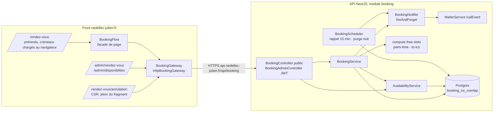

# 024 — Prise de rendez-vous

## Description

### Objectif

Demande du propriétaire (2026-10-12) : « j'aimerai ajouter a mon portfolio https://nedellec-julien.fr/ une
prise de RDV via agenda comme j'ai implémenter sur coachingLife […] a peut pret mais de manière plus
professionelle et efficace et en parfaite harmonie avec ce qui existe déja ! »

Un visiteur réserve lui-même l'**appel de cadrage de 30 min** déjà promis par la section Méthode
(« Cadrer · jour 1 · 30 min ») et la FAQ (« un cadrage gratuit de 30 minutes »), sans échange d'emails.

### Arbitrages du propriétaire (2026-10-12)

1. **Confirmation immédiate** : le créneau est bloqué dès la réservation (pas de demande « en attente »).
2. **Visio ou téléphone au choix du visiteur** : visio = lien unique généré par rendez-vous (Jitsi, sans
   compte côté visiteur) ; téléphone = le propriétaire appelle au numéro donné.
3. **Un seul type** : « Appel de cadrage · 30 min ».
4. **Disponibilités gérées dans l'admin** (plages hebdomadaires + fermetures), **sans** synchronisation
   Google Agenda.

### Exigence (contrat)

1. **Aucune double réservation possible**, y compris sous requêtes concurrentes : garantie par la base de
   données, pas seulement par le code applicatif.
2. Les créneaux libres sont **calculés par le serveur** (seule source de vérité) ; le front n'en recopie
   pas les règles. Un créneau absent du calcul est refusé à la création.
3. Les heures sont justes toute l'année : instants stockés en UTC, règles exprimées à l'heure de Paris,
   changements d'heure (25/10/2026, 28/03/2027) couverts par des tests.
4. Le visiteur reçoit un email de confirmation avec une invitation `.ics`, le lien de visio (ou la mention
   téléphone) et un **lien d'annulation** ; un **rappel** la veille. Le propriétaire reçoit la même
   invitation, qui arrive dans son agenda. Toute annulation (visiteur ou propriétaire) prévient l'autre
   partie avec un `.ics` d'annulation.
5. Règles : créneaux de 30 min, départ toutes les 30 min, 15 min de battement autour d'un rendez-vous,
   réservation au plus tard 24 h avant, au plus 21 jours à l'avance, au plus 2 rendez-vous à venir par
   email.
6. Anti-abus : champ piège (honeypot), limitation de débit par IP, plafond par email.
7. RGPD : aucune donnée personnelle dans la lecture publique des créneaux, mention sous le formulaire,
   page `confidentialite` à jour, purge des rendez-vous 6 mois après leur date, téléphone masqué dans les
   logs.
8. Page publique `/rendez-vous` dans la grammaire du site (cartouche, ligne de cote, `appButton`,
   Archivo + Plex Mono), points d'entrée depuis l'accueil sans remplacer les CTA existants, page
   d'annulation, deux écrans d'admin (Rendez-vous, Disponibilités).
9. WCAG AA : contrôles natifs (groupes de radios), erreurs annoncées, focus géré à la confirmation ;
   zéro violation au job `a11y` sur les nouvelles pages.

### Constat (2026-10-12, front `master` `ba92887`, API `master` `33f2d7b`)

1. Le front n'a aucune prise de rendez-vous ; seule trace : `/booking` dans `src/prerender-routes.txt`,
   fichier non branché (déjà relevé périmé par la spec 006).
2. L'API a eu un module `bookings`, supprimé le 2026-05-21 (`0c823b4`) : stockage `date` + `start_time`
   en texte, sans contrainte anti-chevauchement. Tables supprimées par `drizzle/0009_brave_annihilus.sql`.
3. L'API n'a ni bibliothèque de dates, ni génération `.ics`, ni honeypot ; le `MailerService` n'accepte pas
   de pièce jointe ; tout est en UTC (`TZ=UTC` dans les tests).
4. Coaching Life (`/home/j-ned/Projects/Coaching Life/coaching-life`) sert de **référence fonctionnelle,
   pas de code à copier** : son audit (`specs/001-intake-audit-repo.md`) relève la double réservation
   possible (F001, corrigée seulement dans la branche non mergée `fix/f001-booking-server-validation`,
   dont l'idée de contrainte d'exclusion et `paris-time.ts` sont reprises), des horaires codés en dur, des
   dates en texte, ni `.ics` ni annulation ni rappel, et des manques a11y (F023-F025, F033).

### Hors périmètre

- Synchronisation d'un agenda externe (Google, Outlook).
- Plusieurs types de rendez-vous, rendez-vous payants, replanification en un clic (le visiteur annule et
  réserve à nouveau).
- Réglage des règles du point 5 depuis l'admin (constantes documentées, YAGNI).

## Plan technique

### Décision d'architecture (ADR-0026)

Instants UTC (`timestamptz`), règles hebdomadaires en heure murale de Paris converties par `Intl`
sans bibliothèque (heure inexistante ignorée, heure répétée proposée une fois, la plus tôt). Le
serveur calcule seul les créneaux et renvoie toute la fenêtre réservable. Double réservation
interdite en base par `EXCLUDE USING gist (tstzrange(starts_at, ends_at, '[)') WITH &&) WHERE
(status = 'confirmed')`, sans extension (`btree_gist` n'est requise que pour mêler une égalité
scalaire au chevauchement). Créations sérialisées par `pg_advisory_xact_lock` pour que le battement
et le plafond par email tiennent aussi sous concurrence. Jeton d'annulation haché SHA-256, transmis
dans le fragment du lien puis dans un corps `POST`. Cf. ADR-0026.

**Corrections apportées au plan approuvé** (arbitrages inchangés) :

1. **Verrou consultatif ajouté** : la contrainte d'exclusion ne couvre que le chevauchement strict ;
   deux réservations concurrentes de 10:00 et 10:30 (battement violé) ou trois du même email
   (plafond dépassé) passaient toutes. Le recalcul sous verrou ferme ces deux courses.
2. **`GET bookings/cancel/:token` remplacé par `POST bookings/cancel/preview { token }`, et lien
   `/rendez-vous/annulation#<jeton>`** : pino journalise `req.url` à chaque requête, et
   `trackedPath` (front) envoie la query string au suivi d'audience. Un jeton dans le chemin ou la
   query string finirait dans les logs et la base d'audience ; le fragment n'est jamais transmis et
   `req.body.token` est déjà masqué.
3. **`GET slots` sans `from`/`to`** : la fenêtre entière (≤ 21 jours) pèse environ 20 Ko ; des
   bornes obligeraient le front à connaître l'horizon pour désactiver « semaine suivante », soit une
   règle recopiée (Exigence 2).
4. **nginx doit changer pour `/rendez-vous/annulation`** (pas pour `/rendez-vous`). Le prérendu
   `/rendez-vous` est servi par `location /` (`try_files $uri $uri/index.html`) : rien à faire. En
   revanche une route `RenderMode.Client` hors de la regex `^/(login|two-factor|admin)(/|$)` tombe
   dans `location /`, ne trouve aucun fichier et reçoit `error_page 404 /index.csr.html` : la page
   s'afficherait avec un **statut 404**. Une location dédiée sert la coquille CSR en 200 avec
   `X-Robots-Tag: noindex, nofollow` (le `noindex` demandé, posé là où un robot le lit sans
   exécuter de JavaScript ; `Seo` ne sait pas émettre de `robots`).
5. **`MailerService.sendMail` gagne `icalEvent`** (option native de nodemailer 10 : alternative
   `text/calendar` + pièce jointe `invite.ics`) plutôt qu'un champ `attachments` générique : c'est la
   forme que Gmail et Outlook reconnaissent comme invitation.
6. **Suivi de l'envoi par `trackContactSubmit('booking')`** au lieu d'un `trackBookingSubmit` : un
   nouveau type d'événement toucherait le DTO, les agrégats et l'écran Audience de l'API ;
   l'emplacement `booking` passe déjà la regex `CONTACT_PLACEMENT` (`/^[a-z0-9_-]{1,64}$/`). Ajout de
   `'booking'` à `ContactPlacement` et de son libellé dans `audience-conversions-view.ts`.
7. **Raison d'échec `limit-reached` ajoutée** au résultat front (plafond par email) et `server`
   séparé de `network` (5xx vs statut 0), sur le modèle de `toSubmissionError` du contact.
8. **Destinataire propriétaire partagé** : `CONTACT_RECIPIENT` (privé à `contact.service.ts`) devient
   `OWNER_EMAIL` dans `src/mailer/mailer.constants.ts`, importé par le contact et le booking.
9. **`PUBLIC_SITE_URL`** ajoutée à l'env de l'API (défaut `https://nedellec-julien.fr`) : l'API n'a
   aucune URL du site pour construire le lien d'annulation.

### Architecture



**API**
- `BookingController` (`@Controller('booking')`, public) et `BookingAdminController`
  (`@Controller('booking')`, `@UseGuards(JwtAuthGuard)` au niveau classe, `@ApiBearerAuth()`).
- `BookingService` : créneaux, création, aperçu et annulation visiteur, liste et annulation admin.
  Ne compose aucun email : il passe au `BookingNotifier` la ligne et, à la création, le jeton en clair.
- `AvailabilityService` : lecture et écriture des plages et fermetures ; fournit au calcul les
  entrées `(rules, closures)`.
- Logique pure, sans Nest ni base : `booking-policy.ts`, `paris-time.ts`, `compute-free-slots.ts`,
  `to-ics.ts`, `cancel-token.ts`, `video-room-url.ts`.
- `BookingNotifier` : charge les gabarits (`loadTemplate`/`renderTemplate`, échappement déjà
  garanti), produit les `.ics`, appelle `MailerService.sendMail`. Toujours appelé en
  `fireAndForget` **après le commit** : un SMTP en panne ne fait pas échouer une réservation, le
  rendez-vous reste visible dans l'admin.
- `BookingScheduler` : deux `@Cron` + `@Sentry.SentryCron`, sur le modèle
  d'`analytics-aggregator.service.ts`.

**Création (`POST bookings`)**, dans `db.transaction(async (tx) => …)` :
1. `website` (champ piège) non vide → réponse 201 de même forme, rien d'écrit ni d'envoyé, log
   `warn` sans donnée personnelle.
2. `select pg_advisory_xact_lock(hashtext('booking:create'))`.
3. Plafond : rendez-vous `confirmed`, `ends_at > now`, `lower(email) = lower(:email)` ≥ 2 → 422
   `booking_limit_reached`.
4. Lectures sous verrou (plages, fermetures, rendez-vous confirmés de la fenêtre), puis
   `computeFreeSlots`. `startsAt` présent → suite ; absent mais en conflit avec un rendez-vous
   confirmé (battement compris) → 409 `slot_taken` ; absent sans conflit → 422 `slot_unavailable`.
5. Insertion (`ends_at` = `starts_at` + 30 min calculé serveur, `cancel_token_hash`, `video_url`
   si visio, `phone` seulement si téléphone). Erreur `23P01` → 409 `slot_taken` (dernier recours).
6. Après commit : `fireAndForget(notifier.bookingConfirmed(row, token))`.

**Front**
- `/rendez-vous` : `RenderMode.Prerender`. Le prérendu contient en-tête, fiche et squelette ; les
  créneaux ne sont **jamais** demandés au rendu serveur : `rxResource({ params: () => (isBrowser ?
  true : undefined), stream })` (patron `isPlatformBrowser(inject(PLATFORM_ID))` de
  `project-detail.ts`). `params` à `undefined` laisse la ressource `idle` : aucune requête au build
  (qui n'a pas d'API), donc aucune réponse à mettre en transfer cache. `/booking` **n'entre pas** dans
  `PUBLIC_READ_PATHS` (des créneaux sérialisés dans le HTML seraient périmés). Le template rend le
  même squelette en `idle` et en `loading` : pas d'écart d'hydratation.
- `/rendez-vous/annulation` : `RenderMode.Client`, jeton lu dans `ActivatedRoute.fragment`.
  `anchorScrolling` cherchera un élément d'id égal au jeton, sans effet.
- Admin : pages `admin/rendez-vous` et `admin/disponibilites` sous `ADMIN_ROUTES`.
- **Landmarks** : les pages sont imbriquées dans le shell, qui possède `banner`, `main` et
  `contentinfo` ; aucune page de la feature n'émet `<header>`, `<main>` ni `<footer>`.
- **Frontière facade / présentation (page `/rendez-vous`)** :
  - `BookingFlow` (`pages/booking/booking-flow.ts`, facade instance-scopée par
    `providers: [BookingFlow]` du composant page, sans suffixe `Store`) : possède la ressource des
    créneaux, la sélection, le modèle et le `form()` Signal Forms, l'issue de l'envoi ; coordonne
    l'I/O. Aucune dépendance DOM.
  - Dérivations pures dans `domain/` : `groupSlotsByDay`, `groupDaysByWeek`, formateurs Paris.
  - Sous-composants dumb listés plus bas : la page ne garde que la mise en page et la glue.

### Contrat d'API (préfixe `/api/booking`)

Corps d'erreur : forme du `HttpExceptionFilter` existant, `{ statusCode, error, message, path,
timestamp }` ; le code métier est dans `error` (exceptions levées avec
`new ConflictException({ error: 'slot_taken', message })`). Instants : ISO 8601 UTC (`…Z`). Dates de
fermeture : `YYYY-MM-DD` (date de Paris). Les DTO portent `@ApiProperty` comme `src/contact/dto`.

| Méthode, route | Accès, throttle | Corps / query | Réponse |
|---|---|---|---|
| `GET slots` | public, `@PublicReadThrottle()` | — | 200 `{ timeZone: 'Europe/Paris', slots: [{ startsAt, endsAt }] }` trié, `Cache-Control: no-store` |
| `POST bookings` | public, `@BookingCreateThrottle()` (5 / 10 min / IP) | `CreateBookingDto` | 201 `{ id, startsAt, endsAt, format, videoUrl }` ; 400 validation ; 409 `slot_taken` ; 422 `slot_unavailable` \| `booking_limit_reached` ; 429 |
| `POST bookings/cancel/preview` | public, limite globale | `{ token }` | 200 `{ startsAt, endsAt, format, status, cancellable }` ; 404 `booking_not_found` |
| `POST bookings/cancel` | public, limite globale | `{ token }` | 200 `{ status: 'cancelled' }` (idempotent, aucun email au second appel) ; 404 `booking_not_found` ; 409 `cancel_too_late` (`now >= startsAt`) |
| `GET availability/rules` | admin | — | 200 `{ data: [{ weekday, startMinute, endMinute }] }` trié jour puis début |
| `PUT availability/rules` | admin | `{ rules: AvailabilityRuleDto[] }` | 200 `{ data }` ; 400 validation ou `rules_overlap` ; remplacement dans une transaction (`delete` + `insert`) |
| `GET availability/closures` | admin | — | 200 `{ data: [{ id, startsOn, endsOn, reason }] }`, `endsOn >= aujourd'hui (Paris)`, trié |
| `POST availability/closures` | admin | `{ startsOn, endsOn, reason? }` | 201 fermeture ; 400 si `endsOn < startsOn` |
| `DELETE availability/closures/:id` | admin, `ParseUUIDPipe` | — | 204 ; 404 |
| `GET bookings?scope=upcoming\|past` | admin | `ListBookingsQueryDto` (`@IsIn`) | 200 `{ data: AdminBooking[] }` ; `upcoming` = `ends_at > now` trié croissant, `past` = sinon, décroissant ; les deux statuts |
| `GET bookings/upcoming-count` | admin | — | 200 `{ count }` (`confirmed`, `ends_at > now`) |
| `PATCH bookings/:id/cancel` | admin, `ParseUUIDPipe` | `{ reason? }` (≤ 500) | 200 `AdminBooking` (idempotent) ; 404 ; 409 `cancel_too_late` |

`CreateBookingDto` (ValidationPipe global `whitelist` + `forbidNonWhitelisted` : le champ piège
**doit** être déclaré) :

| Champ | Validation |
|---|---|
| `startsAt` | `@IsISO8601({ strict: true })` |
| `name` | `@IsString() @IsNotEmpty() @MaxLength(200)` |
| `email` | `@IsEmail() @MaxLength(320)` |
| `format` | `@IsIn(['video', 'phone'])` |
| `phone` | `@ValidateIf((o) => o.format === 'phone') @IsString() @Matches(/^\+?[0-9][0-9 .-]{5,19}$/)` ; ignoré (non stocké) en visio |
| `company` | `@IsOptional() @IsString() @MaxLength(200)` |
| `message` | `@IsString() @IsNotEmpty() @MaxLength(1000)` |
| `website` | `@IsOptional() @IsString() @MaxLength(200)` (piège) |

`token` (aperçu, annulation) : `@Matches(/^[A-Za-z0-9_-]{43}$/)`. `AvailabilityRuleDto` :
`weekday` `@IsInt() @Min(1) @Max(7)`, `startMinute` / `endMinute` `@IsInt() @Min(0) @Max(1440)
@IsDivisibleBy(30)`, `endMinute > startMinute` vérifié au service avec le non-chevauchement par jour
(`rules_overlap`) ; `rules` `@ValidateNested({ each: true }) @Type(() => AvailabilityRuleDto)
@ArrayMaxSize(50)`.

`AdminBooking` : `{ id, startsAt, endsAt, name, email, phone, company, message, format, videoUrl,
status, cancelledAt, cancelledBy, cancelReason, reminderSentAt, createdAt }` (jamais
`cancelTokenHash`).

### Modèles de données

**API — `src/database/schema/booking.ts`** (ajouté au barrel `index.ts` : import, `export *`, entrée
de `schema`), style `contact-messages.ts` / `projects.ts` (texte + `check`, pas de `pgEnum`) :

- `availability_rule` : `id uuid pk default gen_random_uuid()`, `weekday smallint not null`,
  `start_minute smallint not null`, `end_minute smallint not null`, `...timestamps()` ; checks
  `availability_rule_weekday_check` (`weekday between 1 and 7`), `availability_rule_range_check`
  (`start_minute >= 0 and end_minute <= 1440 and end_minute > start_minute`).
- `availability_closure` : `id uuid pk`, `starts_on date not null` (`mode: 'string'`),
  `ends_on date not null`, `reason text`, `created_at` ; check `availability_closure_range_check`
  (`ends_on >= starts_on`).
- `booking` : `id uuid pk`, `starts_at timestamptz not null`, `ends_at timestamptz not null`,
  `name text not null`, `email text not null`, `phone text`, `company text`, `message text not null`,
  `format text not null`, `video_url text`, `status text not null default 'confirmed'`,
  `cancel_token_hash text not null` (unique `booking_cancel_token_hash_unique`), `cancelled_at
  timestamptz`, `cancelled_by text`, `cancel_reason text`, `reminder_sent_at timestamptz`,
  `...timestamps()` ; index `booking_starts_at_idx` ; checks :
  - `booking_range_check` : `ends_at > starts_at` ;
  - `booking_format_check` : `format in ('video', 'phone')` ;
  - `booking_status_check` : `status in ('confirmed', 'cancelled')` ;
  - `booking_video_check` : `(format = 'video') = (video_url is not null)` ;
  - `booking_phone_check` : `format <> 'phone' or phone is not null` ;
  - `booking_cancel_check` : `(status = 'cancelled') = (cancelled_at is not null)` et
    `cancelled_by is null or cancelled_by in ('visitor', 'owner')`.
- Types `Booking`, `NewBooking`, `AvailabilityRule`, `AvailabilityClosure` (`$inferSelect` /
  `$inferInsert`).

**Migrations** (`drizzle/`) :
- `0022_booking.sql` : `pnpm db:generate --name booking` (tables, checks, index).
- `0023_booking_no_overlap.sql` : `pnpm drizzle-kit generate --custom --name booking_no_overlap`
  (entrée de journal créée par drizzle-kit), contenu écrit à la main :

  ```sql
  -- Deux rendez-vous confirmés ne se chevauchent jamais ; un rendez-vous annulé libère son créneau.
  ALTER TABLE "booking" ADD CONSTRAINT "booking_no_overlap"
    EXCLUDE USING gist (tstzrange("starts_at", "ends_at", '[)') WITH &&)
    WHERE ("status" = 'confirmed');
  ```

  Aucune `CREATE EXTENSION`. Table neuve : aucune donnée existante à contrôler avant la migration
  (lancée par `pnpm db:migrate` au démarrage du conteneur API).

**API — politique** (`src/booking/booking-policy.ts`) :

```ts
export const BOOKING_POLICY = {
  timeZone: 'Europe/Paris',
  slotMinutes: 30,
  stepMinutes: 30,
  bufferMinutes: 15,
  minNoticeHours: 24,
  maxAdvanceDays: 21,
  maxUpcomingPerEmail: 2,
  reminderLeadHours: 24,
  reminderMinCreatedAheadHours: 30,
  retentionMonths: 6,
} as const satisfies BookingPolicy;
```

- Créneau candidat : pour chaque date de Paris de `date(now)` à `date(now + 21 j)`, chaque plage du
  jour ISO, chaque `m` de `startMinute` au pas de 30 tant que `m + 30 <= endMinute` ;
  `start = parisWallTimeToUtc(date, m)` (`null` → ignoré), `end = start + 30 min` (durée absolue).
- Libre si : `start >= now + 24 h`, `start <= now + 21 j`, date de Paris de `start` hors de toute
  fermeture `[startsOn, endsOn]`, et aucun rendez-vous confirmé `b` tel que
  `b.startsAt - 15 min < end && start < b.endsAt + 15 min`. Résultat dédoublonné par instant, trié.
- `paris-time.ts` : `parisWallTimeToUtc(date: string, minuteOfDay: number): Date | null` (deux
  candidats +01:00 / +02:00, retenus si le formatage `Intl` `en-CA`, `hourCycle: 'h23'`,
  `timeZone: 'Europe/Paris'` redonne date et minute ; le plus tôt gagne), `toParisDate(instant)`,
  `isoWeekday(date)`, `formatParisLong(instant)` (« lundi 19 octobre 2026 à 09:00 », pour les
  emails). Formateurs créés une fois au niveau module.
- `cancel-token.ts` : `createCancelToken(): { token: string; hash: string }`
  (`randomBytes(32).toString('base64url')`, 43 caractères ; `sha256` hex, 64 caractères) et
  `hashCancelToken(token)`.
- `video-room-url.ts` : `videoRoomUrl(base: string, random: Buffer): string` →
  `${base sans / final}/nedellec-${16 caractères [a-z0-9]}`. L'aléa est injecté (pur, testable).
- `src/common/utils.ts` : la marche dans la chaîne `cause` d'`isUniqueViolation` devient une fonction
  interne partagée ; ajout d'`isExclusionViolation(err, constraintHint?)` (`code === '23P01'`).

**Front — `features/booking/domain/models/`** (`type` immuables, unions) :

```ts
type BookingFormat = 'video' | 'phone';
type BookingSlot = { readonly startsAt: string; readonly endsAt: string };
type BookingSlotOption = BookingSlot & { readonly timeLabel: string };          // « 09:00 »
type BookingDay = { readonly date: string; readonly label: string;               // « lundi 19 octobre »
                    readonly shortLabel: string; readonly slots: readonly BookingSlotOption[] };
type BookingWeek = { readonly key: string; readonly label: string; readonly days: readonly BookingDay[] };
type BookingRequest = { readonly startsAt: string; readonly name: string; readonly email: string;
  readonly format: BookingFormat; readonly phone: string | null; readonly company: string | null;
  readonly message: string; readonly website: string };
type BookingConfirmation = { readonly id: string; readonly startsAt: string; readonly endsAt: string;
  readonly format: BookingFormat; readonly videoUrl: string | null };
type BookingFailureReason = 'slot-taken' | 'slot-unavailable' | 'limit-reached' | 'rate-limited'
  | 'invalid' | 'network' | 'server';
type BookingSubmission = { readonly success: true; readonly data: BookingConfirmation }
  | { readonly success: false; readonly reason: BookingFailureReason };
type BookingCancelPreview = { readonly startsAt: string; readonly endsAt: string;
  readonly format: BookingFormat; readonly status: 'confirmed' | 'cancelled'; readonly cancellable: boolean };
type BookingCancelFailure = 'not-found' | 'too-late' | 'network' | 'server';
type IsoWeekday = 1 | 2 | 3 | 4 | 5 | 6 | 7;
type AvailabilityRule = { readonly weekday: IsoWeekday; readonly startMinute: number; readonly endMinute: number };
type AvailabilityClosure = { readonly id: string; readonly startsOn: string; readonly endsOn: string;
  readonly reason: string | null };
type AdminBooking = { /* champs AdminBooking du contrat */ };
```

Résultats de l'aperçu, de l'annulation, des écritures admin : Result pattern
`{ success: true; data } | { success: false; reason }` produit par la gateway (aucune exception pour un
échec métier). Types API (DTO bruts) isolés dans `infra/booking-api.types.ts` ; adapters purs
`toBookingSlot`, `toBookingConfirmation`, `toCancelPreview`, `toAdminBooking`, `toAvailabilityRule`,
`toAvailabilityClosure` dans `infra/booking.adapter.ts`. Validation runtime des réponses HTTP non
vérifiée (profil : aucune lib côté front).

### Fichiers à créer / modifier

**API (`/home/j-ned/Projects/Portfolio/nest-portfolio-app`, branche `feat/booking`)**

| Fichier | Rôle |
|---|---|
| `src/database/schema/booking.ts` | trois tables, checks, index, types |
| `src/database/schema/index.ts` | barrel : import, `export *`, `schema` |
| `drizzle/0022_booking.sql`, `drizzle/meta/0022_snapshot.json`, `_journal.json` | générés |
| `drizzle/0023_booking_no_overlap.sql`, `_journal.json` | migration custom (contrainte) |
| `src/booking/booking.module.ts` | imports `MailerModule` ; providers et deux contrôleurs |
| `src/booking/booking.controller.ts` | routes publiques |
| `src/booking/booking-admin.controller.ts` | routes admin (`JwtAuthGuard` de classe) |
| `src/booking/booking.service.ts` | créneaux, création sous verrou, aperçu, annulations, listes |
| `src/booking/availability.service.ts` | plages (remplacement transactionnel), fermetures |
| `src/booking/booking-notifier.service.ts` | emails + `.ics` |
| `src/booking/booking-scheduler.service.ts` | crons rappel et purge |
| `src/booking/booking-policy.ts` | `BOOKING_POLICY` + type |
| `src/booking/paris-time.ts` | heure murale de Paris ⇄ instant |
| `src/booking/compute-free-slots.ts` | calcul pur des créneaux libres + `overlapsBooking` |
| `src/booking/to-ics.ts` | VCALENDAR RFC 5545 |
| `src/booking/cancel-token.ts` | jeton + empreinte |
| `src/booking/video-room-url.ts` | lien de visio |
| `src/booking/dto/create-booking.dto.ts`, `cancel-token.dto.ts`, `owner-cancel-booking.dto.ts`, `availability-rule.dto.ts`, `replace-availability-rules.dto.ts`, `create-closure.dto.ts`, `list-bookings-query.dto.ts` | DTO class-validator + Swagger |
| `src/booking/mail-templates/booking-confirmation.html`, `booking-notification.html`, `booking-cancelled.html`, `booking-reminder.html` | gabarits inline (style des gabarits contact) ; copiés par l'asset `**/mail-templates/**/*.html` déjà déclaré dans `nest-cli.json` |
| `src/booking/*.spec.ts`, `src/booking/booking.integration.spec.ts` | tests (rôle de `qa`) |
| `src/mailer/mailer.service.ts` | `SendMailOptions.icalEvent?: { method: 'REQUEST' \| 'CANCEL'; content: string }` transmis à nodemailer (`{ method, content, filename: 'invitation.ics' }`) |
| `src/mailer/mailer.constants.ts` | `OWNER_EMAIL` |
| `src/contact/contact.service.ts` | importe `OWNER_EMAIL` (retire `CONTACT_RECIPIENT`) |
| `src/common/utils.ts` | `isExclusionViolation`, marche `cause` partagée |
| `src/common/throttle.ts` | `BOOKING_CREATE_THROTTLE` (`{ default: { limit: 5, ttl: 600_000 } }`) + `BookingCreateThrottle()` |
| `src/config/env.schema.ts` | `PUBLIC_SITE_URL` (`z.string().url().default('https://nedellec-julien.fr')`), `BOOKING_VIDEO_URL_BASE` (`z.string().url().default('https://meet.jit.si')`) |
| `src/config/app-config.service.ts` | getters `publicSiteUrl`, `bookingVideoUrlBase` |
| `src/app.module.ts` | `BookingModule` ; redact `req.body.phone`, `req.body.email` (défense en profondeur : le sérialiseur `req` n'écrit pas le corps aujourd'hui) |
| `README.md` | variables d'env, endpoints `booking`, ligne `CONTACT_RECIPIENT` → `OWNER_EMAIL`, crons |

**Front (`/home/j-ned/Projects/Portfolio/ng-portfolio-app`, branche `feat/024-prise-de-rendez-vous`)**

| Fichier | Rôle |
|---|---|
| `src/app/features/booking/domain/models/booking.model.ts` | types publics (créneau, demande, confirmation, résultats) |
| `src/app/features/booking/domain/models/booking-admin.model.ts` | `AdminBooking`, `AvailabilityRule`, `AvailabilityClosure`, `IsoWeekday` |
| `src/app/features/booking/domain/gateways/booking.gateway.ts` | `abstract class BookingGateway` (patron `ContactGateway`, une impl HTTP + le stub) |
| `src/app/features/booking/domain/paris-format.ts` | formateurs `Intl` `fr-FR` / `Europe/Paris` créés une fois : clé de date, libellés jour, heure, date longue |
| `src/app/features/booking/domain/group-slots-by-day.ts` | `groupSlotsByDay(slots): readonly BookingDay[]` |
| `src/app/features/booking/domain/group-days-by-week.ts` | `groupDaysByWeek(days): readonly BookingWeek[]` (semaine ISO, lundi) |
| `src/app/features/booking/domain/booking-copy.static-data.ts` | textes de page, lignes de fiche, message par `BookingFailureReason` et par échec d'annulation, mention RGPD |
| `src/app/features/booking/infra/booking-api.types.ts` | DTO bruts |
| `src/app/features/booking/infra/booking.adapter.ts` | adapters purs |
| `src/app/features/booking/infra/http-booking.gateway.ts` | `HttpBookingGateway` ; `silentErrors()` sur toutes les requêtes (la page affiche ses propres erreurs) ; `toBookingFailure(err)` ; compteur à venir partagé + `invalidateUpcomingCount()` (patron `unreadCount$`) |
| `src/app/features/booking/testing/stub-booking-gateway.ts`, `booking-builders.ts` | doublure et builders |
| `src/app/features/booking/booking.routes.ts` | `BOOKING_ROUTES` : `''` → `Booking` (title, `data.seo`, BreadcrumbList), `'annulation'` → `BookingCancellation` |
| `src/app/features/booking/pages/booking/booking.ts` | page smart : mise en page, fiche, étapes, états |
| `src/app/features/booking/pages/booking/booking-flow.ts` | facade de page |
| `src/app/features/booking/application/booking-day-picker.ts` | radios des jours de la semaine affichée, boutons semaine précédente / suivante (`aria-disabled` aux bornes) |
| `src/app/features/booking/application/booking-time-picker.ts` | radios des créneaux du jour, liées par `[formField]` au champ `startsAt` (patron radios d'`admin-post-form.ts`), erreur du champ |
| `src/app/features/booking/application/booking-details-fields.ts` | champs coordonnées (entrée `FieldTree`, patron `admin-pair-rows`), champ piège |
| `src/app/features/booking/application/booking-summary.ts` | récapitulatif (jour, heure, format) |
| `src/app/features/booking/application/booking-confirmation.ts` | écran de succès, focus sur son titre (`afterNextRender({ write })`) |
| `src/app/features/booking/pages/booking-cancellation/booking-cancellation.ts` | aperçu puis confirmation d'annulation |
| `src/app/app.routes.ts` | route `rendez-vous` (`loadChildren`) |
| `src/app/app.routes.server.ts` | `rendez-vous` Prerender, `rendez-vous/annulation` Client ; commentaire étendu aux routes Client |
| `src/app/app.config.ts` | `{ provide: BookingGateway, useClass: HttpBookingGateway }` |
| `src/server/feeds/sitemap.ts` | `/rendez-vous` (`monthly`, `0.6`) |
| `Dockerfile` | location `^/rendez-vous/annulation/?$` : coquille CSR 200 + `X-Robots-Tag` |
| `.github/workflows/ci.yml` | smoke docker : `/rendez-vous` 200 ; `/rendez-vous/annulation` 200 avec `X-Robots-Tag: noindex` |
| `src/app/features/analytics/domain/models/analytics.types.ts` | `ContactPlacement` + `'booking'` |
| `src/app/features/admin/application/audience-conversions-view.ts` | libellé `booking` → « Prise de rendez-vous » |
| `src/app/features/home/domain/home-hero.static-data.ts` | `HOME_HERO_CTA_LABELS.booking` |
| `src/app/features/home/application/home-hero-section.ts` | lien texte sous les CTA, output `bookingOpened` |
| `src/app/features/home/pages/home/home.ts` | `trackCtaClick('home_hero_booking', …)` |
| `src/app/features/home/domain/models/home-pitch.model.ts`, `home-pitch.static-data.ts` | étape `frame` : `link?: { label; href }` ; réponse FAQ `application-price` mentionnant la réservation en ligne |
| `src/app/features/home/application/home-method.ts` | lien de l'étape (`RouterLink`) |
| `src/app/features/contact/application/contact-form.ts` | encart « Préférez en parler ? Réservez 30 min » sous les coordonnées |
| `src/app/layout/components/footer/footer.static-data.ts`, `footer.ts` | lien de la colonne Contact |
| `src/app/pages/privacy-policy.ts` | section « Prise de rendez-vous », date de mise à jour |
| `src/prerender-routes.txt` | supprimé (non branché, cite un `/booking` inexistant) |
| `src/app/shared/icons/icon-map.ts`, `public/icons/sprite.svg`, `sprite-version.ts` | `calendar` (`calendar-days`), `video` ; `pnpm icons:build` |
| `src/app/features/admin/admin.routes.ts` | `rendez-vous`, `disponibilites` (`canDeactivate: [unsavedChangesGuard]`) |
| `src/app/features/admin/application/admin-nav-groups.ts` | groupe « Rendez-vous » : `bookings` (compteur, suffixe « à venir »), `availability` |
| `src/app/features/admin/pages/admin-layout/admin-layout.ts` | compteur `getUpcomingCount()` |
| `src/app/features/admin/application/admin-bookings-view.ts` | vue pure (filtres À venir / Passés, lignes, libellés) |
| `src/app/features/admin/application/components/admin-booking-row.ts` | ligne de rendez-vous |
| `src/app/features/admin/pages/admin-bookings/admin-bookings.ts` | liste + annulation avec motif (`app-confirm-dialog`) |
| `src/app/features/admin/application/availability-draft.ts` | `toAvailabilityDraft`, `toAvailabilityRules`, minutes ⇄ `HH:MM` |
| `src/app/features/admin/application/components/admin-availability-rows.ts` | lignes jour / début / fin, ajout et retrait par `value.update` |
| `src/app/features/admin/application/components/admin-closures.ts` | liste, ajout, suppression des fermetures |
| `src/app/features/admin/pages/admin-availability/admin-availability.ts` | `DocumentDraft` des plages + barre d'enregistrement + fermetures |
| `e2e/a11y/scenarios.ts`, `interactive-states.spec.ts` | pages et états du parcours |
| `ci/api-stub/server.mjs`, `ci/api-stub/fixtures/booking-admin.json`, `booking-availability.json` | routes booking de la doublure |

### Réactivité / état

- **`BookingFlow`** (facade de page, aucune donnée partagée hors de l'écran : pas de store) :
  - `_slots = rxResource({ params: () => (this._isBrowser ? true : undefined), stream: () =>
    gateway.getSlots() })` ; `days = computed(groupSlotsByDay)`, `weeks = computed(groupDaysByWeek)` ;
    `state = computed(() => loadState(...))`, avec `idle` rendu comme `loading`.
  - `weekIndex = linkedSignal` (borné aux semaines disponibles) ; `selectedDate = linkedSignal({
    source: days, computation })` : remis à `null` si le jour n'existe plus après rechargement.
  - `_model = signal<BookingDraft>(EMPTY_BOOKING)` (défauts non `null` : `startsAt: ''`,
    `format: 'video'`, `phone: ''`, `company: ''`, `website: ''`) ;
    `form = form(this._model, schema, { submission: { action, onInvalid: focusFirstInvalid } })`.
    Schéma : `required(startsAt, { message: 'Choisissez un horaire.' })`, nom (requis, 2 à 200),
    email (requis, `pattern` du contact, ≤ 320), `required(phone, { when: ({ valueOf }) =>
    valueOf(path.format) === 'phone', message })` + `pattern` téléphone, entreprise ≤ 200, message
    requis 10 à 1000.
  - `selectDay(date)` remet `startsAt` à `''` (`_model.update`, nouvelle référence).
  - `outcome = signal<BookingOutcome | null>` : `{ kind: 'confirmed', confirmation, email }` ou
    `{ kind: 'failed', reason }` ; lu en lecture seule (`asReadonly()`).
  - Action d'envoi : payload copié champ par champ (`phone` à `null` en visio, `company` vide →
    `null`) ; succès → `outcome` confirmé + `analytics.trackContactSubmit('booking')` ;
    `slot-taken` → `_slots.reload()`, `startsAt` remis à `''`, coordonnées conservées, message dans
    la région `role="status"`, focus sur le titre de l'étape Heure (`tabindex="-1"`) ; autres échecs
    → message seul.
  - Bouton d'envoi désactivé **seulement** sur `form().submitting()`.
- **Page d'annulation** : `token = toSignal(route.fragment)` ; `preview = rxResource({ params:
  token, stream })` (pas de jeton → état « lien invalide » sans requête) ; `cancelling` / `result`
  en signaux locaux ; succès → focus sur le titre du message.
- **Admin** : patron `admin-messages` (`rxResource`, `loadState`, `@switch`). Plages :
  `DocumentDraft<readonly AvailabilityRule[], AvailabilityDraft>` (une section TOC `weekly`),
  `canLeave()` et `warnBeforeUnload` comme `admin-profile.ts` ; fermetures en ressource séparée,
  écritures immédiates (hors brouillon). Annulation admin → `invalidateUpcomingCount()`.
- Immutabilité : modèles `readonly`, aucune mutation en place, signaux exposés en lecture seule.

### Tranches

Commandes : API `pnpm test -- src/booking; echo $?` puis `pnpm test; echo $?`, `pnpm lint`,
`pnpm build`. Front `pnpm test -- --include='src/app/features/booking/**/*.spec.ts'; echo $?`, puis
`pnpm test; echo $?`, `pnpm lint`. Le code de sortie fait foi, pas le résumé (rejets non gérés).
Postgres jetable des tests d'intégration :
`podman run --rm -d --name booking-it -e POSTGRES_PASSWORD=it -p 55432:5432 docker.io/postgres:17-alpine`,
puis `BOOKING_IT_DATABASE_URL=postgres://postgres:it@127.0.0.1:55432/postgres pnpm test -- booking.integration`.

**API (PR 1, `nest-portfolio-app`)**

- **A1 — les créneaux libres sont justes toute l'année** : schéma des trois tables, migration
  `0022_booking`, `booking-policy.ts`, `paris-time.ts`, `compute-free-slots.ts`,
  `AvailabilityService` (lecture), `BookingService.getSlots`, `GET slots`, `BookingModule` câblé.
  Vérifiable : unitaires purs verts (DST compris, sous `TZ=UTC` **et**
  `TZ=Pacific/Kiritimati pnpm test -- src/booking`) ; `pnpm db:migrate` sur la base jetable ;
  contrôle ICU dans l'image :
  `podman run --rm docker.io/node:24-alpine node -e "console.log(new Intl.DateTimeFormat('fr-FR',{timeZone:'Europe/Paris',timeStyle:'short'}).format(new Date('2026-10-25T01:30:00Z')))"`
  doit afficher `02:30`.
- **A2 — une réservation est confirmée, jamais en double** : migration `0023_booking_no_overlap`,
  `CreateBookingDto`, création sous verrou, 409 / 422, champ piège, `BookingCreateThrottle`, plafond,
  `cancel-token.ts`, `video-room-url.ts`, `BOOKING_VIDEO_URL_BASE`, `isExclusionViolation`.
  Vérifiable : unitaires (`createMockDb`) ; intégration sur Postgres réel (cas listés aux consignes).
- **A3 — invitations et annulation par le visiteur** : `to-ics.ts`, `icalEvent` du mailer,
  `OWNER_EMAIL`, `PUBLIC_SITE_URL`, `BookingNotifier` (confirmation visiteur, notification
  propriétaire, annulation des deux côtés), `POST bookings/cancel/preview`, `POST bookings/cancel`.
  Vérifiable : unitaires ; manuel Mailpit (`pnpm mail:up`) : réserver, deux emails reçus, `.ics`
  importé dans Google Agenda (compte du propriétaire **et** compte tiers), annulation par le lien,
  deux emails `CANCEL`, événement retiré des deux agendas.
- **A4 — l'admin gère plages, fermetures et rendez-vous** : `BookingAdminController`,
  `AvailabilityService` (écritures, `rules_overlap`), listes, compteur, annulation propriétaire
  (motif, emails `CANCEL` au visiteur **et** au propriétaire).
- **A5 — rappel la veille et purge** : `BookingScheduler` ; rappel `*/15 * * * *` UTC
  (`SentryCron('booking-reminders', …)`), purge `30 3 * * *` UTC
  (`SentryCron('booking-purge', …)`) ; redact pino ; README. Rappel : réclamation atomique
  `update booking set reminder_sent_at = now() where status = 'confirmed' and reminder_sent_at is
  null and starts_at > now() and starts_at <= now() + interval '24 hours' and created_at <=
  starts_at - interval '30 hours' returning *`, puis envoi (au plus une fois : un envoi raté est
  journalisé, pas rejoué). Purge : `delete from booking where ends_at < now() - interval '6 months'`.

**Front (PR 2, après déploiement de l'API)**

- **F1 — la gateway parle le contrat de l'API** : modèles, `BookingGateway`, `HttpBookingGateway`,
  adapters, `paris-format.ts`, `groupSlotsByDay`, `groupDaysByWeek`, stub, builders, câblage
  `app.config.ts`. Vérifiable : `HttpTestingController` sur chaque route et chaque statut d'erreur.
- **F2a — le visiteur choisit un jour et une heure** : routes (`app.routes.ts`,
  `app.routes.server.ts`, `booking.routes.ts`), sitemap, page `Booking`, `BookingFlow` (ressource,
  sélection, semaines), fiche, `booking-day-picker`, `booking-time-picker`, états chargement /
  erreur (`app-load-error` + Réessayer) / vide (lien vers le contact). Vérifiable : specs composant ;
  `pnpm run build --configuration production` produit `dist/angular-portfolio-app/browser/rendez-vous/index.html`
  sans créneau ni requête au build.
- **F2b — le visiteur réserve** : formulaire Signal Forms (champs, validation croisée du téléphone,
  champ piège, mention RGPD), récapitulatif, envoi, messages par raison, parcours 409, écran de
  confirmation et focus, `ContactPlacement` `booking` + libellé Audience.
- **F3 — le visiteur annule par le lien** : page `BookingCancellation`, location nginx, smoke
  docker. Vérifiable : specs ; `docker build -t ng-portfolio-app:local .` puis
  `curl -sI http://127.0.0.1:3000/rendez-vous/annulation` → `200` et `X-Robots-Tag: noindex, nofollow`.
- **F4 — points d'entrée et confidentialité** : hero, étape Cadrer, encart contact, pied de page,
  FAQ, page `confidentialite`, icônes, suppression de `src/prerender-routes.txt`.
- **F5a — l'admin voit et annule les rendez-vous** : route, entrée de navigation et compteur,
  `admin-bookings-view`, `admin-booking-row`, page `AdminBookings`, dialogue avec motif.
- **F5b — l'admin règle ses disponibilités** : route avec garde, `availability-draft`,
  `admin-availability-rows`, `admin-closures`, page `AdminAvailability`.
- **F6 — zéro violation axe sur les nouvelles pages** : doublure (créneaux **générés relativement à
  l'heure courante** dans `server.mjs`, pas en fixture, sinon périmés ; `POST bookings`,
  `cancel/preview`, `cancel` ; lectures admin sous `STUB_ADMIN_SESSION`, testées avant le 405 des
  méthodes non-GET), scénarios `/rendez-vous` (repère `booking-day-picker`),
  `/rendez-vous/annulation#<jeton de 43 caractères>` (repère `booking-cancel-preview`),
  `/admin/rendez-vous` (`admin-bookings-list`), `/admin/disponibilites` (`admin-availability-rules`) ;
  états interactifs : jour et heure choisis, formulaire soumis vide (erreurs affichées), écran de
  confirmation, dialogue d'annulation admin. Vérifiable : `docker build -t ng-portfolio-app:a11y .
  && ci/a11y-stack.sh up && pnpm a11y; echo $?`.

Découpage de F2 et F5 en a/b (le plan approuvé listait F1 à F6) : chacune des deux tranches
d'origine dépassait un rouge et un vert raisonnables ; chaque demi-tranche est verte sans la
suivante.

### Consignes pour `qa`

- **Domaine pur sans TestBed ni Nest** (`paris-time`, `compute-free-slots`, `to-ics`,
  `cancel-token`, `video-room-url`, `groupSlotsByDay`, `groupDaysByWeek`, `paris-format`,
  `availability-draft`, `admin-bookings-view`).
- **DST, `it.each`** (valeurs vérifiées le 2026-10-12 avec `Intl` sous Node) :

  | Date de Paris, heure | Instant attendu |
  |---|---|
  | 2026-10-19 (lundi) 09:00 | `2026-10-19T07:00:00Z` |
  | 2026-10-26 (lundi) 09:00 | `2026-10-26T08:00:00Z` |
  | 2027-03-22 (lundi) 09:00 | `2027-03-22T08:00:00Z` |
  | 2027-03-29 (lundi) 09:00 | `2027-03-29T07:00:00Z` |
  | 2026-10-25 (dimanche) 02:30 | `2026-10-25T00:30:00Z` (heure répétée : la plus tôt) |
  | 2026-10-25 03:00 | `2026-10-25T02:00:00Z` |
  | 2027-03-28 (dimanche) 02:30 | `null` (heure inexistante) |
  | 2027-03-28 03:00 | `2027-03-28T01:00:00Z` |

  `computeFreeSlots` avec une plage dimanche `0`–`1440` : 48 créneaux le 2026-10-25 (aucun à
  `01:00Z` ni `01:30Z`), 46 le 2027-03-28. `now` est un paramètre : aucune horloge dans le pur.
- **Politique, `it.each`** : préavis (23 h 59 refusé, 24 h accepté), horizon (21 j accepté,
  au-delà refusé), battement (rendez-vous 10:00–10:30 → 09:30 et 10:30 exclus, 09:00 et 11:00
  libres), fermeture inclusive aux deux bornes, rendez-vous annulé ignoré, plage `09:00–10:00` →
  09:00 et 09:30 seulement (un départ à 10:00 finirait hors plage).
- **Concurrence (intégration, Postgres réel, `describe.skip` sans `BOOKING_IT_DATABASE_URL`,
  patron `profile-portrait.integration.spec.ts`)** : 10 `create()` simultanés sur le même créneau →
  exactement 1 succès, 9 `ConflictException` `slot_taken`, 1 ligne en base ; 10:00 et 10:30
  simultanés → 1 succès (battement sous verrou) ; 3 créneaux distincts, même email (casse
  différente) → 2 succès, 1 `booking_limit_reached` ; insertion SQL directe d'un chevauchement
  confirmé → `23P01` ; même chevauchement avec une ligne `cancelled` → accepté ; annuler libère le
  créneau. Pool `postgres` `max ≥ 10`. `MailerService` doublé.
- **`.ics`** : CRLF partout, aucune ligne > 75 octets UTF-8 (nom accentué long : repli sans couper
  un caractère multioctet), échappement `\\`, `;`, `,`, saut de ligne, `UID` stable entre `REQUEST` et
  `CANCEL`, `SEQUENCE` 0 puis 1, `DTSTART`/`DTEND` en `Z`.
- **Jeton** : 43 caractères `[A-Za-z0-9_-]`, empreinte hex de 64, seule l'empreinte est insérée ;
  le jeton en clair n'apparaît dans aucun appel de log (`Logger` espionné).
- **Champ piège** : `website` non vide → 201, aucune insertion, aucun email.
- **Front, gateway** : `it.each` statut → raison (`0` network, `400` invalid, `409` slot-taken,
  `422` + `slot_unavailable`, `422` + `booking_limit_reached`, `429` rate-limited, `500`/`503`
  server) ; `verify()` en `afterEach`.
- **Front, prérendu** : avec `{ provide: PLATFORM_ID, useValue: 'server' }`, `getSlots` n'est jamais
  appelé et le squelette est rendu.
- **Front, parcours** : changer de jour vide l'heure ; formulaire soumis vide → erreurs sous les
  champs touchés, focus sur le premier invalide, aucun appel ; téléphone requis seulement en format
  téléphone (`aria-required` suit) ; 409 → créneaux rechargés, coordonnées conservées, heure vide,
  message dans `booking-status` ; succès → `booking-confirmation-heading` focalisé,
  `trackContactSubmit('booking')` appelé une fois. Zoneless : jamais `fakeAsync`, `await
  fixture.whenStable()`.
- **`data-testid`** (seuls sélecteurs) : `booking-fiche`, `booking-slots-loading`, `load-error`,
  `booking-empty`, `booking-day-picker`, `booking-day-option`, `booking-week-previous`,
  `booking-week-next`, `booking-week-label`, `booking-time-picker`, `booking-time-option`,
  `booking-time-heading`, `booking-start-error`, `booking-name`, `booking-email`,
  `booking-format-video`, `booking-format-phone`, `booking-phone`, `booking-company`,
  `booking-message`, `booking-website`, `booking-privacy-notice`, `booking-summary`,
  `booking-submit`, `booking-status`, `booking-confirmation`, `booking-confirmation-heading`,
  `booking-cancel-preview`, `booking-cancel-confirm`, `booking-cancel-result`,
  `booking-cancel-invalid`, `hero-booking-link`, `home-method-step-link`, `contact-booking-link`,
  `footer-booking-link`, `admin-bookings-list`, `admin-booking-row`, `admin-booking-cancel`,
  `admin-booking-reason`, `admin-availability-rules`, `admin-availability-rule-*`,
  `admin-closures-list`, `admin-closure-delete`. Erreurs de champ : `<testid>-error` (patron
  `app-field-error`).

### Risques & inconnues

- **meet.jit.si exige la connexion de l'organisateur** (Google, GitHub ou Facebook) pour ouvrir la
  salle : sans le propriétaire, le visiteur attend dans le hall. Le propriétaire rejoint le lien en
  premier ; `BOOKING_VIDEO_URL_BASE` permet de basculer vers un Jitsi auto-hébergé sans code.
- **Ordre de déploiement** (CLAUDE.md item 10) : PR API mergée, conteneur API déployé (migrations
  0022 et 0023 jouées au démarrage), `curl https://api.nedellec-julien.fr/api/booking/slots` → 200 ;
  le propriétaire saisit ses plages dans l'admin, **puis** merge du front. Sinon `/rendez-vous`
  affiche l'erreur de chargement (404) ou l'état vide.
- **Copie du propriétaire** : une invitation `REQUEST` dont le destinataire est aussi `ORGANIZER`
  peut être affichée sans être ajoutée par Google Agenda ; vérifié à la main en A3. Repli si besoin :
  `METHOD:PUBLISH` pour la copie propriétaire uniquement (même `UID`), à acter en A3.
- **Anti-abus borné** : le plafond par email se contourne avec plusieurs adresses ; au pire 5
  réservations par IP et 10 min. Le propriétaire annule depuis l'admin (le visiteur est prévenu).
- **Fermeture posée sur des rendez-vous existants** : ils restent confirmés ; l'admin les annule à
  la main (pas d'annulation en cascade, hors périmètre).
- `AdminLayout` passe de 7 à 8 collaborateurs injectés (seuil advisory 6, non bloquant).

### Décisions à arbitrer par le propriétaire

> **Arbitré le 2026-10-13 par le propriétaire** : les deux recommandations sont retenues (battement de
> 15 min, suivant possible 1 h après ; pas de rappel sous 30 h).

1. **Battement de 15 min sur une grille de 30 min** : un rendez-vous à 10:00 rend indisponibles
   09:30 et 10:30, le suivant possible est 11:00 (tout battement entre 1 et 30 min a le même effet
   sur cette grille). Recommandation : garder (la règle écrite, et une marge réelle entre deux
   appels). Si l'intention était « 10:00 puis 10:45 », il faut un pas de 15 min.
2. **Pas de rappel pour une réservation faite moins de 30 h avant le rendez-vous** : réservée à
   24 h 05, elle recevrait sinon le rappel quelques minutes après la confirmation. Recommandation :
   garder le seuil de 30 h (`reminderMinCreatedAheadHours`).

## Plan de test

### Tranche A1 — les créneaux libres sont justes toute l'année

API `nest-portfolio-app`, branche `feat/booking`, fichiers sous `src/booking/` (66 tests, 6 suites,
builders partagés `booking-test-builders.ts` : `anAvailabilityRule`, `anAvailabilityClosure`,
`aBooking`, typés sur `AvailabilityRule`, `AvailabilityClosure`, `Booking` du barrel `schema`).

Signatures figées par les tests (non précisées au plan) :
`computeFreeSlots({ now, rules, closures, bookings }): readonly { startsAt: Date; endsAt: Date }[]`
(les rendez-vous portent `status`, un `cancelled` est ignoré par le calcul) ;
`AvailabilityService.listRules()` et `listClosures()` (terminateur Drizzle `orderBy`, fermetures
filtrées sur `endsOn >= date de Paris du jour`) ; `BookingService` injecte `DRIZZLE` et
`AvailabilityService`, lit les rendez-vous de la fenêtre (terminateur `where`) ;
`getSlots(): Promise<{ timeZone: 'Europe/Paris'; slots: { startsAt: string; endsAt: string }[] }>`
(chaînes `toISOString()`).

| Fichier | Tests | Scénario | Assertions clés |
|---|---|---|---|
| `booking-policy.spec.ts` | 1 | constante de politique | `toEqual` exact de `BOOKING_POLICY` (golden) |
| `paris-time.spec.ts` | 13 | `parisWallTimeToUtc` : table DST des consignes + minuit / 23:30 du 25/10, 02:00 répété, 01:30 et 02:00 du 28/03 | instant ISO exact ou `null` |
| | 6 | `toParisDate` aux bords des deux jours de bascule | date `YYYY-MM-DD` de Paris |
| | 5 | `isoWeekday` | 1 à 7, dimanche = 7 |
| | 4 | `formatParisLong` | « lundi 19 octobre 2026 à 09:00 », heure répétée, lendemain du trou |
| `compute-free-slots.spec.ts` | 3 | plage dimanche 0–1440 : 25/10/2026, 28/03/2027 ; durée | 48 (sans `01:00Z`/`01:30Z`), 46 (`00:30Z` suivi de `01:00Z`) ; 30 min absolues |
| | 2 | préavis | 24 h pile proposé, 23 h 59 refusé |
| | 4 | horizon | 21 j pile proposé, 21 j + 30 min refusé, triangulé à 09:30 ; bornes min/max = now + 24 h / now + 21 j |
| | 8 | battement | RDV 10:00–10:30 → 09:30, 10:00, 10:30 exclus, 09:00 et 11:00 libres ; liste exacte ; bornes semi-ouvertes (RDV 10:15–10:45 → 09:30 et 11:00 libres) ; RDV annulé ignoré |
| | 7 | fermetures | inclusive aux deux bornes ; jugée sur la date de Paris (plage jeudi 00:00–01:00 = mercredi 23:00Z) |
| | 3 | plages | 09:00–10:00 → 09:00 et 09:30 ; tri et dédoublonnage ; aucune plage → `[]` |
| `availability.service.spec.ts` | 3 | lecture | `listRules` rend les lignes ; `listClosures` filtre sur `2026-10-25` à 22:30Z et `2026-10-26` à 23:30Z (date de Paris, pas UTC) |
| `booking.service.spec.ts` | 5 | `getSlots` (horloge simulée) | réponse exacte `{ timeZone, slots }` avec battement ; annulé non bloquant ; préavis depuis l'heure courante ; aucune donnée personnelle sérialisée ; vide |
| `booking.controller.spec.ts` | 2 | `GET /booking/slots` (supertest, ValidationPipe de `main.ts`) | 200, corps du service, `Cache-Control: no-store` ; aucune garde, `PublicReadThrottle` (120 / 60 s) |

Indépendance au fuseau du processus : prouvée par le rejeu `TZ=Pacific/Kiritimati pnpm test --
src/booking` prescrit par la tranche (changer `process.env.TZ` dans un test n'a pas d'effet sous
Jest, vérifié). Non couverts par un test automatique en A1 : schéma et migration `0022`
(`pnpm db:migrate` sur la base jetable), câblage `BookingModule` dans `AppModule` (`pnpm build`
et démarrage), contrôle ICU dans l'image ; `overlapsBooking` est laissé à A2, qui l'utilise.

Sortie condensée (`pnpm test -- src/booking; echo $?`) :

```
FAIL src/booking/booking-policy.spec.ts      Cannot find module './booking-policy'
FAIL src/booking/paris-time.spec.ts          Cannot find module './paris-time'
FAIL src/booking/compute-free-slots.spec.ts  Cannot find module './compute-free-slots'
FAIL src/booking/availability.service.spec.ts Cannot find module './availability.service'
FAIL src/booking/booking.service.spec.ts     Cannot find module './availability.service'
FAIL src/booking/booking.controller.spec.ts  Cannot find module './booking.controller'
Test Suites: 6 failed, 6 total
EXIT 1
```

`pnpm test; echo $?` : `Test Suites: 6 failed, 1 skipped, 47 passed` ; `Tests: 5 skipped, 897
passed` ; exit 1 ; les seuls échecs sont les six suites `src/booking`. `tsc --noEmit` : seules
erreurs nouvelles TS2307 (modules absents) et TS2305 (`Booking`, `AvailabilityRule`,
`AvailabilityClosure` absents du barrel) ; prettier vert ; eslint ne signale que des cascades de
types non résolus.

Tous les tests de cette tranche échouent à ce stade (RED confirmé via la commande test du profil
le 2026-10-13 16:32, 6 failed / 6 total suites, 66 tests écrits non collectés). Nature : module
applicatif introuvable à l'import (aucune erreur de harnais) ; le GREEN doit créer
`booking-policy.ts`, `paris-time.ts`, `compute-free-slots.ts`, `availability.service.ts`,
`booking.service.ts`, `booking.controller.ts` et les types du schéma.

### Tranche A2 — une réservation est confirmée, jamais en double

API `nest-portfolio-app`, branche `feat/booking` (sur `06a96dc`), 111 tests dans 9 fichiers. Builder
ajouté : `booking-request-test-builder.ts` (`aBookingRequest`, typé `CreateBookingDto`), séparé de
`booking-test-builders.ts` pour que les suites A1 qui l'importent restent vertes tant que le DTO
n'existe pas.

Signatures figées par les tests (non précisées au plan) :
- `BookingService.create(dto: CreateBookingDto)` → `{ id, startsAt, endsAt, format, videoUrl }`
  (chaînes ISO, rien d'autre) ; `BookingService` injecte aussi `AppConfigService`
  (`bookingVideoUrlBase`), salle tirée par `videoRoomUrl(base, randomBytes(16))`.
- Dans `db.transaction(tx)` : `tx.execute(sql\`select pg_advisory_xact_lock(hashtext('booking:create'))\`)`
  avant toute lecture (rendez-vous **et** `availability.listRules/listClosures`) ; puis, sur `tx`,
  le plafond en premier (terminateur `where`, résultat `[{ count }]`), puis les rendez-vous
  confirmés de la fenêtre (terminateur `where`), puis `tx.insert(bookings).values(…).returning()`.
  Aucune lecture ni écriture de rendez-vous sur la connexion partagée.
- Exceptions : `UnprocessableEntityException({ error: 'booking_limit_reached' | 'slot_unavailable', message })`,
  `ConflictException({ error: 'slot_taken', message })` ; toute autre erreur d'insertion remonte
  telle quelle.
- Champ piège : réponse de même forme sans verrou, lecture ni écriture, même pour un créneau
  indisponible (un robot n'apprend rien) : `id` UUID aléatoire, `startsAt` normalisé, `endsAt` +30 min,
  `format` demandé, `videoUrl` générée sur la base (visio) ou `null` ; un seul `warn`, sans valeur saisie.
- `videoRoomUrl(base, random)` : aléa de 16 octets, chaque octet influe sur la salle ;
  `isExclusionViolation(err, constraintHint?)` exporté de `common/utils.ts`.

| Fichier | Tests | Scénario | Assertions clés |
|---|---|---|---|
| `dto/create-booking.dto.spec.ts` | 35 | validation avec `whitelist` + `forbidNonWhitelisted` | visio, téléphone, champ piège rempli acceptés ; champ inconnu rejeté ; 14 entrées invalides → la seule propriété en erreur ; 4 bornes acceptées (200, 1000, décalage `+01:00`) ; téléphone requis en format téléphone, 4 numéros acceptés, 5 refusés, non contrôlé en visio |
| `cancel-token.spec.ts` | 6 | jeton et empreinte | 43 car. `[A-Za-z0-9_-]`, 32 octets décodés, empreinte hex 64 = `hashCancelToken(token)`, deux jetons distincts ; SHA-256 de référence (`abc`, chaîne vide) |
| `video-room-url.spec.ts` | 8 | salle de visio | `…/nedellec-[a-z0-9]{16}` pour trois aléas extrêmes ; barre finale non doublée ; base avec chemin ; déterministe ; deux aléas (dont dernier octet seul) → deux salles |
| `booking.service.spec.ts` (`BookingService.create`) | 29 | création, horloge simulée, transaction doublée par un second `createMockDb` | confirmation exacte ; valeurs insérées (fin +30 min, salle sur la base configurée, empreinte, `phone` `null` en visio, `company` `null`) ; téléphone gardé sans salle ; deux créations → salles et empreintes distinctes ; instant `+01:00` comparé comme instant ; jeton absent des logs (fenêtres de 43 car. hachées comparées à l'empreinte insérée) ; verrou SQL exact, avant toute lecture, sur `tx` ; plafond 2 et 3 → 422 sans insertion, 0 et 1 → insertion, plafond prioritaire ; 409 `slot_taken` (même instant, battement avant/après, hors grille en conflit) ; 422 `slot_unavailable` (hors grille, avant la plage, jour sans plage, jour fermé, préavis 23 h 30) ; 23P01 → 409 ; autre erreur remontée ; champ piège (forme, format téléphone, aucun accès base, un `warn` sans donnée), champ piège vide → insertion |
| `booking.controller.spec.ts` (`POST bookings`) | 9 | supertest, `ValidationPipe` et `HttpExceptionFilter` de `main.ts` | 201 corps exact, demande transmise ; champ piège jusqu'au service ; 400 sans appel (champ inconnu, téléphone manquant, instant non ISO) ; 409 / 422 / 422 avec `statusCode`, `error` métier, `path` ; aucune garde, throttle 5 / 600 000 ms |
| `common/utils.spec.ts` (`isExclusionViolation`) | 11 | marche dans `cause` | brute, enveloppée une et deux fois ; indice de contrainte juste / faux ; 23505, sans code, `null`, chaîne refusés ; 23P01 non pris pour une unicité |
| `config/env.validation.spec.ts` | 3 | `BOOKING_VIDEO_URL_BASE` | défaut `https://meet.jit.si`, valeur fournie gardée, non-URL rejetée |
| `config/app-config.service.spec.ts` | 1 | getter | `bookingVideoUrlBase` rend la valeur de l'env |
| `booking.integration.spec.ts` | 9 | Postgres réel (`describe.skip` sans `BOOKING_IT_DATABASE_URL`), pool `max: 20`, plages 00:00–24:00 tous les jours | migration `0023_booking_no_overlap` au journal et contrainte `x` en base ; 10 créations simultanées → 1 succès, 9 `slot_taken`, 1 ligne ; 12:00 et 12:30 UTC simultanés → 1 succès, `slot_taken` ; 3 créneaux, même email en trois casses → 2 succès, `booking_limit_reached`, 2 lignes ; chevauchement confirmé en SQL direct → `isExclusionViolation(…, 'booking_no_overlap')` ; plages adjacentes acceptées (`[)`) ; chevauchement d'une ligne annulée accepté ; annuler libère le créneau ; champ piège → aucune ligne |

Adaptation mécanique : `booking.service.spec.ts` (suite A1) — 1 site, provider `AppConfigService`
ajouté au module de test, aucune valeur attendue modifiée.

Non couverts par un test automatique : `MailerService` (aucun email en A2, notifier en A3 : le
doublage prévu aux consignes viendra avec lui, et le module de test de l'intégration gagnera ce
provider) ; câblage `AppConfigModule` dans `BookingModule` (`pnpm build` et démarrage).
`@MaxLength(320)` de l'email n'est pas testable : `@IsEmail` refuse déjà toute adresse de plus de
319 caractères (partie locale ≤ 64, domaine ≤ 254). Les deux tests d'intégration « plages adjacentes »
et « ligne annulée » sont verts avant la contrainte (aucune contrainte ne refuse) : ils gardent la
forme `[)` et la clause `WHERE status = 'confirmed'` de la migration une fois posée.

Sortie condensée (`pnpm test -- src/booking; echo $?`) :

```
FAIL src/booking/video-room-url.spec.ts           Cannot find module './video-room-url'
FAIL src/booking/cancel-token.spec.ts             Cannot find module './cancel-token'
FAIL src/booking/dto/create-booking.dto.spec.ts   Cannot find module './create-booking.dto'
FAIL src/booking/booking.service.spec.ts          29 × TypeError: service.create is not a function (5 tests A1 verts)
FAIL src/booking/booking.controller.spec.ts       8 × expect(...).toBe (404 au lieu de 201/400/409/422), 1 × toBeDefined (route absente) ; 2 tests A1 verts
Test Suites: 5 failed, 1 skipped, 4 passed, 9 of 10 total
Tests:       38 failed, 9 skipped, 66 passed, 113 total
EXIT 1
```

Intégration (`docker run … postgres:17-alpine` sur 55433,
`BOOKING_IT_DATABASE_URL=… pnpm test -- booking.integration; echo $?`) : `Tests: 7 failed, 2 passed,
9 total`, exit 1 ; 5 × `service.create is not a function`, 1 × `isExclusionViolation is not a
function`, 1 × `toContain` (`0023_booking_no_overlap` absent du journal) ; verts : plages adjacentes,
ligne annulée.

`pnpm test; echo $?` : `Test Suites: 8 failed, 2 skipped, 49 passed` ; `Tests: 52 failed, 14 skipped,
964 passed` ; exit 1 ; seuls échecs : les fichiers ci-dessus plus `utils.spec.ts` (10 ×
`isExclusionViolation is not a function`), `env.validation.spec.ts` (3 × `toMatchObject` / `toThrow`)
et `app-config.service.spec.ts` (1 × `toBe`) ; les 66 tests A1 et toutes les suites existantes
restent verts. `tsc --noEmit` : seules erreurs nouvelles TS2307 (`cancel-token`, `video-room-url`,
`dto/create-booking.dto`), TS2305 (`isExclusionViolation`), TS2339 (`create`,
`bookingVideoUrlBase`) ; les erreurs TS2345 préexistantes (`analytics`, `auth`, `profile`) sont
inchangées. Prettier vert ; eslint ne signale que des cascades de types non résolus.

Tous les tests de cette tranche échouent à ce stade (RED confirmé via la commande test du profil
le 2026-10-13 16:55, 52 failed / 1030 total, plus 3 suites non chargées et 7 failed / 9 total en
intégration). Nature : module ou membre applicatif absent (`Cannot find module`, `is not a
function`) et assertions d'HTTP, d'env et de journal de migrations ; aucune erreur de harnais. Le
GREEN doit créer `cancel-token.ts`, `video-room-url.ts`, `dto/create-booking.dto.ts`,
`BookingService.create`, la route `POST bookings`, `BOOKING_CREATE_THROTTLE` /
`BookingCreateThrottle`, `isExclusionViolation`, `BOOKING_VIDEO_URL_BASE` + getter et
`drizzle/0023_booking_no_overlap.sql`.

### Tranche A3 — invitations et annulation par le visiteur

API `nest-portfolio-app`, branche `feat/booking` (sur `01b2f4c`), 103 tests neufs dans 8 fichiers.

Signatures figées par les tests (non précisées au plan) :
- `toIcs(event)` (`src/booking/to-ics.ts`), `event = { method: 'REQUEST' | 'CANCEL', uid, stamp, startsAt,
  endsAt, summary, description, location, organizer: { name, email }, attendee: { name, email } }` ;
  `SEQUENCE` (0 / 1) et `STATUS` (`CONFIRMED` / `CANCELLED`) **dérivés de la méthode** ; `UID` = id brut ;
  `METHOD` avant `BEGIN:VEVENT`, `END:VEVENT` juste avant `END:VCALENDAR` (pas de `VTIMEZONE`) ; `CN`
  entre guillemets s'il contient `,` `;` `:` ; repli « plein » (une ligne de 76 octets donne 75 + ` a`).
- `MailerService.sendMail({ …, icalEvent?: { method, content } })` → nodemailer reçoit
  `icalEvent: { method, content, filename: 'invitation.ics' }`.
- `BookingNotifier` (`booking-notifier.service.ts`) injecte `MailerService` et `AppConfigService`
  (`publicSiteUrl`, barre finale non doublée) ; `bookingConfirmed(row, token)` et
  `bookingCancelled(row)` envoient chacun deux emails (visiteur, `contact@nedellec-julien.fr`) avec la même
  invitation (`REQUEST` puis `CANCEL`, `DTSTAMP` = horloge à l'envoi), sujet et corps datés par
  `formatParisLong` ; un échec d'envoi est rejeté vers l'appelant. Le jeton n'apparaît que dans le
  corps de l'email du visiteur : ni email propriétaire, ni `.ics`, ni log.
- `BookingService` injecte `BookingNotifier` ; `create` appelle `bookingConfirmed(ligne insérée,
  jeton)` après la transaction, sans l'attendre, échec journalisé (`Logger.error`, message contenant
  l'id). `previewCancellation(token)` → `{ startsAt, endsAt, format, status, cancellable }`
  (`cancellable` = confirmé et `now < startsAt`) ; `cancelByVisitor(token)` → `{ status: 'cancelled' }`.
  Lecture `db.select().from(bookings).where(eq(cancelTokenHash, hash))` (terminateur `where`), puis
  `db.update(bookings).set({ status, cancelledAt: now, cancelledBy: 'visitor' }).where(id et status
  'confirmed').returning()` ; ligne rendue → `bookingCancelled(ligne)` sans attente ; aucune ligne
  (annulation concurrente) → 200 sans email ; déjà annulé → 200 sans écriture ni email, **avant** le
  contrôle d'heure ; `now >= startsAt` → `ConflictException({ error: 'cancel_too_late' })` ; inconnu →
  `NotFoundException({ error: 'booking_not_found' })`.
- Contrôleur : `POST bookings/cancel/preview` et `POST bookings/cancel` répondent **200** (pas le 201
  par défaut de Nest), corps `{ token }` (`@Matches(/^[A-Za-z0-9_-]{43}$/)`), aucune garde ni throttle
  propre.
- `OWNER_EMAIL` : constante (`mailer.constants.ts`) comme le plan le décide ; les tests assertent le
  destinataire `contact@nedellec-julien.fr`, pas le symbole.

| Fichier | Tests | Scénario | Assertions clés |
|---|---|---|---|
| `to-ics.spec.ts` | 32 | VCALENDAR pur | structure et ordre ; `UID`, `SEQUENCE:0`, `STATUS:CONFIRMED`, `DTSTAMP`/`DTSTART`/`DTEND` en `Z` (3 instants dont DST, millisecondes tronquées) ; `ORGANIZER` exact, `ATTENDEE` mailto + `CN` (3 cas entre guillemets) ; `CANCEL` → `SEQUENCE:1`, `STATUS:CANCELLED`, même `UID` et dates ; CRLF partout ; ligne de 75 octets non repliée, 76 repliée en deux ; 8 descriptions (accents, `€`, émojis, décalées d'1 à 3 octets) → chaque ligne ≤ 75 octets, ni `U+FFFD` ni surrogate isolé, dépliage exact ; continuation à une espace ; échappement `\\ ; , \n` (CRLF compris, `:` intact) sur DESCRIPTION, SUMMARY, LOCATION |
| `booking-notifier.service.spec.ts` | 16 | emails et invitations | deux destinataires ; date de Paris en français dans sujet et corps (hiver, été) ; lien `…/rendez-vous/annulation#<jeton>` au visiteur, barre finale non doublée ; jeton absent de l'email propriétaire, des `.ics` et des logs, y compris sur échec SMTP (rejeté) ; visio → lien et `LOCATION:<url>` ; téléphone → numéro, `LOCATION` avec le numéro, sans lien ; coordonnées et message au propriétaire ; échappement HTML ; `REQUEST` complet ; annulation : deux emails `CANCEL`/`SEQUENCE:1`/`STATUS:CANCELLED`, sans lien d'annulation, nom échappé |
| `booking.service.spec.ts` (notification de `create`) | 8 | `fireAndForget` | ligne insérée + jeton dont `hashCancelToken` = empreinte insérée ; appel après la transaction ; confirmation rendue sans attendre un envoi bloqué ; échec journalisé avec l'id sans le jeton ; champ piège puis vraie réservation → une seule notification ; plafond, 409, 23P01 → aucune (3 gardes vertes avant GREEN) |
| `booking.service.spec.ts` (`previewCancellation`) | 8 | aperçu | réponse exacte ; recherche par empreinte (paramètres SQL), jamais par le jeton ; annulé / commence à l'instant / commencé → non annulable, 1 ms avant → annulable ; 404 ; jeton hors logs |
| `booking.service.spec.ts` (`cancelByVisitor`) | 14 | annulation | `set` exact, mise à jour gardée par id + `confirmed` ; `bookingCancelled(ligne annulée)` après l'`update`, sans attente, échec journalisé sans jeton ; déjà annulé (même passé) → 200 sans écriture ni email ; course perdue → 200 sans email ; 409 `cancel_too_late` (à l'instant, commencé, terminé) ; 1 ms avant → annulé ; 404 sans écriture ; jeton hors logs |
| `booking.controller.spec.ts` | 18 | supertest, deux routes | 400 sans appel (42 et 44 caractères, `+`, absent, champ inconnu) ; 404 / 409 avec `error` métier et `path` sans jeton ; aucune garde ni throttle propre ; 200 et corps exacts, jeton lu dans le corps |
| `mailer/mailer.service.spec.ts` | 2 | `icalEvent` | `REQUEST` et `CANCEL` transmis avec `filename: 'invitation.ics'` |
| `config/env.validation.spec.ts` + `app-config.service.spec.ts` | 4 | `PUBLIC_SITE_URL` | défaut `https://nedellec-julien.fr`, valeur gardée, non-URL rejetée ; getter `publicSiteUrl` |
| `booking.integration.spec.ts` | 1 | Postgres réel | réservation, annulation par `cancelByVisitor(jeton reçu par le notifier)`, nouvelle réservation au même horaire réussie, ligne `cancelled` / `visitor` / `cancelledAt`, 2 lignes, une notification d'annulation |

Adaptation mécanique : `booking.service.spec.ts` (2 modules de test A1/A2) et
`booking.integration.spec.ts` (1) — `useMocker` qui fournit un double de `BookingNotifier` reconnu par
nom de classe (le module n'existe pas encore : un import ferait tomber les suites A1/A2) et lève sur
toute autre dépendance ; `booking.controller.spec.ts` — 2 doubles ajoutés à `booking`. Aucune valeur
attendue modifiée.

Sweep : `contact@nedellec-julien.fr` / `CONTACT_RECIPIENT` dans les tests → seul
`contact.service.spec.ts` (littéral, inchangé, reste vert après le passage à `OWNER_EMAIL`).
Fire-and-forget vidé par 10 micro-tâches (`setImmediate` est simulé par les fake timers de ces
suites). Assertions vérifiées contre une implémentation de référence jetable (`to-ics`, notifier,
méthodes du service : 32, 16 et 64 verts, intégration 10 verts), supprimée avant la preuve.

Non couverts par un test automatique : rendu dans Gmail / Outlook / Google Agenda (manuel Mailpit
prévu), copie propriétaire en `REQUEST` (repli `PUBLISH` à acter au manuel), câblage
`BookingNotifier` dans `BookingModule` (`pnpm build` et démarrage), retrait de `CONTACT_RECIPIENT`.

Sortie condensée (`pnpm test -- src/booking; echo $?`) :

```
FAIL src/booking/to-ics.spec.ts                   Cannot find module './to-ics'
FAIL src/booking/booking-notifier.service.spec.ts Cannot find module './booking-notifier.service'
FAIL src/booking/booking.service.spec.ts          22 × TypeError: service.cancelByVisitor / previewCancellation is not a function, 5 × toHaveBeenCalledTimes (0 au lieu de 1) ; 37 verts (34 A1/A2 + 3 gardes)
FAIL src/booking/booking.controller.spec.ts       18 × toBe / toEqual / toBeDefined (404 au lieu de 200/400/409, route absente) ; 11 A1/A2 verts
Test Suites: 4 failed, 1 skipped, 7 passed, 11 of 12 total
Tests:       45 failed, 10 skipped, 156 passed, 211 total
EXIT 1
```

Intégration (`docker run … postgres:17-alpine` sur 55433) : `Tests: 1 failed, 9 passed, 10 total`,
exit 1 ; échec `expect(notifier.bookingConfirmed).toHaveBeenCalledTimes(1)` (0 appel) ; les 9 cas A2
restent verts.

`pnpm test; echo $?` : `Test Suites: 7 failed, 2 skipped, 52 passed` ; `Tests: 51 failed, 15 skipped,
1068 passed, 1134 total` ; exit 1 ; seuls échecs : les quatre suites ci-dessus plus
`env.validation.spec.ts` (3), `app-config.service.spec.ts` (1), `mailer.service.spec.ts` (2) ; les
1065 tests verts d'A2 le restent. `tsc --noEmit` : seules erreurs nouvelles TS2307 (`to-ics`,
`booking-notifier.service`), TS2339 (`cancelByVisitor`, `previewCancellation`, `publicSiteUrl`),
TS2353 (`icalEvent`) ; TS2345 préexistantes inchangées. Prettier vert ; eslint ne signale que des
cascades de types non résolus.

Tous les tests de cette tranche échouent à ce stade (RED confirmé via la commande test du profil
le 2026-10-13 17:18, 51 failed / 1134 total, plus 2 suites non chargées (48 tests) et 1 failed / 10
total en intégration). Nature : module ou membre applicatif absent et assertions d'appel, d'HTTP et
d'env ; aucune erreur de harnais. Trois gardes « aucune notification sur échec » sont vertes avant le
GREEN par construction. Le GREEN doit créer `to-ics.ts`, `booking-notifier.service.ts` et ses gabarits,
`icalEvent` du mailer, `OWNER_EMAIL`, `PUBLIC_SITE_URL` + getter, `CancelTokenDto`,
`previewCancellation`, `cancelByVisitor`, l'appel du notifier dans `create` et les deux routes.

## Journal des tranches

- **Tranche A1 — les créneaux libres sont justes toute l'année** : GREEN 66 passed / 66 total (`pnpm test -- src/booking`, exit 0, aussi sous `TZ=Pacific/Kiritimati`), commité `06a96dc` · refactor : aucun signalé au journal A1
- **Tranche A2 — une réservation est confirmée, jamais en double** : GREEN 153 passed / 153 total + 9 skipped (`pnpm test -- src/booking`, exit 0), intégration 9 passed / 9 total sur Postgres 17 réel (exit 0) · refactor : test de battement extrait de `computeFreeSlots` en `overlapsBooking` (partagé avec le 409), lecture des entrées du calcul factorisée entre `getSlots` et `create`, marche `cause` d'`isUniqueViolation` partagée avec `isExclusionViolation`
- **Tranche A3 — invitations et annulation par le visiteur** : GREEN 249 passed / 249 total + 10 skipped (`pnpm test -- src/booking`, exit 0, aussi sous `TZ=Pacific/Kiritimati`), intégration 10 passed / 10 total sur Postgres 17 réel (exit 0), 4 emails vérifiés dans Mailpit · refactor : gabarits regénérés au format compact des gabarits contact (Prettier les avait éclatés), paramètres `ATTENDEE` réduits à `CN` + `PARTSTAT` (ligne repliée inutilement)

### A1

GREEN le 2026-10-13, API `nest-portfolio-app` branche `feat/booking`, non commité. Tests de `qa`
inchangés.

**Fichiers**
- Créés : `src/database/schema/booking.ts` (trois tables, checks, index, types `AvailabilityRule`,
  `AvailabilityClosure`, `Booking`, `NewBooking`), `drizzle/0022_booking.sql`,
  `drizzle/meta/0022_snapshot.json` (`pnpm db:generate --name booking`, nommé directement
  `0022_booking`), `src/booking/booking-policy.ts`, `paris-time.ts`, `compute-free-slots.ts`,
  `availability.service.ts`, `booking.service.ts`, `booking.controller.ts`, `booking.module.ts`.
- Modifiés : `src/database/schema/index.ts` (import, `export *`, `schema`),
  `drizzle/meta/_journal.json` (entrée 22), `src/app.module.ts` (`BookingModule`).

**Écarts au plan**
- Colonnes `format`, `status`, `cancelled_by` déclarées `text(…, { enum })` (patron `projects.kind`) en
  plus des checks : types littéraux côté TypeScript, aucun effet sur le SQL généré.
- `computeFreeSlots` prend des `Pick<…>` (plages : jour et minutes ; fermetures : dates ; rendez-vous :
  `startsAt`, `endsAt`, `status`) ; `BookingService` ne sélectionne que ces trois colonnes des
  rendez-vous (`confirmed`, `ends_at > now`, `starts_at < now + 21 j + 45 min`) : aucune donnée
  personnelle n'est lue pour la route publique.
- `overlapsBooking` non exporté (laissé à A2, comme prévu au plan de test) : le test de battement est
  en ligne dans `computeFreeSlots`.
- Postgres jetable lancé avec **Docker** (`docker run`, mêmes arguments) : `podman` n'est pas installé
  sur le poste.

**Preuves**
- `pnpm test -- src/booking; echo $?` → `Test Suites: 6 passed`, `Tests: 66 passed`, exit 0 ;
  `TZ=Pacific/Kiritimati pnpm test -- src/booking` → idem, exit 0 (le `globalSetup` respecte un `TZ`
  explicite).
- `pnpm test; echo $?` → `Test Suites: 1 skipped, 53 passed` ; `Tests: 5 skipped, 963 passed`, exit 0.
- `pnpm lint` exit 0 ; `pnpm build` exit 0.
- `DATABASE_URL=postgres://postgres:it@127.0.0.1:55433/postgres pnpm db:migrate` exit 0 sur
  `postgres:17-alpine` neuve ; `\d booking` montre les 18 colonnes, `booking_cancel_token_hash_unique`,
  `booking_starts_at_idx` et les six checks ; `availability_rule` et `availability_closure` avec leurs
  checks ; 23 migrations journalisées.
- Contrôle hors test sur la même base (script jetable supprimé) : plage mercredi 09:00–12:00 → 12
  créneaux (deux mercredis dans la fenêtre au 2026-10-13), un rendez-vous confirmé inséré à 10:00 →
  9 (09:30, 10:00, 10:30 retirés) ; fermeture passée filtrée par `listClosures`.
- ICU dans `node:24-alpine` (image de l'API) : `02:30` ; libellé long
  « dimanche 25 octobre 2026 à 02:30 ».

### A2

GREEN le 2026-10-13, API `nest-portfolio-app` branche `feat/booking` (sur `06a96dc`), non commité.
Tests de `qa` inchangés (horodatages antérieurs au GREEN vérifiés).

**Fichiers**
- Créés : `drizzle/0023_booking_no_overlap.sql` et `drizzle/meta/0023_snapshot.json`
  (`pnpm drizzle-kit generate --custom --name booking_no_overlap`, entrée 23 de `_journal.json`
  créée par drizzle-kit, SQL écrit à la main), `src/booking/cancel-token.ts`,
  `src/booking/video-room-url.ts`, `src/booking/dto/create-booking.dto.ts`.
- Modifiés : `src/booking/booking.service.ts` (`create`, `AppConfigService` injecté),
  `booking.controller.ts` (`POST bookings`, `@BookingCreateThrottle()`), `booking.module.ts`
  (`imports: [AppConfigModule]`), `availability.service.ts` (`listRules` / `listClosures` acceptent
  l'exécuteur, défaut connexion partagée), `compute-free-slots.ts` (`overlapsBooking` exporté),
  `src/common/utils.ts` (`isExclusionViolation`, marche `cause` interne partagée),
  `src/common/throttle.ts` (`BOOKING_CREATE_THROTTLE`, `BookingCreateThrottle`),
  `src/config/env.schema.ts` + `app-config.service.ts` (`BOOKING_VIDEO_URL_BASE`, getter
  `bookingVideoUrlBase`), `src/database/drizzle.types.ts` (`Transaction`, `DbExecutor`),
  `README.md` (ligne d'env), `drizzle/meta/_journal.json`.

**Écarts au plan**
- Plages et fermetures lues **sur `tx`** sous verrou (paramètre `executor` d'`AvailabilityService`) :
  lues sur la connexion partagée, chaque création en attente du verrou tiendrait une connexion
  pendant que le détenteur en réclame une seconde ; un pool saturé de créations se bloquerait.
- `CreateBookingDto.format` typé `Booking['format']` (union du schéma) ; liste de `@IsIn` vérifiée
  par `satisfies` contre ce type.
- Salle de visio : un caractère `[a-z0-9]` par octet (`octet % 36`), environ 82 bits ; léger biais
  modulo assumé (aucun enjeu de secret : la salle n'est pas un jeton d'accès).
- Jeton d'annulation créé dans la transaction, seule l'empreinte est utilisée en A2 ; le jeton en
  clair sera passé au `BookingNotifier` après commit en A3.
- Aucun `.env.example` dans le repo API : variable documentée dans le README seulement.
- Postgres jetable lancé avec Docker sur 55433 (`podman` absent), comme en A1.

**Preuves**
- `pnpm test -- src/booking; echo $?` → `Test Suites: 1 skipped, 9 passed` ; `Tests: 9 skipped,
  153 passed, 162 total` ; exit 0. Idem sous `TZ=Pacific/Kiritimati`, exit 0.
- `docker run --rm -d --name booking-it -e POSTGRES_PASSWORD=it -p 55433:5432
  docker.io/postgres:17-alpine`, puis `BOOKING_IT_DATABASE_URL=postgres://postgres:it@127.0.0.1:55433/postgres
  pnpm test -- booking.integration; echo $?` → `Tests: 9 passed, 9 total`, exit 0 ;
  `pnpm db:migrate` sur la même base exit 0 ; `pg_get_constraintdef` de `booking_no_overlap` :
  `EXCLUDE USING gist (tstzrange(starts_at, ends_at, '[)'::text) WITH &&) WHERE ((status =
  'confirmed'::text))`.
- `pnpm test; echo $?` → `Test Suites: 2 skipped, 57 passed` ; `Tests: 14 skipped, 1065 passed,
  1079 total` ; exit 0.
- `pnpm lint` exit 0 ; `pnpm build` exit 0.
- Non vérifié : démarrage de l'application (câblage DI d'`AppConfigModule` dans `BookingModule`),
  faute d'env S3/SMTP locale ; couvert par compilation seulement.

### A3

GREEN le 2026-10-13, API `nest-portfolio-app` branche `feat/booking` (sur `01b2f4c`), non commité.
Tests de `qa` inchangés.

**Fichiers**
- Créés : `src/booking/to-ics.ts`, `src/booking/booking-notifier.service.ts`,
  `src/booking/dto/cancel-token.dto.ts`, `src/booking/mail-templates/booking-confirmation.html`
  (visiteur, seul porteur du lien d'annulation), `booking-notification.html` (propriétaire :
  coordonnées, société, message), `booking-cancelled.html` (les deux côtés, accroche et intro en
  variables).
- Modifiés : `src/booking/booking.service.ts` (`BookingNotifier` injecté, notification
  `fireAndForget` après la transaction, `previewCancellation`, `cancelByVisitor`,
  `findByCancelToken`), `booking.controller.ts` (deux routes `@HttpCode(200)`), `booking.module.ts`
  (provider `BookingNotifier`), `src/mailer/mailer.service.ts` (`icalEvent` transmis avec
  `filename: 'invitation.ics'`, clé absente sans invitation), `mailer.constants.ts` (`OWNER_EMAIL`),
  `src/contact/contact.service.ts` (`CONTACT_RECIPIENT` retiré au profit d'`OWNER_EMAIL`),
  `src/config/env.schema.ts` + `app-config.service.ts` (`PUBLIC_SITE_URL`, getter `publicSiteUrl`),
  `README.md` (ligne d'env, paragraphe du destinataire propriétaire).
- `nest-cli.json` inchangé : l'asset `**/mail-templates/**/*.html` copie déjà les trois gabarits
  (`dist/booking/mail-templates/`).

**Écarts au plan**
- `BookingModule` n'importe pas `MailerModule` : il est `@Global()` et déjà importé par
  `AppModule` ; `MailerService` est résolu sans import.
- `ATTENDEE;CN=…;PARTSTAT=ACCEPTED` (le visiteur a lui-même réservé) ; pas de `ROLE` ni de `RSVP`
  (valeurs par défaut de la RFC). `CALSCALE:GREGORIAN` ajouté (défaut explicite).
- Valeur `CN` : guillemets retirés de la saisie avant mise entre guillemets (un `"` n'est pas
  représentable dans une valeur de paramètre RFC 5545).
- Téléphone : lien `tel:` (chiffres et `+`) dans les emails, `LOCATION:Téléphone : <numéro>`.
- `bookingCancelled` envoie au propriétaire « <nom> (<email>) a annulé son rendez-vous » : rédigé pour
  l'annulation visiteur (seule existante en A3) ; A4 devra adapter l'intro à `cancelledBy: 'owner'`
  et au motif.
- Copie du propriétaire laissée en `METHOD:REQUEST` (même `UID`) : le repli `PUBLISH` n'est pas
  acté, faute d'essai dans Google Agenda (voir Non vérifié).

**Preuves**
- `pnpm test -- src/booking; echo $?` → `Test Suites: 1 skipped, 11 passed` ; `Tests: 10 skipped,
  249 passed, 259 total` ; exit 0. Idem sous `TZ=Pacific/Kiritimati`, exit 0.
- `docker run --rm -d --name booking-it -e POSTGRES_PASSWORD=it -p 55433:5432
  docker.io/postgres:17-alpine`, `pg_isready`, puis `BOOKING_IT_DATABASE_URL=… pnpm test --
  booking.integration; echo $?` → `Tests: 10 passed, 10 total`, exit 0.
- `pnpm test; echo $?` → `Test Suites: 2 skipped, 59 passed` ; `Tests: 15 skipped, 1167 passed,
  1182 total` ; exit 0.
- `pnpm lint` exit 0 ; `pnpm build` exit 0 ; `dist/booking/mail-templates/` contient les trois
  gabarits.
- Mailpit (`axllent/mailpit`, SMTP 1025) : script jetable hors repo, vrai `MailerService` sur un
  transport nodemailer `localhost:1025`, `BookingNotifier` du build, réservation visio dont le nom
  contient `<b>`, `publicSiteUrl` avec barre finale. `GET /api/v1/messages` → 4 messages :
  - `camille@example.com` « Rendez-vous confirmé : mercredi 4 novembre 2026 à 11:00 » ;
  - `contact@nedellec-julien.fr` « Nouveau rendez-vous : Camille <b>Martin</b>, mercredi 4 novembre
    2026 à 11:00 » ;
  - `camille@example.com` « Rendez-vous annulé : mercredi 4 novembre 2026 à 11:00 » ;
  - `contact@nedellec-julien.fr` « Rendez-vous annulé : Camille <b>Martin</b>, mercredi 4 novembre
    2026 à 11:00 ».
  Chaque `/raw` : `multipart/mixed` > `multipart/alternative` (`text/html`, `text/calendar;
  charset="utf-8"; method="REQUEST"` pour les deux premiers, `method="CANCEL"` pour les deux
  derniers) + pièce jointe `application/ics; name="invitation.ics"`. Contenu `.ics` : `UID:dddddddd-…`
  identique, `DTSTART:20261104T100000Z`, `DTEND:20261104T103000Z`, `DTSTAMP` en `Z` à l'heure
  d'envoi, `SEQUENCE:0` / `STATUS:CONFIRMED` puis `SEQUENCE:1` / `STATUS:CANCELLED`, CRLF seuls,
  lignes ≤ 75 octets, `ORGANIZER;CN=Julien Nédellec:mailto:contact@nedellec-julien.fr`. Lien
  `https://nedellec-julien.fr/rendez-vous/annulation#<jeton>` présent dans le seul email de
  confirmation du visiteur ; jeton absent des trois autres messages bruts et des quatre `.ics` ;
  nom échappé (`&lt;b&gt;`) dans les quatre HTML. `html-check` Mailpit : 91,6 % des tests de
  compatibilité client supportés, 0,8 % non supportés.

**Non vérifié**
- Import réel dans Google Agenda (compte propriétaire et compte tiers), affichage Gmail / Outlook,
  retrait de l'événement à réception du `CANCEL` : demande un SMTP réel vers ces boîtes (Mailpit, `pnpm
  mail:up`, capture sans délivrer) : à faire par le propriétaire après déploiement, ou en local avec
  le SMTP de prod. Le repli `PUBLISH` pour la copie du
  propriétaire reste à trancher sur ce résultat.
- Démarrage de l'application (câblage DI de `BookingNotifier`) : couvert par compilation et par les
  modules de test, pas par un `nest start`.
