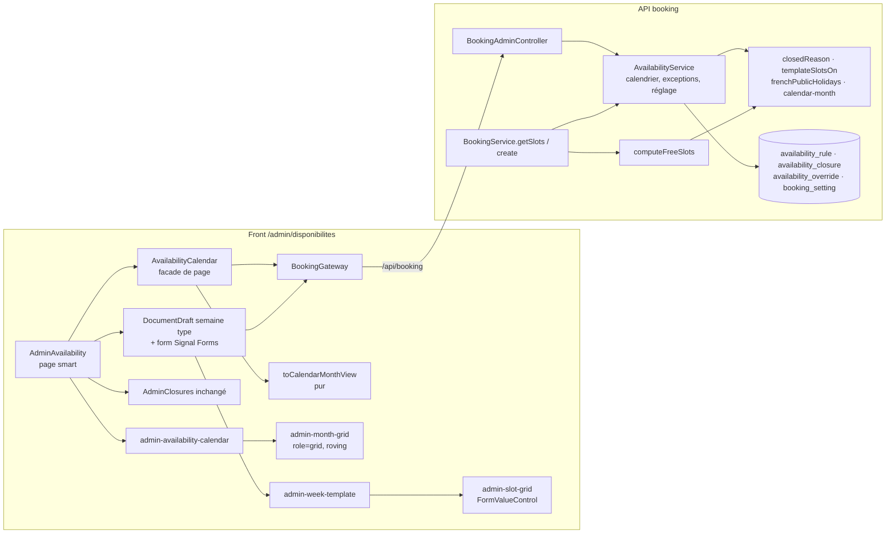

# 025 — Calendrier des disponibilités

## Description

### Objectif

Demande du propriétaire (2026-10-14), après la mise en prod de la spec 024 : « avoir un calendrier
complet et depuis le dashboard activer ou désactiver les journées choisis, pouvoir désactiver ou activer
tous les jours férié, choisir les créneau horaires que j'aurai choisi de mettre ».

L'écran `/admin/disponibilites` de la spec 024 (plages début/fin par jour de la semaine, fermetures par
période) devient un écran en deux blocs : une **semaine type en créneaux cliquables** et un **calendrier
du mois** sur lequel le propriétaire agit directement.

### Arbitrages du propriétaire (2026-10-14)

Maquette présentée en conversation et validée dans son principe (« semaine type + calendrier
d'exceptions ») :

1. **Semaine type en créneaux** : pour chaque jour de la semaine, une grille de pastilles de 30 min de
   **08:00 à 21:00** ; le propriétaire allume celles qu'il propose ; résumé lisible des plages obtenues.
2. **Calendrier du mois** : un clic sur un jour le **ferme**, un second clic le **rouvre**.
3. **Pas d'horaires spécifiques par date** dans cette version : un jour est ouvert (créneaux de la semaine
   type) ou fermé.
4. **Jours fériés français fermés par défaut** (interrupteur « Fermer les jours fériés », activé), avec
   **réouverture d'un férié au cas par cas** d'un clic.
5. **Jours passés affichés en rouge barré** (non cliquables).

### Exigence (contrat)

1. Les créneaux restent **calculés par le serveur seul** (exigence 2 de la spec 024) : semaine type, puis
   exceptions par date, puis jours fériés, puis fermetures par période, puis rendez-vous et règles de
   `BOOKING_POLICY` inchangées (préavis 24 h, horizon 21 j, battement 15 min, 2 par email).
2. Ordre de priorité d'un jour : passé → fermé ; fermeture par période → fermé ; exception « fermé » →
   fermé ; exception « ouvert » (réouverture d'un férié) → ouvert ; férié et interrupteur actif → fermé ;
   sinon → créneaux de la semaine type du jour.
3. Jours fériés de France métropolitaine calculés côté serveur (fixes + Pâques, lundi de Pâques,
   Ascension, lundi de Pentecôte), testés sur plusieurs années.
4. Les plages déjà saisies avec l'écran de la spec 024 sont reprises sans perte (même modèle de règles
   hebdomadaires) ; les fermetures par période existantes restent valables.
5. Aucune régression de la page publique `/rendez-vous` ni de la garantie anti double réservation.
6. WCAG AA : grille de pastilles en boutons à état (`aria-pressed`), calendrier utilisable au clavier
   (flèches, Entrée/Espace), états jamais portés par la seule couleur (libellé + barré pour le passé),
   zéro violation au job `a11y`.

### Constat (2026-10-14, front `master` `47c8c7b`, API en prod depuis #55)

1. `availability_rule` (jour ISO, minute de début et de fin) et `availability_closure` (période de dates,
   motif) existent ; `computeFreeSlots` ne connaît ni exception par date ni jour férié.
2. L'écran `/admin/disponibilites` (F5b, spec 024) saisit des plages par menus début/fin au pas de 30 min.
3. Aucune plage n'est encore saisie en prod (`/api/booking/slots` renvoie une liste vide).

### Hors périmètre

- Horaires spécifiques pour une date donnée (arbitrage 3).
- Synchronisation d'un agenda externe.
- Jours fériés d'Alsace-Moselle et d'outre-mer.

## Plan technique

### Décision d'architecture (ADR-0027)

Le serveur reste la seule source de l'état d'un jour. Une fonction pure `closedReason(date, ctx)` applique
l'ordre de l'exigence 2 ; `computeFreeSlots` et le calendrier de l'admin l'appellent tous les deux, et les
créneaux d'un jour viennent d'une seule fonction `templateSlotsOn(date, rules)` extraite de
`computeFreeSlots`. L'admin lit un **mois résolu** (`GET availability/calendar`) et n'applique aucune
priorité. Exception par date dans `availability_override (day date pk, kind 'open'|'closed')`, écrite en
**état souhaité** (`PUT availability/days/:date { open }`) : le serveur supprime l'exception si l'état voulu
est celui qu'aurait le jour sans elle, l'insère ou la remplace sinon. Réglage `close_public_holidays` dans
une table singleton `booking_setting` (modèle `profile_content`, défaut vrai porté par une seule constante).
Fériés de métropole (L3133-1 : 8 fixes, lundi de Pâques, Ascension, lundi de Pentecôte) calculés par
l'API, Pâques par Meeus/Jones/Butcher, sans dépendance. Écritures du calendrier **non optimistes**. Cf.
ADR-0027.

**Écarts au brief, justifiés** :

1. **Pas de `DELETE` d'exception** : l'écriture en état souhaité couvre fermer, rouvrir et « revenir à la
   règle » ; le front n'a pas à savoir si un jour est férié pour choisir entre supprimer et créer.
2. **Pas de `GET` du réglage** : `closePublicHolidays` est rendu par `GET availability/calendar`, que
   l'écran lit de toute façon.
3. **`@ArrayMaxSize` des plages relevé de 50 à 168** : une grille de 26 pastilles produit jusqu'à 13 plages
   par jour en alternant (7 × 13 = 91 > 50, refus 400) ; 168 = 7 × 24, maximum théorique au pas de 30 min
   sur 24 h, la reprise des plages hors grille comprise.
4. **Fériés lus dans L3133-1** (Pâques et Pentecôte dimanche non compris) : question ouverte en fin de plan.

### Architecture



**API**
- `closedReason(date, ctx)` (`resolve-day.ts`), ordre exact : `date < ctx.today` → `'past'` ; date dans une
  fermeture `[startsOn, endsOn]` → `'closed-period'` ; exception `closed` → `'closed'` ; exception `open` →
  `null` ; férié et `ctx.closePublicHolidays` → `'holiday'` ; sinon `null`. `ctx = { today, closures,
  overrides: ReadonlyMap<string, 'open' | 'closed'>, closePublicHolidays }`. Le férié est lu dans
  `publicHolidayName(date)` (table annuelle mémoïsée par année dans le module).
- `templateSlotsOn(date, rules): readonly Date[]` : la boucle intérieure actuelle de `computeFreeSlots`
  (plages du jour ISO, pas de 30, `m + 30 <= endMinute`, `parisWallTimeToUtc` non nul), sans préavis,
  horizon ni rendez-vous. `computeFreeSlots` devient : pour chaque date de la fenêtre, `closedReason` non nul
  → jour sauté ; sinon `templateSlotsOn` puis filtres préavis / horizon / battement inchangés.
- `toCalendarDay(date, ctx, rules, closures): CalendarDay` : `state = closedReason ?? (slotCount > 0 ?
  'open' : 'empty')`, `holiday` = nom du férié **quel que soit l'état** (un férié rouvert ou un férié sous
  interrupteur inactif est `open` avec `holiday` renseigné), `slotCount = templateSlotsOn(...).length`,
  `closure` = la fermeture qui couvre le jour (première par `startsOn`) ou `null`.
- `AvailabilityService` (même service, même `DbExecutor` optionnel que `listRules`) gagne :
  `listOverrides(executor, from, to)`, `readClosePublicHolidays(executor)`, `getCalendar(month?)`,
  `setDayOpen(date, open)`, `setClosePublicHolidays(value)`.
- `BookingService.freeSlots(executor, now)` lit en plus, sur le même `executor` (donc **sous le verrou** à la
  création), les exceptions de `toParisDate(now)` à `toParisDate(now + 21 j)` et le réglage, puis passe
  `overrides` et `closePublicHolidays` à `computeFreeSlots`. Aucune autre ligne de la création ne change :
  un créneau d'un jour fermé est absent du calcul, donc 422 `slot_unavailable` (ou 409 si un rendez-vous le
  touche), comportement de la spec 024.
- `nextDate` (privé à `compute-free-slots.ts`) devient `addDays(date, days)` exporté par `paris-time.ts`,
  réutilisé par le calendrier et les mois.

**Front**
- Écran en trois sections sous le `h1` : « Semaine type » (brouillon + barre d'enregistrement),
  « Calendrier » (écritures immédiates), « Fermetures » (`AdminClosures` **inchangé**). Landmarks : la page
  est dans le shell admin, aucune section n'émet `header`/`main`/`footer` ; un seul `h1`
  (`AdminPageHeader`), trois `h2`.
- **Fermetures par période** : on garde le formulaire de période et sa liste. Le calendrier les **affiche**
  (état `closed-period`, non cliquable, nom accessible qui cite la période et renvoie à la section
  Fermetures). Ajouter ou supprimer une fermeture recharge le mois affiché. Pas de sélection de plage dans le
  calendrier (minimal, aucun nouveau contrat).
- **Frontière presenter / composants (feature view-heavy)** :
  - `AvailabilityCalendar` (`pages/admin-availability/availability-calendar.ts`) : **facade** instance-scopée
    par `providers: [AvailabilityCalendar]` de la page, sans suffixe `Store`. Possède le mois demandé, la
    ressource du mois, les jours en cours d'écriture, la date à focaliser, l'annonce de statut, l'écriture du
    réglage ; coordonne l'I/O et les toasts. Aucune dépendance DOM.
  - `toCalendarMonthView(month)` (`application/calendar-month-view.ts`, fonction pure) : semaines de lundi à
    dimanche avec cases vides, libellé du mois, nom accessible de chaque jour, libellé court, icône,
    `actionable`. Seule dérivation non triviale ; testée sans TestBed.
  - `nextCalendarDate(date, key)` (`application/calendar-keyboard.ts`, pure) : déplacement clavier.
  - Composants de présentation : `admin-availability-calendar` (section : en-tête, interrupteur,
    navigation, légende, statut, états de chargement), `admin-month-grid` (tableau `role="grid"`, focus
    itinérant, seule glue DOM), `admin-week-template` (choix du jour, grille, résumé), `admin-slot-grid`
    (pastilles d'un jour).
- **Calendrier : APG « grid » complet**, pas une liste de boutons. Justification : le propriétaire demande
  flèches, Entrée/Espace (exigence 6) et la maquette est un mois en 7 colonnes ; un `role="grid"` n'est posé
  que parce que la navigation qu'il promet est implémentée entièrement (flèches, Home/End, PageUp/PageDown).
  Une liste de 28 à 31 boutons sans flèches imposerait autant d'arrêts de tabulation ; un tableau de
  boutons sans `role="grid"` mentirait sur la structure clavier. Structure :
  `<table role="grid" aria-labelledby="admin-calendar-month-label" aria-describedby="admin-calendar-help">`,
  `<thead>` de 7 `<th scope="col" abbr="lundi">lun.</th>`, `<tr>` par semaine, `<td role="gridcell">`
  contenant **un** `<button type="button">` (case vide : `<td role="gridcell">` sans bouton). Focus
  itinérant : un seul bouton à `tabindex="0"` (date active), les autres à `-1`. Jours passés et jours sous
  fermeture : `aria-disabled="true"` (**pas** `disabled`, pour que les flèches les traversent), activation
  ignorée. Aujourd'hui : `aria-current="date"`.
  - Clavier sur un bouton du tableau : `ArrowLeft/Right` ±1 jour, `ArrowUp/Down` ±7, `Home`/`End` lundi /
    dimanche de la semaine, `PageUp`/`PageDown` même jour du mois précédent / suivant (borné au dernier jour
    du mois), `Enter`/`Space` = clic natif du bouton. Cible dans le mois affiché → focus déplacé ; cible
    dans le mois précédent ou suivant **permis** (`previousMonth`/`nextMonth` non nuls) → `monthRequested`
    avec la date cible, focus posé sur elle après chargement ; sinon touche sans effet (`preventDefault`
    quand même pour les flèches, pour ne pas faire défiler la page).
  - Focus après rendu : `afterRenderEffect({ write })` lit une demande de focus (signal interne) et appelle
    `focus()` sur le bouton de la date ; jamais `setTimeout`.
  - Nom accessible de chaque bouton, construit par `describeDay(day)` (pur, partagé avec l'annonce) :
    « jeudi 12 novembre 2026, ouvert, 4 créneaux » ; « …, fermé » ; « mercredi 11 novembre 2026, férié
    (Armistice 1918), fermé » ; « …, férié (Armistice 1918) rouvert, 4 créneaux » ; « …, fermé par la
    période du jeudi 24 décembre 2026 au vendredi 1er janvier 2027 (Congés) » ; « …, aucun créneau » ;
    « …, passé ». Dates par `formatLongDate` existant (« 1er »).
  - Aide (`admin-calendar-help`, visible, sous le tableau) : « Cliquez un jour, ou Entrée et Espace, pour le
    fermer ou le rouvrir. Flèches : jour voisin ; Page précédente et Page suivante : mois voisin. »
  - Annonce (`admin-calendar-status`, `role="status"`) après chaque écriture réussie : `describeDay` du jour
    rendu par le serveur, préfixé du verbe (« Fermé : jeudi 12 novembre 2026. », « Rouvert : mercredi
    11 novembre 2026, 4 créneaux. ») ; après l'interrupteur : « Jours fériés fermés. » / « Jours fériés
    ouverts selon la semaine type. ».
  - Libellé du mois (`admin-calendar-month-label`, « Novembre 2026 ») en `aria-live="polite"` : la navigation
    par boutons annonce le mois chargé.
- **Traitement visuel des états** (le rouge est réservé au passé). Ratios calculés le 2026-10-14 par
  conversion OKLCH → sRGB (Ottosson) puis luminance relative WCAG 2.x, script jetable, sur les valeurs de
  `src/styles.css` ; teintes à `color-mix` posées sur `--theme-background` ; à re-mesurer au rendu par axe
  (F5) :

  | État | Visible (≥ `sm`) | Porteurs non colorés | Couleur | Texte / fond clair · sombre |
  |---|---|---|---|---|
  | `past` | numéro barré, aucun libellé | `line-through`, `aria-disabled`, légende « Passé » | `text-status-error` | 5,89 · 7,20 |
  | `closed` (à la main) | icône `lock` + « Fermé » | icône, libellé, bord **pointillé** `border-field` (3,04 · 3,41 sur le fond) | texte `foreground` sur `foreground` 8 % | 12,06 · 16,10 |
  | `holiday` (fermé) | icône `flag` + « Férié » | icône, libellé | `text-muted` | 7,21 · 7,51 |
  | `closed-period` | icône `calendar` + « Période » | icône, libellé, `aria-disabled` | `text-status-warn` sur warn 10 % | 4,84 · 8,03 |
  | `open` | nombre + « créneaux » | nombre écrit | `text-primary` sur primary 10 % | 6,81 · 7,28 |
  | `open` + férié (rouvert) | idem + petite icône `flag` | icône | idem | idem |
  | `empty` | « — » | tiret, « aucun créneau » dans le nom | `text-muted` | 7,21 · 7,51 |

  Sous `sm` (375 px, 7 colonnes d'environ 44 px), le libellé court passe en `sr-only` : restent numéro,
  icône ou nombre (cible ≥ 44 × 44 px). Légende (`admin-calendar-legend`, `<ul role="list">`) : les six
  états avec la même pastille, la même icône et le libellé. Icônes `lock`, `flag`, `calendar`,
  `chevron-left`, `chevron-right`, `check` déjà présentes au sprite : `pnpm icons:check` reste vert, aucun
  `icons:build`.
- **Semaine type** :
  - Sélecteur du jour : `app-filter-group` existant (`aria-pressed`, label « Jour de la semaine »), options
    `{ value: clé du jour, label: 'Lundi', count: nombre de créneaux du jour }`.
  - `admin-slot-grid` implémente `FormValueControl<readonly number[]>` (précédent `AdminTagsSelector`) :
    `admin-week-template` reçoit `slots: FieldTree<WeeklySlotsDraft>` (patron `admin-pair-rows`) et lie
    `[formField]="slots()[selectedKey()]"`. 26 boutons `aria-pressed` de 08:00 à 20:30, texte
    visible « 08:00 » complété en `sr-only` « à 08:30 », groupe `role="group"` nommé par un titre « Créneaux
    du mardi ». Allumé : fond `primary-bg`, texte blanc (5,50:1), icône `check` ; éteint : bord
    `border-field` (3,04 · 3,41), texte `foreground`. Arrêts de tabulation naturels (26 boutons), sans
    navigation fléchée.
  - Résumé (`admin-week-summary`, `<dl>`) des sept jours : « Mardi : 18:00–20:00 », plusieurs plages
    séparées par une virgule, « Mardi : aucun créneau ». Calculé sur **toutes** les demi-heures du jour, y
    compris hors grille.
  - **Reprise sans perte (exigence 4)** : le brouillon garde les 48 demi-heures de chaque jour ; la grille
    n'en montre que 26 et n'écrit que celles-là. Des plages saisies hors 08:00–21:00 avec l'écran 024 sont
    conservées et signalées (`admin-week-hidden-ranges`) : « Conservé hors de la grille : lundi 07:00–08:00. ».
    Des plages adjacentes (09:00–10:00 et 10:00–11:00) ressortent fusionnées (09:00–11:00) : mêmes créneaux,
    puisque créneau = pas = 30 min.
  - `form(this.draft.value, { submission: { action } })` sans schéma (aucune saisie invalide possible),
    `<form id="availability-form" [formRoot]>` pour la barre d'enregistrement existante.

### Contrat d'API (préfixe `/api/booking`, admin, `JwtAuthGuard` de classe existant)

Corps d'erreur : `HttpExceptionFilter` existant, code métier dans `error`. Dates `YYYY-MM-DD` et mois
`YYYY-MM` de Paris. Routes de la spec 024 **inchangées** (seul `@ArrayMaxSize` de `PUT availability/rules`
passe à 168).

| Méthode, route | Corps / query | Réponse |
|---|---|---|
| `GET availability/calendar` | `month?` (`CalendarQueryDto` : `@IsOptional() @Matches(/^\d{4}-(0[1-9]\|1[0-2])$/)`) ; absent → mois de Paris courant | 200 `CalendarMonthResponse` ; 400 validation ; 400 `month_out_of_range` (mois avant le mois courant ou après courant + 12) |
| `PUT availability/days/:date` | param `date` (`DayParamDto` : `@Matches(/^\d{4}-\d{2}-\d{2}$/) @IsISO8601({ strict: true })`) ; corps `{ open: boolean }` (`@IsBoolean()`) | 200 `CalendarDay` du jour après écriture ; 400 validation ; 422 `day_in_past` (`date < aujourd'hui`) ; 422 `day_out_of_range` (après le dernier jour du mois courant + 12) ; 409 `day_in_closure` |
| `PUT availability/settings` | `{ closePublicHolidays: boolean }` (`@IsBoolean()`) | 200 `{ closePublicHolidays }` |

```ts
type CalendarDayState = 'past' | 'closed-period' | 'closed' | 'holiday' | 'open' | 'empty';
type CalendarDay = {
  date: string;                       // YYYY-MM-DD
  state: CalendarDayState;
  holiday: string | null;             // « Armistice 1918 », quel que soit l'état
  slotCount: number;                  // templateSlotsOn(date, rules).length, changements d'heure compris
  closure: { startsOn: string; endsOn: string; reason: string | null } | null; // si closed-period
};
type CalendarMonthResponse = {
  month: string;                      // YYYY-MM effectivement rendu
  today: string;                      // date de Paris du serveur
  previousMonth: string | null;       // null au mois courant
  nextMonth: string | null;           // null à courant + 12
  closePublicHolidays: boolean;
  days: CalendarDay[];                // tous les jours du mois, croissants
};
```

`setDayOpen(date, open)`, dans une transaction : contrôles passé / borne / fermeture (dans cet ordre) ;
`base = estFérié(date) && closePublicHolidays ? fermé : ouvert` ; `open === base` → `delete` de l'exception
(sans erreur si absente) ; sinon `insert … on conflict (day) do update set kind = excluded.kind` ; relecture et
`toCalendarDay`. Constante `CALENDAR_MONTHS_AHEAD = 12` dans `calendar-month.ts` (navigation d'admin, pas
une règle de réservation : `BOOKING_POLICY` et son test golden inchangés). Swagger : `@ApiOperation`,
`@ApiResponse` pour 400/409/422 comme les routes existantes.

### Modèles de données

**API — `src/database/schema/booking.ts`** (le barrel fait déjà `...booking` dans `schema` : rien à y
ajouter) :

- `bookingSettings` (`booking_setting`) : `id text pk default 'main'`, `close_public_holidays boolean not
  null default DEFAULT_CLOSE_PUBLIC_HOLIDAYS`, `updated_at timestamptz not null default now()` ; check
  `booking_setting_single_row` (`id = 'main'`). `BOOKING_SETTING_ROW_ID = 'main'` et
  `DEFAULT_CLOSE_PUBLIC_HOLIDAYS = true` exportés du schéma (source unique, relue par le service quand la
  ligne n'existe pas ; écriture `insert … on conflict (id) do update`).
- `availabilityOverrides` (`availability_override`) : `day date pk` (`mode: 'string'`), `kind text not null`
  (`enum: ['open', 'closed']`), `created_at timestamptz not null default now()` ; check
  `availability_override_kind_check` (`kind in ('open', 'closed')`).
- Types `BookingSetting`, `AvailabilityOverride` (`$inferSelect`).

**Migrations** (générées, `pnpm db:generate --name …`, relues ; aucune donnée existante touchée, aucune
reprise : `availability_rule` et `availability_closure` ne changent pas) :

```sql
-- drizzle/0024_booking_setting.sql (tranche A1)
CREATE TABLE "booking_setting" (
  "id" text PRIMARY KEY DEFAULT 'main' NOT NULL,
  "close_public_holidays" boolean DEFAULT true NOT NULL,
  "updated_at" timestamp with time zone DEFAULT now() NOT NULL,
  CONSTRAINT "booking_setting_single_row" CHECK ("booking_setting"."id" = 'main')
);
-- drizzle/0025_availability_override.sql (tranche A2)
CREATE TABLE "availability_override" (
  "day" date PRIMARY KEY NOT NULL,
  "kind" text NOT NULL,
  "created_at" timestamp with time zone DEFAULT now() NOT NULL,
  CONSTRAINT "availability_override_kind_check" CHECK ("availability_override"."kind" in ('open', 'closed'))
);
```

**API — logique pure** :

- `french-public-holidays.ts` : `easterSunday(year): string` (Meeus/Jones/Butcher, entiers, `Date.UTC` pour
  le seul formatage) ; `frenchPublicHolidays(year): ReadonlyMap<string, string>` : `01-01` Jour de l'an,
  lundi de Pâques (+1), `05-01` Fête du Travail, `05-08` Victoire 1945, Ascension (+39), lundi de Pentecôte
  (+50), `07-14` Fête nationale, `08-15` Assomption, `11-01` Toussaint, `11-11` Armistice 1918, `12-25`
  Noël. Deux fériés le même jour (2008-05-01 : Fête du Travail et Ascension) : `Fête du Travail et
  Ascension` (fixe d'abord). `publicHolidayName(date): string | null`.
- `calendar-month.ts` : `currentMonth(today)`, `addMonths(month, n)`, `daysOfMonth(month): readonly
  string[]`, `monthOf(date)`, `lastAllowedDay(today)`, `CALENDAR_MONTHS_AHEAD`.
- `resolve-day.ts` : `DayOverrideKind`, `DayClosedReason`, `DayContext`, `closedReason`, `templateSlotsOn`,
  `toCalendarDay`.
- `compute-free-slots.ts` : `FreeSlotsInput` gagne `overrides: ReadonlyMap<string, DayOverrideKind>` et
  `closePublicHolidays: boolean` (**obligatoires** : un oubli doit échouer à la compilation, pas fermer ou
  ouvrir les fériés en silence).

**Front — `features/booking/domain/models/booking-admin.model.ts`** (`type` immuables) :

```ts
type CalendarDayState = 'past' | 'closed-period' | 'closed' | 'holiday' | 'open' | 'empty';
type CalendarDay = { readonly date: string; readonly state: CalendarDayState;
  readonly holiday: string | null; readonly slotCount: number;
  readonly closure: { readonly startsOn: string; readonly endsOn: string; readonly reason: string | null } | null };
type CalendarMonth = { readonly month: string; readonly today: string;
  readonly previousMonth: string | null; readonly nextMonth: string | null;
  readonly closePublicHolidays: boolean; readonly days: readonly CalendarDay[] };
type BookingAdminFailure = 'overlap' | 'invalid' | 'not-found' | 'too-late' | 'day-past'
  | 'day-in-closure' | 'network' | 'server';
```

`toAdminFailure` (gateway) : `409` + `day_in_closure` → `day-in-closure` (sinon `too-late`, inchangé) ;
`422` + `day_in_past` → `day-past` ; autre `422` → `invalid` ; `400` inchangé (`month_out_of_range` →
`invalid`). DTO bruts dans `booking-api.types.ts`, adapters purs `toCalendarMonth` / `toCalendarDay`
(copie champ par champ, `state` et `holiday` repris tels quels). Validation runtime des réponses non
vérifiée (profil).

**Front — `features/admin/application/availability-draft.ts`** (réécrit ; `AvailabilityRangeRow`,
`findOverlappedRange`, `toMinuteOfDay` supprimés, plus aucun consommateur) :

```ts
type WeeklySlotsDraft = Record<AvailabilityWeekdayKey, readonly number[]>; // demi-heures 0..47 triées
const SLOT_GRID: readonly number[];          // 16..41 : 08:00 → 20:30, dernier créneau fini à 21:00
function toWeeklySlotsDraft(rules: readonly AvailabilityRule[] | null): WeeklySlotsDraft;
function toAvailabilityRules(draft: WeeklySlotsDraft): AvailabilityRule[]; // suites contiguës → plages
function toggleSlot(slots: readonly number[], index: number): readonly number[];
function summarizeSlots(slots: readonly number[]): string;  // « 18:00–20:00, 21:00–22:00 » | ''
function hiddenRanges(draft: WeeklySlotsDraft): readonly { readonly label: string; readonly ranges: string }[];
```

`AVAILABILITY_WEEKDAYS` et `toTimeOfDay` gardés. Un changement par jour modifié (`countChangedFields` sur
des tableaux de nombres, sans symbole Signal Forms).

**Front — `features/admin/application/calendar-month-view.ts`** :

```ts
type CalendarCell = { readonly date: string; readonly dayOfMonth: number; readonly state: CalendarDayState;
  readonly today: boolean; readonly actionable: boolean; readonly label: string;   // describeDay
  readonly shortLabel: string; readonly icon: 'lock' | 'flag' | 'calendar' | null; readonly reopenedHoliday: boolean };
type CalendarMonthView = { readonly month: string; readonly label: string;         // « Novembre 2026 »
  readonly previousMonth: string | null; readonly nextMonth: string | null;
  readonly closePublicHolidays: boolean; readonly weeks: readonly (readonly (CalendarCell | null)[])[] };
function toCalendarMonthView(month: CalendarMonth): CalendarMonthView;
function describeDay(day: CalendarDay): string;
function wantsOpen(day: CalendarDay): boolean; // closed | holiday → true ; open | empty → false
```

`actionable = state !== 'past' && state !== 'closed-period'`. `wantsOpen` traduit un clic en état souhaité :
ce n'est pas la priorité, c'est l'inverse de l'état affiché. `paris-format.ts` gagne
`formatMonthLabel(month)` (« novembre 2026 », capitalisé par `capitalize` existant).

### Fichiers à créer / modifier

**API (`/home/j-ned/Projects/Portfolio/nest-portfolio-app`, branche `feat/booking-calendar` depuis `master`
`c20acdb`)**

| Fichier | Rôle |
|---|---|
| `src/database/schema/booking.ts` | `bookingSettings`, `availabilityOverrides`, constantes, types |
| `drizzle/0024_booking_setting.sql`, `drizzle/0025_availability_override.sql`, `drizzle/meta/*_snapshot.json`, `_journal.json` | générés |
| `src/booking/french-public-holidays.ts` | Pâques, fériés de l'année, nom d'un férié |
| `src/booking/calendar-month.ts` | mois de Paris : courant, ±n, jours, bornes, `CALENDAR_MONTHS_AHEAD` |
| `src/booking/resolve-day.ts` | `closedReason`, `templateSlotsOn`, `toCalendarDay` |
| `src/booking/paris-time.ts` | `addDays` exporté |
| `src/booking/compute-free-slots.ts` | entrées `overrides`, `closePublicHolidays` ; utilise `closedReason` et `templateSlotsOn` |
| `src/booking/availability.service.ts` | exceptions, réglage, calendrier, `setDayOpen` |
| `src/booking/booking.service.ts` | `freeSlots` lit exceptions et réglage sur le même `executor` |
| `src/booking/booking-admin.controller.ts` | trois routes |
| `src/booking/dto/calendar-query.dto.ts`, `day-param.dto.ts`, `set-day-open.dto.ts`, `update-booking-settings.dto.ts` | DTO class-validator + Swagger |
| `src/booking/dto/replace-availability-rules.dto.ts` | `@ArrayMaxSize(168)`, `maxItems: 168` |
| `src/booking/booking-test-builders.ts` | `anAvailabilityOverride` |
| `src/booking/*.spec.ts`, `booking.integration.spec.ts` | tests (rôle de `qa`) |
| `README.md` | trois routes, réglage, fériés |

**Front (`/home/j-ned/Projects/Portfolio/ng-portfolio-app`, branche `feat/025-calendrier-disponibilites`)**

| Fichier | Rôle |
|---|---|
| `src/app/features/booking/domain/models/booking-admin.model.ts` | types du calendrier, deux raisons d'échec |
| `src/app/features/booking/domain/gateways/booking.gateway.ts` | `getAvailabilityCalendar(month: string \| null)`, `setDayOpen(date, open)`, `setClosePublicHolidays(value)` |
| `src/app/features/booking/domain/paris-format.ts` | `formatMonthLabel` |
| `src/app/features/booking/infra/booking-api.types.ts`, `booking.adapter.ts`, `http-booking.gateway.ts` | DTO, adapters, trois méthodes (`silentErrors()`), `toAdminFailure` étendu |
| `src/app/features/booking/testing/stub-booking-gateway.ts`, `booking-builders.ts` | trois méthodes doublées ; `aCalendarDay`, `aCalendarMonth`, builders DTO |
| `src/app/features/admin/application/availability-draft.ts` | brouillon en demi-heures (réécrit) |
| `src/app/features/admin/application/calendar-month-view.ts` | vue pure du mois |
| `src/app/features/admin/application/calendar-keyboard.ts` | `nextCalendarDate` |
| `src/app/features/admin/application/components/admin-slot-grid.ts` | pastilles d'un jour (`FormValueControl`) |
| `src/app/features/admin/application/components/admin-week-template.ts` | `section` semaine type : `app-filter-group`, grille, résumé, plages hors grille |
| `src/app/features/admin/application/components/admin-availability-calendar.ts` | `section` calendrier : en-tête, interrupteur, navigation, légende, aide, statut, chargement / erreur |
| `src/app/features/admin/application/components/admin-month-grid.ts` | tableau `role="grid"`, focus itinérant |
| `src/app/features/admin/application/components/admin-availability-rows.ts` | **supprimé** |
| `src/app/features/admin/pages/admin-availability/availability-calendar.ts` | facade du calendrier |
| `src/app/features/admin/pages/admin-availability/availability-messages.ts` | tables de messages d'échec (sorties de la page, 304 LOC signalées en revue 024) |
| `src/app/features/admin/pages/admin-availability/admin-availability.ts` | composition des trois sections ; rechargement du mois après plages ou fermetures |
| `e2e/a11y/scenarios.ts`, `e2e/a11y/booking-states.spec.ts` | repère et états du calendrier ; scénario de chevauchement retiré |
| `ci/api-stub/server.mjs` | trois routes admin |

### Réactivité / état

- **Semaine type** : `DocumentDraft<readonly AvailabilityRule[], WeeklySlotsDraft>` (`toDraft:
  toWeeklySlotsDraft`, une section TOC `admin-availability-weekly`, champs = clés des jours), `canLeave()`,
  `warnBeforeUnload`, dialogue de sortie : inchangés. `slotsForm = form(draft.value, { submission: { action:
  saveRules } })`. Le jour affiché est un `signal` local d'`admin-week-template` (lundi au départ), pas dans le
  brouillon. Enregistrement : `toAvailabilityRules(draft.value())` → `replaceAvailabilityRules` → succès :
  toast, `calendar.reload()` (les nombres de créneaux changent) ; échec : toast, brouillon gardé (patron 024).
- **`AvailabilityCalendar`** (facade ; aucun état partagé hors de l'écran, donc pas de store) :
  - `_month = signal<string | null>(null)` ; `month = rxResource({ params: () => ({ month: _month() }),
    stream: ({ params }) => gateway.getAvailabilityCalendar(params.month) })`.
  - `_shown = linkedSignal` sur la valeur de la ressource qui garde le dernier mois chargé pendant un
    rechargement (le tableau ne disparaît pas ; `aria-busy="true"` sur le tableau pendant le chargement) ;
    `view = computed(() => _shown() && toCalendarMonthView(_shown()))` ; `state = computed(loadState(...))`,
    squelette seulement au premier chargement.
  - `_pending = signal<ReadonlySet<string>>(new Set())` exposé en lecture seule : plusieurs jours peuvent
    être en cours ensemble (écritures indépendantes et idempotentes) ; un second clic sur un jour en cours est
    ignoré. Cellule en cours : `opacity` réduite, aucun changement d'ARIA (le focus reste dessus).
  - `toggleDay(date)` : jour introuvable, non `actionable` ou en cours → rien ; sinon
    `setDayOpen(date, wantsOpen(day))` ; succès → `month.update` qui remplace **ce** jour par la réponse
    (nouvelle référence), annonce ; échec → toast (`availability-messages`), et `day-past` /
    `day-in-closure` → `month.reload()`.
  - `setHolidaysClosed(value)` : `_holidaysSaving` vrai pendant l'appel (interrupteur `aria-disabled`,
    activation ignorée) ; succès → `month.reload()`, annonce ; échec → toast.
  - `goToMonth(month, focusDate)` : `_month.set(month)`, `_focusDate.set(focusDate)` ; la grille focalise
    `focusDate` dès qu'elle est dans le mois rendu, puis la facade l'efface.
  - `_announcement` exposé en lecture seule. Aucune `effect()` d'écriture : toutes les écritures partent
    d'un événement.
- **Interrupteur fériés** : `<button appButton variant="outlined" type="button" aria-pressed>` au libellé
  **fixe** « Fermer les jours fériés » (précédent `device-exclusion-toggle`, sans changer le libellé selon
  l'état, conformément à APG « button » à bascule), icône `check` quand actif.
- **`admin-month-grid`** : entrées `view`, `pending`, `focusDate` ; sorties `dayActivated(date)`,
  `monthRequested({ month, focusDate })`. `_activeDate = linkedSignal` (source : `view` + `focusDate`,
  calcul : `focusDate` s'il est dans le mois, sinon aujourd'hui s'il y est, sinon le 1er).
- Immutabilité : modèles `readonly`, `Set` et tableaux remplacés, jamais mutés ; signaux exposés par
  `asReadonly()`.

### Tranches

Commandes. API : `pnpm test -- src/booking; echo $?`, `TZ=Pacific/Kiritimati pnpm test -- src/booking; echo
$?`, puis `pnpm test; echo $?`, `pnpm lint`, `pnpm build`. Intégration sur Postgres jetable :
`docker run --rm -d --name booking-it -e POSTGRES_PASSWORD=it -p 55433:5432 postgres:17-alpine`, puis
`BOOKING_IT_DATABASE_URL=postgres://postgres:it@127.0.0.1:55433/postgres pnpm test -- booking.integration
booking-scheduler.integration; echo $?`, `docker stop booking-it`. Front :
`pnpm test --include='src/app/features/{admin,booking}/**/*.spec.ts'; echo $?` (pnpm 10 : sans `--`), puis
`pnpm test; echo $?`, `pnpm lint`, `pnpm run format:check`, `pnpm run build --configuration production`. Le
code de sortie fait foi.

**API (PR 1, `nest-portfolio-app`)**

- **Tranche A1 — les jours fériés sont fermés sur la page publique** : `french-public-holidays.ts`,
  `addDays`, `resolve-day.ts` (`closedReason` avec `overrides` vide accepté, `templateSlotsOn`), schéma et
  migration `0024_booking_setting`, `readClosePublicHolidays` (constante si ligne absente),
  `computeFreeSlots` étendu, `BookingService.freeSlots` lit le réglage. Vérifiable : unitaires purs (fériés
  multi-années, priorité sans exception, DST) sous `TZ=UTC` et `TZ=Pacific/Kiritimati` ; intégration :
  migration `0024` au journal, `readClosePublicHolidays()` rend `true` sans ligne puis `false` après une
  ligne insérée en SQL direct (l'effet sur les créneaux d'un férié est prouvé en unitaire, horloge simulée :
  l'intégration tourne sur la date réelle) ; `pnpm db:migrate` sur la base jetable.
- **Tranche A2 — un jour se ferme ou se rouvre** : migration `0025_availability_override`,
  `listOverrides`, priorité complète de `closedReason`, `toCalendarDay`, `setDayOpen` (état souhaité,
  422 / 409), `PUT availability/days/:date`, `freeSlots` lit les exceptions sous le même `executor`.
  Vérifiable : unitaires (matrices de priorité et d'état souhaité) ; supertest ; intégration : fermer une
  date ouverte → plus aucun créneau ce jour dans `getSlots` et `create` refusé en 422 `slot_unavailable` ;
  rouvrir → créneaux revenus, **aucune** ligne en base ; réouverture d'un férié → ligne `open`.
- **Tranche A3 — l'admin lit le mois résolu et règle les fériés** : `calendar-month.ts`, `getCalendar`,
  `GET availability/calendar`, `setClosePublicHolidays` (upsert), `PUT availability/settings`,
  `@ArrayMaxSize(168)`, README. Vérifiable : unitaires (mois, bornes, horloge simulée), supertest ;
  intégration : mois courant complet, interrupteur coupé → férié `open` avec `holiday` renseigné et créneaux
  publics revenus ; `node dist/main.js` : trois routes mappées, 401 sans session.

**Front (PR 2, après déploiement de l'API — CLAUDE.md item 10)**

- **Tranche F1 — la gateway parle le contrat du calendrier** : modèles, trois méthodes abstraites,
  DTO, adapters, `HttpBookingGateway`, `toAdminFailure` étendu, stub et builders. Vérifiable :
  `HttpTestingController` (URL, verbe, corps, `month` absent puis présent, chaque code d'échec).
- **Tranche F2 — la semaine type se règle en pastilles** : `availability-draft.ts` réécrit,
  `admin-slot-grid`, `admin-week-template`, section « Semaine type » de la page (brouillon, barre,
  sortie), suppression d'`admin-availability-rows`, `availability-messages.ts`. Le calendrier n'existe pas
  encore : la page garde Semaine type et Fermetures. Vérifiable : specs de la page et purs du brouillon.
- **Tranche F3 — le calendrier du mois s'affiche et se parcourt au clavier** : `calendar-month-view.ts`,
  `calendar-keyboard.ts`, `formatMonthLabel`, facade (lecture et navigation seulement),
  `admin-availability-calendar`, `admin-month-grid`, légende, aide, états chargement / erreur / Réessayer.
  Activer un jour ne fait encore rien. Vérifiable : purs ; specs composant (rendu des états, noms,
  `aria-current`, `aria-disabled`, focus itinérant, PageDown charge le mois suivant et focalise le jour).
- **Tranche F4 — un clic ferme ou rouvre un jour, l'interrupteur ferme les fériés** : `toggleDay`,
  `setHolidaysClosed`, jours en cours, annonces, toasts, rechargement après plages enregistrées et après
  ajout / suppression d'une fermeture. Vérifiable : specs page (un `PUT` par clic, cellule remplacée par la
  réponse, double clic → une requête, 409 / 422 → rechargement, focus conservé).
- **Tranche F5 — zéro violation axe sur le nouvel écran** : doublure, scénarios (cf. Consignes). Vérifiable :
  `docker build -t ng-portfolio-app:a11y . && ci/a11y-stack.sh up && pnpm a11y; echo $?`, puis
  `ci/a11y-stack.sh down`. Tranche d'audit, verte d'emblée attendue (exception actée en 024).

### Consignes pour `qa`

- **Pur sans TestBed ni Nest** : `french-public-holidays`, `calendar-month`, `resolve-day`,
  `compute-free-slots`, `availability-draft`, `calendar-month-view`, `calendar-keyboard`, `paris-format`.
- **Fériés, `it.each`** (contrôlés sous Node le 2026-10-14) — dates mobiles :

  | Année | Pâques (non férié) | Lundi de Pâques | Ascension | Lundi de Pentecôte |
  |---|---|---|---|---|
  | 2026 | 04-05 | 04-06 | 05-14 | 05-25 |
  | 2027 | 03-28 | 03-29 | 05-06 | 05-17 |
  | 2028 | 04-16 | 04-17 | 05-25 | 06-05 |
  | 2029 | 04-01 | 04-02 | 05-10 | 05-21 |
  | 2030 | 04-21 | 04-22 | 05-30 | 06-10 |

  `easterSunday` aux bornes : 2008 → `2008-03-23`, 2019 → `2019-04-21`, 2038 → `2038-04-25`, 2285 →
  `2285-03-22`. Chaque année 2026-2030 : exactement 11 fériés, les 8 fixes présents. Non fériés : Pâques
  et Pentecôte dimanche, 2026-12-26, 2027-11-02. Collision 2008-05-01 → un seul férié, nom « Fête du
  Travail et Ascension ».
- **Priorité (`closedReason`), `it.each`**, `today = 2026-11-10` :

  | Date | Fermeture | Exception | Férié | Interrupteur | Attendu |
  |---|---|---|---|---|---|
  | 2026-11-09 | oui | `closed` | non | actif | `past` |
  | 2026-11-11 | oui | `open` | oui | actif | `closed-period` |
  | 2026-11-11 | non | `closed` | oui | inactif | `closed` |
  | 2026-11-12 | non | `closed` | non | actif | `closed` |
  | 2026-11-11 | non | `open` | oui | actif | `null` |
  | 2026-11-11 | non | — | oui | actif | `holiday` |
  | 2026-11-11 | non | — | oui | inactif | `null` |
  | 2026-11-12 | non | `open` | non | actif | `null` |
  | 2026-11-10 | non | — | non | actif | `null` (aujourd'hui n'est pas passé) |

  `today` dérivé de `now` à Paris : `2026-10-25T22:30:00Z` → `2026-10-25` ; `2026-10-25T23:30:00Z` →
  `2026-10-26` ; mois courant à `2026-10-31T23:30:00Z` → `2026-11`.
- **État souhaité (`setDayOpen`), `it.each`** (base = férié et interrupteur actif → fermé, sinon ouvert) :
  ordinaire sans ligne + `open: false` → insert `closed` ; ordinaire `closed` + `open: true` → delete ;
  ordinaire sans ligne + `open: true` → aucune écriture d'insertion ; férié actif sans ligne + `true` →
  insert `open` ; férié actif `open` + `false` → delete ; férié actif `closed` + `true` → `kind` remplacé
  par `open` ; férié inactif sans ligne + `false` → insert `closed`. Refus **avant** toute écriture : passé
  → 422 `day_in_past`, au-delà du dernier jour de courant + 12 → 422 `day_out_of_range`, sous fermeture →
  409 `day_in_closure`. Réponse = `CalendarDay` relu.
- **DST** : `templateSlotsOn` avec une plage `0–1440` → 48 le 2026-10-25, 46 le 2027-03-28 (aussi Pâques,
  non férié) ; `slotCount` du calendrier identique. `computeFreeSlots` : les 48 / 46 de la spec 024
  restent vrais avec `overrides` vide et `closePublicHolidays: false`.
- **`computeFreeSlots`** : plage tous les jours, `now = 2026-11-02T08:00:00Z` → aucun créneau le
  2026-11-11 interrupteur actif, présents inactif ; exception `closed` le 2026-11-12 → aucun ; `open` le
  2026-11-11 → présents. **Adaptation mécanique** des appels existants (`compute-free-slots.spec.ts`,
  `booking.service.spec.ts`, intégration) : `overrides: new Map()`, `closePublicHolidays: false`, réglage
  lu à `false` dans les mocks et `booking_setting` posé à `false` (et `availability_override` vidée) dans le
  `beforeEach` d'intégration, **sans** changer une valeur attendue — sans quoi un test qui tombe sur le
  11 novembre (horloge simulée au 2026-11-02, ou `now` réel en intégration) change de sens.
- **Mois (`getCalendar`, `calendar-month`)** : 2027-02 → 28 jours, 2028-02 → 29, 2026-11 → 30 ; `month`
  absent → mois de Paris courant ; mois courant → `previousMonth: null` ; courant + 12 → `nextMonth: null` ;
  courant − 1 et courant + 13 → 400 `month_out_of_range` ; `today` renseigné ; `closure` seulement en
  `closed-period`.
- **Front, brouillon** : lundi 07:00–09:00 → demi-heures 14 à 17, retour à une seule règle `{ 1, 420, 540 }`,
  `hiddenRanges` signale lundi 07:00–08:00 ; 09:00–10:00 + 10:00–11:00 → une règle 09:00–11:00 ; dimanche
  00:00–24:00 → 48 demi-heures → `{ 7, 0, 1440 }` ; `toggleSlot` allume puis éteint (tableau trié, nouvelle
  référence) ; `summarizeSlots([36, 37, 38, 39])` → `18:00–20:00` ; `SLOT_GRID` = 26 demi-heures, première
  08:00, dernière 20:30.
- **Front, vue du mois** : 2026-11 (1er = dimanche) → 6 semaines, 6 cases vides en tête ; 2027-02 (1er =
  lundi) → 4 semaines sans case vide ; `describeDay` pour chaque état (libellés du plan, « 1er ») ;
  `actionable` faux pour `past` et `closed-period` ; `wantsOpen` vrai pour `closed` et `holiday`.
- **Front, clavier `nextCalendarDate`, `it.each`** : ArrowRight 2026-11-30 → 2026-12-01 ; ArrowLeft
  2026-11-01 → 2026-10-31 ; ArrowDown 2026-11-26 → 2026-12-03 ; ArrowUp 2026-11-03 → 2026-10-27 ; Home
  2026-11-12 → 2026-11-09 ; End 2026-11-12 → 2026-11-15 ; PageDown 2027-01-31 → 2027-02-28 ; PageDown
  2028-01-31 → 2028-02-29 ; PageUp 2026-03-31 → 2026-02-28 ; `Tab` → `null`.
- **Front, composants** : un seul `tabindex="0"` dans la grille ; flèches, Home/End, PageUp/PageDown
  (mois borné → sans effet) ; Entrée et Espace = clic ; jour passé / sous fermeture : `aria-disabled`,
  aucun appel ; `aria-current="date"` sur aujourd'hui ; double clic avant réponse → un `PUT` ; échec
  `day-in-closure` → toast et second `GET` ; 26 pastilles `aria-pressed`, une modification par jour,
  allumer puis éteindre → « Aucune modification » ; plages hors grille conservées dans le `PUT`. Zoneless :
  jamais `fakeAsync`, `await fixture.whenStable()` ; horloge non utilisée côté front (le serveur donne
  `today`).
- **`data-testid`** (seuls sélecteurs) : `admin-availability-weekly`, `admin-availability-rules` (le
  `form`), `admin-availability-loading`, `admin-availability-none`, `admin-week-template`, `filter-option`
  (existant), `admin-slot-grid`, `admin-slot-grid-heading`, `admin-slot`, `admin-week-summary`,
  `admin-week-summary-day`, `admin-week-hidden-ranges`, `admin-calendar`, `admin-calendar-heading`,
  `admin-calendar-holidays-toggle`, `admin-calendar-previous`, `admin-calendar-next`,
  `admin-calendar-month-label`, `admin-calendar-grid`, `admin-calendar-day` (avec `data-state` = état, lu
  en assertion, jamais en sélecteur seul), `admin-calendar-legend`, `admin-calendar-help`,
  `admin-calendar-status`, `admin-calendar-loading`, `load-error` (existant) ; fermetures inchangées.
  Testids supprimés : `admin-availability-day`, `admin-availability-day-empty`, `admin-availability-rule*`.
- **a11y (F5)** : doublure — `GET availability/calendar` répartit les états **par jour du mois**, sans
  dépendre de la date réelle (1–4 `past`, 5 aujourd'hui, 8 `holiday` « Armistice 1918 », 9 férié rouvert,
  12–14 `closed-period` « Congés », 16 `closed`, samedis et dimanches `empty`, autres `open` à 4
  créneaux), bornes `previousMonth` / `nextMonth` calculées depuis le mois courant réel ; `PUT
  availability/days/:date` → jour résolu (`open: false` → `closed`, `true` → `open`, `holiday` gardé le 8 ou
  le 9) ; `PUT availability/settings` → corps renvoyé ; routes testées avant le 405. Scénarios, clair et
  sombre : `/admin/disponibilites` (repère `admin-calendar-grid`, aucun squelette ni erreur) ; « pastilles
  allumées » (mardi, deux pastilles, `savebar-state` « 1 modification non enregistrée ») ; « jour fermé à la
  main » (clic d'un jour `open` → `data-state="closed"`, statut non vide). Retirer le scénario « plages qui
  se chevauchent ».

### Risques & inconnues

- **Ordre de déploiement** : API (migrations 0024 et 0025 au démarrage du conteneur) puis front. Un front en
  avance afficherait le calendrier en erreur et refuserait au-delà de 50 plages ; `/rendez-vous` n'est pas
  touché. Dès l'API déployée, les fériés de la fenêtre de 21 jours ferment (défaut vrai) : aucun effet en
  prod aujourd'hui (aucune plage saisie, Constat 3).
- **Intégration API hors de toute CI** (risque déjà ouvert en 024) et dépendante de la date réelle : sans le
  réglage posé à `false` dans le `beforeEach`, un test lancé fin octobre ou début novembre tomberait sur la
  Toussaint ou l'Armistice.
- **Exceptions passées jamais purgées** : quelques lignes par an, sans donnée personnelle ; la purge
  nocturne n'y touche pas (YAGNI, à ajouter si la table grossit).

### Décisions à arbitrer par le propriétaire

> **Arbitré le 2026-10-14 par le propriétaire** : liste légale L3133-1 retenue (dimanches de Pâques et de
> Pentecôte non compris) ; lundi de Pentecôte fermé par défaut comme les autres fériés, rouvrable d'un clic.

1. **Dimanche de Pâques et de Pentecôte** : l'exigence 3 cite « Pâques ». Le plan suit la liste légale
  (L3133-1), où seul le **lundi** de Pâques et le **lundi** de Pentecôte sont fériés ; avec des créneaux le
  dimanche, Pâques et Pentecôte resteraient ouverts sauf clic. Recommandation : liste légale (un clic ferme
  un dimanche si besoin). Alternative : ajouter les deux dimanches à `frenchPublicHolidays`.
2. **Lundi de Pentecôte** (journée de solidarité, souvent travaillée) : fermé par défaut comme les autres
  fériés, réouvrable d'un clic. Recommandation : garder (comportement uniforme de l'interrupteur).

## Plan de test

### Tranche A1 — les jours fériés sont fermés sur la page publique

API `nest-portfolio-app`, branche `feat/booking-calendar`, fichiers sous `src/booking/` (80 tests neufs,
dont 4 d'intégration ; builders partagés `anAvailabilityRule`, `anAvailabilityClosure`, `aBooking`).

Signatures figées par les tests (squelettes sans comportement posés pour que les suites se chargent,
retours neutres `''` / `new Map()` / `null` / `[]` / `false` / date inchangée) :

- `french-public-holidays.ts` : `easterSunday(year: number): string` ; `frenchPublicHolidays(year: number):
  ReadonlyMap<string, string>`, **clés `YYYY-MM-DD` complètes** ; `publicHolidayName(date: string): string | null`.
  Noms : `Jour de l’an` (apostrophe typographique, comme les messages de l'API), `Lundi de Pâques`,
  `Fête du Travail`, `Victoire 1945`, `Ascension`, `Lundi de Pentecôte`, `Fête nationale`, `Assomption`,
  `Toussaint`, `Armistice 1918`, `Noël`.
- `resolve-day.ts` : `DayOverrideKind = 'open' | 'closed'` ; `DayClosedReason = 'past' | 'closed-period' |
  'closed' | 'holiday'` ; `DayContext = { today; closures: Pick<AvailabilityClosure, 'startsOn' | 'endsOn'>[];
  overrides: ReadonlyMap<string, DayOverrideKind>; closePublicHolidays }` ; `closedReason(date, ctx)` ;
  `templateSlotsOn(date, rules): readonly Date[]` (créneaux dans l'ordre des plages fournies).
- `paris-time.ts` : `addDays(date: string, days: number): string` (négatif accepté).
- `compute-free-slots.ts` : `FreeSlotsInput` gagne `overrides` et `closePublicHolidays`, obligatoires.
- `AvailabilityService.readClosePublicHolidays(executor: DbExecutor = this.db): Promise<boolean>` : requête
  `select … from booking_setting where id = 'main' limit 1` (terminateur Drizzle `limit`, précédent
  `ProfileService`), ligne absente → vrai.
- `BookingService.freeSlots` appelle `readClosePublicHolidays(executor)` : `db` pour `getSlots`, `tx` après
  le verrou pour `create`.

| Fichier | Tests | Scénario | Assertions clés |
|---|---|---|---|
| `french-public-holidays.spec.ts` | 9 | `easterSunday` 2008, 2019, 2026-2030, 2038, 2285 | date exacte |
| | 1 | 2026 complet | `toEqual` de la `Map` des 11 fériés nommés |
| | 5 | 2026 à 2030 | `size` 11, trois mobiles nommés aux dates de la table, 8 fixes nommés |
| | 1 | 2008, Ascension le 1er mai | `size` 10, « Fête du Travail et Ascension » |
| | 5 | `publicHolidayName` sur des fériés | nom exact |
| | 5 | Pâques, Pentecôte (dimanches), 2026-12-26, 2027-11-02, 2026-12-31 | `null` |
| | 1 | années demandées dans le désordre (mémoïsation) | 2029-04-02 et 2026-04-06 fériés, 2026-04-02 et 2029-04-06 non |
| `paris-time.spec.ts` | 11 | `addDays` : fin de mois, d'année, 29 février, jours de bascule, +50, −1, 0 | date exacte |
| `resolve-day.spec.ts` | 8 | `closedReason`, `today = 2026-11-10`, sans exception : lignes de la table des consignes sans colonne Exception, plus hier sans fermeture et aujourd'hui sous fermeture | `past`, `closed-period`, `holiday`, `null` |
| | 4 | fermeture du 24 au 26/11 | inclusive aux deux bornes, veille et lendemain `null` |
| | 4 | interrupteur actif | dimanche de Pâques `null` ; lundi de Pâques, lundi de Pentecôte, jour de l'an `holiday` |
| | 4 | `templateSlotsOn` plage dimanche 0–1440 | 48 le 2026-10-25, 46 le 2027-03-28, 48 un dimanche ordinaire ; premier, dernier et heure répétée exacts |
| | 5 | `templateSlotsOn` plages | 09:00–10:00 → deux créneaux ; 09:00–09:50 → un ; seules les plages du jour ISO ; un férié et une date de 2030 gardent leurs créneaux (ni férié, ni préavis, ni horizon) ; jour sans plage → `[]` |
| `compute-free-slots.spec.ts` | 2 | plage tous les jours, `now = 2026-11-02T08:00Z`, 11 novembre | interrupteur actif `[]`, inactif 09:00 et 09:30 |
| | 1 | interrupteur actif | 10/11 et 12/11 intacts, 39 créneaux au total (41 sans le férié) |
| | 2 | date de Paris contre date UTC | mercredi 11/11 23:00–24:00 → `[]` ; jeudi 12/11 00:00–01:00 (= 11/11 23:00Z) proposé |
| | 1 | plage 0–1440, interrupteur actif, `now = 2027-03-23` | Pâques 46 créneaux, lundi de Pâques 0, mardi 48 |
| `availability.service.spec.ts` | 3 | `readClosePublicHolidays` : aucune ligne, ligne fausse, ligne vraie | `true`, `false`, `true` |
| | 1 | requête | table `booking_setting` (`getTableName`), paramètre `['main']` |
| | 1 | exécuteur fourni | lu par `tx`, jamais par `db` |
| `booking.service.spec.ts` | 2 | `getSlots`, plages le mercredi, aucune fermeture | réglage actif → jours `2026-11-04`, `2026-11-18` ; inactif → `2026-11-11` en plus |
| | 1 | `getSlots` | réglage lu une fois, sur `db` |
| | 1 | `create` | réglage lu une fois par `tx`, après `pg_advisory_xact_lock` |
| | 2 | `create` le 11/11 10:00 de Paris, aucune fermeture | réglage actif → 422 `slot_unavailable` sans insertion ; inactif → inséré |
| `booking.integration.spec.ts` | 4 | Postgres jetable | `0024_booking_setting` au journal et contrainte `booking_setting_single_row` (`c`) ; seconde ligne refusée (23514) ; `readClosePublicHolidays()` vrai sans ligne, faux après une ligne insérée en SQL direct |

Contrôles verts par construction (lignes de triangulation qui passent contre le squelette et
départageront une implémentation fausse) : 18 — `closedReason` à `null` (6), `publicHolidayName` à `null`
(5), `addDays(…, 0)`, ligne de réglage fausse, interrupteur inactif (`computeFreeSlots`, `getSlots`,
`create`), plage du jeudi 00:00–01:00, jour sans plage (`templateSlotsOn`).

Adaptation mécanique : `compute-free-slots.spec.ts`, `booking.service.spec.ts`,
`booking.integration.spec.ts` — 15 appels de `computeFreeSlots` reçoivent `overrides: new Map()` et
`closePublicHolidays: false` (l'appel sur une ligne est seulement replié par prettier) ; 2 doubles
d'`AvailabilityService` reçoivent `readClosePublicHolidays: jest.fn().mockResolvedValue(false)` ; le
`beforeEach` d'intégration pose `booking_setting` à faux (upsert SQL) ; aucune valeur attendue modifiée.
Le vidage d'`availability_override` dans ce `beforeEach` revient à A2 (table absente en A1).

Scaffold dû au GREEN : `src/booking/booking.service.ts` (appel de `computeFreeSlots` sans `overrides` ni
`closePublicHolidays`, seule erreur `tsc` du module ; les erreurs `tsc` d'`analytics`, `auth` et `profile`
préexistent sur `master`) ; schéma `bookingSettings` + migration `drizzle/0024_booking_setting.sql`.

Tous les tests de cette tranche échouent à ce stade (RED confirmé via `pnpm test` le 2026-10-14 18:49,
62 failed / 1471 total). Détail, code de sortie lu à chaque fois :

```text
$ pnpm test -- src/booking; echo $?
Test Suites: 6 failed, 2 skipped, 9 passed, 15 of 17 total
Tests:       62 failed, 32 skipped, 403 passed, 497 total
1
$ TZ=Pacific/Kiritimati pnpm test -- src/booking; echo $?
Tests:       62 failed, 32 skipped, 403 passed, 497 total
1
$ pnpm test; echo $?
Test Suites: 6 failed, 3 skipped, 59 passed, 65 of 68 total
Tests:       62 failed, 37 skipped, 1372 passed, 1471 total
1
```

Avant la tranche : 1354 passed / 1387 total, sortie 0. Les 1354 restent verts ; les 62 échecs sont tous
des tests neufs, tous des assertions (`toBe`, `toEqual`, `toHaveLength`, `toHaveBeenCalledTimes`) ; le
test 422 du 11/11 échoue sur `toBeInstanceOf` (la création continue jusqu'à l'insertion non simulée).
`jest` transpile sans contrôle de type (sonde du 2026-10-14) : le typage des specs est vérifié par
`npx tsc --noEmit -p tsconfig.json` et `eslint src/booking` (0).

Intégration (`docker.io/postgres:17-alpine` sur 55433) :
`BOOKING_IT_DATABASE_URL=… pnpm test -- booking.integration booking-scheduler.integration; echo $?` →
18 failed / 32 total, sortie 1 : les 18 tests de `booking.integration` tombent dans le `beforeEach` sur
`relation "booking_setting" does not exist` (migration 0024 absente, livrable de la tranche), les 14 du
planificateur passent. Contre-épreuve, table créée à la main avec le SQL du plan (sans entrée au
journal) : 2 failed / 32 total — journal sans `0024_booking_setting`, lecture sans ligne rendue fausse ;
les 28 autres verts, dont les deux tests d'intégration du réglage qui ne dépendent que du DDL.

### Tranche A2 — un jour se ferme ou se rouvre

API `nest-portfolio-app`, branche `feat/booking-calendar` (A1 commitée `bd45c0a`), fichiers sous
`src/booking/` (86 tests neufs, dont 8 d'intégration ; builder neuf `anAvailabilityOverride`).

Signatures figées par les tests (squelettes sans comportement posés : `toCalendarDay` et `setDayOpen`
rendent `{ date, state: 'empty', holiday: null, slotCount: 0, closure: null }`, `listOverrides` une
`Map` vide) :

- `resolve-day.ts` : `CalendarDayState = DayClosedReason | 'open' | 'empty'` ; `CalendarDay` (champs du
  contrat d'API, `readonly`) ; `toCalendarDay(date, ctx: DayContext, rules, closures: Pick<AvailabilityClosure,
  'startsOn' | 'endsOn' | 'reason'>[]): CalendarDay`. `slotCount` = `templateSlotsOn(date, rules).length`
  **quel que soit l'état** (passé et fermé compris) ; `closure` seulement en `closed-period`.
- `AvailabilityService.listOverrides(executor: DbExecutor, from: string, to: string):
  Promise<ReadonlyMap<string, DayOverrideKind>>` : `select … from availability_override where day` entre
  `from` et `to` (paramètres `[from, to]`), terminateur Drizzle `where` (ni `orderBy` ni `limit`).
- `AvailabilityService.setDayOpen(date: string, open: boolean): Promise<CalendarDay>` : une
  `db.transaction` ; lit par `tx` via ses propres méthodes `readClosePublicHolidays(tx)`,
  `listClosures(tx)`, `listRules(tx)` et, **après** l'écriture, `listOverrides(tx, date, date)` ;
  suppression `tx.delete(availability_override).where(day = date)` ; sinon
  `tx.insert(availability_override).values({ day, kind }).onConflictDoUpdate({ target: day, set })`, clés de
  `set` exactement `['kind']`. Refus : `UnprocessableEntityException({ error: 'day_in_past' |
  'day_out_of_range' })`, `ConflictException({ error: 'day_in_closure' })`, dans cet ordre, avant toute
  écriture. Borne : dernier jour du mois de Paris courant + 12 (`2027-11-30` pour aujourd'hui
  `2026-11-10` comme pour `2026-10-31T23:30Z`).
- `BookingService.freeSlots` : `listOverrides(executor, toParisDate(now), toParisDate(now + 21 j))`, une
  fois, `db` pour `getSlots`, `tx` après le verrou pour `create`.
- `BookingAdminController` : `PUT availability/days/:date` sous le `JwtAuthGuard` de classe, 200, corps =
  `CalendarDay` rendu par le service, appel `setDayOpen(date, open)`.

| Fichier | Tests | Scénario | Assertions clés |
|---|---|---|---|
| `resolve-day.spec.ts` | 7 | `closedReason`, lignes de la table des consignes avec colonne Exception, plus une exception qui ne ferme que son jour | `past`, `closed-period`, `closed`, `null` |
| | 9 | `toCalendarDay`, plages du lundi au vendredi 09:00–11:00 : ordinaire, fermé à la main, férié actif, férié rouvert, férié sous interrupteur inactif, férié fermé à la main, hier, aujourd'hui, samedi | `toEqual` du jour complet (`holiday` « Armistice 1918 » quel que soit l'état, `slotCount` 4 ou 0) |
| | 3 | fermeture « Congés » ; deux fermetures qui se recouvrent ; hier sous fermeture | `closure` exacte, première par `startsOn`, `past` sans `closure` |
| | 2 | plage dimanche 0–1440 | `slotCount` 48 le 2026-10-25, 46 le 2027-03-28 |
| `compute-free-slots.spec.ts` | 3 | exception `closed` le 12/11 ; `open` le 11/11 interrupteur actif ; `open` sous fermeture | créneaux du 10 au 12/11 exacts, 37 et 41 au total |
| `availability.service.spec.ts` | 4 | `listOverrides` | `Map` exacte depuis les lignes, table `availability_override`, paramètres `[from, to]`, vide, lu par `tx` |
| | 8 | `setDayOpen`, matrice d'état souhaité (4 insertions, 4 suppressions) | table, `values({ day, kind })`, cible `day`, `set` sur `kind` ; `delete … where [date]`, aucune insertion |
| | 3 | transaction et lectures | une `transaction`, aucune écriture par `db`, lectures par `tx`, relecture après l'écriture |
| | 3 | réponse | jour relu exact : fermé, férié rouvert, férié revenu à la règle (`holiday`) |
| | 13 | refus et bornes, horloge simulée | `day_in_past` (dont veille en date de Paris), `day_out_of_range` (dont mois courant pris à Paris), aujourd'hui et `2027-11-30` acceptés, `day_in_closure` aux deux bornes, lendemain accepté, passé et borne avant fermeture, aucune écriture |
| `booking.service.spec.ts` | 2 | `getSlots`, 11/11 fermé à la main (interrupteur inactif) ou rouvert (actif) | jours `2026-11-04`, `2026-11-18` puis `2026-11-11` en plus |
| | 2 | `getSlots` à `08:00Z` et `23:30Z` | `listOverrides(db, '2026-11-02', '2026-11-23')`, puis `('2026-11-03', '2026-11-24')`, une fois |
| | 1 | `create` | `listOverrides(tx, …)` une fois, après `pg_advisory_xact_lock` |
| | 2 | `create` | 04/11 fermé → 422 `slot_unavailable` sans insertion ; 11/11 rouvert sous interrupteur actif → inséré |
| `booking-admin.controller.spec.ts` | 1 | route déclarée sur le contrôleur gardé | `PUT availability/days/:date` (métadonnées) |
| | 2 | `open: false`, `open: true` sur un férié | 200, corps exact, `setDayOpen('2026-11-12', false)` / `('2026-11-11', true)` |
| | 10 | date de chemin invalide (5) ; corps : absent, `null`, chaîne `"false"`, nombre `0`, champ inconnu | 400 sans appel |
| | 3 | refus du service | 422 `day_in_past`, 422 `day_out_of_range`, 409 `day_in_closure` dans `error` |
| `booking.integration.spec.ts` | 1 | Postgres jetable | `0025_availability_override` au journal, contrainte `availability_override_kind_check` (`c`) |
| | 7 | exceptions réelles | fermer → aucun créneau ce jour et `create` 422 `slot_unavailable`, ligne `closed` ; rouvrir → créneaux identiques, aucune ligne ; double fermeture → une ligne, réponses égales ; double réouverture d'un jour ordinaire → aucune ligne ; prochain férié rouvert → ligne `open` et `holiday`, refermé → aucune ligne ; 409 et 422 sans ligne |

Contrôles verts par construction : 12 — les 10 tests d'exception de `closedReason` (7) et de
`computeFreeSlots` (3), parce que la GREEN de A1 a déjà câblé la priorité complète (ils épinglent le
contrat contre une régression) ; `listOverrides` vide et le samedi `empty` de `toCalendarDay` (retours
neutres des squelettes).

Adaptation mécanique : `booking.service.spec.ts` — 2 doubles d'`AvailabilityService` reçoivent
`listOverrides: jest.fn().mockResolvedValue(new Map())` (et le champ du type) ;
`booking-admin.controller.spec.ts` — le double reçoit `setDayOpen: jest.fn()` ; `booking.integration.spec.ts`
— le `beforeEach` vide `availability_override` (SQL direct) ; aucune valeur attendue modifiée.

Scaffold dû au GREEN : schéma `availabilityOverrides` et type `AvailabilityOverride`
(`src/database/schema/booking.ts`, seule erreur `tsc` du module, dans `booking-test-builders.ts` ; les 4
erreurs d'`analytics`, `auth` et `profile` préexistent), migration `drizzle/0025_availability_override.sql`,
DTO `day-param.dto.ts` et `set-day-open.dto.ts`. Le refus de `{ open: "false" }` et `{ open: 0 }` ne tient
pas avec `@IsBoolean()` seul : sous `enableImplicitConversion`, la sonde du 2026-10-14 (même
`ValidationPipe` que `main.ts`) convertit `"false"` en `true` et `0` en `false` avant validation ; le DTO
doit lire la valeur brute (par exemple `@Transform(({ obj }) => obj.open)` avant `@IsBoolean()`). Même
précaution pour `PUT availability/settings` en A3.

Tous les tests de cette tranche échouent à ce stade, hors contrôles ci-dessus (RED confirmé via `pnpm test`
le 2026-10-14 19:11, 66 failed / 1557 total). Détail, code de sortie lu à chaque fois :

```text
$ pnpm test -- src/booking; echo $?
Test Suites: 4 failed, 2 skipped, 11 passed, 15 of 17 total
Tests:       66 failed, 40 skipped, 477 passed, 583 total
1
$ TZ=Pacific/Kiritimati pnpm test -- src/booking; echo $?
Tests:       66 failed, 40 skipped, 477 passed, 583 total
1
$ pnpm test; echo $?
Test Suites: 4 failed, 3 skipped, 61 passed, 65 of 68 total
Tests:       66 failed, 45 skipped, 1446 passed, 1557 total
1
```

Avant la tranche : 1434 passed / 1471 total + 37 skipped, sortie 0. Comparaison par nom (`jest --json`
avant et après, `git stash`) : aucun test préexistant en échec ni disparu ; les 66 échecs sont tous neufs,
tous des assertions (`toEqual`, `toHaveBeenCalledTimes`, `toHaveBeenCalledWith`, `toBeInstanceOf`, `toBe`
sur le statut HTTP : la route absente répond 404). `npx tsc --noEmit -p tsconfig.json` : la seule erreur
de `src/booking` est le type `AvailabilityOverride` (scaffold) ; `eslint src/booking` 0 ; `prettier --check`
vert.

Intégration (`docker.io/postgres:17-alpine` sur 55433) :
`BOOKING_IT_DATABASE_URL=… pnpm test -- booking.integration booking-scheduler.integration; echo $?` →
26 failed / 40 total, sortie 1 : les 26 tests de `booking.integration` tombent dans le `beforeEach` sur
`relation "availability_override" does not exist` (migration 0025 absente, livrable de la tranche), les
14 du planificateur passent. Contre-épreuve, table créée à la main avec le SQL du plan (sans entrée au
journal) : 8 failed / 40 total — les 8 neufs, sur assertion (journal sans `0025_availability_override`,
réponses et lignes des écritures, créneaux du jour fermé, codes 409 / 422) ; les 32 autres verts.

### Tranche A3 — l'admin lit le mois résolu et règle les fériés

API `nest-portfolio-app`, branche `feat/booking-calendar` (A2 commitée `f208922`), fichiers sous
`src/booking/` (74 tests neufs, dont 5 d'intégration ; 2 tests existants recalibrés sur 168 plages ;
builders existants, aucun neuf).

Signatures figées par les tests (squelettes sans comportement posés : `monthOf` rend `''`, `addMonths` le
mois inchangé, `daysOfMonth` `[]`, `getCalendar` un mois vide à bornes nulles, `setClosePublicHolidays`
`false`) :

- `calendar-month.ts` : `monthOf(date: string): string` ; `addMonths(month: string, months: number): string`
  (négatif accepté) ; `daysOfMonth(month: string): readonly string[]` (dates `YYYY-MM-DD` croissantes).
  `currentMonth(today)` du plan n'est pas épinglé : avec `today` en date de Paris, il ferait double emploi
  avec `monthOf` ; la dérivation à Paris est prouvée par `getCalendar` sous horloge simulée.
- `AvailabilityService.getCalendar(month?: string): Promise<CalendarMonthResponse>`, type exporté du
  service (champs du contrat d'API, `readonly`). `today` = date de Paris de `now` ; mois absent → mois de
  `today` ; hors de [mois courant, courant + 12] → `BadRequestException({ error: 'month_out_of_range' })` ;
  `previousMonth` nul au mois courant, `nextMonth` nul à courant + 12 ; jours par `toCalendarDay`. Lit
  `listRules`, `listClosures`, `readClosePublicHolidays` et `listOverrides(executor, '<mois>-01',
  '<dernier jour>')`, une fois chacune, **par le même exécuteur** (le plan ne prescrit pas de transaction ;
  une transaction pour les quatre passe aussi).
- `AvailabilityService.setClosePublicHolidays(value: boolean): Promise<boolean>` : `db.insert(booking_setting)
  .values({ id: 'main', closePublicHolidays: value }).onConflictDoUpdate({ target: id, set })`, clés de
  `set` exactement `closePublicHolidays` et `updatedAt` (`Date`, précédent `CvService`) ; rend la valeur
  enregistrée.
- `BookingAdminController` : `GET availability/calendar` (`month` en query, transmis tel quel, absent →
  `undefined`), 200, corps = réponse du service ; `PUT availability/settings`, 200, corps
  `{ closePublicHolidays }` = valeur rendue par le service, appel `setClosePublicHolidays(value)`. Les deux
  sous le `JwtAuthGuard` de classe.

| Fichier | Tests | Scénario | Assertions clés |
|---|---|---|---|
| `calendar-month.spec.ts` (neuf) | 3 | `monthOf` | mois exact |
| | 8 | `addMonths` : ±1, fin et début d'année, +12, +25, −13, 0 | mois exact |
| | 8 | `daysOfMonth` : 30, 31, 28, 29, 2100 (28), 2000 (29), octobre et mars des changements d'heure | longueur, 1er, dernier jour |
| | 4 | février simple et bissextile, 2026-10, 2027-03 | liste complète exacte (chaque date une fois, dans l'ordre) |
| `availability.service.spec.ts` | 1 | mois courant 2026-11, `now = 2026-11-10T09:00Z` | `month`, `today`, `previousMonth: null`, `nextMonth: '2026-12'`, réglage, 30 dates exactes |
| | 1 | exception `closed` le 12, `open` le 13, fermeture « Congés » du 24 au 26, Armistice, plages lun.–ven. 09:00–11:00 | `toEqual` de 10 jours : `past`, `open`, `holiday`, `closed`, `open`, `empty` (samedi), `open` la veille de la fermeture, `closed-period` aux deux bornes avec `closure`, `open` le lendemain |
| | 1 | interrupteur coupé | `closePublicHolidays: false`, Armistice `open` avec son nom |
| | 2 | 2027-02 et 2028-02 | 28 / 29 jours, premier et dernier |
| | 3 | mois absent à `2026-11-10T09:00Z`, `2026-10-31T22:30Z`, `2026-10-31T23:30Z` | mois `2026-11` / `2026-10` / `2026-11`, `today` de Paris, `previousMonth: null` |
| | 5 | bornes : courant, +1 (changement d'année), +6, +12, +12 avec mois courant pris à Paris | `previousMonth` / `nextMonth` exacts, `null` aux bornes |
| | 5 | courant − 1, courant + 13, 2020-01, 2030-11, octobre quand Paris est déjà en novembre | `BadRequestException`, `month_out_of_range` |
| | 2 | exceptions du mois | `listOverrides` une fois, `('2026-11-01', '2026-11-30')`, `('2028-02-01', '2028-02-29')` |
| | 1 | lectures | quatre lectures, une fois chacune, un seul exécuteur |
| | 2 | `setClosePublicHolidays(false / true)` | valeur rendue, table `booking_setting`, `values({ id: 'main', … })`, cible `id`, `set` = `closePublicHolidays` + `updatedAt` |
| `booking-admin.controller.spec.ts` | 2 | routes déclarées sur le contrôleur gardé | `GET availability/calendar`, `PUT availability/settings` (métadonnées) |
| | 2 | sans mois ; `month=2027-02` | 200, corps exact, mois `undefined` / `'2027-02'` transmis |
| | 9 | `month` : 13, 00, sans zéro, année sur deux chiffres, date complète, mot, vide, deux valeurs, paramètre inconnu | 400 sans appel |
| | 1 | service refuse | 400, `error: 'month_out_of_range'` |
| | 2 | `closePublicHolidays` `false`, `true` | 200, `{ closePublicHolidays }`, appel avec le booléen |
| | 7 | corps vide, `null`, `"false"`, `"true"`, `0`, `1`, champ inconnu | 400 sans appel (valeur lue brute, cf. écart A2) |
| | 2 (recalibrés) | `PUT availability/rules` | 169 plages → 400 ; 168 plages → 200 (anciennement 51 / 50) |
| `booking.integration.spec.ts` | 1 | calendrier sans mois, plages tous les jours, réglage à faux | mois de Paris courant, `today`, `previousMonth: null`, `nextMonth` = mois suivant, toutes les dates, `past` avant aujourd'hui et `open` après |
| | 1 | mois du prochain férié : une exception fermée (par `setDayOpen`), une fermeture « Congés », fériés fermés | `toEqual` des quatre jours : `closed`, `closed-period` avec `closure`, `holiday` avec son nom, `open` ; `slotCount` = `templateSlotsOn` |
| | 1 | interrupteur coupé puis remis | valeurs rendues, prochain férié `open` puis `holiday` avec son nom, une seule ligne `main` à vrai |
| | 1 | aucune ligne de réglage | `setClosePublicHolidays(false)` crée la ligne `main`, relue fausse |
| | 1 | `Date` seule simulée au `2027-11-06T08:00Z` (minuteries réelles pour le pilote Postgres), fériés fermés | `getSlots` : aucun créneau le 2027-11-11, puis 48 après l'interrupteur coupé |

Le mois du calendrier intégré « reflète une plage, une exception, une fermeture et un férié » est le mois
du **prochain férié** et non le mois courant : l'intégration tourne sur la date réelle et le mois courant
peut n'avoir aucun férié (octobre 2026). Jours choisis après aujourd'hui et hors fériés dans ce mois.

Contrôles verts par construction : 2 — `addMonths(…, 0)` (mois inchangé du squelette) et 169 plages
(déjà refusées sous la borne 50) ; ils départageront une implémentation fausse.

Recalibration (`@ArrayMaxSize` 50 → 168, sweep `grep` de `ArrayMaxSize`, `maxItems`, `50 plages`,
`51 plages`, `length: 50|51` sur `src/` et `test/` de l'API et sur `src/` et `ci/` du front) : seule
occurrence, `booking-admin.controller.spec.ts` (2 tests recalibrés ci-dessus) ; aucun test mort.

Scaffold dû au GREEN : DTO `calendar-query.dto.ts` et `update-booking-settings.dto.ts` (non importés par
les tests ; `@Transform` sur la valeur brute avant `@IsBoolean()`, comme `SetDayOpenDto`),
`@ArrayMaxSize(168)` / `maxItems: 168`.

Tous les tests de cette tranche échouent à ce stade, hors contrôles ci-dessus (RED confirmé via `pnpm test`
le 2026-10-14 19:28, 70 failed / 1631 total). Détail, code de sortie lu à chaque fois :

```text
$ pnpm test -- src/booking; echo $?
Test Suites: 3 failed, 2 skipped, 13 passed, 16 of 18 total
Tests:       70 failed, 45 skipped, 542 passed, 657 total
1
$ TZ=Pacific/Kiritimati pnpm test -- src/booking; echo $?
Tests:       70 failed, 45 skipped, 542 passed, 657 total
1
$ pnpm test; echo $?
Test Suites: 3 failed, 3 skipped, 63 passed, 66 of 69 total
Tests:       70 failed, 50 skipped, 1511 passed, 1631 total
1
```

Avant la tranche : 1512 passed / 1557 total + 45 skipped, sortie 0. Les 70 échecs (`jest --json`) : 68
neufs ; le test recalibré « 168 plages » ; et « plages qui se chevauchent → `rules_overlap` », **non
régressé** : il hérite la réponse unique `mockResolvedValueOnce([])` que le test 168 ne consomme pas tant
que la borne vaut 50 (`clearAllMocks` ne vide pas les réponses uniques). Contre-épreuve, borne passée à 168
le temps d'un run puis rétablie : `PUT availability/rules` 18 passed / 18. Nature : toutes des assertions
(`toBe` sur le statut HTTP — routes absentes, 404 —, `toEqual`, `toHaveLength`, `toHaveBeenCalledTimes`,
`toBeDefined` des métadonnées, rejet attendu non survenu pour `month_out_of_range`) ; aucune erreur de
harnais. `npx tsc --noEmit -p tsconfig.json` : 4 erreurs, toutes préexistantes (analytics ×2, auth,
profile), aucune dans `src/booking` ; `eslint src/booking` 0 ; `prettier --check` vert.

Intégration (`docker.io/postgres:17-alpine` sur 55433) :
`BOOKING_IT_DATABASE_URL=… pnpm test -- booking.integration booking-scheduler.integration; echo $?` →
5 failed / 45 total, sortie 1 : les 5 neufs, sur assertion (mois `''` du squelette, réglage relu vrai,
48 créneaux attendus pour 0) ; les 40 autres verts. Contre-épreuve, upsert du réglage écrit à la main le
temps d'un run puis retiré : les 2 tests qui ne dépendent pas de `getCalendar` passent (ligne créée,
créneaux du férié revenus sous `Date` simulée, sans blocage du pilote Postgres), les 3 autres restent rouges.

### Tranche F1 — la gateway parle le contrat du calendrier

Front `ng-portfolio-app`, branche `feat/025-calendrier-disponibilites`, fichiers sous
`src/app/features/booking/` (28 tests neufs ; contrat relu dans le code API, branche `feat/booking-calendar`
`83c2aad` : `CalendarDay`, `CalendarMonthResponse`, DTO `calendar-query`, `set-day-open`,
`update-booking-settings`, codes `day_in_past`, `day_out_of_range`, `day_in_closure`, `month_out_of_range`).

Signatures figées par les tests (types posés tels quels, squelettes sans comportement : adapters à retours
vides, trois méthodes de `HttpBookingGateway` en `NEVER`) :

- `booking-admin.model.ts` : `CalendarDayState`, `CalendarDay`, `CalendarMonth` (champs du plan,
  `readonly`) ; `BookingAdminFailure` gagne `'day-past'` et `'day-in-closure'`.
- `booking-api.types.ts` : `CalendarDayDto`, `CalendarMonthResponseDto`, `BookingSettingsDto`
  (`{ closePublicHolidays: boolean }`, pour typer la réponse du `PUT availability/settings`).
- `booking.adapter.ts` : `toCalendarDay(raw: CalendarDayDto): CalendarDay`, `toCalendarMonth(raw:
  CalendarMonthResponseDto): CalendarMonth` — copie champ par champ, `closure` recopiée sur ses trois champs.
- `BookingGateway` : `getAvailabilityCalendar(month: string | null): Observable<CalendarMonth>` (lecture :
  l'erreur se propage) ; `setDayOpen(date: string, open: boolean): Observable<BookingAdminResult<CalendarDay>>` ;
  `setClosePublicHolidays(value: boolean): Observable<BookingAdminResult<boolean>>` (donnée = valeur rendue
  par l'API).
- Requêtes, toutes avec `silentErrors()` : `GET {booking}/availability/calendar` **sans aucun paramètre**
  si `month` est nul, `?month=<YYYY-MM>` sinon ; `PUT {booking}/availability/days/<date>` corps `{ open }` ;
  `PUT {booking}/availability/settings` corps `{ closePublicHolidays }`.
- `toAdminFailure` : `422` + `day_in_past` → `day-past` ; autre `422` → `invalid` ; `409` + `day_in_closure`
  → `day-in-closure` (autre `409` → `too-late`, toujours épinglé par `cancel_too_late`) ; `400` → `invalid` ;
  `0` → `network` ; `5xx` → `server`.
- Doublures : `stubBookingGateway` double les trois méthodes (mois `aCalendarMonth()` ; jour rendu dans
  l'état demandé, `open` ou `closed` ; réglage renvoyé tel quel). Builders `aCalendarDay`, `aCalendarMonth`,
  `aCalendarDayDto`, `aCalendarMonthDto` (défauts : 2026-11, aujourd'hui 2026-11-10, jeudi 12 `open` à
  4 créneaux, fériés fermés, `previousMonth: null`, `nextMonth: '2026-12'`).

| Fichier | Tests | Scénario | Assertions clés |
|---|---|---|---|
| `booking.adapter.spec.ts` | 6 | jour `past`, `closed`, `holiday` nommé, `open` férié rouvert, `open` à 46 créneaux, `empty` | `toEqual` du jour : `state`, `holiday`, `slotCount` repris tels quels, `closure: null` |
| | 1 | jour `closed-period` dont la fermeture porte un `id` en trop | `closure` réduite à `startsOn`, `endsOn`, `reason` |
| | 1 | jour avec un champ inconnu | cinq champs du contrat, rien d'autre |
| | 2 | mois courant (`previousMonth: null`) et courant + 12 (`nextMonth: null`, fériés ouverts), champs en trop au mois et à un jour | `toEqual` du mois complet, jours adaptés dans l'ordre |
| `http-booking.gateway.spec.ts` | 1 | calendrier sans mois | `GET`, URL exacte, aucun paramètre, silencieux, mois adapté |
| | 1 | calendrier `2027-02` | `?month=2027-02`, seul paramètre `month`, mois adapté |
| | 3 | lecture en 500, 400 `month_out_of_range`, réseau coupé | l'erreur atteint l'appelant |
| | 2 | `setDayOpen('2026-11-12', false / true)` | `PUT`, corps `{ open }`, silencieux, succès avec le jour rendu (`holiday` gardé) |
| | 2 | `setClosePublicHolidays(false / true)` | `PUT`, corps `{ closePublicHolidays }`, silencieux, succès avec la valeur |
| | 9 | échecs : jour (422 `day_in_past`, 409 `day_in_closure`, 422 `day_out_of_range`, 400, réseau, 500) ; réglage (400, réseau, 503) | `day-past`, `day-in-closure`, `invalid`, `invalid`, `network`, `server` ; `invalid`, `network`, `server` |

Sweep du contrat : `BookingAdminFailure` n'est consommé qu'en `Partial<Record<…>>` (`admin-availability.ts`,
`admin-bookings.ts`) et en `it.each` typés dans leurs specs : l'élargissement de l'union ne casse aucun site.
Aucun test existant n'assertait un `422` admin (mapping précédent : `server`). Seule sous-classe du port :
`StubBookingGateway`, étendue. Aucune adaptation mécanique, aucune valeur attendue modifiée.

Tous les tests de cette tranche échouent à ce stade (RED confirmé via `pnpm test` le 2026-10-14 20:19,
28 failed / 4540 total). Détail, code de sortie lu à chaque fois :

```text
$ pnpm test --include='src/app/features/booking/**/*.spec.ts'; echo $?
 Test Files  2 failed | 8 passed (10)
      Tests  28 failed | 233 passed (261)
1
$ pnpm test; echo $?
 Test Files  2 failed | 246 passed (248)
      Tests  28 failed | 4512 passed (4540)
1
$ pnpm lint; echo $?            → 0
$ pnpm run format:check; echo $? → 0
```

Avant la tranche : 4512 passed / 4512 total, sortie 0 ; les 4512 restent verts. Nature des 28 échecs, tous
des assertions : 10 `AssertionError` de `toEqual` (adapters, retours vides des squelettes) et 18
`Expected one matching request … found none` de `HttpTestingController.expectOne` (aucune requête émise par
les squelettes `NEVER`, donc aucune promesse rejetée ni rejet non géré). Le build compile toutes les specs
(typecheck vert). Aucun cache touché par le diff.

### Tranche F2 — la semaine type se règle en pastilles

Front `ng-portfolio-app`, branche `feat/025-calendrier-disponibilites` (F1 commitée `f42e24b`), fichiers sous
`src/app/features/admin/` (124 tests dans les quatre suites touchées, dont 67 hors page ; builder neuf
`application/testing/weekly-slots-draft-builder.ts` : `aWeeklySlotsDraft`, `halfHoursBetween`).

Signatures figées par les tests (squelettes sans comportement posés pour que les suites se chargent :
`SLOT_GRID` vide, `toWeeklySlotsDraft` semaine vide, `toggleSlot` rend la liste reçue, `summarizeSlots` `''`,
`hiddenRanges` `[]`, `toAvailabilityRules` accepte provisoirement les deux formes de brouillon et ignore
les demi-heures ; anciens exports gardés jusqu'au GREEN, qui les supprime avec `admin-availability-rows.ts`) :

- `availability-draft.ts` : `AvailabilityWeekdayKey` exporté ; `WeeklySlotsDraft`, `SLOT_GRID`,
  `toWeeklySlotsDraft`, `toAvailabilityRules(draft: WeeklySlotsDraft)`, `toggleSlot`, `summarizeSlots`,
  `hiddenRanges` aux signatures du plan. `hiddenRanges` rend `{ label: 'Lundi', ranges: '07:00–08:00' }` :
  libellé de `AVAILABILITY_WEEKDAYS` (capitalisé), plages hors grille seules, jours du lundi au dimanche,
  jours sans plage cachée omis. Plages séparées par `, `, tiret demi-cadratin `–`.
- `AdminSlotGrid` (`app-admin-slot-grid`) : `implements FormValueControl<readonly number[]>`,
  `day = input.required<AvailabilityWeekday>()` (précédent `AdminAvailabilityRows`), `value = model<readonly
  number[]>([])`. Groupe `data-testid="admin-slot-grid"` `role="group"` nommé par `aria-labelledby` vers le
  titre `h3` `admin-slot-grid-heading` « Créneaux du mardi » ; 26 `<button type="button"
  data-testid="admin-slot">` sans `tabindex`, ni `disabled`, ni `aria-disabled`, `aria-pressed`, nom « 18:00 à
  18:30 » (texte visible + `sr-only`). Un clic = `toggleSlot`, demi-heures hors grille conservées.
- `AdminWeekTemplate` (`app-admin-week-template`, `data-testid="admin-week-template"`) :
  `slots = input.required<FieldTree<WeeklySlotsDraft>>()`. `app-filter-group` « Jour de la semaine », Lundi
  au départ, `count` = **toutes** les demi-heures du jour (hors grille comprises) ; `admin-week-summary` en
  `<dl>`, sept `admin-week-summary-day` dont le texte (espaces fusionnés, insécables compris) lit
  « Mardi : 18:00–20:00 » ou « Mardi : aucun créneau » ; `admin-week-hidden-ranges` absent sans plage hors
  grille, sinon « Conservé hors de la grille : lundi 07:00–08:00. ».
- Page : `h2` « Semaine type » (au lieu de « Plages hebdomadaires ») puis « Fermetures » ; le `form`
  `admin-availability-rules` (`id="availability-form"`) contient `admin-week-template`, dans la section
  `admin-availability-weekly` ; introduction, notice `admin-availability-none`, chargement, erreur,
  barre et dialogue de sortie inchangés.

| Fichier | Tests | Scénario | Assertions clés |
|---|---|---|---|
| `availability-draft.spec.ts` (réécrit) | 6 | `toTimeOfDay` (gardé) | heure exacte |
| | 1 | `AVAILABILITY_WEEKDAYS` | sept jours, clés, ISO, libellés |
| | 1 | `SLOT_GRID` | 16 à 41, première 08:00, dernière 20:30 |
| | 5 | `toWeeklySlotsDraft` : aucune règle, lundi 07:00–09:00, semaine (dimanche 0–1440), désordre, règles adjacentes | `toEqual` du brouillon (14 à 17 ; 48 demi-heures ; triées ; une seule fois) |
| | 11 | `toAvailabilityRules` : vide, 14 à 17, dimanche entier, 5 suites (`it.each`), plusieurs jours, adjacentes relues, aller-retour, hors grille adjacente | règles exactes, une par suite contiguë, lundi → dimanche (`{ 1, 420, 540 }`, `{ 7, 0, 1440 }`, `{ 4, 540, 660 }`) |
| | 7 | `toggleSlot` : 6 cas (`it.each`), allumer puis éteindre | liste triée, nouvelle référence, entrée intacte |
| | 7 | `summarizeSlots` (`it.each`) | `''`, `18:00–20:00`, `20:30–21:00`, deux et trois plages, `23:30–24:00`, `00:00–24:00` |
| | 4 | `hiddenRanges` : grille seule, lundi 07:00–09:00, bords 07:30 et 21:00, mardi et dimanche | `[]`, `Lundi 07:00–08:00`, `07:30–08:00, 21:00–21:30`, ordre des jours |
| `admin-slot-grid.spec.ts` (neuf) | 1 | rendu | 26 boutons `button`, noms « 08:00 à 08:30 » … « 20:30 à 21:00 » |
| | 2 | groupe ; jour changé | `role="group"` nommé « Créneaux du mardi », `h3`, puis « Créneaux du dimanche » |
| | 1 | valeur avec demi-heures hors grille | seuls 18:00 et 18:30 pressés |
| | 1 | clavier | boutons natifs, aucun `tabindex`, `disabled` ni `aria-disabled` |
| | 5 | clics (`it.each`) | valeur triée exacte, hors grille gardée, `aria-pressed` suivi, entrée intacte |
| | 3 | lié par `[formField]` | pressés depuis le modèle, clic écrit le mardi seul, modèle remplacé suivi |
| `admin-week-template.spec.ts` (neuf) | 5 | choix du jour | groupe « Jour de la semaine », comptes `6 4 0 0 0 0 48`, lundi pressé ; grille du lundi ; Mardi choisi (brouillon intact) ; clic du mercredi écrit le brouillon et le compte ; hors grille gardée au clic |
| | 3 | résumé | `<dl>` des sept jours (hors grille comprise) ; plage jusqu'à 21:00 ; brouillon remplacé suivi |
| | 3 | hors grille | lundi 07:00–08:00 ; dimanche `00:00–08:00, 21:00–24:00` ; aucun avertissement dans la grille |
| `admin-availability.spec.ts` | 7 | ouverture | sections `Semaine type`, `Fermetures` ; formulaire contenant la semaine type, lundi pressé, 26 pastilles ; résumé, comptes `14 0 3 0 0 0 0` et pastilles du lundi ; dimanche entier ; lundi 07:00–09:00 signalé ; aucune règle |
| | 3 | chargement, erreur, Réessayer | statut, message, résumé relu |
| | 7 | régler | 18:00 allumé (résumé, compte, une modification) ; autre jour affiché sans modification ; deux pastilles un seul changement ; 09:00 éteint ; mercredi vidé ; lundi et jeudi deux modifications ; allumer puis éteindre « Aucune modification » |
| | 2 | fusion | les heures entre deux plages comblées → une règle `{ 1, 540, 1080 }`, aucun `role="alert"` ; deux règles adjacentes lues → affichées et envoyées en une |
| | 10 | enregistrer | barre ; corps exact de toute la semaine ; plage hors grille envoyée intacte ; hors grille gardée quand la grille du jour est vidée ; réponse de l'API affichée ; tout éteint → `[]` ; échecs `invalid`, `network`, `server` (toast, brouillon gardé) ; envoi en cours désactivé |
| | 6 | quitter | sans changement ; dialogue ; confirmer / annuler (résumé gardé) ; après enregistrement ; `beforeunload` |
| | 22 | fermetures | inchangés |

Contrôles verts par construction (passent contre les squelettes ou l'ancienne page, épinglent le contrat) :
12 dans `availability-draft.spec.ts` — `toTimeOfDay` (6), `AVAILABILITY_WEEKDAYS`, `toWeeklySlotsDraft(null)`,
`toAvailabilityRules` vide, allumer puis éteindre, `summarizeSlots([])`, `hiddenRanges` dans la grille ; 7 dans
la page hors fermetures — introduction, chargement, erreur, barre, sortie sans changement, sortie confirmée,
sortie après enregistrement (l'ancienne page enregistre un formulaire inchangé).

**Recalage des tests de la spec 024 F5b** (`admin-availability.spec.ts`, 60 tests → 57, couverture gardée) :
- Recalés sur le nouveau contrat : titre de section (`Plages hebdomadaires` → `Semaine type`), plages par jour
  (menus → résumé et pastilles), dimanche entier, aucune règle, Réessayer, les cinq modifications (ajouter /
  retirer une plage → allumer / éteindre des pastilles), corps exact de l'enregistrement, tout retirer,
  échecs, envoi en cours, quatre tests de sortie (ajout de plage → pastille allumée).
- Remplacés : « une fieldset par jour » → formulaire contenant la semaine type ; libellés des menus, options
  00:00–24:00 et boutons Ajouter / Retirer → noms des 26 pastilles (`admin-slot-grid.spec.ts`) et sélecteur de
  jour ; chevauchement signalé (2 tests) → fusion automatique (2 tests) ; plages contiguës acceptées →
  règles adjacentes envoyées fusionnées ; « l'API trie la grille » → réponse de l'API affichée, plus deux
  tests de reprise hors grille dans le `PUT`.
- Retirés, cas devenus impossibles : fin égale ou antérieure au début (2), plage laissée vide (1), message
  d'échec `overlap` (le brouillon ne peut plus produire de chevauchement).
- `availability-draft.spec.ts` : tests de `toMinuteOfDay`, `toAvailabilityDraft`, `findOverlappedRange` et de
  l'ancien `toAvailabilityRules` retirés avec leurs fonctions (30 tests) ; `toTimeOfDay` gardé.
- `e2e/a11y/booking-states.spec.ts` : scénario « overlapping weekly ranges submitted » retiré (il pilotait
  `admin-availability-rule-start` supprimé) ; le repère `admin-availability-rules` de `scenarios.ts` reste
  valable ; les scénarios neufs restent à F5. `pnpm a11y:typecheck` 0.

Sweep : `grep` de `admin-availability-(rule|day)`, `AdminAvailabilityRows`, `findOverlappedRange`,
`toMinuteOfDay`, `toAvailabilityDraft`, `AvailabilityDraft`, `AvailabilityRangeRow`, `Plages hebdomadaires`,
`chevauch` sur `src/`, `e2e/`, `ci/` : seuls consommateurs la page, `admin-availability-rows.ts`, les deux
specs recalées et le scénario e2e retiré. `ci/api-stub` ne dépend que des routes (inchangées en F2).

Tous les tests de cette tranche échouent à ce stade, hors contrôles ci-dessus (RED confirmé via `pnpm test`
le 2026-10-14 20:54, 82 failed / 4574 total). Détail, code de sortie lu à chaque fois :

```text
$ pnpm test --include='src/app/features/admin/**/*.spec.ts'; echo $?
 Test Files  4 failed | 64 passed (68)
      Tests  82 failed | 1751 passed (1833)
1
$ pnpm test; echo $?
 Test Files  4 failed | 246 passed (250)
      Tests  82 failed | 4492 passed (4574)
1
$ pnpm lint; echo $?            → 0
$ pnpm run format:check; echo $? → 0
```

Avant la tranche : 4540 passed / 4540 total. Hors des quatre suites touchées, les 4450 tests restent verts.
Les 82 échecs sont tous des `AssertionError` (`toEqual` / `toBe`) : 31 `availability-draft`, 13
`admin-slot-grid`, 11 `admin-week-template`, 27 page (aucune semaine type rendue, ancienne page à menus) ;
aucune erreur de harnais, aucun rejet non géré. Typecheck des specs vert (la suite compile). Aucun cache
touché par le diff.

### Tranche F3 — le calendrier du mois s'affiche et se parcourt au clavier

Front `ng-portfolio-app`, branche `feat/025-calendrier-disponibilites` (F2 commitée `2ca30ca`). 127 tests
neufs et 1 test recalé. Builder neuf `admin/application/testing/calendar-month-builder.ts` :
`aCalendarMonthOf(month, { today, previousMonth, nextMonth, closePublicHolidays, days })` rend **tous** les
jours du mois par `aCalendarDay` (ouverts à 4 créneaux, ceux d'avant `today` en `past`, surcharges par
date) ; `datesOfMonth(month)`.

Signatures figées par les tests (squelettes sans comportement posés pour que les suites se chargent :
`formatMonthLabel` rend `''`, `toCalendarMonthView` une vue vide, `describeDay` `''`, `nextCalendarDate`
`null`, facade à signaux constants sans I/O, grille au gabarit vide) :

- `booking/domain/paris-format.ts` : `formatMonthLabel(month: string): string` → « novembre 2026 » (minuscule ;
  la vue capitalise).
- `admin/application/calendar-month-view.ts` : `CalendarCell`, `CalendarMonthView`, `toCalendarMonthView`,
  `describeDay` aux types du plan. `label` = « Novembre 2026 ». `shortLabel` : `past` → `''`, `closed` →
  « Fermé », `holiday` → « Férié », `closed-period` → « Période », `open` → « 4 créneaux » / « 1 créneau »,
  `empty` → « — ». `icon` : `lock` / `flag` / `calendar` pour `closed` / `holiday` / `closed-period`, sinon
  `null` ; un férié rouvert (`open` + `holiday`) a `icon: null` et `reopenedHoliday: true`. `describeDay` :
  libellés du plan, singulier « 1 créneau », période sans motif sans parenthèses. `wantsOpen` non testé ici
  (son seul consommateur est `toggleDay`, F4).
- `admin/application/calendar-keyboard.ts` : `nextCalendarDate(date: string, key: string): string | null`.
- `admin/pages/admin-availability/availability-calendar.ts` : `@Injectable()` `AvailabilityCalendar`
  (instance-scopé, fourni par la page), `view: Signal<CalendarMonthView | null>`, `state: Signal<LoadState>`,
  `busy: Signal<boolean>` (vrai pendant le chargement d'un autre mois **ou** un rechargement alors qu'un
  mois est déjà affiché), `focusDate: Signal<string | null>`, `goToMonth(month: string, focusDate: string |
  null): void`, `reload(): void`. Premier appel `getAvailabilityCalendar(null)`, puis le mois par son nom.
- `admin/application/components/admin-month-grid.ts` : `AdminMonthGrid` (`app-admin-month-grid`),
  `view = input.required<CalendarMonthView>()`, `focusDate = input<string | null>(null)`,
  `dayActivated = output<string>()`, `monthRequested = output<CalendarMonthRequest>()` avec
  `CalendarMonthRequest = { month: string; focusDate: string }` exporté. `pending` et `aria-busy` laissés
  au GREEN (prouvés par la page). `<table data-testid="admin-calendar-grid" role="grid">`, en-têtes
  `<th scope="col" abbr="lundi">lun.</th>`, `<tbody>` d'une `<tr>` par semaine, sept `<td role="gridcell">` ;
  **`data-testid="admin-calendar-day"` et `data-state` posés sur le `<button type="button">`** (enfant direct
  du `gridcell`), case vide sans bouton ni testid. Nom du bouton = `describeDay`. `aria-disabled="true"` sur
  `past` et `closed-period` seuls (attribut absent ailleurs, jamais `disabled`). Icônes rendues par
  `app-icon` (`solid-lock`, `solid-flag` aussi pour le férié rouvert, `solid-calendar-days`). Le focus n'est
  pris qu'à une demande (`focusDate` dans le mois rendu, ou une touche) : jamais au premier rendu.
- Section de la page (prouvée par la page, sans spec isolé, `admin-availability-calendar` étant de
  présentation) : `<section data-testid="admin-calendar" aria-labelledby="admin-calendar-heading">` avec le
  `h2` « Calendrier » (`admin-section-head`, `headingId="admin-calendar-heading"`) entre la semaine type et
  les fermetures ; libellé `admin-calendar-month-label` (`id` identique, `aria-live="polite"`) ; aide
  `admin-calendar-help` (`id` identique, texte du plan) ; boutons `admin-calendar-previous` « Mois
  précédent » et `admin-calendar-next` « Mois suivant », indisponibles (`disabled` ou `aria-disabled`) quand
  la borne est nulle ; légende `<ul role="list" data-testid="admin-calendar-legend">` de six
  `admin-calendar-legend-item` porteurs de `data-state` (« Passé », « Fermé », « Férié », « Période »
  épinglés ; libellés `open` et `empty` libres) ; `aria-busy="true"` sur la grille pendant un chargement ;
  `admin-calendar-loading` (`role="status"`) au premier chargement ; `load-error` dans la section, Réessayer
  relit le mois.

| Fichier | Tests | Scénario | Assertions clés |
|---|---|---|---|
| `paris-format.spec.ts` | 4 | `formatMonthLabel` (`it.each`) | « novembre 2026 », « décembre 2026 », « janvier 2027 », « août 2027 » |
| `calendar-month-view.spec.ts` (neuf) | 5 | semaines (`it.each`) : 2026-11, 2027-02, 2027-03, 2026-03, 2028-02 | 6/4/5/6/5 semaines de 7, cases vides en tête 6/0/0/6/1 et en fin 6/0/4/5/5, dates et numéros dans l'ordre |
| | 1 | colonnes de novembre | 1er en colonne dimanche, 2 en tête de la 2ᵉ semaine, 30 en tête de la 6ᵉ |
| | 4 | en-tête (`it.each` ×3, fériés fermés) | `month`, « Novembre 2026 », « Août 2027 », bornes recopiées, `closePublicHolidays` |
| | 7 | une case par état (`it.each`) | `toEqual` de la case entière : nom, libellé court, icône, `actionable`, `reopenedHoliday` |
| | 3 | aujourd'hui ; mois suivant ; actionnable | seule la date serveur est `today` ; aucune des 31 en décembre ; non actionnables = passés + période |
| | 9 | `describeDay` (`it.each`) | ouvert 4 / 1, fermé, férié « 1er », rouvert, période avec et sans motif, vide, passé |
| `calendar-keyboard.spec.ts` (neuf) | 24 | flèches, Home/End, PageUp/PageDown (`it.each`) | cas des Consignes + année, Home/End déjà au bord ou dans le mois voisin, PageDown 31 → 30, PageUp 31/05 → 30/04 |
| | 5 | autres touches (`it.each`) | `Tab`, `Enter`, Espace, `Escape`, `a` → `null` |
| `availability-calendar.spec.ts` (neuf) | 4 | lecture | un appel `null`, prêt, « Novembre 2026 », 6 semaines ; chargement ; erreur ; `reload` relit et affiche |
| | 5 | navigation | `goToMonth('2026-12', '2026-12-12')` lit `2026-12` et expose la date ; sans date → `null` ; pendant le chargement de décembre novembre reste affiché, `busy`, jamais `loading` ; retour à novembre par son nom ; `reload` relit le mois affiché |
| `admin-month-grid.spec.ts` (neuf) | 2 | structure | `table` `role="grid"`, `aria-labelledby` / `aria-describedby`, 7 en-têtes `abbr`/`scope` ; 6 lignes de 7 `gridcell`, 30 boutons natifs, 12 cases vides |
| | 7 | une case par état (`it.each`) | `data-state`, nom, `aria-disabled` (passé, période), jamais `disabled`, texte visible (numéro + libellé), icône |
| | 1 | aujourd'hui | seul le 10 porte `aria-current="date"` |
| | 5 | focus itinérant | un seul `tabindex="0"` (aujourd'hui, sinon le 1er, sinon `focusDate`), 29 à `-1`, focus non pris au rendu ; `focusDate` dans le mois → focalisé ; hors du mois → ignoré ; décembre reçu avec une date → focus dessus |
| | 7 | clavier dans le mois (`it.each` ×6 + période) | focus et arrêt de tabulation déplacés, jours `aria-disabled` traversés, `preventDefault`, aucune demande de mois |
| | 3 | `Tab`, `Entrée`, Espace (`it.each`) | non empêchés, rien ne bouge |
| | 7 | mois voisin (`it.each` ×6 + 31 janvier) | `monthRequested` `{ month, focusDate }` : PageDown, PageUp, débordements de flèches et de `End`, 2027-02-28 |
| | 6 | bornes (`it.each` ×3 et ×3) | sans mois précédent / suivant : rien demandé, focus gardé, `preventDefault` |
| | 3 | activation | clic d'un jour ouvert → `dayActivated` ; passé et période → rien |
| `admin-availability.spec.ts` | 1 recalé | ouverture | `h2` `Semaine type`, `Calendrier`, `Fermetures` ; un seul `h1` |
| | 7 | calendrier du mois | lu une fois sans mois, section entre semaine type et fermetures ; grille nommée « Novembre 2026 », région polie, aide, 30 jours, arrêt sur le 10 ; légende ; « Mois suivant » lit `2026-12`, arrêt sur le 1er ; « Mois précédent » ; bornes indisponibles sans lecture (novembre, janvier 2027) |
| | 5 | calendrier au clavier | PageDown du 12 → lecture `2026-12`, focus sur le samedi 12 décembre ; pendant le chargement novembre reste, `aria-busy="true"`, pas de squelette ; PageUp retour au 12 novembre ; PageUp au mois courant sans effet ; ArrowRight vers le férié |
| | 3 | chargement, erreur, Réessayer | statut sans grille, autres sections présentes ; `load-error` dans la section seule ; relecture `[null]` puis grille |

Contrôles verts par construction (passent contre les squelettes, épinglent le contrat) : 5 touches sans effet
de `calendar-keyboard.spec.ts`, et l'état de chargement de la facade (`loading`, rien à montrer).

**Recalage** (comportement modifié, pas de test parallèle) : le premier test d'ouverture de la page
attendait `['Semaine type', 'Fermetures']` ; il attend `['Semaine type', 'Calendrier', 'Fermetures']`.
Construction des entrées : `Spies` gagne `getAvailabilityCalendar` (mois de novembre, décembre, janvier
2027 selon le mois demandé) ; aucune autre valeur attendue des 56 tests existants de la page ne bouge.

Sweep : `grep` de `admin-calendar`, `availability/calendar`, `'Semaine type', 'Fermetures'` sur `src/`,
`e2e/`, `ci/` : aucun autre consommateur (doublure `ci/api-stub` et scénarios axe à F5). États seedés : les
autres suites de la page passent par la doublure `stubBookingGateway`, dont le mois par défaut
(`aCalendarMonth()`, un jour) rend désormais une grille, sans assertion qui en dépende ; aucune suite hors
de la page ne monte l'écran. Écrire un jour (clic suivi d'un `PUT`), l'interrupteur, le statut et
`wantsOpen` restent à F4.

Tous les tests de cette tranche échouent à ce stade, hors contrôles ci-dessus (RED confirmé via `pnpm test`
le 2026-10-14 21:19, 122 failed / 4701 total). Détail, code de sortie lu à chaque fois :

```text
$ pnpm test --include='src/app/features/admin/**/*.spec.ts'; echo $?
 Test Files  5 failed | 67 passed (72)
      Tests  118 failed | 1838 passed (1956)
1
$ pnpm test; echo $?
 Test Files  6 failed | 248 passed (254)
      Tests  122 failed | 4579 passed (4701)
1
$ pnpm lint; echo $?               → 0
$ pnpm run format:check; echo $?   → 0
$ pnpm run a11y:typecheck; echo $? → 0
```

Avant la tranche : 4574 passed / 4574 total. Hors des six suites touchées, tout reste vert ; dans la page,
les 56 tests existants non recalés restent verts. Les 122 échecs sont tous des `AssertionError` (`toEqual` /
`toBe`) : 24 clavier, 29 vue, 8 facade, 41 grille, 4 `formatMonthLabel`, 16 page (15 neufs + le recalé) ;
aucune erreur de harnais, aucun rejet non géré. Typecheck des specs vert (la suite compile). Aucun cache
touché par le diff.

### Tranche F4 — un clic ferme ou rouvre un jour, l'interrupteur ferme les fériés

Front `ng-portfolio-app`, branche `feat/025-calendrier-disponibilites` (F3 commitée `9510b34`). 68 tests
neufs, aucun test existant recalé.

**Décision du propriétaire (2026-10-14), rendez-vous sur un jour fermé** : fermer un jour qui porte un
rendez-vous confirmé à venir le ferme quand même (rien n'est annulé), puis un avertissement est annoncé
avec un lien vers `/admin/rendez-vous`. Les rendez-vous à venir sont lus par `getBookings('upcoming')`,
**une fois** à l'ouverture du calendrier, sans bloquer son affichage ; un échec de cette lecture n'empêche
pas la fermeture et ne donne aucun avertissement. Un rendez-vous compte pour un jour par sa date de Paris
(`toParisDateKey(startsAt)`), statut `confirmed` seulement. Rouvrir le jour, ou toute autre écriture réussie,
retire l'avertissement.

**Copie proposée** (épinglée par les tests) :

| Situation | Texte |
|---|---|
| annonce, jour rendu `closed` ou `holiday` | « Fermé : jeudi 12 novembre 2026. » |
| annonce, jour rendu `open` | « Rouvert : mercredi 11 novembre 2026, 4 créneaux. » (« 1 créneau ») |
| annonce, jour rendu `empty` | « Rouvert : dimanche 15 novembre 2026, aucun créneau. » |
| annonce, interrupteur | « Jours fériés fermés. » / « Jours fériés ouverts selon la semaine type. » |
| avertissement, 1 | « 1 rendez-vous reste prévu le jeudi 12 novembre 2026 : annulez-le depuis Rendez-vous si besoin. » |
| avertissement, n | « 2 rendez-vous restent prévus le jeudi 12 novembre 2026 : annulez-les depuis Rendez-vous si besoin. » |
| toast `day-past` | « Ce jour est passé : il ne peut plus être modifié. » (puis relecture du mois) |
| toast `day-in-closure` | « Ce jour est couvert par une fermeture : modifiez-la dans la section Fermetures. » (puis relecture) |
| toast `network` (jour) | « Modification impossible : vérifiez votre connexion, puis réessayez. » |
| toast autre raison (jour) | « Modification impossible : le serveur n'a pas répondu. Réessayez dans un instant. » |
| toast `network` (fériés) | « Réglage des jours fériés impossible : vérifiez votre connexion, puis réessayez. » |
| toast autre raison (fériés) | « Réglage des jours fériés impossible : le serveur n'a pas répondu. Réessayez dans un instant. » |

L'annonce suit les exemples du plan (verbe, date longue, créneaux si ouvert) et non `describeDay` préfixé,
qui doublerait l'état (« Fermé : …, fermé »). Aucun toast de succès sur un jour : la région de statut suffit.

Signatures figées par les tests (squelettes sans comportement posés pour que les suites compilent :
`wantsOpen` rend `false`, signaux constants, méthodes vides) :

- `admin/application/calendar-month-view.ts` : `wantsOpen(day: CalendarDay): boolean`.
- `admin/pages/admin-availability/availability-calendar.ts` : `export type BookingWarning = { readonly date:
  string; readonly count: number }` ; `pending: Signal<ReadonlySet<string>>`, `holidaysSaving:
  Signal<boolean>`, `announcement: Signal<string>` (`''` au départ), `bookingWarning: Signal<BookingWarning |
  null>`, `toggleDay(date: string): void`, `setHolidaysClosed(value: boolean): void`. La facade injecte
  `ToastStore` (fourni dans les deux harnais). Effacement de `focusDate` : mécanisme libre, prouvé par la page
  (le focus ne revient pas sur la date de navigation après une écriture).
- Page / section (sans spec isolé) : `admin-calendar-status` (`role="status"`, présent et vide avant toute
  écriture, dans la section) ; `admin-calendar-booking-warning` **dans** la région de statut, avec le lien
  `admin-calendar-booking-warning-link` (`<a>`, nom « Rendez-vous », `href="/admin/rendez-vous"`) ;
  `admin-calendar-holidays-toggle` = `<button type="button" aria-pressed>` au libellé fixe « Fermer les jours
  fériés », sans `role`, icône `solid-check` quand actif, `aria-disabled="true"` pendant l'écriture ; jour en
  cours : `data-pending="true"` sur le bouton du jour, **sans** `aria-busy` ni `aria-disabled` (plan :
  aucun changement d'ARIA) ; la page appelle `calendar.reload()` après plages enregistrées, fermeture ajoutée,
  fermeture supprimée (succès seulement).

| Fichier | Tests | Scénario | Assertions clés |
|---|---|---|---|
| `calendar-month-view.spec.ts` | 5 | `wantsOpen` (`it.each`) | `closed`, `holiday` → vrai ; `open`, férié rouvert, `empty` → faux |
| `availability-calendar.spec.ts` | 5 | état souhaité (`it.each`) | un `setDayOpen('2026-11-12', open)` selon l'état affiché |
| | 3 | non actionnable (`it.each`) | passé, période, date hors du mois : aucune écriture, rien en cours, aucune annonce |
| | 1 | succès | seule la case du 12 remplacée par la réponse (état, nom), voisin intact, nouvelle vue, aucune relecture, aucun toast, annonce |
| | 5 | annonce (`it.each`) | fermé, férié refermé, férié rouvert 4, rouvert 1, vide |
| | 1 | en vol | second clic du 12 ignoré, 12 et 13 en cours ensemble, le 12 sort de l'ensemble à sa réponse |
| | 5 | échecs (`it.each`) | toast exact ; `day-past` / `day-in-closure` relisent le mois, `network` / `server` / `invalid` non ; case inchangée, rien en cours, aucune annonce |
| | 2 | après échec ; décembre | nouveau clic → nouvelle écriture ; refus en décembre → relecture `2026-12` |
| | 2 | interrupteur (`it.each`) | une écriture, relecture, `closePublicHolidays` de la vue suit, annonce, aucun toast |
| | 2 | interrupteur en vol ; décembre | `holidaysSaving`, seconde demande ignorée ; relecture `2026-12` |
| | 2 | interrupteur refusé (`it.each`) | toast exact, réglage serveur gardé, aucune relecture ni annonce |
| | 8 | rendez-vous | lus une fois (`['upcoming']`) ; 2 sur le 12 (dont `23:30Z` la veille, annulé exclu) ; 1 sur le 13 ; aucun le 16 ; retiré à la réouverture ; refus → aucun ; lecture en échec → fermé sans avertissement ni toast ; lecture sans réponse → mois affiché |
| `admin-availability.spec.ts` | 1 | région de statut | `role="status"`, vide, dans la section |
| | 2 | clic d'un jour | 12 ouvert → `[['2026-11-12', false]]`, `data-state="closed"`, nom, annonce, une lecture, aucun toast ; férié → `true`, nom « rouvert », annonce |
| | 1 | en cours | un `PUT`, seul le 12 `data-pending`, pas d'`aria-disabled`/`aria-busy`, puis remplacé |
| | 2 | focus | 12 focalisé puis cliqué : focus et arrêt de tabulation restent ; PageDown, ArrowRight, clic du 13 décembre : restent sur le 13 |
| | 2 | sans requête | passé et période : aucun `PUT`, statut vide ; Entrée sur un jour : aucun `PUT` par la touche |
| | 3 | échecs (`it.each`) | toast, case gardée, 2 / 2 / 1 lectures, statut vide |
| | 6 | interrupteur | bouton natif nommé, `aria-pressed` vrai + `solid-check` ; faux sans icône ; clic → `[[false]]`, relecture, férié rouvert, libellé fixe, annonce ; second clic → `[[false], [true]]` ; en vol `aria-disabled`, un seul `PUT` ; refus → toast, `aria-pressed` gardé |
| | 5 | avertissement | texte singulier, dans la région de statut, lien ; pluriel ; autre jour → aucun ; lecture sans réponse → grille ; lecture en échec → fermé sans avertissement |
| | 5 | rechargement | fermeture ajoutée / supprimée → `[[null], [null]]` ; en décembre → `2026-12` ; ajout refusé → aucune relecture ; plages enregistrées → relecture |

Contrôles verts par construction (passent contre les squelettes, épinglent le contrat) : `wantsOpen` faux ×3,
facade non actionnable ×3, avertissement absent sur refus, Entrée sans `PUT`, ajout refusé sans relecture.

**Construction des entrées** (pas de recalage) : `Spies` de la page gagne `setDayOpen` (jour résolu comme le
serveur depuis le mois doublé : rouvert `open`/`empty`, fermé `closed`/`holiday`), `setClosePublicHolidays`
(renvoie la valeur) et `getBookings` (liste vide) ; le harnais de la facade (`openCalendar`) fournit
`ToastStore`. Aucune valeur attendue des 1956 tests existants ne bouge.

Sweep : `grep` de `AvailabilityCalendar`, `admin-calendar-status`, `holidays-toggle` sur `src/`, `e2e/`, `ci/` :
aucun autre consommateur (doublure `ci/api-stub` et scénarios axe à F5). États seedés : `getBookings` est
désormais lu par l'écran ; la doublure `stubBookingGateway` le rend vide, aucune autre suite ne monte l'écran.

Tous les tests de cette tranche échouent à ce stade, hors contrôles ci-dessus (RED confirmé via `pnpm test`
le 2026-10-14 21:50, 59 failed / 4769 total). Détail, code de sortie lu à chaque fois :

```text
$ pnpm test --include='src/app/features/admin/**/*.spec.ts'; echo $?
 Test Files  3 failed | 69 passed (72)
      Tests  59 failed | 1965 passed (2024)
1
$ pnpm test; echo $?
 Test Files  3 failed | 251 passed (254)
      Tests  59 failed | 4710 passed (4769)
1
$ pnpm lint; echo $?               → 0
$ pnpm run format:check; echo $?   → 0
$ pnpm run a11y:typecheck; echo $? → 0
```

Avant la tranche : 4701 passed / 4701 total ; après : 4710 passed = 4701 + les 9 contrôles. Échecs : 2
`calendar-month-view`, 32 facade, 25 page ; tous des `AssertionError` (`toEqual` / `toBe` / `toBeNull`),
aucune erreur de harnais, aucun rejet non géré. Typecheck des specs vert. Aucun cache touché par le diff.

### Tranche F5 — zéro violation axe sur le nouvel écran

Front, branche `feat/025-calendrier-disponibilites` (F4 commitée `95a40a2`). Audit axe en navigateur réel
contre l'image de production (ADR-0025), réseau fermé : l'API de production est rejouée sur la doublure,
tout autre hôte est bloqué. Aucun code applicatif touché.

**Doublure `ci/api-stub/server.mjs`** (sous `STUB_ADMIN_SESSION`, routes testées avant le 405) :
- `GET availability/calendar[?month=]` : mois de Paris courant réel (jamais périmé), `previousMonth`
  `null` au mois courant, `nextMonth` `null` à courant + 12, 400 `month_out_of_range` hors fenêtre, 400 si
  le format est faux ; `today` = le 5 du mois courant ; états **par jour du mois** (consigne du plan) : 1–4
  `past` (mois courant), 8 `holiday` « Armistice 1918 », 9 férié rouvert « Victoire 1945 », 12–14
  `closed-period` « Congés », 16 `closed`, samedis et dimanches `empty`, autres `open` à 4 créneaux ; un
  jour portant un rendez-vous confirmé à venir (`adminBookings('upcoming')`, date de Paris) n'est jamais
  `past` ni `closed-period`, pour rester actionnable. Les fériés sont simulés (positions fixes) plutôt que lus
  dans le calendrier réel : un vrai férié tombe parfois sur un jour passé, un week-end ou la période, et la
  couverture des six états dépendrait alors de la date d'exécution.
- `PUT availability/days/:date` `{ open }` → jour résolu : `true` → `open` (4) ou `empty` le week-end,
  `false` → `closed`, ou `holiday` les 8 et 9 ; 400 si date ou corps invalide.
- `PUT availability/settings` `{ closePublicHolidays }` → corps renvoyé (400 si non booléen). Sans état :
  la relecture du mois rend toujours `closePublicHolidays: true` (les workers Playwright tournent en
  parallèle sur la même doublure, un état partagé ferait dépendre un scénario de l'ordre d'exécution).

**Scénarios**, clair et sombre (`e2e/a11y/scenarios.ts`, `e2e/a11y/booking-states.spec.ts`, describe
`admin › disponibilités` ; chaque état est atteint par `openAvailability` — grille du mois et grille de
pastilles visibles, aucun squelette, erreur ni toast — puis asserté avant l'analyse) :

| Scénario | Repère | Assertion d'atteinte avant l'analyse |
|---|---|---|
| `/admin/disponibilites` (`ADMIN_PAGES`, repère recalé) | `admin-calendar-grid` | aucun squelette, erreur ni toast |
| calendrier, tous les états | `admin-calendar-grid` | un jour visible pour chacun des 6 `data-state`, le 9 nommé « rouvert », un seul `aria-current="date"` |
| jour fermé à la main | `admin-calendar-status` | premier jour `open` cliqué → `data-state="closed"`, statut « Fermé : … » |
| avertissement rendez-vous | `admin-calendar-booking-warning` | date de Paris du premier rendez-vous confirmé lue dans la réponse `bookings?scope=upcoming` reçue par l'app ; mois suivant si besoin ; jour déjà fermé rouvert d'abord ; clic → fermé, avertissement visible, lien `href="/admin/rendez-vous"` |
| interrupteur des fériés basculé | `admin-calendar-holidays-toggle` | `aria-pressed="true"`, clic → statut « Jours fériés ouverts selon la semaine type. », écriture finie (`aria-disabled` retiré), relecture finie (`aria-busy` retiré), aucun toast |
| pastilles allumées | `admin-slot-grid` | « Mardi » choisi, titre « Créneaux du mardi », 08:00 et 08:30 `aria-pressed` faux puis vrais, `savebar-state` « 1 modification non enregistrée » |

Le scénario « plages qui se chevauchent » était déjà retiré en F2 (`2ca30ca`). Le 2026-10-14, le premier
rendez-vous confirmé tombe le 16 (jour `closed`) : la branche « rouvrir puis fermer » a joué (deux `PUT
days/2026-10-16`) ; la branche « mois suivant » ne joue qu'en fin de mois.

**Pas de RED : tout passe d'emblée** (tranche d'audit, exception actée en 024 F6). `pnpm a11y` le
2026-10-14 22:15, 0 failed / 83 total (83 passed, dont 10 nouveaux scénarios ; les 73 existants restent
verts), exit 0 ; aucune violation WCAG 2.0/2.1/2.2 A et AA, aucun `incomplete` à relire sur les 12
analyses de l'écran (31 à 32 règles passées chacune). Réseau, relu dans `network.json` de chaque test
(reporter JSON) : `blocked=0` sur les 12 scénarios de l'écran, chaque appel à l'API rejoué sur la doublure
(`GET availability/calendar`, `GET bookings?scope=upcoming`, `PUT availability/days/…`, `PUT
availability/settings`) ; sur la suite entière, seuls blocages : `https://giscus.app/client.js` sur
`/blog/article-temoin` (existant, hors périmètre).

```text
$ docker build -t ng-portfolio-app:a11y .; echo $?   → 0
$ ci/a11y-stack.sh up                                → Pile a11y prête
$ pnpm a11y; echo $?
  83 passed (1.2m)
0
$ ci/a11y-stack.sh down; echo $?                     → 0
$ pnpm run a11y:typecheck; echo $?                   → 0
$ pnpm test; echo $?
 Test Files  254 passed (254)
      Tests  4769 passed (4769)
0
$ pnpm lint; echo $?                                 → 0
$ pnpm exec prettier --check e2e ci/api-stub; echo $? → 0
```

## Journal des tranches

- **Tranche A1 — les jours fériés sont fermés sur la page publique** : GREEN 465 passed / 465 total + 32 skipped (`pnpm test -- src/booking`, exit 0, aussi sous `TZ=Pacific/Kiritimati`), intégration 32 passed / 32 total sur Postgres 17 réel (exit 0), suite complète 1434 passed / 1471 total + 37 skipped (exit 0), `pnpm lint` exit 0, `pnpm build` exit 0, non commité · refactor : boucle intérieure de `computeFreeSlots` remplacée par `templateSlotsOn` (plus de `stepMinutes`, `isoWeekday` ni `parisWallTimeToUtc` dans le calcul), `nextDate` privé supprimé au profit d'`addDays`
- **Tranche A2 — un jour se ferme ou se rouvre** : GREEN 543 passed / 543 total + 40 skipped (`pnpm test -- src/booking`, exit 0, aussi sous `TZ=Pacific/Kiritimati`), intégration 40 passed / 40 total sur Postgres 17 réel (exit 0), suite complète 1512 passed / 1557 total + 45 skipped (exit 0), `pnpm lint` exit 0, `pnpm build` exit 0, non commité · refactor : `kind` calculé une fois pour `values` et `set`, fermeture couvrante de `toCalendarDay` par filtre puis tri (plus de `reduce`) · écart : `@Transform` sur la valeur brute avant `@IsBoolean()` dans `SetDayOpenDto` (le plan disait `@IsBoolean()` seul)
- **Tranche A3 — l'admin lit le mois résolu et règle les fériés** : GREEN 612 passed / 612 total + 45 skipped (`pnpm test -- src/booking`, exit 0, aussi sous `TZ=Pacific/Kiritimati`), intégration 45 passed / 45 total sur Postgres 17 réel (exit 0), suite complète 1581 passed / 1631 total + 50 skipped (exit 0), `pnpm lint` exit 0, `pnpm build` exit 0, démarrage réel `node dist/main.js` (routes mappées, 401 sans session, parcours admin vérifié au curl), commité `eb31c06` · refactor : `lastAllowedDay` dérivé de `daysOfMonth(addMonths(monthOf(today), 12))` (une seule arithmétique de mois) · écart : `@Transform` sur la valeur brute avant `@IsBoolean()` dans `UpdateBookingSettingsDto`, comme A2
- **Tranche F1 — la gateway parle le contrat du calendrier** : GREEN 261 passed / 261 total (`pnpm test --include='src/app/features/booking/**/*.spec.ts'`, exit 0), suite complète 4540 passed / 4540 total (exit 0), `pnpm lint` exit 0, `pnpm run format:check` exit 0, `pnpm run build --configuration production` exit 0, non commité · refactor : aucun · verify : reportée (aucune surface atteignable restructurée)
- **Tranche F2 — la semaine type se règle en pastilles** : GREEN 1833 passed / 1833 total (`pnpm test --include='src/app/features/admin/**/*.spec.ts'`, exit 0), suite complète 4574 passed / 4574 total (exit 0), `pnpm lint` exit 0, `pnpm run format:check` exit 0, `pnpm run a11y:typecheck` exit 0, `pnpm run build --configuration production` exit 0, non commité · refactor : conversion demi-heure → heure partagée par `toSlotTime` (brouillon et grille, plus de constante de 30 min dupliquée dans `admin-slot-grid`), tables de messages d'échec sorties dans `availability-messages.ts` · verify : PASS (surface `/admin/disponibilites` déjà atteignable et restructurée)
- **Tranche F3 — le calendrier du mois s'affiche et se parcourt au clavier** : GREEN 1956 passed / 1956 total (`pnpm test --include='src/app/features/admin/**/*.spec.ts'`, exit 0), suite complète 4701 passed / 4701 total (exit 0), `pnpm lint` exit 0, `pnpm run format:check` exit 0, `pnpm run a11y:typecheck` exit 0, `pnpm run build --configuration production` exit 0, non commité · refactor : le clavier de la grille part de la date active plutôt que du bouton qui reçoit la touche (répétition clavier sans perte), navigation sous `min-w-11` · verify : PASS (section neuve sur la surface `/admin/disponibilites` déjà atteignable)
- **Tranche F4 — un clic ferme ou rouvre un jour, l'interrupteur ferme les fériés** : GREEN 2024 passed / 2024 total (`pnpm test --include='src/app/features/admin/**/*.spec.ts'`, exit 0), suite complète 4769 passed / 4769 total (exit 0), `pnpm lint` exit 0, `pnpm run format:check` exit 0, `pnpm run a11y:typecheck` exit 0, `pnpm run build --configuration production` exit 0, non commité · refactor : aucun (passe manuelle sur le diff, rien à reprendre) · verify : PASS (surface `/admin/disponibilites` déjà atteignable, section calendrier rendue interactive)
- **Tranche F5 — zéro violation axe sur le nouvel écran** : tranche d'audit, verte d'emblée par nature (exception actée le 2026-10-14, comme 024 F6) · `pnpm a11y` 83 passed / 83 total, exit 0, dont 12 analyses neuves (5 états + page, clair et sombre), aucun `incomplete`, réseau fermé ; `pnpm test` 4769 passed, exit 0 ; doublure `ci/api-stub` étendue (calendrier relatif à la date courante, `PUT days`, `PUT settings`)

### A1

GREEN le 2026-10-14, API `nest-portfolio-app` branche `feat/booking-calendar` (depuis `c20acdb`), non
commité. Tests de `qa` inchangés.

**Fichiers**
- Créés : `drizzle/0024_booking_setting.sql`, `drizzle/meta/0024_snapshot.json` (`pnpm db:generate --name
  booking_setting` ; SQL identique au plan, `prevId` = id du snapshot 0023, entrée `idx 24` au journal).
- Implémentés (squelettes de `qa`) : `src/booking/french-public-holidays.ts` (Meeus/Jones/Butcher, 8 fixes
  + 3 mobiles par décalage depuis Pâques, collision nommée « fixe et mobile », `Map` mémoïsée par année),
  `src/booking/resolve-day.ts` (`closedReason` dans l'ordre passé → période → exception → férié,
  `templateSlotsOn`), `addDays` dans `src/booking/paris-time.ts`, `readClosePublicHolidays` dans
  `src/booking/availability.service.ts` (`select … where id = 'main' limit 1`, défaut
  `DEFAULT_CLOSE_PUBLIC_HOLIDAYS`).
- Modifiés : `src/database/schema/booking.ts` (`bookingSettings`, `BOOKING_SETTING_ROW_ID`,
  `DEFAULT_CLOSE_PUBLIC_HOLIDAYS` relu par la colonne et par le service, type `BookingSetting`),
  `src/booking/compute-free-slots.ts` (jour sauté si `closedReason` non nul, créneaux par
  `templateSlotsOn`), `src/booking/booking.service.ts` (`freeSlots` lit le réglage sur le même `executor`,
  donc par `tx` après le verrou à la création ; `overrides: new Map()` jusqu'à A2).

**Sorties**

```text
$ pnpm test -- src/booking; echo $?
Test Suites: 2 skipped, 15 passed, 15 of 17 total
Tests:       32 skipped, 465 passed, 497 total
0
$ TZ=Pacific/Kiritimati pnpm test -- src/booking; echo $?
Tests:       32 skipped, 465 passed, 497 total
0
$ BOOKING_IT_DATABASE_URL=postgres://postgres:it@127.0.0.1:55433/postgres pnpm test -- booking.integration booking-scheduler.integration; echo $?
Test Suites: 2 passed, 2 total
Tests:       32 passed, 32 total
0
$ pnpm test; echo $?
Test Suites: 3 skipped, 65 passed, 65 of 68 total
Tests:       37 skipped, 1434 passed, 1471 total
0
$ pnpm lint; echo $?     → 0
$ pnpm build; echo $?    → 0
$ npx tsc --noEmit -p tsconfig.json   → 4 erreurs, toutes préexistantes (analytics ×2, auth, profile), aucune dans src/booking
```

**Écarts** : aucun au plan. `overrides` passé vide par `BookingService` (lecture des exceptions = A2).

### A2

GREEN le 2026-10-14, API `nest-portfolio-app` branche `feat/booking-calendar` (A1 commitée `bd45c0a`), non
commité. Tests de `qa` inchangés (`git diff --stat` des specs et du builder identique avant / après).

**Fichiers**
- Créés : `drizzle/0025_availability_override.sql`, `drizzle/meta/0025_snapshot.json` (`pnpm db:generate
  --name availability_override` ; SQL identique au plan, `prevId` = id du snapshot 0024, entrée `idx 25` au
  journal) ; `src/booking/calendar-month.ts` (`CALENDAR_MONTHS_AHEAD = 12`, `lastAllowedDay(today)` par
  `Date.UTC(année, mois + 12, 0)` ; le reste du module — `currentMonth`, `addMonths`, `daysOfMonth`,
  `monthOf` — reste à A3) ; `src/booking/dto/day-param.dto.ts` (`@Matches` + `@IsISO8601({ strict: true })`),
  `src/booking/dto/set-day-open.dto.ts`.
- Implémentés (squelettes de `qa`) : `toCalendarDay` (`src/booking/resolve-day.ts` : `slotCount` et
  `holiday` quel que soit l'état, `closure` = fermeture couvrante au plus petit `startsOn`, seulement en
  `closed-period`) ; `listOverrides` et `setDayOpen` (`src/booking/availability.service.ts` : `select
  { day, kind } … where day between from and to` ; transaction, refus `day_in_past` → `day_out_of_range` →
  `day_in_closure` avant toute écriture, base = férié et interrupteur actif → fermé, `open === base` →
  `delete`, sinon `insert … onConflictDoUpdate({ target: day, set: { kind } })`, relecture
  `listOverrides(tx, date, date)` puis `toCalendarDay`).
- Modifiés : `src/database/schema/booking.ts` (`availabilityOverrides`, type `AvailabilityOverride`),
  `src/booking/booking.service.ts` (`freeSlots` lit `listOverrides(executor, toParisDate(now),
  toParisDate(now + maxAdvanceDays))` dans le même `Promise.all`, donc par `tx` après le verrou à la
  création), `src/booking/booking-admin.controller.ts` (`PUT availability/days/:date`, 200 par défaut de
  `@Put`, Swagger 400 / 409 / 422).

**Sorties**

```text
$ pnpm test -- src/booking; echo $?
Test Suites: 2 skipped, 15 passed, 15 of 17 total
Tests:       40 skipped, 543 passed, 583 total
0
$ TZ=Pacific/Kiritimati pnpm test -- src/booking; echo $?
Tests:       40 skipped, 543 passed, 583 total
0
$ BOOKING_IT_DATABASE_URL=postgres://postgres:it@127.0.0.1:55433/postgres pnpm test -- booking.integration booking-scheduler.integration; echo $?
Test Suites: 2 passed, 2 total
Tests:       40 passed, 40 total
0
$ pnpm test; echo $?
Test Suites: 3 skipped, 65 passed, 65 of 68 total
Tests:       45 skipped, 1512 passed, 1557 total
0
$ pnpm lint; echo $?     → 0
$ pnpm build; echo $?    → 0
$ npx tsc --noEmit -p tsconfig.json   → 4 erreurs, toutes préexistantes (analytics ×2, auth, profile), aucune dans src/booking
$ npx prettier --list-different src/booking src/database/schema   → seulement les 5 gabarits mail HTML, préexistants (même sortie sans le diff)
```

**Écarts**
- `SetDayOpenDto` : `@Transform(({ obj }) => obj.open)` avant `@IsBoolean()` (le contrat d'API disait
  `@IsBoolean()` seul). Sous `enableImplicitConversion` du `ValidationPipe` global, `"false"` deviendrait
  `true` et `0` `false` avant validation ; le DTO lit donc la valeur brute du corps, et `"false"`, `0`,
  `null` ou un corps vide répondent 400. À reprendre tel quel pour `PUT availability/settings` en A3.
- `calendar-month.ts` créé dès A2 avec la seule borne nécessaire à `day_out_of_range` ; aucune fonction
  de mois exportée sans consommateur.

### A3

GREEN le 2026-10-14, API `nest-portfolio-app` branche `feat/booking-calendar` (A2 commitée `f208922`), non
commité. Tests de `qa` inchangés.

**Fichiers**
- Créés : `src/booking/dto/calendar-query.dto.ts` (`@IsOptional() @Matches(/^\d{4}-(0[1-9]|1[0-2])$/)`),
  `src/booking/dto/update-booking-settings.dto.ts` (`@Transform(({ obj }) => obj.closePublicHolidays)` puis
  `@IsBoolean()` ; champ inconnu refusé par `forbidNonWhitelisted` global).
- Implémentés (squelettes de `qa`) : `src/booking/calendar-month.ts` (`monthOf` par découpe, `addMonths` et
  `daysOfMonth` par `Date.UTC` sur des dates calendaires, donc sans fuseau ; `lastAllowedDay` réécrit sur
  ces fonctions) ; `getCalendar` et `setClosePublicHolidays` dans `src/booking/availability.service.ts`
  (`today` de Paris, mois absent → mois de `today`, hors [courant, courant + 12] →
  `BadRequestException({ error: 'month_out_of_range' })` avant toute lecture ; quatre lectures en
  `Promise.all` sur `this.db`, exceptions du 1er au dernier jour du mois ; chaque jour par
  `toCalendarDay` ; bornes nulles au mois courant et à courant + 12 ; upsert `insert … values({ id: 'main',
  closePublicHolidays }) … onConflictDoUpdate({ target: id, set: { closePublicHolidays, updatedAt } })
  … returning`, valeur relue rendue).
- Modifiés : `src/booking/booking-admin.controller.ts` (`GET availability/calendar`, `PUT
  availability/settings` → 200 `{ closePublicHolidays }`, Swagger 200 / 400),
  `src/booking/dto/replace-availability-rules.dto.ts` (`@ArrayMaxSize(168)`, `maxItems: 168`), `README.md`
  (section Rendez-vous : trois routes, priorité de résolution, fériés et interrupteur, exceptions par date,
  calendrier admin ; formatage Prettier du README non conforme avant le diff, laissé tel quel).

**Sorties**

```text
$ pnpm test -- src/booking; echo $?
Test Suites: 2 skipped, 16 passed, 16 of 18 total
Tests:       45 skipped, 612 passed, 657 total
0
$ TZ=Pacific/Kiritimati pnpm test -- src/booking; echo $?
Tests:       45 skipped, 612 passed, 657 total
0
$ BOOKING_IT_DATABASE_URL=postgres://postgres:it@127.0.0.1:55433/postgres pnpm test -- booking.integration booking-scheduler.integration; echo $?
Tests:       45 passed, 45 total
0
$ pnpm test; echo $?
Test Suites: 3 skipped, 66 passed, 66 of 69 total
Tests:       50 skipped, 1581 passed, 1631 total
0
$ pnpm lint; echo $?     → 0
$ pnpm build; echo $?    → 0
$ npx tsc --noEmit -p tsconfig.json   → 4 erreurs, toutes préexistantes (analytics ×2, auth, profile), aucune dans src/booking
```

Démarrage réel (`node dist/main.js`, base `postgres:17-alpine` jetable migrée par `drizzle-kit migrate`,
env minimal, S3 et SMTP factices, utilisateur inséré en SQL, JWT HS256 local signé avec le secret jetable ;
plages lun.–dim. 09:00–11:00 posées par `PUT availability/rules`), le 2026-10-14 :

```text
Mapped {/api/booking/availability/calendar, GET} · {/api/booking/availability/settings, PUT} · {/api/booking/availability/days/:date, PUT}
GET calendar sans session                → 401
GET calendar                             → {"month":"2026-10","today":"2026-10-14","previousMonth":null,"nextMonth":"2026-11","closePublicHolidays":true,"days":31 jours}
                                            2026-10-13 past · 2026-10-14 open (4) · 2026-10-20 open (4)
GET calendar?month=2026-11               → previousMonth 2026-10, nextMonth 2026-12, 30 jours ;
                                            2026-11-01 holiday « Toussaint », 2026-11-11 holiday « Armistice 1918 »
GET calendar?month=2027-10 (+12)         → previousMonth 2027-09, nextMonth null, 31 jours
GET calendar?month=2027-11 (+13)         → 400 {"error":"month_out_of_range"}
GET calendar?month=2026-09 (−1)          → 400 {"error":"month_out_of_range"}
GET calendar?month=2026-13               → 400 validation
GET slots                                → 2026-10-20 : 4 / 76 ; 2026-11-01 : 0
PUT days/2026-10-20 {open:false}         → 200 {"date":"2026-10-20","state":"closed","holiday":null,"slotCount":4,"closure":null}
GET slots                                → 2026-10-20 : 0 / 72
PUT days/2026-10-20 {open:true}          → 200 {"date":"2026-10-20","state":"open",…}
GET slots                                → 2026-10-20 : 4 / 76 ; availability_override vide
PUT settings {closePublicHolidays:false} → 200 {"closePublicHolidays":false}
GET calendar?month=2026-11               → closePublicHolidays false, 2026-11-01 open « Toussaint » (4)
GET slots                                → 2026-11-01 : 4 / 80
PUT settings {closePublicHolidays:true}  → 200 {"closePublicHolidays":true}
GET slots                                → 2026-11-01 : 0 / 76 ; booking_setting : une ligne main, t, updated_at posé
PUT settings {"closePublicHolidays":"false"} → 400 ; sans session → 401
```

Application et conteneurs arrêtés, port libéré.

**Écarts**
- `UpdateBookingSettingsDto` : valeur brute lue par `@Transform` avant `@IsBoolean()` (le contrat disait
  `@IsBoolean()` seul), même raison que `SetDayOpenDto` en A2.
- `currentMonth(today)` du plan non créé : `monthOf(today)` le couvre (cf. plan de test A3).
- Les quatre lectures de `getCalendar` passent par `this.db` sans transaction (le plan de test admet les
  deux) : lecture seule, aucun invariant entre elles à protéger.
- Le démarrage réel a tourné sur le `dist` d'avant le refactor de `lastAllowedDay` ; ce refactor est couvert
  par les tests `day_out_of_range` (dont `2027-11-30` accepté) et le `pnpm build` final.

### F1

**Fait** (tests et doublures de `qa` inchangés)
- `infra/booking.adapter.ts` : `toCalendarDay` (copie champ par champ, `closure` recopiée sur `startsOn`,
  `endsOn`, `reason` ou `null`), `toCalendarMonth` (jours adaptés par `toCalendarDay`, dans l'ordre).
- `infra/http-booking.gateway.ts` : `getAvailabilityCalendar` (`GET availability/calendar`, `params` vide si
  `month` est nul, `{ month }` sinon, erreur propagée), `setDayOpen` (`PUT availability/days/<date>`, corps
  `{ open }`), `setClosePublicHolidays` (`PUT availability/settings`, corps `{ closePublicHolidays }`, donnée
  = `closePublicHolidays` de la réponse) ; les trois avec `silentErrors()`, les deux écritures via
  `toResult(toAdminFailure)`. `toAdminFailure` : `409` + `day_in_closure` → `day-in-closure` (sinon
  `too-late`), `422` + `day_in_past` → `day-past` (sinon `invalid`) ; `429` reste `server` (arbitrage).
- Modèles, DTO, port abstrait, builders et stub : posés par `qa` tels que figés, gardés.

**Sorties** (code de sortie lu à chaque fois, 2026-10-14)

```text
$ pnpm test --include='src/app/features/booking/**/*.spec.ts'; echo $?
 Test Files  10 passed (10)
      Tests  261 passed (261)
0
$ pnpm test; echo $?
 Test Files  248 passed (248)
      Tests  4540 passed (4540)
0
$ pnpm lint; echo $?                                → 0 (All files pass linting.)
$ pnpm run format:check; echo $?                    → 0
$ pnpm run build --configuration production; echo $? → 0 (Prerendered 9 static routes.)
```

**Refactor** : aucun (passe manuelle sur le diff : deux adapters et trois méthodes calqués sur les patrons
024, rien à factoriser).

**Verify** : reportée. Aucun composant ne consomme encore les trois méthodes (F2+), aucune surface atteignable
n'est modifiée ; `toAdminFailure` change seulement pour `422` (avant `server`, aucune route admin existante ne
le renvoie) et pour `409` + `day_in_closure` (code propre aux nouvelles routes).

**Écarts** : aucun.


### F2

**Fait** (tests, builder et scénario e2e de `qa` inchangés)
- `application/availability-draft.ts` réécrit : `SLOT_GRID` (16..41), `toWeeklySlotsDraft` (demi-heures
  couvertes par les règles, dédoublonnées, triées), `toAvailabilityRules` (une règle par suite contiguë, lundi →
  dimanche), `toggleSlot`, `summarizeSlots`, `hiddenRanges`, `toSlotTime` ; supprimés : `toMinuteOfDay`,
  `toAvailabilityDraft`, `findOverlappedRange`, `AvailabilityRangeRow`, `AvailabilityDraft`, l'ancienne forme de
  `toAvailabilityRules`.
- `application/components/admin-slot-grid.ts` : `FormValueControl<readonly number[]>` sur le patron
  d'`AdminTagsSelector` ; groupe nommé par le `h3` « Créneaux du mardi », 26 boutons natifs `aria-pressed`
  (« 18:00 » + `sr-only` « à 18:30 »), allumé `bg-primary-bg` texte blanc + icône `check`, éteint bord
  `border-field` ; cible 44 px de haut, `focus-visible:outline-primary`, grille `auto-fill` (≥ 4,5 rem) : 8
  colonnes à 1440 px, 4 à 375 px.
- `application/components/admin-week-template.ts` : `app-filter-group` « Jour de la semaine » (compte = toutes
  les demi-heures du jour), grille liée par `[formField]="slots()[dayKey()]"`, récapitulatif `<dl>` sous un `h3`,
  avertissement `admin-week-hidden-ranges` (jours séparés par « ; », arbitrage).
- Page : section « Semaine type », `form(draft.value, { submission })` sans schéma ni `onInvalid`,
  `DocumentDraft<readonly AvailabilityRule[], WeeklySlotsDraft>`, barre et garde de sortie inchangées ; messages
  d'échec dans `pages/admin-availability/availability-messages.ts` (entrée `overlap` retirée : un `overlap`
  résiduel tombe sur le message générique, arbitrage). `admin-availability-rows.ts` supprimé.
- Sweep (`admin-availability-(rule|day)`, `AdminAvailabilityRows`, `findOverlappedRange`, `toMinuteOfDay`,
  `toAvailabilityDraft`, `AvailabilityDraft`, `AvailabilityRangeRow`, `Plages hebdomadaires`, `chevauch` sur
  `src/`, `e2e/`, `ci/`) : seul reste le repère conservé `admin-availability-rules`.

**Sorties** (code de sortie lu à chaque fois, 2026-10-14)

```text
$ pnpm test --include='src/app/features/admin/**/*.spec.ts'; echo $?
 Test Files  68 passed (68)
      Tests  1833 passed (1833)
0
$ pnpm test; echo $?
 Test Files  250 passed (250)
      Tests  4574 passed (4574)
0
$ pnpm lint; echo $?                                → 0 (All files pass linting.)
$ pnpm run format:check; echo $?                    → 0
$ pnpm run a11y:typecheck; echo $?                  → 0
$ pnpm run build --configuration production; echo $? → 0 (Prerendered 9 static routes.)
```

**Refactor** : passe manuelle (skill `simplify` non lancée en sous-agent) : `toSlotTime` partagé, tables de
messages sorties de la page ; vert relancé ensuite, aucun fichier de test touché.

**Verify** : PASS. `pnpm start` + `STUB_ADMIN_SESSION=1 node ci/api-stub/server.mjs`, script Playwright jetable
(`verify.mjs`, indice `auth:session` posé par `addInitScript`), captures dans `/tmp/claude-1000/-home-j-ned-Projects-Portfolio-ng-portfolio-app/0eba6dcb-8029-4acc-acf8-26cd15578b28/scratchpad/s025-f2/`.
1. Desktop clair 1440 : `/admin/disponibilites`, résumé initial conforme à la fixture ; Mardi 18:00–19:30 et
   Samedi 09:00–11:30 allumés → récapitulatif « Mardi : 09:00–12:00, 18:00–20:00 », « Samedi : 09:00–12:00 »,
   comptes `14 10 6 8 5 6 0`, barre « 2 modifications non enregistrées » ; Enregistrer → un `PUT
   /api/booking/availability/rules` (200) au corps de la semaine entière (mardi `540–720` et `1080–1200`, samedi
   `540–720`), toast « Disponibilités enregistrées », barre « Aucune modification » (`01-…`, `02-…` focus visible
   sur 10:30, `03-…`).
2. Hors grille (`page.route` : lundi 07:00–09:00, dimanche 00:00–24:00), desktop sombre, mobile 375 clair et
   sombre : « Conservé hors de la grille : lundi 07:00–08:00 ; dimanche 00:00–08:00, 21:00–24:00. », pastilles
   80 × 44 px en 4 colonnes, aucun défilement horizontal (`scrollWidth` 375) (`desktop-dark-hidden.png`,
   `mobile-light-hidden.png`, `mobile-dark-hidden.png`).
Console : aucune erreur applicative ; seul `404 /api/config`, route absente de la doublure, sans lien avec le diff
(présent sur toute page admin servie par `ci/api-stub`).

**Écarts** : aucun au contrat ; `role="group"` porté par un élément interne d'`admin-slot-grid` (et non par
l'hôte) parce que la spec le cherche sous l'hôte du composant.

### F3

**Fait** (tests et builder de `qa` inchangés)
- `booking/domain/paris-format.ts` : `formatMonthLabel` (`Intl` mois long + année, fuseau de Paris).
- `application/calendar-keyboard.ts` : `nextCalendarDate` (jours ±1/±7, Home/End lundi/dimanche ISO,
  PageUp/PageDown même jour borné au dernier jour du mois), arithmétique UTC sur les clés de date.
- `application/calendar-month-view.ts` : `toCalendarMonthView` (semaines de lundi à dimanche construites sur
  les jours rendus par le serveur, cases vides en tête et en fin), `describeDay` (libellés du plan, « 1er »
  par `formatLongDate`, singulier « 1 créneau », période sans motif sans parenthèses), libellé court, icône,
  `actionable`, `reopenedHoliday`. `wantsOpen` non écrit (F4, seul consommateur `toggleDay`).
- `pages/admin-availability/availability-calendar.ts` : facade `@Injectable()` fournie par la page
  (`providers: [AvailabilityCalendar]`) ; `rxResource` sur le mois demandé (`null` au départ), `view`,
  `state`, `busy`, `focusDate`, `goToMonth`, `reload`.
- `application/components/admin-month-grid.ts` : `table role="grid"` (`aria-labelledby` / `aria-describedby`,
  `aria-busy` pendant un chargement, opacité réduite), sept `th scope="col" abbr`, `td role="gridcell"`, un
  `button type="button"` par jour nommé par `describeDay` ; `aria-disabled` sur passé et période,
  `aria-current="date"` ; focus itinérant (`activeDate` en `linkedSignal` : `focusDate` du mois, sinon la date
  active gardée tant que la vue ne change pas, sinon aujourd'hui, sinon le 1er), focus posé par
  `afterRenderEffect({ write })` sur demande seulement ; flèches, Home/End, PageUp/PageDown, `preventDefault`,
  `monthRequested` vers un mois voisin permis. Traitement visuel par variantes `data-[state=…]` : passé
  `text-status-error` + `line-through`, fermé cadenas + « Fermé » + bord `border-dashed border-field` sur
  `foreground/8`, férié drapeau + « Férié » en `text-muted`, période calendrier + « Période » en
  `text-status-warn` sur `status-warn/10`, ouvert nombre en `text-primary` sur `primary/10` (petit drapeau si
  férié rouvert), vide « — » ; aujourd'hui `ring-2 ring-foreground`. Sous `sm` : numéro + icône, nombre ou
  tiret visibles, reste du libellé en `max-sm:sr-only`.
- `application/components/admin-availability-calendar.ts` (`section[app-admin-availability-calendar]`) :
  `h2` « Calendrier », libellé du mois `aria-live="polite"`, « Mois précédent » / « Mois suivant »
  (`appButton outlined`, icône seule sous `sm`, `aria-disabled` aux bornes, activation ignorée), grille, aide,
  légende `ul role="list"` des six états, squelette `role="status"`, `app-load-error` avec Réessayer.
- Page : section entre « Semaine type » et « Fermetures », `goToMonth` / `reload` câblés.

**Sorties** (code de sortie lu à chaque fois, 2026-10-14)

```text
$ pnpm test --include='src/app/features/admin/**/*.spec.ts'; echo $?
      Tests  1956 passed (1956)
0
$ pnpm test; echo $?
 Test Files  254 passed (254)
      Tests  4701 passed (4701)
0
$ pnpm lint; echo $?                                → 0 (All files pass linting.)
$ pnpm run format:check; echo $?                    → 0
$ pnpm run a11y:typecheck; echo $?                  → 0
$ pnpm run build --configuration production; echo $? → 0 (Prerendered 9 static routes.)
$ pnpm icons:check; echo $?                         → 0
```

**Refactor** : passe manuelle (skill `simplify` non lancée en sous-agent) : `move` part de `activeDate`
(trois ArrowRight rapides depuis le 14 atterrissent sur le 17, vérifié au navigateur), test `startsWith`
redondant retiré d'`inView`, cible tactile de la navigation ; vert relancé, aucun fichier de test touché.

**Verify** : PASS. `pnpm start` + `STUB_ADMIN_SESSION=1 node ci/api-stub/server.mjs`, script Playwright jetable
(`verify.mjs`, `page.route('**/api/booking/availability/calendar**')` : mois généré depuis la date réelle,
passés avant aujourd'hui, 16 fermé, 19 férié, 20 férié rouvert, 23-25 période « Congés », week-ends vides,
`previousMonth` nul au mois courant), captures dans
`/tmp/claude-1000/-home-j-ned-Projects-Portfolio-ng-portfolio-app/0eba6dcb-8029-4acc-acf8-26cd15578b28/scratchpad/s025-f3/`.
1. Desktop clair 1440 : « Octobre 2026 », 31 jours aux états attendus, seul arrêt de tabulation le 14
   (`aria-current`), focus non pris au chargement (`01-desktop-light-month.png`). « Mois suivant » → lecture
   `2026-11`, arrêt sur le 1er ; « Mois précédent » → `2026-10`, bouton `aria-disabled="true"`.
2. Clavier depuis le 14 : ArrowRight 15, ArrowDown 22, Home 19, End 25 (période traversée), ArrowUp 18,
   ArrowLeft 17, toujours un seul `tabindex="0"` ; PageDown → lecture `2026-11`, focus sur le mardi 17 novembre
   (`02-desktop-light-pagedown-focus.png`) ; PageUp → retour au 17 octobre ; PageUp au mois courant sans effet.
3. Desktop sombre, mobile 375 clair et sombre : cases 47 × 44 px au minimum, aucun défilement horizontal
   (`scrollWidth` 375), états lisibles sans la couleur (`desktop-dark-month.png`, `mobile-light-month.png`,
   `mobile-dark-month.png`).
Console : aucune erreur applicative ; seul `404 /api/config`, route absente de la doublure (comme F2).

**Écarts**
- Facade : le mois affiché est un `signal` écrit par `tap` à chaque réponse du flux, non un `linkedSignal` sur
  la valeur de la ressource. Un `linkedSignal` jamais lu avant le changement de mois (cas du spec de la facade,
  sans gabarit) n'a aucune valeur précédente à garder : le test « novembre reste affiché pendant décembre »
  échouait. Même contrat (`view`, `busy`, `state`) ; F4 remplacera le jour dans ce signal.
- `AdminMonthGrid` gagne l'entrée `busy` (laissée au GREEN par le plan de test) ; `pending` reste à F4.
- Le clic d'un jour émet `dayActivated` mais la section ne l'écoute pas encore (F4).

### F4

**Fait** (tests et builders de `qa` inchangés)
- `application/calendar-month-view.ts` : `wantsOpen` (vrai pour `closed` et `holiday`), `isActionable`
  (partagé par `toCell` et la facade), `announceDay` (« Fermé : … », « Rouvert : …, 4 créneaux. », « …, aucun
  créneau. »), type `BookingWarning`.
- `pages/admin-availability/availability-calendar.ts` : `toggleDay` non optimiste (jour introuvable, non
  actionnable ou en cours → rien ; `setDayOpen(date, wantsOpen(day))` ; succès → le jour remplacé dans le mois
  affiché, annonce, avertissement recalculé ; échec → toast, relecture pour `day-past` / `day-in-closure`) ;
  `pending` (ensemble remplacé, jamais muté) ; `setHolidaysClosed` (`holidaysSaving`, seconde demande ignorée,
  succès → relecture du mois, annonce, avertissement retiré ; échec → toast) ; rendez-vous à venir lus une fois
  par `rxResource` (`getBookings('upcoming')`), comptés par `toParisDateKey` sur les seuls `confirmed`, une
  lecture en échec ne donne aucun avertissement ; `focusDate` effacé par `toggleDay`, `setHolidaysClosed` et
  `reload`.
- `availability-messages.ts` : `dayFailureMessage`, `holidaysFailureMessage` (copie du plan de test).
- `admin-month-grid.ts` : entrée `pending` → `data-pending="true"` et `opacity-50`, sans ARIA ; l'arrêt de
  tabulation garde la date active quand une nouvelle vue du **même mois** la contient (point dur n°7 : le jour
  cliqué garde focus et `tabindex="0"`, la grille ne revient plus sur aujourd'hui ni sur la date de navigation).
- `admin-availability-calendar.ts` : interrupteur `appButton outlined` `aria-pressed` au libellé fixe, icône
  `check` quand actif, `aria-disabled` pendant l'écriture (activation ignorée) ; région `role="status"`
  (annonce + avertissement avec lien `routerLink="/admin/rendez-vous"`) entre la grille et l'aide, hauteur
  réservée ; relais `dayActivated` / `holidaysToggled`.
- Page : liaisons de la section, `calendar.reload()` après plages enregistrées, fermeture ajoutée, fermeture
  supprimée (succès seulement).

**Sorties** (code de sortie lu à chaque fois, 2026-10-14)

```text
$ pnpm test --include='src/app/features/admin/**/*.spec.ts'; echo $?
 Test Files  72 passed (72)
      Tests  2024 passed (2024)
0
$ pnpm test; echo $?
 Test Files  254 passed (254)
      Tests  4769 passed (4769)
0
$ pnpm lint; echo $?                                → 0 (All files pass linting.)
$ pnpm run format:check; echo $?                    → 0
$ pnpm run a11y:typecheck; echo $?                  → 0
$ pnpm run build --configuration production; echo $? → 0
$ pnpm icons:check; echo $?                         → 0
```

Vert atteint au premier cycle ; seul Prettier a reformaté la section ensuite (gates relancées).

**Refactor** : passe manuelle (skill `simplify` non lancée en sous-agent) sur le diff : rien à reprendre ;
aucun fichier de test touché.

**Verify** : PASS. `pnpm start` + `STUB_ADMIN_SESSION=1 node ci/api-stub/server.mjs`, script Playwright jetable
(`verify.mjs`, `page.route` à état sur `**/api/booking/availability/**` : `PUT days` écrit l'exception en état
souhaité et renvoie le jour résolu, `PUT settings` change le réglage relu par le mois ; `**/api/booking/bookings?scope=upcoming` :
deux rendez-vous confirmés le 21 octobre à Paris dont un à `22:30Z` la veille ; 250 ms de latence), captures et
`verify.json` dans `/tmp/claude-1000/-home-j-ned-Projects-Portfolio-ng-portfolio-app/0eba6dcb-8029-4acc-acf8-26cd15578b28/scratchpad/s025-f4/`.
1. Desktop clair 1440 (`01-desktop-light-initial.png`) : statut vide, interrupteur `aria-pressed="true"`.
   Focus sur le 15, Entrée → pendant l'écriture seul le 15 porte `data-pending`, sans `aria-disabled` ni
   `aria-busy` ; réponse → `data-state="closed"`, cadenas, statut « Fermé : jeudi 15 octobre 2026. », focus et
   seul arrêt de tabulation sur le 15 (`02-desktop-light-closed-15.png`). Espace → rouvert, « Rouvert : jeudi
   15 octobre 2026, 1 créneau. », focus gardé.
2. Clic du 21 → fermé, « 2 rendez-vous restent prévus le mercredi 21 octobre 2026 : annulez-les depuis
   Rendez-vous si besoin. », lien `href="/admin/rendez-vous"` (`03-desktop-light-booking-warning.png`). Clic du
   férié 19 → rouvert (« férié (Armistice 1918) rouvert, 4 créneaux »), avertissement retiré.
3. Interrupteur → `aria-disabled="true"` pendant l'écriture, puis une relecture, `aria-pressed="false"`, « Jours
   fériés ouverts selon la semaine type. » ; second appui → `aria-pressed="true"`, « Jours fériés fermés. »,
   réglage serveur suivi.
4. Clic d'un jour passé (2) et d'un jour de période (24) : aucune requête.
5. `PUT` en 500 sur le 22 : toast « Modification impossible : le serveur n'a pas répondu. Réessayez dans un
   instant. », cellule inchangée (`04-desktop-light-failure-toast.png`).
6. Desktop sombre, mobile 375 clair et sombre, avertissement affiché : aucun défilement horizontal
   (`scrollWidth` 375), interrupteur de 44 px de haut (`desktop-dark-warning.png`, `mobile-light-warning.png`,
   `mobile-dark-warning.png`).
Console : aucune erreur applicative ; `404 /api/config` (route absente de la doublure, comme F2-F3) et le 500
provoqué à l'étape 5.

**Écarts**
- `BookingWarning` est déclaré dans `application/calendar-month-view.ts` et non exporté par la facade : la
  section (couche `application`) le consomme et ne doit pas dépendre de `pages/`. Aucun test ne l'importe.
- Effacement de `focusDate` (mécanisme laissé libre) : à chaque écriture et à chaque `reload`, pas à la prise
  de focus. Gardée, la date de navigation reprendrait le focus à chaque nouvelle vue, y compris quand la page
  recharge le mois après une fermeture ajoutée (vol du focus depuis le formulaire de fermeture).
- Entre la réponse de `PUT settings` et la relecture du mois, l'interrupteur montre encore l'ancien
  `aria-pressed` alors que le statut annonce déjà le nouveau réglage (latence d'une lecture, conforme au plan :
  écriture puis rechargement, non optimiste).

## Review code

### API (A1-A3)

Revue du 2026-10-14, repo `nest-portfolio-app`, branche `feat/booking-calendar`, `git diff origin/master...HEAD`
(3 commits `bd45c0a`, `f208922`, `eb31c06` sur `c20acdb`, 30 fichiers).

**Verdict** : REJECTED
**Gates CI locaux** : install ✅ (`pnpm install --frozen-lockfile`, exit 0) / tests ✅ (`pnpm test`, exit 0 : 66 suites passées, 3 ignorées ; 1581 tests passés, 50 ignorés) / `TZ=Pacific/Kiritimati pnpm test -- src/booking` ✅ (exit 0, 612 passés, 45 ignorés) / lint ✅ (`pnpm lint`, exit 0, arbre propre après `--fix`) / build ✅ (`pnpm build`, exit 0) / intégration ✅ (`BOOKING_IT_DATABASE_URL=postgres://postgres:it@127.0.0.1:55433/postgres pnpm test -- booking.integration booking-scheduler.integration` sur `docker.io/postgres:17-alpine`, exit 0, 45 tests sur 45) / image ✅ (`docker build -t nest-portfolio-app:review .`, exit 0). Typecheck : `jest` transpile sans contrôle de type ; `npx tsc --noEmit -p tsconfig.json` sort en 1 sur 4 erreurs, **identiques sur `origin/master`** (worktree `c20acdb` rejoué : `analytics-tracker.service.spec.ts`, `referrer.spec.ts`, `auth.service.spec.ts`, `update-profile.dto.spec.ts`), aucune dans le diff. `pnpm exec drizzle-kit check` : « Everything's fine ».
**Checks mécaniques** : `aak-checks.sh` non joué (checker Angular, sans objet pour un repo NestJS ; profil API absent : politique d'archéologie non vérifiée, les références ADR des commentaires suivent le style du repo). Greps à la main : aucun `toMatchSnapshot`, `.only`, `.skip` ajouté, aucune boucle générant des `it` (la seule boucle `for` des specs construit une liste de dates dans un helper) ; exports sans consommateur hors de leur fichier : `BookingSetting`, `CalendarDayState`, `DayClosedReason` (prescrits par le plan, non bloquant).
**Warnings de gate** : (b) déjà présents, hors diff : les 4 erreurs `tsc` ; avis pnpm `approve-builds` ; NOTICE `relation "__drizzle_migrations" already exists` à chaque `db:migrate`. Aucun warning nouveau (a).
**Rendu compilé** : N/A (API)
**Preuve de verify runtime** : ✅ image `nest-portfolio-app:master-base` (construite depuis `c20acdb`) : `pnpm db:migrate` sur une base neuve → 24 migrations ; données de niveau `master` posées (7 plages, une fermeture « Congés » 27–28/10, un rendez-vous confirmé le 21/10 09:00). Puis image `review` démarrée sur cette base (`CMD` réel `pnpm db:migrate && node dist/main.js`, `--network host`) : 0024 et 0025 appliquées (26 lignes au journal), empreinte md5 d'`availability_rule` et comptes (7/1/1) **inchangés**, `booking_setting` et `availability_override` vides, trois routes mappées, 401 sans session sur les trois. `GET slots` (sans PII : clés `startsAt`, `endsAt`) : Toussaint absente (défaut vrai sans ligne), 27–28/10 absents, 21/10 réduit à 2 (battement), 25/10 (changement d'heure) à 4. Avec un JWT local : calendrier courant et `2026-11` (Toussaint et Armistice `holiday` nommés, `slotCount` 4), `2027-10` → `nextMonth: null`, `2027-11` / `2026-09` → 400 `month_out_of_range`, `2026-13` et `month` doublé → 400 ; `PUT days` : férié rouvert → `open` + nom, refermé → `holiday` (aucune ligne), 27/10 → 409 `day_in_closure`, 13/10 → 422 `day_in_past`, `2027-11-01` → 422 `day_out_of_range`, `2027-10-31` → 200, `2026-02-30` → 400, `"false"` / `0` / `{}` → 400 ; `PUT settings` false → Toussaint `open` avec nom, true → une ligne `main`. `POST bookings` sur un jour fermé à la main → 422 `slot_unavailable`, aucune insertion. **Et** le 11ᵉ `PUT availability/days/:date` de la minute → **429** (point 1).
**Score de mutation** : N/A (profil sans outil côté API)
**Conventions** : ✅
**Conventions Angular 20+** : N/A (API NestJS)
**Cross-platform** : N/A
**Tests** : ✅
**Sécurité** : ✅
**Alignement spec** : ❌ (point 1 : le plan ne traite pas le débit qu'impose un écran à un `PUT` par clic)

Constats vérifiés et conformes :
- **Fériés** : liste L3133-1 exacte (8 fixes, lundi de Pâques +1, Ascension +39, lundi de Pentecôte +50, dimanches non fériés). `easterSunday` comparé à un algorithme indépendant (Oudin / Tøndering) sur **1900–2400** : 501 dates identiques. Collisions possibles seulement Ascension × 1er mai et × 8 mai (le lundi de Pâques et celui de Pentecôte ne peuvent toucher un fixe) : 2008 « Fête du Travail et Ascension », 2059 / 2070 / 2081 / 2092 « Victoire 1945 et Ascension », dix fériés ces années-là. Année lue dans la date, mémoïsation par année ; la table ne grossit que sur des dates déjà bornées en amont (fenêtre, mois, borne de `setDayOpen`).
- **Exigence 2** : `closedReason` applique passé → période → exception `closed` → exception `open` → férié sous interrupteur → semaine type, et c'est la **même** fonction qu'appellent `computeFreeSlots` et `toCalendarDay` ; `slotCount` vient du même `templateSlotsOn`, donc le calendrier et la page publique ne peuvent pas diverger (prouvé au runtime : jour fermé absent de `slots` et refusé à la création).
- **Spec 024** : verrou `pg_advisory_xact_lock` inchangé ; réglage et exceptions lus par `tx` dans le même `Promise.all` que règles, fermetures et rendez-vous (tests unitaires d'ordre après le verrou) ; fenêtre des exceptions = fenêtre du calcul (`toParisDate(now)` → `toParisDate(now + maxAdvanceDays)`) ; `GET slots` sans PII ; 10 créations concurrentes toujours un seul succès (intégration).
- **Contrat** : codes et corps (`error`) conformes ; ordre des refus passé → borne → fermeture avant toute écriture ; booléens lus bruts par `@Transform(({ obj }) => …)` avant `@IsBoolean()` (écart justifié, la conversion implicite du `ValidationPipe` global ferait de `"false"` un `true`) ; date stricte (`2026-02-30` refusé) ; bornes de mois lexicales sur `YYYY-MM` validé.
- **Migrations** : deux `CREATE TABLE` neufs, aucune donnée lue ni modifiée, singleton garanti par `check (id = 'main')` (seconde ligne refusée en 23514), pas de ligne amorcée (défaut porté par `DEFAULT_CLOSE_PUBLIC_HOLIDAYS`, relu par la colonne et le service) ; snapshots chaînés (`prevId`), seule table ajoutée à chaque pas. Retour à l'image précédente sans risque : son migrateur ignore les deux entrées plus récentes, les tables restent inertes.
- **README** : trois routes, borne 168, priorité, fériés, interrupteur, exceptions et calendrier décrits. Code mort : `nextDate` remplacé par `addDays`, boucle intérieure extraite, aucun reste.

**Tests notables** :
- ✨ `src/booking/french-public-holidays.spec.ts` — Pâques aux bornes du calcul (2285-03-22, 2038-04-25), collision 2008, dimanches non fériés, mémoïsation dans le désordre.
- ✨ `src/booking/booking.integration.spec.ts` — fermer / rouvrir / férié rouvert sur Postgres réel, `getSlots` et `create` compris ; le mois testé est celui du **prochain férié** (indépendant de la date réelle) et l'interrupteur est posé à faux dans le `beforeEach`.
- ⚠️ Les suites d'intégration restent hors de toute CI (risque déjà ouvert en 024).

**Duplication / dérivation** :
- ⚠️ `src/booking/availability.service.ts:145` — la base « férié et interrupteur actif → fermé » de `setDayOpen` (`openByRule`) réécrit la branche férié de `closedReason` (`src/booking/resolve-day.ts:41`) : deux sites pour la même règle. Non bloquant ; dérivable par `closedReason(date, { today, closures: [], overrides: new Map(), closePublicHolidays }) === null`.
- ⚠️ `src/database/schema/booking.ts:83` — le `check` écrit `'main'` en littéral à côté de `BOOKING_SETTING_ROW_ID` (`:65`). Non bloquant (SQL généré, mais deux sources).

**Risque résiduel** (advisory) :
- Profil API absent : livraison et monitoring non renseignés. Réversibilité : un retour d'image ne retire pas les deux tables (inertes) ; aucune donnée existante migrée.
- `setDayOpen` ne prend pas le verrou de création : une fermeture validée pendant une création concurrente peut laisser passer ce rendez-vous (fenêtre de quelques millisecondes, même comportement que `createClosure` en 024). Fermer un jour qui porte déjà un rendez-vous confirmé ne prévient pas le propriétaire et ne l'annule pas (idem fermetures 024) : à dire au front ou à traiter dans un suivi.
- Non couvert par les gates : intégration hors CI ; écart doc dans cette spec, section « Tranches » : la ligne du journal A3 est insérée au milieu de la description de la tranche A2 (lignes 486–488), à remettre dans « Journal des tranches ».

**Points à corriger** :
1. **Bloquant, robustesse / contrat d'usage** — `src/booking/booking-admin.controller.ts:46`, `:103`, `:118`, `:131` : les trois routes neuves restent sous la limite globale de **10 requêtes par minute, par route et par IP** (`ThrottlerModule.forRoot([{ ttl: 60_000, limit: 10 }])`, clé `@nestjs/throttler` 6.7 = classe + méthode). L'écran du plan fait **un `PUT availability/days/:date` par clic**, autorise plusieurs jours en cours ensemble, et recharge `GET availability/calendar` à chaque navigation de mois (boutons, `PageUp`/`PageDown`, 13 mois parcourables). Prouvé sur l'image : 10 fermetures en rafale → 200, la 11ᵉ → **429** ; parcourir les 13 mois au clavier en moins d'une minute fera de même. Précédent exact dans le repo : `ADMIN_WRITE_THROTTLE` (60/min, ADR-0009) créé parce que les écritures de galerie dépassaient 10. Correctif attendu : `@AdminWriteThrottle()` sur `getCalendar`, `setDayOpen` et `updateSettings` (ou sur ces trois seules méthodes, pas sur la classe, pour laisser les autres routes à 10), commentaire de classe mis à jour, et un test de métadonnées par route comme ceux des contrôleurs d'images.

#### Re-revue du correctif (`eb31c06..83c2aad`)

Revue du 2026-10-14, limitée à `git diff eb31c06..83c2aad` (2 fichiers, commit `83c2aad`) et au replacement du
journal A3 dans cette spec (`bb3c31f`).

**Verdict** : APPROVED
**Gates CI locaux** : tests ✅ (`pnpm test`, exit 0 : 66 suites passées, 3 ignorées ; 1584 tests passés, 50 ignorés, soit les 3 tests de métadonnées en plus) / lint ✅ (`pnpm lint`, exit 0, arbre propre après `--fix`) / build ✅ (`pnpm build`, exit 0) / image ✅ (`docker build -t nest-portfolio-app:review .`, exit 0). `tsc --noEmit` : toujours les 4 mêmes erreurs, déjà présentes sur `master` et hors diff.
**Checks mécaniques** : greps à la main sur le diff : aucun snapshot, `.only` ni `.skip`. L'import `@nestjs/throttler/dist/throttler.constants` du test suit le précédent du repo (`booking.controller.spec.ts`, `profile.controller.spec.ts`, `common/throttle.spec.ts`). Aucun nouvel export.
**Warnings de gate** : aucun nouveau (a).
**Rendu compilé** : N/A (API)
**Preuve de verify runtime** : ✅ image reconstruite sur `83c2aad`, démarrée sur une base jetable migrée par son `CMD` réel, JWT local. 61 `PUT availability/days/:date` en rafale sur 61 dates distinctes : les **60 premiers → 200**, le 61ᵉ → 429 (limite `ADMIN_WRITE_THROTTLE`). 13 `GET availability/calendar` (les 13 mois navigables) → 200 partout. Contre-épreuve : 11 `GET availability/rules` → le 11ᵉ toujours en 429, donc les autres routes restent bien à la limite globale de 10.
**Score de mutation** : N/A (profil sans outil côté API)
**Conventions** : ✅
**Conventions Angular 20+** : N/A (API NestJS)
**Cross-platform** : N/A
**Tests** : ✅
**Sécurité** : ✅
**Alignement spec** : ✅

Constats :
- **Point 1 levé.** `@AdminWriteThrottle()` est posé sur les seules méthodes `getCalendar`, `updateSettings` et `setDayOpen`, pas sur la classe. Le commentaire de classe dit maintenant quelles routes en relèvent et pourquoi. Le test `it.each` vérifie, route par route, la limite et la durée lues dans les métadonnées contre `ADMIN_WRITE_THROTTLE` : sans le décorateur, il échouerait.
- Défaut de spec levé : l'entrée du journal A3 est revenue dans « Journal des tranches », et la description de la tranche A2 est de nouveau d'un seul tenant.
- Les remarques non bloquantes de la revue initiale (règle férié écrite à deux endroits, `'main'` en littéral dans le `check`, exports prescrits sans consommateur) et le risque résiduel (verrou de création non pris par `setDayOpen`, rendez-vous existant sur un jour fermé, intégration hors CI) restent ouverts, sans bloquer.
