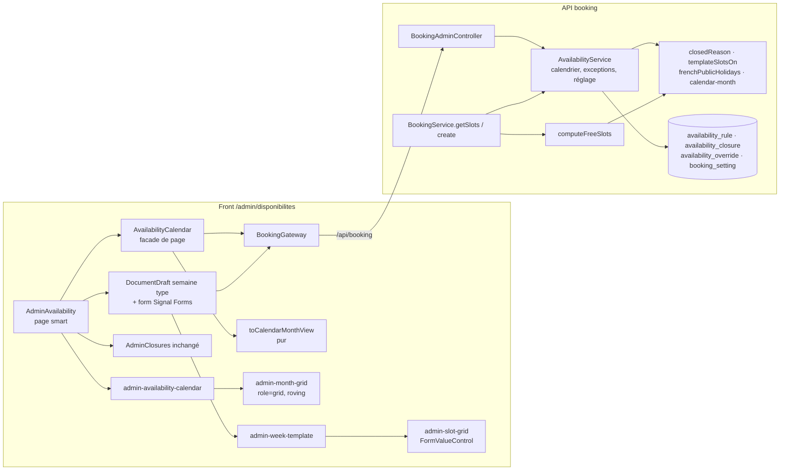

# 025 — Calendrier des disponibilités

## Description

### Objectif

Demande du propriétaire (2026-10-14), après la mise en prod de la spec 024 : « avoir un calendrier
complet et depuis le dashboard activer ou désactiver les journées choisis, pouvoir désactiver ou activer
tous les jours férié, choisir les créneau horaires que j'aurai choisi de mettre ».

L'écran `/admin/disponibilites` de la spec 024 (plages début/fin par jour de la semaine, fermetures par
période) devient un écran en deux blocs : une **semaine type en créneaux cliquables** et un **calendrier
du mois** sur lequel le propriétaire agit directement.

### Arbitrages du propriétaire (2026-10-14)

Maquette présentée en conversation et validée dans son principe (« semaine type + calendrier
d'exceptions ») :

1. **Semaine type en créneaux** : pour chaque jour de la semaine, une grille de pastilles de 30 min de
   **08:00 à 21:00** ; le propriétaire allume celles qu'il propose ; résumé lisible des plages obtenues.
2. **Calendrier du mois** : un clic sur un jour le **ferme**, un second clic le **rouvre**.
3. **Pas d'horaires spécifiques par date** dans cette version : un jour est ouvert (créneaux de la semaine
   type) ou fermé.
4. **Jours fériés français fermés par défaut** (interrupteur « Fermer les jours fériés », activé), avec
   **réouverture d'un férié au cas par cas** d'un clic.
5. **Jours passés affichés en rouge barré** (non cliquables).

### Exigence (contrat)

1. Les créneaux restent **calculés par le serveur seul** (exigence 2 de la spec 024) : semaine type, puis
   exceptions par date, puis jours fériés, puis fermetures par période, puis rendez-vous et règles de
   `BOOKING_POLICY` inchangées (préavis 24 h, horizon 21 j, battement 15 min, 2 par email).
2. Ordre de priorité d'un jour : passé → fermé ; fermeture par période → fermé ; exception « fermé » →
   fermé ; exception « ouvert » (réouverture d'un férié) → ouvert ; férié et interrupteur actif → fermé ;
   sinon → créneaux de la semaine type du jour.
3. Jours fériés de France métropolitaine calculés côté serveur (fixes + Pâques, lundi de Pâques,
   Ascension, lundi de Pentecôte), testés sur plusieurs années.
4. Les plages déjà saisies avec l'écran de la spec 024 sont reprises sans perte (même modèle de règles
   hebdomadaires) ; les fermetures par période existantes restent valables.
5. Aucune régression de la page publique `/rendez-vous` ni de la garantie anti double réservation.
6. WCAG AA : grille de pastilles en boutons à état (`aria-pressed`), calendrier utilisable au clavier
   (flèches, Entrée/Espace), états jamais portés par la seule couleur (libellé + barré pour le passé),
   zéro violation au job `a11y`.

### Constat (2026-10-14, front `master` `47c8c7b`, API en prod depuis #55)

1. `availability_rule` (jour ISO, minute de début et de fin) et `availability_closure` (période de dates,
   motif) existent ; `computeFreeSlots` ne connaît ni exception par date ni jour férié.
2. L'écran `/admin/disponibilites` (F5b, spec 024) saisit des plages par menus début/fin au pas de 30 min.
3. Aucune plage n'est encore saisie en prod (`/api/booking/slots` renvoie une liste vide).

### Hors périmètre

- Horaires spécifiques pour une date donnée (arbitrage 3).
- Synchronisation d'un agenda externe.
- Jours fériés d'Alsace-Moselle et d'outre-mer.

## Plan technique

### Décision d'architecture (ADR-0027)

Le serveur reste la seule source de l'état d'un jour. Une fonction pure `closedReason(date, ctx)` applique
l'ordre de l'exigence 2 ; `computeFreeSlots` et le calendrier de l'admin l'appellent tous les deux, et les
créneaux d'un jour viennent d'une seule fonction `templateSlotsOn(date, rules)` extraite de
`computeFreeSlots`. L'admin lit un **mois résolu** (`GET availability/calendar`) et n'applique aucune
priorité. Exception par date dans `availability_override (day date pk, kind 'open'|'closed')`, écrite en
**état souhaité** (`PUT availability/days/:date { open }`) : le serveur supprime l'exception si l'état voulu
est celui qu'aurait le jour sans elle, l'insère ou la remplace sinon. Réglage `close_public_holidays` dans
une table singleton `booking_setting` (modèle `profile_content`, défaut vrai porté par une seule constante).
Fériés de métropole (L3133-1 : 8 fixes, lundi de Pâques, Ascension, lundi de Pentecôte) calculés par
l'API, Pâques par Meeus/Jones/Butcher, sans dépendance. Écritures du calendrier **non optimistes**. Cf.
ADR-0027.

**Écarts au brief, justifiés** :

1. **Pas de `DELETE` d'exception** : l'écriture en état souhaité couvre fermer, rouvrir et « revenir à la
   règle » ; le front n'a pas à savoir si un jour est férié pour choisir entre supprimer et créer.
2. **Pas de `GET` du réglage** : `closePublicHolidays` est rendu par `GET availability/calendar`, que
   l'écran lit de toute façon.
3. **`@ArrayMaxSize` des plages relevé de 50 à 168** : une grille de 26 pastilles produit jusqu'à 13 plages
   par jour en alternant (7 × 13 = 91 > 50, refus 400) ; 168 = 7 × 24, maximum théorique au pas de 30 min
   sur 24 h, la reprise des plages hors grille comprise.
4. **Fériés lus dans L3133-1** (Pâques et Pentecôte dimanche non compris) : question ouverte en fin de plan.

### Architecture



**API**
- `closedReason(date, ctx)` (`resolve-day.ts`), ordre exact : `date < ctx.today` → `'past'` ; date dans une
  fermeture `[startsOn, endsOn]` → `'closed-period'` ; exception `closed` → `'closed'` ; exception `open` →
  `null` ; férié et `ctx.closePublicHolidays` → `'holiday'` ; sinon `null`. `ctx = { today, closures,
  overrides: ReadonlyMap<string, 'open' | 'closed'>, closePublicHolidays }`. Le férié est lu dans
  `publicHolidayName(date)` (table annuelle mémoïsée par année dans le module).
- `templateSlotsOn(date, rules): readonly Date[]` : la boucle intérieure actuelle de `computeFreeSlots`
  (plages du jour ISO, pas de 30, `m + 30 <= endMinute`, `parisWallTimeToUtc` non nul), sans préavis,
  horizon ni rendez-vous. `computeFreeSlots` devient : pour chaque date de la fenêtre, `closedReason` non nul
  → jour sauté ; sinon `templateSlotsOn` puis filtres préavis / horizon / battement inchangés.
- `toCalendarDay(date, ctx, rules, closures): CalendarDay` : `state = closedReason ?? (slotCount > 0 ?
  'open' : 'empty')`, `holiday` = nom du férié **quel que soit l'état** (un férié rouvert ou un férié sous
  interrupteur inactif est `open` avec `holiday` renseigné), `slotCount = templateSlotsOn(...).length`,
  `closure` = la fermeture qui couvre le jour (première par `startsOn`) ou `null`.
- `AvailabilityService` (même service, même `DbExecutor` optionnel que `listRules`) gagne :
  `listOverrides(executor, from, to)`, `readClosePublicHolidays(executor)`, `getCalendar(month?)`,
  `setDayOpen(date, open)`, `setClosePublicHolidays(value)`.
- `BookingService.freeSlots(executor, now)` lit en plus, sur le même `executor` (donc **sous le verrou** à la
  création), les exceptions de `toParisDate(now)` à `toParisDate(now + 21 j)` et le réglage, puis passe
  `overrides` et `closePublicHolidays` à `computeFreeSlots`. Aucune autre ligne de la création ne change :
  un créneau d'un jour fermé est absent du calcul, donc 422 `slot_unavailable` (ou 409 si un rendez-vous le
  touche), comportement de la spec 024.
- `nextDate` (privé à `compute-free-slots.ts`) devient `addDays(date, days)` exporté par `paris-time.ts`,
  réutilisé par le calendrier et les mois.

**Front**
- Écran en trois sections sous le `h1` : « Semaine type » (brouillon + barre d'enregistrement),
  « Calendrier » (écritures immédiates), « Fermetures » (`AdminClosures` **inchangé**). Landmarks : la page
  est dans le shell admin, aucune section n'émet `header`/`main`/`footer` ; un seul `h1`
  (`AdminPageHeader`), trois `h2`.
- **Fermetures par période** : on garde le formulaire de période et sa liste. Le calendrier les **affiche**
  (état `closed-period`, non cliquable, nom accessible qui cite la période et renvoie à la section
  Fermetures). Ajouter ou supprimer une fermeture recharge le mois affiché. Pas de sélection de plage dans le
  calendrier (minimal, aucun nouveau contrat).
- **Frontière presenter / composants (feature view-heavy)** :
  - `AvailabilityCalendar` (`pages/admin-availability/availability-calendar.ts`) : **facade** instance-scopée
    par `providers: [AvailabilityCalendar]` de la page, sans suffixe `Store`. Possède le mois demandé, la
    ressource du mois, les jours en cours d'écriture, la date à focaliser, l'annonce de statut, l'écriture du
    réglage ; coordonne l'I/O et les toasts. Aucune dépendance DOM.
  - `toCalendarMonthView(month)` (`application/calendar-month-view.ts`, fonction pure) : semaines de lundi à
    dimanche avec cases vides, libellé du mois, nom accessible de chaque jour, libellé court, icône,
    `actionable`. Seule dérivation non triviale ; testée sans TestBed.
  - `nextCalendarDate(date, key)` (`application/calendar-keyboard.ts`, pure) : déplacement clavier.
  - Composants de présentation : `admin-availability-calendar` (section : en-tête, interrupteur,
    navigation, légende, statut, états de chargement), `admin-month-grid` (tableau `role="grid"`, focus
    itinérant, seule glue DOM), `admin-week-template` (choix du jour, grille, résumé), `admin-slot-grid`
    (pastilles d'un jour).
- **Calendrier : APG « grid » complet**, pas une liste de boutons. Justification : le propriétaire demande
  flèches, Entrée/Espace (exigence 6) et la maquette est un mois en 7 colonnes ; un `role="grid"` n'est posé
  que parce que la navigation qu'il promet est implémentée entièrement (flèches, Home/End, PageUp/PageDown).
  Une liste de 28 à 31 boutons sans flèches imposerait autant d'arrêts de tabulation ; un tableau de
  boutons sans `role="grid"` mentirait sur la structure clavier. Structure :
  `<table role="grid" aria-labelledby="admin-calendar-month-label" aria-describedby="admin-calendar-help">`,
  `<thead>` de 7 `<th scope="col" abbr="lundi">lun.</th>`, `<tr>` par semaine, `<td role="gridcell">`
  contenant **un** `<button type="button">` (case vide : `<td role="gridcell">` sans bouton). Focus
  itinérant : un seul bouton à `tabindex="0"` (date active), les autres à `-1`. Jours passés et jours sous
  fermeture : `aria-disabled="true"` (**pas** `disabled`, pour que les flèches les traversent), activation
  ignorée. Aujourd'hui : `aria-current="date"`.
  - Clavier sur un bouton du tableau : `ArrowLeft/Right` ±1 jour, `ArrowUp/Down` ±7, `Home`/`End` lundi /
    dimanche de la semaine, `PageUp`/`PageDown` même jour du mois précédent / suivant (borné au dernier jour
    du mois), `Enter`/`Space` = clic natif du bouton. Cible dans le mois affiché → focus déplacé ; cible
    dans le mois précédent ou suivant **permis** (`previousMonth`/`nextMonth` non nuls) → `monthRequested`
    avec la date cible, focus posé sur elle après chargement ; sinon touche sans effet (`preventDefault`
    quand même pour les flèches, pour ne pas faire défiler la page).
  - Focus après rendu : `afterRenderEffect({ write })` lit une demande de focus (signal interne) et appelle
    `focus()` sur le bouton de la date ; jamais `setTimeout`.
  - Nom accessible de chaque bouton, construit par `describeDay(day)` (pur, partagé avec l'annonce) :
    « jeudi 12 novembre 2026, ouvert, 4 créneaux » ; « …, fermé » ; « mercredi 11 novembre 2026, férié
    (Armistice 1918), fermé » ; « …, férié (Armistice 1918) rouvert, 4 créneaux » ; « …, fermé par la
    période du jeudi 24 décembre 2026 au vendredi 1er janvier 2027 (Congés) » ; « …, aucun créneau » ;
    « …, passé ». Dates par `formatLongDate` existant (« 1er »).
  - Aide (`admin-calendar-help`, visible, sous le tableau) : « Cliquez un jour, ou Entrée et Espace, pour le
    fermer ou le rouvrir. Flèches : jour voisin ; Page précédente et Page suivante : mois voisin. »
  - Annonce (`admin-calendar-status`, `role="status"`) après chaque écriture réussie : `describeDay` du jour
    rendu par le serveur, préfixé du verbe (« Fermé : jeudi 12 novembre 2026. », « Rouvert : mercredi
    11 novembre 2026, 4 créneaux. ») ; après l'interrupteur : « Jours fériés fermés. » / « Jours fériés
    ouverts selon la semaine type. ».
  - Libellé du mois (`admin-calendar-month-label`, « Novembre 2026 ») en `aria-live="polite"` : la navigation
    par boutons annonce le mois chargé.
- **Traitement visuel des états** (le rouge est réservé au passé). Ratios calculés le 2026-10-14 par
  conversion OKLCH → sRGB (Ottosson) puis luminance relative WCAG 2.x, script jetable, sur les valeurs de
  `src/styles.css` ; teintes à `color-mix` posées sur `--theme-background` ; à re-mesurer au rendu par axe
  (F5) :

  | État | Visible (≥ `sm`) | Porteurs non colorés | Couleur | Texte / fond clair · sombre |
  |---|---|---|---|---|
  | `past` | numéro barré, aucun libellé | `line-through`, `aria-disabled`, légende « Passé » | `text-status-error` | 5,89 · 7,20 |
  | `closed` (à la main) | icône `lock` + « Fermé » | icône, libellé, bord **pointillé** `border-field` (3,04 · 3,41 sur le fond) | texte `foreground` sur `foreground` 8 % | 12,06 · 16,10 |
  | `holiday` (fermé) | icône `flag` + « Férié » | icône, libellé | `text-muted` | 7,21 · 7,51 |
  | `closed-period` | icône `calendar` + « Période » | icône, libellé, `aria-disabled` | `text-status-warn` sur warn 10 % | 4,84 · 8,03 |
  | `open` | nombre + « créneaux » | nombre écrit | `text-primary` sur primary 10 % | 6,81 · 7,28 |
  | `open` + férié (rouvert) | idem + petite icône `flag` | icône | idem | idem |
  | `empty` | « — » | tiret, « aucun créneau » dans le nom | `text-muted` | 7,21 · 7,51 |

  Sous `sm` (375 px, 7 colonnes d'environ 44 px), le libellé court passe en `sr-only` : restent numéro,
  icône ou nombre (cible ≥ 44 × 44 px). Légende (`admin-calendar-legend`, `<ul role="list">`) : les six
  états avec la même pastille, la même icône et le libellé. Icônes `lock`, `flag`, `calendar`,
  `chevron-left`, `chevron-right`, `check` déjà présentes au sprite : `pnpm icons:check` reste vert, aucun
  `icons:build`.
- **Semaine type** :
  - Sélecteur du jour : `app-filter-group` existant (`aria-pressed`, label « Jour de la semaine »), options
    `{ value: clé du jour, label: 'Lundi', count: nombre de créneaux du jour }`.
  - `admin-slot-grid` implémente `FormValueControl<readonly number[]>` (précédent `AdminTagsSelector`) :
    `admin-week-template` reçoit `slots: FieldTree<WeeklySlotsDraft>` (patron `admin-pair-rows`) et lie
    `[formField]="slots()[selectedKey()]"`. 26 boutons `aria-pressed` de 08:00 à 20:30, texte
    visible « 08:00 » complété en `sr-only` « à 08:30 », groupe `role="group"` nommé par un titre « Créneaux
    du mardi ». Allumé : fond `primary-bg`, texte blanc (5,50:1), icône `check` ; éteint : bord
    `border-field` (3,04 · 3,41), texte `foreground`. Arrêts de tabulation naturels (26 boutons), sans
    navigation fléchée.
  - Résumé (`admin-week-summary`, `<dl>`) des sept jours : « Mardi : 18:00–20:00 », plusieurs plages
    séparées par une virgule, « Mardi : aucun créneau ». Calculé sur **toutes** les demi-heures du jour, y
    compris hors grille.
  - **Reprise sans perte (exigence 4)** : le brouillon garde les 48 demi-heures de chaque jour ; la grille
    n'en montre que 26 et n'écrit que celles-là. Des plages saisies hors 08:00–21:00 avec l'écran 024 sont
    conservées et signalées (`admin-week-hidden-ranges`) : « Conservé hors de la grille : lundi 07:00–08:00. ».
    Des plages adjacentes (09:00–10:00 et 10:00–11:00) ressortent fusionnées (09:00–11:00) : mêmes créneaux,
    puisque créneau = pas = 30 min.
  - `form(this.draft.value, { submission: { action } })` sans schéma (aucune saisie invalide possible),
    `<form id="availability-form" [formRoot]>` pour la barre d'enregistrement existante.

### Contrat d'API (préfixe `/api/booking`, admin, `JwtAuthGuard` de classe existant)

Corps d'erreur : `HttpExceptionFilter` existant, code métier dans `error`. Dates `YYYY-MM-DD` et mois
`YYYY-MM` de Paris. Routes de la spec 024 **inchangées** (seul `@ArrayMaxSize` de `PUT availability/rules`
passe à 168).

| Méthode, route | Corps / query | Réponse |
|---|---|---|
| `GET availability/calendar` | `month?` (`CalendarQueryDto` : `@IsOptional() @Matches(/^\d{4}-(0[1-9]\|1[0-2])$/)`) ; absent → mois de Paris courant | 200 `CalendarMonthResponse` ; 400 validation ; 400 `month_out_of_range` (mois avant le mois courant ou après courant + 12) |
| `PUT availability/days/:date` | param `date` (`DayParamDto` : `@Matches(/^\d{4}-\d{2}-\d{2}$/) @IsISO8601({ strict: true })`) ; corps `{ open: boolean }` (`@IsBoolean()`) | 200 `CalendarDay` du jour après écriture ; 400 validation ; 422 `day_in_past` (`date < aujourd'hui`) ; 422 `day_out_of_range` (après le dernier jour du mois courant + 12) ; 409 `day_in_closure` |
| `PUT availability/settings` | `{ closePublicHolidays: boolean }` (`@IsBoolean()`) | 200 `{ closePublicHolidays }` |

```ts
type CalendarDayState = 'past' | 'closed-period' | 'closed' | 'holiday' | 'open' | 'empty';
type CalendarDay = {
  date: string;                       // YYYY-MM-DD
  state: CalendarDayState;
  holiday: string | null;             // « Armistice 1918 », quel que soit l'état
  slotCount: number;                  // templateSlotsOn(date, rules).length, changements d'heure compris
  closure: { startsOn: string; endsOn: string; reason: string | null } | null; // si closed-period
};
type CalendarMonthResponse = {
  month: string;                      // YYYY-MM effectivement rendu
  today: string;                      // date de Paris du serveur
  previousMonth: string | null;       // null au mois courant
  nextMonth: string | null;           // null à courant + 12
  closePublicHolidays: boolean;
  days: CalendarDay[];                // tous les jours du mois, croissants
};
```

`setDayOpen(date, open)`, dans une transaction : contrôles passé / borne / fermeture (dans cet ordre) ;
`base = estFérié(date) && closePublicHolidays ? fermé : ouvert` ; `open === base` → `delete` de l'exception
(sans erreur si absente) ; sinon `insert … on conflict (day) do update set kind = excluded.kind` ; relecture et
`toCalendarDay`. Constante `CALENDAR_MONTHS_AHEAD = 12` dans `calendar-month.ts` (navigation d'admin, pas
une règle de réservation : `BOOKING_POLICY` et son test golden inchangés). Swagger : `@ApiOperation`,
`@ApiResponse` pour 400/409/422 comme les routes existantes.

### Modèles de données

**API — `src/database/schema/booking.ts`** (le barrel fait déjà `...booking` dans `schema` : rien à y
ajouter) :

- `bookingSettings` (`booking_setting`) : `id text pk default 'main'`, `close_public_holidays boolean not
  null default DEFAULT_CLOSE_PUBLIC_HOLIDAYS`, `updated_at timestamptz not null default now()` ; check
  `booking_setting_single_row` (`id = 'main'`). `BOOKING_SETTING_ROW_ID = 'main'` et
  `DEFAULT_CLOSE_PUBLIC_HOLIDAYS = true` exportés du schéma (source unique, relue par le service quand la
  ligne n'existe pas ; écriture `insert … on conflict (id) do update`).
- `availabilityOverrides` (`availability_override`) : `day date pk` (`mode: 'string'`), `kind text not null`
  (`enum: ['open', 'closed']`), `created_at timestamptz not null default now()` ; check
  `availability_override_kind_check` (`kind in ('open', 'closed')`).
- Types `BookingSetting`, `AvailabilityOverride` (`$inferSelect`).

**Migrations** (générées, `pnpm db:generate --name …`, relues ; aucune donnée existante touchée, aucune
reprise : `availability_rule` et `availability_closure` ne changent pas) :

```sql
-- drizzle/0024_booking_setting.sql (tranche A1)
CREATE TABLE "booking_setting" (
  "id" text PRIMARY KEY DEFAULT 'main' NOT NULL,
  "close_public_holidays" boolean DEFAULT true NOT NULL,
  "updated_at" timestamp with time zone DEFAULT now() NOT NULL,
  CONSTRAINT "booking_setting_single_row" CHECK ("booking_setting"."id" = 'main')
);
-- drizzle/0025_availability_override.sql (tranche A2)
CREATE TABLE "availability_override" (
  "day" date PRIMARY KEY NOT NULL,
  "kind" text NOT NULL,
  "created_at" timestamp with time zone DEFAULT now() NOT NULL,
  CONSTRAINT "availability_override_kind_check" CHECK ("availability_override"."kind" in ('open', 'closed'))
);
```

**API — logique pure** :

- `french-public-holidays.ts` : `easterSunday(year): string` (Meeus/Jones/Butcher, entiers, `Date.UTC` pour
  le seul formatage) ; `frenchPublicHolidays(year): ReadonlyMap<string, string>` : `01-01` Jour de l'an,
  lundi de Pâques (+1), `05-01` Fête du Travail, `05-08` Victoire 1945, Ascension (+39), lundi de Pentecôte
  (+50), `07-14` Fête nationale, `08-15` Assomption, `11-01` Toussaint, `11-11` Armistice 1918, `12-25`
  Noël. Deux fériés le même jour (2008-05-01 : Fête du Travail et Ascension) : `Fête du Travail et
  Ascension` (fixe d'abord). `publicHolidayName(date): string | null`.
- `calendar-month.ts` : `currentMonth(today)`, `addMonths(month, n)`, `daysOfMonth(month): readonly
  string[]`, `monthOf(date)`, `lastAllowedDay(today)`, `CALENDAR_MONTHS_AHEAD`.
- `resolve-day.ts` : `DayOverrideKind`, `DayClosedReason`, `DayContext`, `closedReason`, `templateSlotsOn`,
  `toCalendarDay`.
- `compute-free-slots.ts` : `FreeSlotsInput` gagne `overrides: ReadonlyMap<string, DayOverrideKind>` et
  `closePublicHolidays: boolean` (**obligatoires** : un oubli doit échouer à la compilation, pas fermer ou
  ouvrir les fériés en silence).

**Front — `features/booking/domain/models/booking-admin.model.ts`** (`type` immuables) :

```ts
type CalendarDayState = 'past' | 'closed-period' | 'closed' | 'holiday' | 'open' | 'empty';
type CalendarDay = { readonly date: string; readonly state: CalendarDayState;
  readonly holiday: string | null; readonly slotCount: number;
  readonly closure: { readonly startsOn: string; readonly endsOn: string; readonly reason: string | null } | null };
type CalendarMonth = { readonly month: string; readonly today: string;
  readonly previousMonth: string | null; readonly nextMonth: string | null;
  readonly closePublicHolidays: boolean; readonly days: readonly CalendarDay[] };
type BookingAdminFailure = 'overlap' | 'invalid' | 'not-found' | 'too-late' | 'day-past'
  | 'day-in-closure' | 'network' | 'server';
```

`toAdminFailure` (gateway) : `409` + `day_in_closure` → `day-in-closure` (sinon `too-late`, inchangé) ;
`422` + `day_in_past` → `day-past` ; autre `422` → `invalid` ; `400` inchangé (`month_out_of_range` →
`invalid`). DTO bruts dans `booking-api.types.ts`, adapters purs `toCalendarMonth` / `toCalendarDay`
(copie champ par champ, `state` et `holiday` repris tels quels). Validation runtime des réponses non
vérifiée (profil).

**Front — `features/admin/application/availability-draft.ts`** (réécrit ; `AvailabilityRangeRow`,
`findOverlappedRange`, `toMinuteOfDay` supprimés, plus aucun consommateur) :

```ts
type WeeklySlotsDraft = Record<AvailabilityWeekdayKey, readonly number[]>; // demi-heures 0..47 triées
const SLOT_GRID: readonly number[];          // 16..41 : 08:00 → 20:30, dernier créneau fini à 21:00
function toWeeklySlotsDraft(rules: readonly AvailabilityRule[] | null): WeeklySlotsDraft;
function toAvailabilityRules(draft: WeeklySlotsDraft): AvailabilityRule[]; // suites contiguës → plages
function toggleSlot(slots: readonly number[], index: number): readonly number[];
function summarizeSlots(slots: readonly number[]): string;  // « 18:00–20:00, 21:00–22:00 » | ''
function hiddenRanges(draft: WeeklySlotsDraft): readonly { readonly label: string; readonly ranges: string }[];
```

`AVAILABILITY_WEEKDAYS` et `toTimeOfDay` gardés. Un changement par jour modifié (`countChangedFields` sur
des tableaux de nombres, sans symbole Signal Forms).

**Front — `features/admin/application/calendar-month-view.ts`** :

```ts
type CalendarCell = { readonly date: string; readonly dayOfMonth: number; readonly state: CalendarDayState;
  readonly today: boolean; readonly actionable: boolean; readonly label: string;   // describeDay
  readonly shortLabel: string; readonly icon: 'lock' | 'flag' | 'calendar' | null; readonly reopenedHoliday: boolean };
type CalendarMonthView = { readonly month: string; readonly label: string;         // « Novembre 2026 »
  readonly previousMonth: string | null; readonly nextMonth: string | null;
  readonly closePublicHolidays: boolean; readonly weeks: readonly (readonly (CalendarCell | null)[])[] };
function toCalendarMonthView(month: CalendarMonth): CalendarMonthView;
function describeDay(day: CalendarDay): string;
function wantsOpen(day: CalendarDay): boolean; // closed | holiday → true ; open | empty → false
```

`actionable = state !== 'past' && state !== 'closed-period'`. `wantsOpen` traduit un clic en état souhaité :
ce n'est pas la priorité, c'est l'inverse de l'état affiché. `paris-format.ts` gagne
`formatMonthLabel(month)` (« novembre 2026 », capitalisé par `capitalize` existant).

### Fichiers à créer / modifier

**API (`/home/j-ned/Projects/Portfolio/nest-portfolio-app`, branche `feat/booking-calendar` depuis `master`
`c20acdb`)**

| Fichier | Rôle |
|---|---|
| `src/database/schema/booking.ts` | `bookingSettings`, `availabilityOverrides`, constantes, types |
| `drizzle/0024_booking_setting.sql`, `drizzle/0025_availability_override.sql`, `drizzle/meta/*_snapshot.json`, `_journal.json` | générés |
| `src/booking/french-public-holidays.ts` | Pâques, fériés de l'année, nom d'un férié |
| `src/booking/calendar-month.ts` | mois de Paris : courant, ±n, jours, bornes, `CALENDAR_MONTHS_AHEAD` |
| `src/booking/resolve-day.ts` | `closedReason`, `templateSlotsOn`, `toCalendarDay` |
| `src/booking/paris-time.ts` | `addDays` exporté |
| `src/booking/compute-free-slots.ts` | entrées `overrides`, `closePublicHolidays` ; utilise `closedReason` et `templateSlotsOn` |
| `src/booking/availability.service.ts` | exceptions, réglage, calendrier, `setDayOpen` |
| `src/booking/booking.service.ts` | `freeSlots` lit exceptions et réglage sur le même `executor` |
| `src/booking/booking-admin.controller.ts` | trois routes |
| `src/booking/dto/calendar-query.dto.ts`, `day-param.dto.ts`, `set-day-open.dto.ts`, `update-booking-settings.dto.ts` | DTO class-validator + Swagger |
| `src/booking/dto/replace-availability-rules.dto.ts` | `@ArrayMaxSize(168)`, `maxItems: 168` |
| `src/booking/booking-test-builders.ts` | `anAvailabilityOverride` |
| `src/booking/*.spec.ts`, `booking.integration.spec.ts` | tests (rôle de `qa`) |
| `README.md` | trois routes, réglage, fériés |

**Front (`/home/j-ned/Projects/Portfolio/ng-portfolio-app`, branche `feat/025-calendrier-disponibilites`)**

| Fichier | Rôle |
|---|---|
| `src/app/features/booking/domain/models/booking-admin.model.ts` | types du calendrier, deux raisons d'échec |
| `src/app/features/booking/domain/gateways/booking.gateway.ts` | `getAvailabilityCalendar(month: string \| null)`, `setDayOpen(date, open)`, `setClosePublicHolidays(value)` |
| `src/app/features/booking/domain/paris-format.ts` | `formatMonthLabel` |
| `src/app/features/booking/infra/booking-api.types.ts`, `booking.adapter.ts`, `http-booking.gateway.ts` | DTO, adapters, trois méthodes (`silentErrors()`), `toAdminFailure` étendu |
| `src/app/features/booking/testing/stub-booking-gateway.ts`, `booking-builders.ts` | trois méthodes doublées ; `aCalendarDay`, `aCalendarMonth`, builders DTO |
| `src/app/features/admin/application/availability-draft.ts` | brouillon en demi-heures (réécrit) |
| `src/app/features/admin/application/calendar-month-view.ts` | vue pure du mois |
| `src/app/features/admin/application/calendar-keyboard.ts` | `nextCalendarDate` |
| `src/app/features/admin/application/components/admin-slot-grid.ts` | pastilles d'un jour (`FormValueControl`) |
| `src/app/features/admin/application/components/admin-week-template.ts` | `section` semaine type : `app-filter-group`, grille, résumé, plages hors grille |
| `src/app/features/admin/application/components/admin-availability-calendar.ts` | `section` calendrier : en-tête, interrupteur, navigation, légende, aide, statut, chargement / erreur |
| `src/app/features/admin/application/components/admin-month-grid.ts` | tableau `role="grid"`, focus itinérant |
| `src/app/features/admin/application/components/admin-availability-rows.ts` | **supprimé** |
| `src/app/features/admin/pages/admin-availability/availability-calendar.ts` | facade du calendrier |
| `src/app/features/admin/pages/admin-availability/availability-messages.ts` | tables de messages d'échec (sorties de la page, 304 LOC signalées en revue 024) |
| `src/app/features/admin/pages/admin-availability/admin-availability.ts` | composition des trois sections ; rechargement du mois après plages ou fermetures |
| `e2e/a11y/scenarios.ts`, `e2e/a11y/booking-states.spec.ts` | repère et états du calendrier ; scénario de chevauchement retiré |
| `ci/api-stub/server.mjs` | trois routes admin |

### Réactivité / état

- **Semaine type** : `DocumentDraft<readonly AvailabilityRule[], WeeklySlotsDraft>` (`toDraft:
  toWeeklySlotsDraft`, une section TOC `admin-availability-weekly`, champs = clés des jours), `canLeave()`,
  `warnBeforeUnload`, dialogue de sortie : inchangés. `slotsForm = form(draft.value, { submission: { action:
  saveRules } })`. Le jour affiché est un `signal` local d'`admin-week-template` (lundi au départ), pas dans le
  brouillon. Enregistrement : `toAvailabilityRules(draft.value())` → `replaceAvailabilityRules` → succès :
  toast, `calendar.reload()` (les nombres de créneaux changent) ; échec : toast, brouillon gardé (patron 024).
- **`AvailabilityCalendar`** (facade ; aucun état partagé hors de l'écran, donc pas de store) :
  - `_month = signal<string | null>(null)` ; `month = rxResource({ params: () => ({ month: _month() }),
    stream: ({ params }) => gateway.getAvailabilityCalendar(params.month) })`.
  - `_shown = linkedSignal` sur la valeur de la ressource qui garde le dernier mois chargé pendant un
    rechargement (le tableau ne disparaît pas ; `aria-busy="true"` sur le tableau pendant le chargement) ;
    `view = computed(() => _shown() && toCalendarMonthView(_shown()))` ; `state = computed(loadState(...))`,
    squelette seulement au premier chargement.
  - `_pending = signal<ReadonlySet<string>>(new Set())` exposé en lecture seule : plusieurs jours peuvent
    être en cours ensemble (écritures indépendantes et idempotentes) ; un second clic sur un jour en cours est
    ignoré. Cellule en cours : `opacity` réduite, aucun changement d'ARIA (le focus reste dessus).
  - `toggleDay(date)` : jour introuvable, non `actionable` ou en cours → rien ; sinon
    `setDayOpen(date, wantsOpen(day))` ; succès → `month.update` qui remplace **ce** jour par la réponse
    (nouvelle référence), annonce ; échec → toast (`availability-messages`), et `day-past` /
    `day-in-closure` → `month.reload()`.
  - `setHolidaysClosed(value)` : `_holidaysSaving` vrai pendant l'appel (interrupteur `aria-disabled`,
    activation ignorée) ; succès → `month.reload()`, annonce ; échec → toast.
  - `goToMonth(month, focusDate)` : `_month.set(month)`, `_focusDate.set(focusDate)` ; la grille focalise
    `focusDate` dès qu'elle est dans le mois rendu, puis la facade l'efface.
  - `_announcement` exposé en lecture seule. Aucune `effect()` d'écriture : toutes les écritures partent
    d'un événement.
- **Interrupteur fériés** : `<button appButton variant="outlined" type="button" aria-pressed>` au libellé
  **fixe** « Fermer les jours fériés » (précédent `device-exclusion-toggle`, sans changer le libellé selon
  l'état, conformément à APG « button » à bascule), icône `check` quand actif.
- **`admin-month-grid`** : entrées `view`, `pending`, `focusDate` ; sorties `dayActivated(date)`,
  `monthRequested({ month, focusDate })`. `_activeDate = linkedSignal` (source : `view` + `focusDate`,
  calcul : `focusDate` s'il est dans le mois, sinon aujourd'hui s'il y est, sinon le 1er).
- Immutabilité : modèles `readonly`, `Set` et tableaux remplacés, jamais mutés ; signaux exposés par
  `asReadonly()`.

### Tranches

Commandes. API : `pnpm test -- src/booking; echo $?`, `TZ=Pacific/Kiritimati pnpm test -- src/booking; echo
$?`, puis `pnpm test; echo $?`, `pnpm lint`, `pnpm build`. Intégration sur Postgres jetable :
`docker run --rm -d --name booking-it -e POSTGRES_PASSWORD=it -p 55433:5432 postgres:17-alpine`, puis
`BOOKING_IT_DATABASE_URL=postgres://postgres:it@127.0.0.1:55433/postgres pnpm test -- booking.integration
booking-scheduler.integration; echo $?`, `docker stop booking-it`. Front :
`pnpm test --include='src/app/features/{admin,booking}/**/*.spec.ts'; echo $?` (pnpm 10 : sans `--`), puis
`pnpm test; echo $?`, `pnpm lint`, `pnpm run format:check`, `pnpm run build --configuration production`. Le
code de sortie fait foi.

**API (PR 1, `nest-portfolio-app`)**

- **Tranche A1 — les jours fériés sont fermés sur la page publique** : `french-public-holidays.ts`,
  `addDays`, `resolve-day.ts` (`closedReason` avec `overrides` vide accepté, `templateSlotsOn`), schéma et
  migration `0024_booking_setting`, `readClosePublicHolidays` (constante si ligne absente),
  `computeFreeSlots` étendu, `BookingService.freeSlots` lit le réglage. Vérifiable : unitaires purs (fériés
  multi-années, priorité sans exception, DST) sous `TZ=UTC` et `TZ=Pacific/Kiritimati` ; intégration :
  migration `0024` au journal, `readClosePublicHolidays()` rend `true` sans ligne puis `false` après une
  ligne insérée en SQL direct (l'effet sur les créneaux d'un férié est prouvé en unitaire, horloge simulée :
  l'intégration tourne sur la date réelle) ; `pnpm db:migrate` sur la base jetable.
- **Tranche A2 — un jour se ferme ou se rouvre** : migration `0025_availability_override`,
  `listOverrides`, priorité complète de `closedReason`, `toCalendarDay`, `setDayOpen` (état souhaité,
  422 / 409), `PUT availability/days/:date`, `freeSlots` lit les exceptions sous le même `executor`.
  Vérifiable : unitaires (matrices de priorité et d'état souhaité) ; supertest ; intégration : fermer une
  date ouverte → plus aucun créneau ce jour dans `getSlots` et `create` refusé en 422 `slot_unavailable` ;
  rouvrir → créneaux revenus, **aucune** ligne en base ; réouverture d'un férié → ligne `open`.
- **Tranche A3 — l'admin lit le mois résolu et règle les fériés** : `calendar-month.ts`, `getCalendar`,
  `GET availability/calendar`, `setClosePublicHolidays` (upsert), `PUT availability/settings`,
  `@ArrayMaxSize(168)`, README. Vérifiable : unitaires (mois, bornes, horloge simulée), supertest ;
  intégration : mois courant complet, interrupteur coupé → férié `open` avec `holiday` renseigné et créneaux
  publics revenus ; `node dist/main.js` : trois routes mappées, 401 sans session.

**Front (PR 2, après déploiement de l'API — CLAUDE.md item 10)**

- **Tranche F1 — la gateway parle le contrat du calendrier** : modèles, trois méthodes abstraites,
  DTO, adapters, `HttpBookingGateway`, `toAdminFailure` étendu, stub et builders. Vérifiable :
  `HttpTestingController` (URL, verbe, corps, `month` absent puis présent, chaque code d'échec).
- **Tranche F2 — la semaine type se règle en pastilles** : `availability-draft.ts` réécrit,
  `admin-slot-grid`, `admin-week-template`, section « Semaine type » de la page (brouillon, barre,
  sortie), suppression d'`admin-availability-rows`, `availability-messages.ts`. Le calendrier n'existe pas
  encore : la page garde Semaine type et Fermetures. Vérifiable : specs de la page et purs du brouillon.
- **Tranche F3 — le calendrier du mois s'affiche et se parcourt au clavier** : `calendar-month-view.ts`,
  `calendar-keyboard.ts`, `formatMonthLabel`, facade (lecture et navigation seulement),
  `admin-availability-calendar`, `admin-month-grid`, légende, aide, états chargement / erreur / Réessayer.
  Activer un jour ne fait encore rien. Vérifiable : purs ; specs composant (rendu des états, noms,
  `aria-current`, `aria-disabled`, focus itinérant, PageDown charge le mois suivant et focalise le jour).
- **Tranche F4 — un clic ferme ou rouvre un jour, l'interrupteur ferme les fériés** : `toggleDay`,
  `setHolidaysClosed`, jours en cours, annonces, toasts, rechargement après plages enregistrées et après
  ajout / suppression d'une fermeture. Vérifiable : specs page (un `PUT` par clic, cellule remplacée par la
  réponse, double clic → une requête, 409 / 422 → rechargement, focus conservé).
- **Tranche F5 — zéro violation axe sur le nouvel écran** : doublure, scénarios (cf. Consignes). Vérifiable :
  `docker build -t ng-portfolio-app:a11y . && ci/a11y-stack.sh up && pnpm a11y; echo $?`, puis
  `ci/a11y-stack.sh down`. Tranche d'audit, verte d'emblée attendue (exception actée en 024).

### Consignes pour `qa`

- **Pur sans TestBed ni Nest** : `french-public-holidays`, `calendar-month`, `resolve-day`,
  `compute-free-slots`, `availability-draft`, `calendar-month-view`, `calendar-keyboard`, `paris-format`.
- **Fériés, `it.each`** (contrôlés sous Node le 2026-10-14) — dates mobiles :

  | Année | Pâques (non férié) | Lundi de Pâques | Ascension | Lundi de Pentecôte |
  |---|---|---|---|---|
  | 2026 | 04-05 | 04-06 | 05-14 | 05-25 |
  | 2027 | 03-28 | 03-29 | 05-06 | 05-17 |
  | 2028 | 04-16 | 04-17 | 05-25 | 06-05 |
  | 2029 | 04-01 | 04-02 | 05-10 | 05-21 |
  | 2030 | 04-21 | 04-22 | 05-30 | 06-10 |

  `easterSunday` aux bornes : 2008 → `2008-03-23`, 2019 → `2019-04-21`, 2038 → `2038-04-25`, 2285 →
  `2285-03-22`. Chaque année 2026-2030 : exactement 11 fériés, les 8 fixes présents. Non fériés : Pâques
  et Pentecôte dimanche, 2026-12-26, 2027-11-02. Collision 2008-05-01 → un seul férié, nom « Fête du
  Travail et Ascension ».
- **Priorité (`closedReason`), `it.each`**, `today = 2026-11-10` :

  | Date | Fermeture | Exception | Férié | Interrupteur | Attendu |
  |---|---|---|---|---|---|
  | 2026-11-09 | oui | `closed` | non | actif | `past` |
  | 2026-11-11 | oui | `open` | oui | actif | `closed-period` |
  | 2026-11-11 | non | `closed` | oui | inactif | `closed` |
  | 2026-11-12 | non | `closed` | non | actif | `closed` |
  | 2026-11-11 | non | `open` | oui | actif | `null` |
  | 2026-11-11 | non | — | oui | actif | `holiday` |
  | 2026-11-11 | non | — | oui | inactif | `null` |
  | 2026-11-12 | non | `open` | non | actif | `null` |
  | 2026-11-10 | non | — | non | actif | `null` (aujourd'hui n'est pas passé) |

  `today` dérivé de `now` à Paris : `2026-10-25T22:30:00Z` → `2026-10-25` ; `2026-10-25T23:30:00Z` →
  `2026-10-26` ; mois courant à `2026-10-31T23:30:00Z` → `2026-11`.
- **État souhaité (`setDayOpen`), `it.each`** (base = férié et interrupteur actif → fermé, sinon ouvert) :
  ordinaire sans ligne + `open: false` → insert `closed` ; ordinaire `closed` + `open: true` → delete ;
  ordinaire sans ligne + `open: true` → aucune écriture d'insertion ; férié actif sans ligne + `true` →
  insert `open` ; férié actif `open` + `false` → delete ; férié actif `closed` + `true` → `kind` remplacé
  par `open` ; férié inactif sans ligne + `false` → insert `closed`. Refus **avant** toute écriture : passé
  → 422 `day_in_past`, au-delà du dernier jour de courant + 12 → 422 `day_out_of_range`, sous fermeture →
  409 `day_in_closure`. Réponse = `CalendarDay` relu.
- **DST** : `templateSlotsOn` avec une plage `0–1440` → 48 le 2026-10-25, 46 le 2027-03-28 (aussi Pâques,
  non férié) ; `slotCount` du calendrier identique. `computeFreeSlots` : les 48 / 46 de la spec 024
  restent vrais avec `overrides` vide et `closePublicHolidays: false`.
- **`computeFreeSlots`** : plage tous les jours, `now = 2026-11-02T08:00:00Z` → aucun créneau le
  2026-11-11 interrupteur actif, présents inactif ; exception `closed` le 2026-11-12 → aucun ; `open` le
  2026-11-11 → présents. **Adaptation mécanique** des appels existants (`compute-free-slots.spec.ts`,
  `booking.service.spec.ts`, intégration) : `overrides: new Map()`, `closePublicHolidays: false`, réglage
  lu à `false` dans les mocks et `booking_setting` posé à `false` (et `availability_override` vidée) dans le
  `beforeEach` d'intégration, **sans** changer une valeur attendue — sans quoi un test qui tombe sur le
  11 novembre (horloge simulée au 2026-11-02, ou `now` réel en intégration) change de sens.
- **Mois (`getCalendar`, `calendar-month`)** : 2027-02 → 28 jours, 2028-02 → 29, 2026-11 → 30 ; `month`
  absent → mois de Paris courant ; mois courant → `previousMonth: null` ; courant + 12 → `nextMonth: null` ;
  courant − 1 et courant + 13 → 400 `month_out_of_range` ; `today` renseigné ; `closure` seulement en
  `closed-period`.
- **Front, brouillon** : lundi 07:00–09:00 → demi-heures 14 à 17, retour à une seule règle `{ 1, 420, 540 }`,
  `hiddenRanges` signale lundi 07:00–08:00 ; 09:00–10:00 + 10:00–11:00 → une règle 09:00–11:00 ; dimanche
  00:00–24:00 → 48 demi-heures → `{ 7, 0, 1440 }` ; `toggleSlot` allume puis éteint (tableau trié, nouvelle
  référence) ; `summarizeSlots([36, 37, 38, 39])` → `18:00–20:00` ; `SLOT_GRID` = 26 demi-heures, première
  08:00, dernière 20:30.
- **Front, vue du mois** : 2026-11 (1er = dimanche) → 6 semaines, 6 cases vides en tête ; 2027-02 (1er =
  lundi) → 4 semaines sans case vide ; `describeDay` pour chaque état (libellés du plan, « 1er ») ;
  `actionable` faux pour `past` et `closed-period` ; `wantsOpen` vrai pour `closed` et `holiday`.
- **Front, clavier `nextCalendarDate`, `it.each`** : ArrowRight 2026-11-30 → 2026-12-01 ; ArrowLeft
  2026-11-01 → 2026-10-31 ; ArrowDown 2026-11-26 → 2026-12-03 ; ArrowUp 2026-11-03 → 2026-10-27 ; Home
  2026-11-12 → 2026-11-09 ; End 2026-11-12 → 2026-11-15 ; PageDown 2027-01-31 → 2027-02-28 ; PageDown
  2028-01-31 → 2028-02-29 ; PageUp 2026-03-31 → 2026-02-28 ; `Tab` → `null`.
- **Front, composants** : un seul `tabindex="0"` dans la grille ; flèches, Home/End, PageUp/PageDown
  (mois borné → sans effet) ; Entrée et Espace = clic ; jour passé / sous fermeture : `aria-disabled`,
  aucun appel ; `aria-current="date"` sur aujourd'hui ; double clic avant réponse → un `PUT` ; échec
  `day-in-closure` → toast et second `GET` ; 26 pastilles `aria-pressed`, une modification par jour,
  allumer puis éteindre → « Aucune modification » ; plages hors grille conservées dans le `PUT`. Zoneless :
  jamais `fakeAsync`, `await fixture.whenStable()` ; horloge non utilisée côté front (le serveur donne
  `today`).
- **`data-testid`** (seuls sélecteurs) : `admin-availability-weekly`, `admin-availability-rules` (le
  `form`), `admin-availability-loading`, `admin-availability-none`, `admin-week-template`, `filter-option`
  (existant), `admin-slot-grid`, `admin-slot-grid-heading`, `admin-slot`, `admin-week-summary`,
  `admin-week-summary-day`, `admin-week-hidden-ranges`, `admin-calendar`, `admin-calendar-heading`,
  `admin-calendar-holidays-toggle`, `admin-calendar-previous`, `admin-calendar-next`,
  `admin-calendar-month-label`, `admin-calendar-grid`, `admin-calendar-day` (avec `data-state` = état, lu
  en assertion, jamais en sélecteur seul), `admin-calendar-legend`, `admin-calendar-help`,
  `admin-calendar-status`, `admin-calendar-loading`, `load-error` (existant) ; fermetures inchangées.
  Testids supprimés : `admin-availability-day`, `admin-availability-day-empty`, `admin-availability-rule*`.
- **a11y (F5)** : doublure — `GET availability/calendar` répartit les états **par jour du mois**, sans
  dépendre de la date réelle (1–4 `past`, 5 aujourd'hui, 8 `holiday` « Armistice 1918 », 9 férié rouvert,
  12–14 `closed-period` « Congés », 16 `closed`, samedis et dimanches `empty`, autres `open` à 4
  créneaux), bornes `previousMonth` / `nextMonth` calculées depuis le mois courant réel ; `PUT
  availability/days/:date` → jour résolu (`open: false` → `closed`, `true` → `open`, `holiday` gardé le 8 ou
  le 9) ; `PUT availability/settings` → corps renvoyé ; routes testées avant le 405. Scénarios, clair et
  sombre : `/admin/disponibilites` (repère `admin-calendar-grid`, aucun squelette ni erreur) ; « pastilles
  allumées » (mardi, deux pastilles, `savebar-state` « 1 modification non enregistrée ») ; « jour fermé à la
  main » (clic d'un jour `open` → `data-state="closed"`, statut non vide). Retirer le scénario « plages qui
  se chevauchent ».

### Risques & inconnues

- **Ordre de déploiement** : API (migrations 0024 et 0025 au démarrage du conteneur) puis front. Un front en
  avance afficherait le calendrier en erreur et refuserait au-delà de 50 plages ; `/rendez-vous` n'est pas
  touché. Dès l'API déployée, les fériés de la fenêtre de 21 jours ferment (défaut vrai) : aucun effet en
  prod aujourd'hui (aucune plage saisie, Constat 3).
- **Intégration API hors de toute CI** (risque déjà ouvert en 024) et dépendante de la date réelle : sans le
  réglage posé à `false` dans le `beforeEach`, un test lancé fin octobre ou début novembre tomberait sur la
  Toussaint ou l'Armistice.
- **Exceptions passées jamais purgées** : quelques lignes par an, sans donnée personnelle ; la purge
  nocturne n'y touche pas (YAGNI, à ajouter si la table grossit).

### Décisions à arbitrer par le propriétaire

> **Arbitré le 2026-10-14 par le propriétaire** : liste légale L3133-1 retenue (dimanches de Pâques et de
> Pentecôte non compris) ; lundi de Pentecôte fermé par défaut comme les autres fériés, rouvrable d'un clic.

1. **Dimanche de Pâques et de Pentecôte** : l'exigence 3 cite « Pâques ». Le plan suit la liste légale
  (L3133-1), où seul le **lundi** de Pâques et le **lundi** de Pentecôte sont fériés ; avec des créneaux le
  dimanche, Pâques et Pentecôte resteraient ouverts sauf clic. Recommandation : liste légale (un clic ferme
  un dimanche si besoin). Alternative : ajouter les deux dimanches à `frenchPublicHolidays`.
2. **Lundi de Pentecôte** (journée de solidarité, souvent travaillée) : fermé par défaut comme les autres
  fériés, réouvrable d'un clic. Recommandation : garder (comportement uniforme de l'interrupteur).

## Plan de test

### Tranche A1 — les jours fériés sont fermés sur la page publique

API `nest-portfolio-app`, branche `feat/booking-calendar`, fichiers sous `src/booking/` (80 tests neufs,
dont 4 d'intégration ; builders partagés `anAvailabilityRule`, `anAvailabilityClosure`, `aBooking`).

Signatures figées par les tests (squelettes sans comportement posés pour que les suites se chargent,
retours neutres `''` / `new Map()` / `null` / `[]` / `false` / date inchangée) :

- `french-public-holidays.ts` : `easterSunday(year: number): string` ; `frenchPublicHolidays(year: number):
  ReadonlyMap<string, string>`, **clés `YYYY-MM-DD` complètes** ; `publicHolidayName(date: string): string | null`.
  Noms : `Jour de l’an` (apostrophe typographique, comme les messages de l'API), `Lundi de Pâques`,
  `Fête du Travail`, `Victoire 1945`, `Ascension`, `Lundi de Pentecôte`, `Fête nationale`, `Assomption`,
  `Toussaint`, `Armistice 1918`, `Noël`.
- `resolve-day.ts` : `DayOverrideKind = 'open' | 'closed'` ; `DayClosedReason = 'past' | 'closed-period' |
  'closed' | 'holiday'` ; `DayContext = { today; closures: Pick<AvailabilityClosure, 'startsOn' | 'endsOn'>[];
  overrides: ReadonlyMap<string, DayOverrideKind>; closePublicHolidays }` ; `closedReason(date, ctx)` ;
  `templateSlotsOn(date, rules): readonly Date[]` (créneaux dans l'ordre des plages fournies).
- `paris-time.ts` : `addDays(date: string, days: number): string` (négatif accepté).
- `compute-free-slots.ts` : `FreeSlotsInput` gagne `overrides` et `closePublicHolidays`, obligatoires.
- `AvailabilityService.readClosePublicHolidays(executor: DbExecutor = this.db): Promise<boolean>` : requête
  `select … from booking_setting where id = 'main' limit 1` (terminateur Drizzle `limit`, précédent
  `ProfileService`), ligne absente → vrai.
- `BookingService.freeSlots` appelle `readClosePublicHolidays(executor)` : `db` pour `getSlots`, `tx` après
  le verrou pour `create`.

| Fichier | Tests | Scénario | Assertions clés |
|---|---|---|---|
| `french-public-holidays.spec.ts` | 9 | `easterSunday` 2008, 2019, 2026-2030, 2038, 2285 | date exacte |
| | 1 | 2026 complet | `toEqual` de la `Map` des 11 fériés nommés |
| | 5 | 2026 à 2030 | `size` 11, trois mobiles nommés aux dates de la table, 8 fixes nommés |
| | 1 | 2008, Ascension le 1er mai | `size` 10, « Fête du Travail et Ascension » |
| | 5 | `publicHolidayName` sur des fériés | nom exact |
| | 5 | Pâques, Pentecôte (dimanches), 2026-12-26, 2027-11-02, 2026-12-31 | `null` |
| | 1 | années demandées dans le désordre (mémoïsation) | 2029-04-02 et 2026-04-06 fériés, 2026-04-02 et 2029-04-06 non |
| `paris-time.spec.ts` | 11 | `addDays` : fin de mois, d'année, 29 février, jours de bascule, +50, −1, 0 | date exacte |
| `resolve-day.spec.ts` | 8 | `closedReason`, `today = 2026-11-10`, sans exception : lignes de la table des consignes sans colonne Exception, plus hier sans fermeture et aujourd'hui sous fermeture | `past`, `closed-period`, `holiday`, `null` |
| | 4 | fermeture du 24 au 26/11 | inclusive aux deux bornes, veille et lendemain `null` |
| | 4 | interrupteur actif | dimanche de Pâques `null` ; lundi de Pâques, lundi de Pentecôte, jour de l'an `holiday` |
| | 4 | `templateSlotsOn` plage dimanche 0–1440 | 48 le 2026-10-25, 46 le 2027-03-28, 48 un dimanche ordinaire ; premier, dernier et heure répétée exacts |
| | 5 | `templateSlotsOn` plages | 09:00–10:00 → deux créneaux ; 09:00–09:50 → un ; seules les plages du jour ISO ; un férié et une date de 2030 gardent leurs créneaux (ni férié, ni préavis, ni horizon) ; jour sans plage → `[]` |
| `compute-free-slots.spec.ts` | 2 | plage tous les jours, `now = 2026-11-02T08:00Z`, 11 novembre | interrupteur actif `[]`, inactif 09:00 et 09:30 |
| | 1 | interrupteur actif | 10/11 et 12/11 intacts, 39 créneaux au total (41 sans le férié) |
| | 2 | date de Paris contre date UTC | mercredi 11/11 23:00–24:00 → `[]` ; jeudi 12/11 00:00–01:00 (= 11/11 23:00Z) proposé |
| | 1 | plage 0–1440, interrupteur actif, `now = 2027-03-23` | Pâques 46 créneaux, lundi de Pâques 0, mardi 48 |
| `availability.service.spec.ts` | 3 | `readClosePublicHolidays` : aucune ligne, ligne fausse, ligne vraie | `true`, `false`, `true` |
| | 1 | requête | table `booking_setting` (`getTableName`), paramètre `['main']` |
| | 1 | exécuteur fourni | lu par `tx`, jamais par `db` |
| `booking.service.spec.ts` | 2 | `getSlots`, plages le mercredi, aucune fermeture | réglage actif → jours `2026-11-04`, `2026-11-18` ; inactif → `2026-11-11` en plus |
| | 1 | `getSlots` | réglage lu une fois, sur `db` |
| | 1 | `create` | réglage lu une fois par `tx`, après `pg_advisory_xact_lock` |
| | 2 | `create` le 11/11 10:00 de Paris, aucune fermeture | réglage actif → 422 `slot_unavailable` sans insertion ; inactif → inséré |
| `booking.integration.spec.ts` | 4 | Postgres jetable | `0024_booking_setting` au journal et contrainte `booking_setting_single_row` (`c`) ; seconde ligne refusée (23514) ; `readClosePublicHolidays()` vrai sans ligne, faux après une ligne insérée en SQL direct |

Contrôles verts par construction (lignes de triangulation qui passent contre le squelette et
départageront une implémentation fausse) : 18 — `closedReason` à `null` (6), `publicHolidayName` à `null`
(5), `addDays(…, 0)`, ligne de réglage fausse, interrupteur inactif (`computeFreeSlots`, `getSlots`,
`create`), plage du jeudi 00:00–01:00, jour sans plage (`templateSlotsOn`).

Adaptation mécanique : `compute-free-slots.spec.ts`, `booking.service.spec.ts`,
`booking.integration.spec.ts` — 15 appels de `computeFreeSlots` reçoivent `overrides: new Map()` et
`closePublicHolidays: false` (l'appel sur une ligne est seulement replié par prettier) ; 2 doubles
d'`AvailabilityService` reçoivent `readClosePublicHolidays: jest.fn().mockResolvedValue(false)` ; le
`beforeEach` d'intégration pose `booking_setting` à faux (upsert SQL) ; aucune valeur attendue modifiée.
Le vidage d'`availability_override` dans ce `beforeEach` revient à A2 (table absente en A1).

Scaffold dû au GREEN : `src/booking/booking.service.ts` (appel de `computeFreeSlots` sans `overrides` ni
`closePublicHolidays`, seule erreur `tsc` du module ; les erreurs `tsc` d'`analytics`, `auth` et `profile`
préexistent sur `master`) ; schéma `bookingSettings` + migration `drizzle/0024_booking_setting.sql`.

Tous les tests de cette tranche échouent à ce stade (RED confirmé via `pnpm test` le 2026-10-14 18:49,
62 failed / 1471 total). Détail, code de sortie lu à chaque fois :

```text
$ pnpm test -- src/booking; echo $?
Test Suites: 6 failed, 2 skipped, 9 passed, 15 of 17 total
Tests:       62 failed, 32 skipped, 403 passed, 497 total
1
$ TZ=Pacific/Kiritimati pnpm test -- src/booking; echo $?
Tests:       62 failed, 32 skipped, 403 passed, 497 total
1
$ pnpm test; echo $?
Test Suites: 6 failed, 3 skipped, 59 passed, 65 of 68 total
Tests:       62 failed, 37 skipped, 1372 passed, 1471 total
1
```

Avant la tranche : 1354 passed / 1387 total, sortie 0. Les 1354 restent verts ; les 62 échecs sont tous
des tests neufs, tous des assertions (`toBe`, `toEqual`, `toHaveLength`, `toHaveBeenCalledTimes`) ; le
test 422 du 11/11 échoue sur `toBeInstanceOf` (la création continue jusqu'à l'insertion non simulée).
`jest` transpile sans contrôle de type (sonde du 2026-10-14) : le typage des specs est vérifié par
`npx tsc --noEmit -p tsconfig.json` et `eslint src/booking` (0).

Intégration (`docker.io/postgres:17-alpine` sur 55433) :
`BOOKING_IT_DATABASE_URL=… pnpm test -- booking.integration booking-scheduler.integration; echo $?` →
18 failed / 32 total, sortie 1 : les 18 tests de `booking.integration` tombent dans le `beforeEach` sur
`relation "booking_setting" does not exist` (migration 0024 absente, livrable de la tranche), les 14 du
planificateur passent. Contre-épreuve, table créée à la main avec le SQL du plan (sans entrée au
journal) : 2 failed / 32 total — journal sans `0024_booking_setting`, lecture sans ligne rendue fausse ;
les 28 autres verts, dont les deux tests d'intégration du réglage qui ne dépendent que du DDL.

## Journal des tranches

- **Tranche A1 — les jours fériés sont fermés sur la page publique** : GREEN 465 passed / 465 total + 32 skipped (`pnpm test -- src/booking`, exit 0, aussi sous `TZ=Pacific/Kiritimati`), intégration 32 passed / 32 total sur Postgres 17 réel (exit 0), suite complète 1434 passed / 1471 total + 37 skipped (exit 0), `pnpm lint` exit 0, `pnpm build` exit 0, non commité · refactor : boucle intérieure de `computeFreeSlots` remplacée par `templateSlotsOn` (plus de `stepMinutes`, `isoWeekday` ni `parisWallTimeToUtc` dans le calcul), `nextDate` privé supprimé au profit d'`addDays`

### A1

GREEN le 2026-10-14, API `nest-portfolio-app` branche `feat/booking-calendar` (depuis `c20acdb`), non
commité. Tests de `qa` inchangés.

**Fichiers**
- Créés : `drizzle/0024_booking_setting.sql`, `drizzle/meta/0024_snapshot.json` (`pnpm db:generate --name
  booking_setting` ; SQL identique au plan, `prevId` = id du snapshot 0023, entrée `idx 24` au journal).
- Implémentés (squelettes de `qa`) : `src/booking/french-public-holidays.ts` (Meeus/Jones/Butcher, 8 fixes
  + 3 mobiles par décalage depuis Pâques, collision nommée « fixe et mobile », `Map` mémoïsée par année),
  `src/booking/resolve-day.ts` (`closedReason` dans l'ordre passé → période → exception → férié,
  `templateSlotsOn`), `addDays` dans `src/booking/paris-time.ts`, `readClosePublicHolidays` dans
  `src/booking/availability.service.ts` (`select … where id = 'main' limit 1`, défaut
  `DEFAULT_CLOSE_PUBLIC_HOLIDAYS`).
- Modifiés : `src/database/schema/booking.ts` (`bookingSettings`, `BOOKING_SETTING_ROW_ID`,
  `DEFAULT_CLOSE_PUBLIC_HOLIDAYS` relu par la colonne et par le service, type `BookingSetting`),
  `src/booking/compute-free-slots.ts` (jour sauté si `closedReason` non nul, créneaux par
  `templateSlotsOn`), `src/booking/booking.service.ts` (`freeSlots` lit le réglage sur le même `executor`,
  donc par `tx` après le verrou à la création ; `overrides: new Map()` jusqu'à A2).

**Sorties**

```text
$ pnpm test -- src/booking; echo $?
Test Suites: 2 skipped, 15 passed, 15 of 17 total
Tests:       32 skipped, 465 passed, 497 total
0
$ TZ=Pacific/Kiritimati pnpm test -- src/booking; echo $?
Tests:       32 skipped, 465 passed, 497 total
0
$ BOOKING_IT_DATABASE_URL=postgres://postgres:it@127.0.0.1:55433/postgres pnpm test -- booking.integration booking-scheduler.integration; echo $?
Test Suites: 2 passed, 2 total
Tests:       32 passed, 32 total
0
$ pnpm test; echo $?
Test Suites: 3 skipped, 65 passed, 65 of 68 total
Tests:       37 skipped, 1434 passed, 1471 total
0
$ pnpm lint; echo $?     → 0
$ pnpm build; echo $?    → 0
$ npx tsc --noEmit -p tsconfig.json   → 4 erreurs, toutes préexistantes (analytics ×2, auth, profile), aucune dans src/booking
```

**Écarts** : aucun au plan. `overrides` passé vide par `BookingService` (lecture des exceptions = A2).
