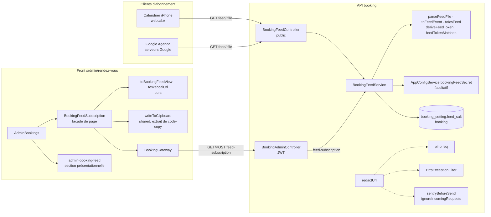

# 026 — Abonnement d'agenda des rendez-vous

## Description

### Objectif

Test réel du propriétaire (2026-10-15) : un rendez-vous ajouté à l'agenda de son iPhone **n'est pas retiré**
quand il est annulé. L'ajout s'est fait par le bandeau « Siri a trouvé un évènement » (iOS Mail), qui crée
un événement indépendant, sans l'`UID` de l'invitation : le `METHOD:CANCEL` envoyé à l'annulation ne peut
pas le rattacher. Pour sa propre copie, le propriétaire est en plus organisateur et destinataire (déjà
relevé : Google Agenda ne l'importait pas).

### Arbitrages du propriétaire (2026-10-15)

1. **Abonnement d'agenda (webcal) pour le propriétaire** : un lien secret qu'il ajoute une fois dans
   Calendrier (iPhone) ou Google Agenda ; ses rendez-vous à venir y apparaissent seuls et une annulation
   les retire à la synchronisation suivante.
2. **Mention dans l'email d'annulation du visiteur** : « Si vous l'aviez ajouté à votre agenda à la main,
   supprimez-le » (l'annulation automatique par `METHOD:CANCEL` reste en place pour les clients qui ont
   importé l'invitation : Gmail, Outlook, ouverture du `.ics`).

### Exigence (contrat)

1. Un flux iCalendar (RFC 5545, `text/calendar`) des rendez-vous **confirmés** du propriétaire, à venir et
   récents, servi par l'API sur une URL secrète, utilisable en abonnement par Apple Calendrier et Google
   Agenda (`webcal://` et `https://`).
2. Un rendez-vous annulé **n'apparaît plus** dans le flux ; chaque événement garde l'`UID` du rendez-vous
   (aligné sur les invitations des specs 024/025) pour que l'agenda remplace plutôt qu'il ne duplique.
3. Secret : jeton aléatoire long, jamais en clair en base (empreinte), **régénérable** depuis l'admin
   (l'ancien lien cesse aussitôt de fonctionner), absent des logs et de Sentry ; réponse 404 indistincte
   pour un jeton faux ou absent ; aucune donnée de visiteur exposée hors du flux authentifié par le jeton.
4. Admin : section « Abonnement d'agenda » (page Rendez-vous ou Disponibilités) avec le lien, un bouton
   « Copier le lien », un lien `webcal://` cliquable, une courte aide (iPhone, Google Agenda) et
   « Régénérer le lien » derrière une confirmation.
5. Email d'annulation au visiteur : la mention de l'arbitrage 2, sans changer les autres emails.
6. Aucune régression des specs 024/025 ; WCAG AA sur la nouvelle section admin (zéro violation au job
   `a11y`).

### Constat (2026-10-15, front `master` `1e07c1f`, API `master` `b2486ce`)

1. Les invitations sont envoyées en une seule alternative `text/calendar` (#57) : visiteur `REQUEST` puis
   `CANCEL` ; propriétaire `PUBLISH` puis `CANCEL`, même `UID` (identifiant du rendez-vous).
2. L'API sait produire un `VEVENT` (`src/booking/to-ics.ts`) mais aucun `VCALENDAR` à plusieurs
   événements ni aucune route publique `text/calendar`.
3. Le propriétaire ajoute aujourd'hui ses rendez-vous à la main via Siri ; ces événements ne suivent ni les
   modifications ni les annulations.

### Hors périmètre

- Synchronisation bidirectionnelle (CalDAV) ou écriture dans l'agenda du propriétaire.
- Abonnement pour les visiteurs.
- Exposer les disponibilités ou les fermetures dans le flux.

## Plan technique

### Décision d'architecture (ADR-0028)

Flux public `GET /api/booking/feed/<jeton>.ics`. Le jeton est dans le **chemin**, parce qu'un client
d'abonnement fait un `GET` nu, sans en-tête ni cookie.

Le jeton est **dérivé, jamais stocké** : `base64url(HMAC-SHA256(BOOKING_FEED_SECRET, 'booking-feed:' + sel))`,
soit 32 octets, 43 caractères.
- `BOOKING_FEED_SECRET` est une nouvelle variable d'environnement de l'API, **facultative**, d'au moins
  32 caractères.
- Le sel est de 16 octets aléatoires en base64url, stocké dans le singleton `booking_setting` avec sa date
  de création.
- Régénérer = tirer un nouveau sel : l'ancien lien ne correspond plus dès la requête suivante.
- La comparaison se fait à **temps constant** (`timingSafeEqual`).

L'admin **relit le lien à tout moment** (`GET feed-subscription`, protégé par JWT, `no-store`), comme le
propriétaire l'a arbitré.

Ce que permet une fuite :
- **la base seule** donne un sel, inutilisable sans le secret ;
- **le secret seul** ne suffit pas non plus : il faut le sel. C'est pour cela qu'on a préféré un sel
  aléatoire à un compteur, qui se devinerait.

La **rotation du secret** invalide tous les liens : c'est documenté, et c'est aussi le recours en cas de
fuite du secret.

**Variable absente** : le démarrage n'échoue pas (Dokploy ne casse pas), le flux répond 404 et l'admin
affiche « Abonnement non configuré ». Une valeur **présente mais trop courte** vaut absente et journalise un
avertissement qui nomme la variable sans sa valeur (décision du 2026-10-15 : une faute de frappe dans
Dokploy ne doit pas couper l'API ni les réservations).

La fonction pure `redactUrl` (`src/common/log-redact.ts`) masque le segment du jeton dans pino, dans le
corps et le log de `HttpExceptionFilter` et dans Sentry. Les requêtes du flux sont en plus exclues du
traçage Sentry. Un jeton faux, malformé ou absent, un abonnement jamais créé et un secret absent reçoivent
tous le **même 404**.

Le flux est un `VCALENDAR` **sans `METHOD`** : c'est un objet publié, pas un message iTIP.
- Il contient les rendez-vous `confirmed` dont la fin tombe dans les **6 derniers mois**, sans borne
  haute (la réservation est déjà bornée à 21 jours).
- La borne réutilise `BOOKING_POLICY.retentionMonths` et l'expression SQL même de la purge nocturne
  (`now() - make_interval(months => …)`), sans nouvelle constante.
- L'`UID` est celui des invitations (`booking.id`), avec `SEQUENCE:0`, `STATUS:CONFIRMED` et `DTSTAMP` =
  `created_at` (stable d'une lecture à l'autre).
- Un rendez-vous annulé **disparaît** du flux.
- Le générateur `to-ics.ts` est factorisé, et `toIcs` doit rester identique à l'octet (les tests existants
  le garantissent).

Côté email, une phrase change dans l'**introduction visiteur** de l'annulation, qui est une chaîne du
`BookingNotifier`. Le gabarit HTML ne bouge pas : ses tests de contraste restent valides sans
modification. Cf. ADR-0028.

**Écarts au brief, justifiés** :

1. **Pas de table dédiée** : un seul propriétaire et un seul lien actif. Le singleton `booking_setting`
   existe déjà (ADR-0027) ; une table serait l'étape suivante si un jour il fallait un lien par appareil.
2. **Mention d'annulation dans l'introduction, pas dans le gabarit** : `booking-cancelled.html` est
   partagé entre l'email du visiteur et celui du propriétaire. Son paragraphe `{{intro}}` porte déjà, côté
   visiteur seulement, la promesse « Il est retiré de votre agenda si vous l'y aviez ajouté ». Cette
   phrase est fausse pour une copie manuelle, et c'est exactement le cas du test réel. On la remplace, ce
   qui ne demande ni nouveau placeholder, ni nouvelle couleur, ni nouveau test de contraste ; l'email du
   propriétaire reste inchangé par construction.
3. **Routes admin `feed-subscription`, pas `feed`** : un chemin distinct du flux public évite qu'une route
   sous garde JWT et une route publique partagent le préfixe `booking/feed`.
4. **Limite de débit globale gardée, sans décorateur** : 10 requêtes par minute, par route et par IP. Un
   iPhone, un iPad et un Mac derrière la même box, à la fréquence la plus courte d'Apple (5 min), font au
   plus 3 requêtes par tranche de 5 minutes. Avec 256 bits de sortie HMAC, la force brute est hors de
   portée, et le throttle ne sert qu'à borner le coût.
5. **Sel aléatoire plutôt que compteur de génération** : même coût, un facteur de plus à voler (voir
   ci-dessus).
6. **Contrat 3 (« empreinte »)** : le propriétaire l'a remplacé le 2026-10-15 par la dérivation HMAC.
   L'esprit est tenu, puisqu'aucune donnée de la base ne permet seule de reconstituer le lien.

### Architecture



**API**

- **Configuration** :
  - `env.schema.ts` :
    ```ts
    BOOKING_FEED_SECRET: z.preprocess((v) => (v === '' ? undefined : v),
      z.string().min(32, { message: 'BOOKING_FEED_SECRET must be at least 32 characters' }).optional())
    ```
    Une variable vide dans Dokploy vaut « absente », et non une erreur de démarrage.
  - `AppConfigService.bookingFeedSecret: string | undefined`.
  - Valeur à générer : `openssl rand -base64 48` (64 caractères).
- `feed-token.ts` (pur, sauf l'aléa de `createFeedSalt`) :
  - `deriveFeedToken(secret, salt)` = `createHmac('sha256', secret).update(\`booking-feed:${salt}\`).digest('base64url')`
    (43 caractères) ;
  - `createFeedSalt()` = `randomBytes(16).toString('base64url')` (22 caractères) ;
  - `feedTokenMatches(candidate, expected)` : longueurs égales, puis `timingSafeEqual` sur les deux
    `Buffer` UTF-8 ; longueurs différentes → `false` sans appel.

  Le module `cancel-token.ts` **n'est pas touché** : aucun besoin commun, puisque le jeton du flux n'est
  ni aléatoire ni haché.
- `parseFeedFile(file): string | null` (`booking-feed.ts`) : `^([A-Za-z0-9_-]{43})\.ics$`, sinon `null`.
  Express décode le paramètre avant l'appel, donc un `%2F` devient `/` et la regex le rejette.
- `BookingFeedService.renderFeed(file): Promise<string | null>` :
  1. secret absent → `null`, sans requête SQL ;
  2. `parseFeedFile` ; `null` → `null`, sans requête SQL ;
  3. `select feed_salt from booking_setting where id = 'main'` ; ligne absente ou sel `null` → `null` ;
  4. `feedTokenMatches(token, deriveFeedToken(secret, salt))` faux → `null`. Le jeton présenté ne part
     jamais en paramètre SQL ;
  5. `select * from booking where status = 'confirmed' and ends_at > now() - make_interval(months => ${BOOKING_POLICY.retentionMonths}) order by starts_at`.
     C'est la même expression que `purgeExpired` : le flux montre exactement ce que la purge n'a pas
     encore supprimé ;
  6. `toIcsFeed({ name, refreshMinutes, events: rows.map(row => toFeedEvent(row, siteUrl)) })`.

  Le contrôleur transforme `null` en `new NotFoundException()` (aucun corps propre). Les cas
  « secret absent », « malformé », « aucun sel » et « jeton faux » donnent le même corps, puisque `path`
  est masqué.
- `BookingFeedService.readSubscription(): Promise<FeedSubscription>`, avec
  `FeedSubscription = { status: 'unconfigured' } | { status: 'none' } | { status: 'active'; token: string; createdAt: string }` :
  - secret absent → `unconfigured`, **sans** lecture de la base ;
  - sel `null` ou ligne absente → `none` ;
  - sinon `active`, avec le jeton dérivé.

  Le secret absent n'est pas une erreur : c'est une donnée de l'écran.
- `BookingFeedService.regenerate(): Promise<FeedSubscription & { status: 'active' }>` :
  - secret absent → `ConflictException({ error: 'feed_not_configured', message: 'Abonnement non configuré.' })` ;
  - sinon `insert into booking_setting (id, feed_salt, feed_created_at) values ('main', $sel, now())
    on conflict (id) do update set feed_salt = excluded.feed_salt, feed_created_at =
    excluded.feed_created_at, updated_at = now() returning feed_created_at`, puis `active` avec le
    jeton dérivé du nouveau sel ;
  - le défaut de `close_public_holidays` ne joue qu'à la création de la ligne ; une ligne existante garde
    son réglage.
- `toFeedEvent(row, siteUrl): IcsFeedEvent` (pur, `booking-feed.ts`), contenu exact en section Modèles.
  `meetingOf` est **extrait** de `booking-notifier.service.ts` vers `booking-meeting.ts` (export) et
  réutilisé : la ligne « Lien de visio / Téléphone » et `LOCATION` restent identiques entre l'invitation
  et le flux.
- `to-ics.ts` : `veventLines(core)` interne (UID → LOCATION, échappement et repli communs) ;
  `calendarLines(props, events)` interne ; `toIcs(event)` y ajoute `METHOD` et ORGANIZER/ATTENDEE comme
  aujourd'hui ; `toIcsFeed(feed)` exporté.
- Masquage (inchangé par l'arbitrage) :
  - `redactUrl(url: string | undefined)` (`log-redact.ts`) : `/^(\/api\/booking\/feed\/)[^]*$/` →
    `$1[Filtered]`, query string comprise ; le reste passe tel quel, y compris
    `/api/booking/feed-subscription`.
  - `serializeRequest(req)` (`log-redact.ts`, sorti de l'inline d'`app.module.ts`) :
    `{ id, method, url: redactUrl(url) }`.
  - `HttpExceptionFilter` : `path: redactUrl(req.url)` et `redactUrl` dans le log 5xx.
  - `sentryBeforeSend` : `request.url` passé à `redactUrl`, `request.query_string` supprimé si l'URL est
    celle du flux, `event.transaction` passé à `redactUrl`.
  - `isUntracedIncomingRequest(url)` (`sentry-before-send.ts`) : `/api/health` ou préfixe
    `/api/booking/feed/`, branché sur `httpIntegration({ ignoreIncomingRequests })` d'`instrument.ts`.
  - La réponse JSON de `GET`/`POST feed-subscription` porte le jeton : ni pino (qui ne journalise que la
    requête) ni Sentry (qui ne capture pas les réponses) ne la reçoivent. Le secret lui-même n'est
    journalisé nulle part : `validateEnv` ne cite que le nom de la variable dans ses erreurs.
- Notifier : la constante `MANUAL_CALENDAR_NOTE` remplace « Il est retiré de votre agenda si vous l'y
  aviez ajouté. » dans les **deux** introductions visiteur (annulation par le propriétaire et par le
  visiteur). Texte exact :
  « Si votre agenda avait enregistré l’invitation, le rendez-vous en est retiré ; si vous l’y aviez
  ajouté à la main, supprimez-le. »
  Les introductions de l'email du propriétaire ne changent pas.

**Front**

- Section « Abonnement d'agenda » sur `/admin/rendez-vous`, sous la liste : le flux, ce sont les
  rendez-vous. Pour les landmarks, la page est dans le shell admin : la section est une
  `<section aria-labelledby>` avec un `h2`, sous l'unique `h1` (`AdminPageHeader`), sans
  `header`/`main`/`footer`.
- **Frontière facade / présentation** :
  - `BookingFeedSubscription` (`pages/admin-bookings/booking-feed-subscription.ts`) : **facade** déclarée
    dans les `providers` de la page, sans suffixe `Store`. Elle possède la ressource de l'abonnement,
    l'état « création en cours », la copie au presse-papiers et les toasts. Aucune dépendance DOM. Le
    lien n'est **jamais écrit en storage**. La page reste sous le seuil de 250 LOC.
  - `toBookingFeedView(subscription)` et `toWebcalUrl(url)` (`application/booking-feed-view.ts`, purs) :
    ils traduisent l'état en `unconfigured | none | active`.
  - `admin-booking-feed` (`application/components/admin-booking-feed.ts`) : section présentationnelle.
    Entrées : `view`, `state`, `regenerating`. Sorties : `copyRequested`, `regenerateRequested`, `retry`.
    Elle porte un `ConfirmDialog` local, dont l'ouverture est un `signal` d'UI.
- Rendu par état :
  - `loading` : squelette dans un `role="status"` (« Chargement de l'abonnement… »).
  - `error` : `app-load-error` + Réessayer.
  - `unconfigured` : « Abonnement non configuré : ajoutez la variable `BOOKING_FEED_SECRET` (32 caractères
    au moins, par exemple la sortie de `openssl rand -base64 48`) à l'environnement de l'API dans
    Dokploy, puis redéployez l'API. » Aucun bouton d'action, aucune aide.
  - `none` : « Aucun lien d'abonnement pour l'instant. »
  - `active` :
    - `<label for>` « Lien d'abonnement » + `<input type="text" readonly class="form-input">` (valeur =
      URL https, sélectionnable à la main) ;
    - bouton « Copier le lien » (`appButton`, icône `clipboard`, déjà au sprite) ;
    - lien `<a appButton variant="outlined" [href]="webcalUrl">Ouvrir dans Calendrier</a>` (le sanitizer
      Angular ne bloque que `javascript:`) ;
    - « Lien créé le jeudi 15 octobre 2026 à 10:32. »
  - L'aide est visible en `active` seulement (`<ul role="list">`) :
    - « iPhone : touchez « Ouvrir dans Calendrier » puis « S'abonner », ou, dans Calendrier,
      Calendriers › Ajouter un calendrier › Ajouter un calendrier avec abonnement, et collez le lien.
      Choisissez une mise à jour toutes les 15 minutes. »
    - « Google Agenda (ordinateur) : Autres agendas › + › À partir de l'URL, collez le lien. Google met
      l'agenda à jour toutes les quelques heures : une annulation peut y rester visible jusqu'à un jour. »
    - « Ce lien donne accès aux coordonnées de vos visiteurs : ne le partagez pas. En cas de doute,
      régénérez-le. »
    - « Une fois abonné, n'ajoutez plus les rendez-vous à la main depuis l'email : ces copies ne suivent
      pas les annulations. »
  - **Un seul bouton d'action**, hors du `@switch`, présent en `none` et `active` :
    - libellés : `none` → « Créer le lien d'abonnement » (création directe, rien à invalider),
      `active` → « Régénérer le lien » (ouvre la confirmation) ;
    - l'élément reste le même d'un état à l'autre : le focus n'est jamais perdu, et le `<dialog>` natif
      rend le focus au bouton à sa fermeture ;
    - pendant l'appel, le bouton passe en `aria-disabled="true"` et l'activation est ignorée (précédent :
      l'interrupteur des fériés), jamais `disabled` ;
    - en `unconfigured`, il n'est pas rendu (aucune transition ne mène de cet état à un autre sans
      rechargement).
  - Confirmation : titre « Régénérer le lien d'abonnement ? » ; corps « L'ancien lien cessera aussitôt
    de fonctionner : les agendas qui y sont abonnés ne recevront plus vos rendez-vous tant que vous ne
    les aurez pas abonnés au nouveau. » ; boutons « Régénérer le lien » / « Garder le lien actuel ».
- Toasts (`ToastStore`, live region existante) :
  - création : « Lien d'abonnement créé : ajoutez-le à vos agendas. » ;
  - régénération : « Nouveau lien créé : l'ancien ne fonctionne plus. Remplacez-le dans vos agendas. » ;
  - copie : « Lien copié dans le presse-papiers » ;
  - échec de copie : « Copie impossible : sélectionnez le lien et copiez-le à la main. » ;
  - échec de création :
    - `not-configured` → « Abonnement non configuré : ajoutez BOOKING_FEED_SECRET à l'API. », suivi d'une
      relecture de l'abonnement ;
    - `network` → « Création impossible : vérifiez votre connexion, puis réessayez. » ;
    - autres → « Création impossible : le serveur n'a pas répondu. Réessayez dans un instant. ».

  Le toast est le retour accessible de la copie, sur le modèle de l'annulation dans la même page. Deux
  copies successives créent deux toasts, donc deux annonces, sans le contournement de
  vidage-réécriture de `code-copy`.
- Presse-papiers : `writeToClipboard(text): Promise<boolean>` est **extrait** de
  `features/blog/application/components/code-copy.ts` (fonction privée aujourd'hui) vers
  `shared/clipboard/write-to-clipboard.ts`, et `code-copy.ts` l'importe. C'est le seul patron de copie du
  repo. La facade appelle `PendingTasks.run(...)` (même précédent), si bien que
  `await fixture.whenStable()` attend la copie.
- Aucune couleur nouvelle : seulement des utilitaires et variantes existants (`form-label`, `form-input`,
  `appButton` `primary`/`outlined`, `text-muted`, `app-load-error`, `app-skeleton`). Aucun ratio à
  calculer, et l'audit axe de F4 tranche.

### Contrat d'API (préfixe `/api/booking`)

Corps d'erreur : `HttpExceptionFilter` existant, `path` masqué pour le flux.

| Méthode, route | Accès | Réponse |
|---|---|---|
| `GET feed/:file` | public, throttle global | 200 corps iCalendar, en-têtes ci-dessous ; **404** `{ statusCode: 404, error: 'Not Found', message: 'Not Found', path: '/api/booking/feed/[Filtered]', timestamp }` identique pour un secret absent, un fichier malformé, aucun abonnement ou un jeton faux ; 429 au-delà de la limite |
| `GET feed-subscription` | `JwtAuthGuard` de classe, `Cache-Control: no-store` | 200 `{ status: 'unconfigured' }` \| `{ status: 'none' }` \| `{ status: 'active', token: string, createdAt: string }` ; 401 |
| `POST feed-subscription` | `JwtAuthGuard` de classe, corps vide, `Cache-Control: no-store` | 201 `{ status: 'active', token, createdAt }` ; 409 `feed_not_configured` ; 401 |

Ni le secret, ni le sel ne sortent jamais de l'API.

En-têtes du `200` du flux, par `@Header` sur la méthode :

- `Content-Type: text/calendar; charset=utf-8` ;
- `Cache-Control: no-store` ;
- `X-Robots-Tag: noindex, nofollow`.

L'ETag faible d'Express reste actif et permet le 304. Aucun CORS. `HEAD` est servi par Express.
Swagger : `@ApiOperation` sur chaque route, et `@ApiResponse({ status: 404 })` sur le flux, sans
exposer le format du jeton.

Corps du flux (CRLF, lignes repliées à 75 octets, TEXT échappé par les fonctions existantes) :

```
BEGIN:VCALENDAR
VERSION:2.0
PRODID:-//nedellec-julien.fr//Booking//FR
CALSCALE:GREGORIAN
NAME:Rendez-vous nedellec-julien.fr
X-WR-CALNAME:Rendez-vous nedellec-julien.fr
REFRESH-INTERVAL;VALUE=DURATION:PT15M
X-PUBLISHED-TTL:PT15M
BEGIN:VEVENT
UID:<booking.id>
SEQUENCE:0
STATUS:CONFIRMED
DTSTAMP:<created_at UTC>
DTSTART:<starts_at UTC>
DTEND:<ends_at UTC>
SUMMARY:Appel de cadrage · <name>
DESCRIPTION:<voir Modèles>
LOCATION:<meetingOf(row).location>
END:VEVENT
END:VCALENDAR
```

Sans rendez-vous, l'enveloppe est rendue seule. RFC 5545 exige en principe au moins un composant, mais
Apple et Google acceptent un calendrier vide (cf. Risques).

### Modèles de données

**API — `src/database/schema/booking.ts`**, dans `bookingSettings` :

- `feedSalt: text('feed_salt')` et
  `feedCreatedAt: timestamp('feed_created_at', { withTimezone: true })`, nullables ;
- `check('booking_setting_feed_check', sql\`(${t.feedSalt} is null) = (${t.feedCreatedAt} is null)\`)`.

Le type `BookingSetting` (`$inferSelect`) suit.

```sql
-- drizzle/0026_booking_feed.sql (pnpm db:generate --name booking_feed, relu ; tranche A1)
ALTER TABLE "booking_setting" ADD COLUMN "feed_salt" text;
ALTER TABLE "booking_setting" ADD COLUMN "feed_created_at" timestamp with time zone;
ALTER TABLE "booking_setting" ADD CONSTRAINT "booking_setting_feed_check"
  CHECK (("booking_setting"."feed_salt" is null) = ("booking_setting"."feed_created_at" is null));
```

Migration additive : aucune donnée lue ni réécrite, et la ligne existante reçoit `null`/`null`, qui
satisfait le check.

**API — logique pure** :

```ts
// to-ics.ts
export type IcsFeedEvent = { uid: string; stamp: Date; startsAt: Date; endsAt: Date;
  summary: string; description: string; location: string };
export type IcsFeed = { name: string; refreshMinutes: number; events: readonly IcsFeedEvent[] };
export function toIcsFeed(feed: IcsFeed): string;

// booking-feed.ts (fenêtre : BOOKING_POLICY.retentionMonths, aucune constante de durée ici)
export const BOOKING_FEED = { refreshMinutes: 15, calendarName: 'Rendez-vous nedellec-julien.fr' } as const;
export function parseFeedFile(file: string): string | null;
export function toFeedEvent(row: Booking, siteUrl: string): IcsFeedEvent;

// feed-token.ts
export function deriveFeedToken(secret: string, salt: string): string;   // HMAC-SHA256 base64url, 43 caractères
export function createFeedSalt(): string;                                // 16 octets base64url, 22 caractères
export function feedTokenMatches(candidate: string, expected: string): boolean; // timingSafeEqual
```

`DESCRIPTION` de `toFeedEvent`, lignes jointes par `\n` (échappées en `\n` par `escapeText`) ; une ligne
dont la valeur est absente est omise :

```
Appel de cadrage de 30 minutes avec <name>.
<meeting.label> : <meeting.value>
Email : <email>
Téléphone : <phone>          ← seulement si format = video et phone non nul (en téléphone, déjà dans la ligne meeting)
Société : <company>          ← si non nul
Message :
<message>
Gérer : <siteUrl>/admin/rendez-vous
```

`stamp` = `row.createdAt`. `siteUrl` = `config.publicSiteUrl` sans slash final, même normalisation que
`BookingNotifier.siteUrl()`.

**Front — `features/booking/domain/models/booking-admin.model.ts`** (`type` immuables) :

```ts
export type BookingFeedSubscription =
  | { readonly kind: 'unconfigured' }
  | { readonly kind: 'none' }
  | { readonly kind: 'active'; readonly url: string; readonly createdAt: string }; // url https absolue
```

Ajout de `'not-configured'` à `BookingAdminFailure`. `toAdminFailure` : `409` + `feed_not_configured` →
`not-configured` ; les autres `409` sont inchangés.

**Front — infra** :

- DTO `BookingFeedSubscriptionDto = { status: 'unconfigured' } | { status: 'none' } | { status: 'active';
  token: string; createdAt: string }` (`booking-api.types.ts`).
- Adapter pur `toBookingFeedSubscription(dto, feedBaseUrl)` (`booking.adapter.ts`), copie champ par champ.
- `HttpBookingGateway` injecte `API_LINK_BASE_URL` et `DOCUMENT`, et calcule
  `feedBaseUrl = new URL(\`${linkBase}/booking/feed/\`, document.location.href).href`. URL du flux =
  `${feedBaseUrl}${encodeURIComponent(token)}.ics`. Elle est absolue en développement aussi (`/api` y est
  relatif), comme en production (`https://api.nedellec-julien.fr/api/booking/feed/…`).
- Validation runtime des réponses non vérifiée (profil).

**Front — `features/admin/application/booking-feed-view.ts`** :

```ts
export type BookingFeedView =
  | { readonly kind: 'unconfigured' }
  | { readonly kind: 'none'; readonly actionLabel: 'Créer le lien d'abonnement' }
  | { readonly kind: 'active'; readonly since: string; readonly url: string; readonly webcalUrl: string;
      readonly actionLabel: 'Régénérer le lien' };
export function toBookingFeedView(subscription: BookingFeedSubscription): BookingFeedView;
export function toWebcalUrl(url: string): string; // ^https?: → webcal:
```

`since` = `formatParisDateTime(createdAt)` existant (« jeudi 15 octobre 2026 à 10:32 », « 1er »).

### Fichiers à créer / modifier

**API (`/home/j-ned/Projects/Portfolio/nest-portfolio-app`, branche `feat/booking-feed` depuis `origin/master`
`b2486ce` ; la copie de travail est aujourd'hui sur `fix/emails-thunderbird`)**

| Fichier | Rôle |
|---|---|
| `src/config/env.schema.ts`, `app-config.service.ts` | `BOOKING_FEED_SECRET` facultatif (vide = absent, ≥ 32 sinon), `bookingFeedSecret` |
| `src/database/schema/booking.ts` | deux colonnes et `check` sur `bookingSettings` |
| `drizzle/0026_booking_feed.sql`, `drizzle/meta/0026_snapshot.json`, `_journal.json` | générés |
| `src/booking/feed-token.ts` | `deriveFeedToken`, `createFeedSalt`, `feedTokenMatches` |
| `src/booking/booking-meeting.ts` | `Meeting`, `meetingOf` extraits du notifier |
| `src/booking/booking-notifier.service.ts` | importe `meetingOf` ; `MANUAL_CALENDAR_NOTE` dans les deux introductions visiteur |
| `src/booking/to-ics.ts` | `veventLines` / `calendarLines` internes, `IcsFeedEvent`, `IcsFeed`, `toIcsFeed` |
| `src/booking/booking-feed.ts` | `BOOKING_FEED`, `parseFeedFile`, `toFeedEvent` |
| `src/booking/booking-feed.service.ts` | `renderFeed`, `readSubscription`, `regenerate` |
| `src/booking/booking-feed.controller.ts` | `GET booking/feed/:file` public |
| `src/booking/booking-admin.controller.ts` | `GET` / `POST feed-subscription` (`no-store`) |
| `src/booking/booking.module.ts` | `BookingFeedController`, `BookingFeedService` |
| `src/common/log-redact.ts` | `redactUrl`, `serializeRequest` |
| `src/app.module.ts` | `serializers.req: serializeRequest` |
| `src/common/filters/http-exception.filter.ts` | `redactUrl` sur `path` et le log 5xx |
| `src/common/sentry-before-send.ts` | masquage `request.url` / `query_string` / `transaction`, `isUntracedIncomingRequest` |
| `src/instrument.ts` | `ignoreIncomingRequests: isUntracedIncomingRequest` |
| `src/**/*.spec.ts`, `booking.integration.spec.ts` | tests (rôle de `qa`) |
| `README.md` | ligne `BOOKING_FEED_SECRET` du tableau Configuration (facultatif, ≥ 32, `openssl rand -base64 48`, **à ajouter dans Dokploy**, rotation = tous les liens invalidés) ; flux, routes admin, masquage, aide d'abonnement |

**Front (`/home/j-ned/Projects/Portfolio/ng-portfolio-app`, branche `feat/026-abonnement-agenda`)**

| Fichier | Rôle |
|---|---|
| `src/app/features/booking/domain/models/booking-admin.model.ts` | `BookingFeedSubscription`, raison `not-configured` |
| `src/app/features/booking/domain/gateways/booking.gateway.ts` | `getFeedSubscription()`, `regenerateFeedSubscription()` |
| `src/app/features/booking/infra/booking-api.types.ts`, `booking.adapter.ts`, `http-booking.gateway.ts` | DTO, adapter, deux méthodes (`silentErrors()`), URL composée, `toAdminFailure` étendu |
| `src/app/features/booking/testing/stub-booking-gateway.ts`, `booking-builders.ts` | deux méthodes doublées ; `aBookingFeedSubscription`, builders DTO |
| `src/app/shared/clipboard/write-to-clipboard.ts` | extrait de `code-copy.ts` |
| `src/app/features/blog/application/components/code-copy.ts` | importe `writeToClipboard` (fonction privée supprimée) |
| `src/app/features/admin/application/booking-feed-view.ts` | vue pure, `toWebcalUrl` |
| `src/app/features/admin/application/components/admin-booking-feed.ts` | section, aide, confirmation |
| `src/app/features/admin/pages/admin-bookings/booking-feed-subscription.ts` | facade |
| `src/app/features/admin/pages/admin-bookings/admin-bookings.ts` | `providers: [BookingFeedSubscription]`, section sous la liste |
| `ci/api-stub/server.mjs` | `GET` / `POST /api/booking/feed-subscription` |
| `e2e/a11y/booking-states.spec.ts` | scénario « lien affiché » |

### Réactivité / état

- **`BookingFeedSubscription`** (facade : rien n'est partagé hors de l'écran, donc pas de store) :
  - `subscription = rxResource({ stream: () => gateway.getFeedSubscription() })`. Les erreurs de lecture
    arrivent brutes, comme `getAvailabilityCalendar`.
  - `_regenerating = signal(false)`.
  - `view = computed(() => subscription.hasValue() ? toBookingFeedView(subscription.value()) : null)` ;
    `state = computed(() => loadState(subscription, () => false))`.
  - `regenerate()` : déjà en cours → rien ; sinon `_regenerating.set(true)`, puis
    `regenerateFeedSubscription()` et `finalize` → `false`.
    - Succès : `subscription.set(data)` (nouvelle référence), puis le toast de création ou de
      régénération selon l'état d'avant.
    - Échec : toast, et l'état affiché est gardé (le serveur n'a rien écrit) ; `not-configured` →
      `subscription.reload()`.
  - `copyLink()` : pas d'état `active` → rien ; sinon `PendingTasks.run(() => writeToClipboard(url))` →
    toast succès ou échec.
  - `reload()` → `subscription.reload()`.
  - Aucune `effect()` : toutes les écritures partent d'un événement. Signaux exposés par
    `asReadonly()`.
- **`admin-booking-feed`** : seul état local, `_confirmOpen = signal(false)`. Activer le bouton d'action
  en `none` émet `regenerateRequested` directement ; en `active`, il ouvre la confirmation, qui émet à la
  validation. `regenerating()` vrai → activation ignorée.
- Immutabilité : modèles `readonly`, état remplacé, jamais muté.

### Tranches

Commandes :

- **API** : `pnpm test -- src/booking src/common src/config src/mailer; echo $?`, puis
  `pnpm test; echo $?`, `pnpm lint`, `pnpm build`.
- **Intégration sur Postgres jetable** :
  1. `docker run --rm -d --name booking-it -e POSTGRES_PASSWORD=it -p 55433:5432 postgres:17-alpine` ;
  2. `BOOKING_IT_DATABASE_URL=postgres://postgres:it@127.0.0.1:55433/postgres pnpm test -- booking.integration; echo $?` ;
  3. `docker stop booking-it`.
- **Front** : `pnpm test --include='src/app/{features/admin,features/booking,features/blog,shared/clipboard}/**/*.spec.ts'; echo $?`
  (pnpm 10 : sans `--`), puis `pnpm test; echo $?`, `pnpm lint`, `pnpm run format:check`,
  `pnpm run build --configuration production`.

Le code de sortie fait foi.

**API (PR 1, `nest-portfolio-app`)**

- **Tranche A1 — qui détient le jeton lit ses rendez-vous confirmés en iCalendar** :
  - contenu : variable `BOOKING_FEED_SECRET`, schéma et migration `0026`, `feed-token.ts`,
    `booking-meeting.ts`, factorisation de `to-ics.ts` et `toIcsFeed`, `booking-feed.ts`,
    `BookingFeedService` (`renderFeed`, `regenerate`), `BookingFeedController`, module ;
  - vérifiable :
    - unitaires purs (`parseFeedFile`, `toIcsFeed`, `toFeedEvent`, `feed-token`, schéma d'env) et
      `to-ics.spec.ts` existant vert sans modification ;
    - unitaires du service ; supertest (200 avec en-têtes, 404 identiques, secret absent compris) ;
    - intégration : migration `0026` au journal ; `regenerate()` puis `GET` → 200 avec le rendez-vous
      confirmé, sans le rendez-vous annulé ni celui terminé il y a 7 mois ; `regenerate()` à nouveau →
      l'ancien jeton reçoit 404 ; un autre secret → l'ancien jeton reçoit 404.
- **Tranche A2 — le jeton n'apparaît dans aucun journal** :
  - contenu : `redactUrl`, `serializeRequest`, `HttpExceptionFilter`, `sentryBeforeSend`,
    `isUntracedIncomingRequest`, `instrument.ts` ;
  - vérifiable :
    - unitaires ; supertest, corps 404 avec `path` masqué ;
    - runtime : `pnpm build && BOOKING_FEED_SECRET=… node dist/main.js` sur la base jetable, `curl` du
      flux avec un jeton valide puis avec un faux, puis `grep -c <jeton>` et `grep -c <secret>` sur la
      sortie du processus → `0` et `0` ;
    - même démarrage **sans** la variable : processus démarré, flux en 404.
- **Tranche A3 — l'admin lit, crée et régénère le lien** :
  - contenu : `readSubscription`, `GET` / `POST feed-subscription`, README ;
  - vérifiable :
    - supertest : 401 sans session ; `unconfigured` sans secret et `POST` → 409 `feed_not_configured` ;
      `none` → `POST` 201 → `GET` rend le même jeton ; `cache-control: no-store` sur les deux routes ;
      aucune clé `salt` ni secret dans les corps ;
    - intégration : `close_public_holidays` inchangé par l'upsert ;
    - `node dist/main.js` : routes mappées.
- **Tranche A4 — l'email d'annulation dit au visiteur de supprimer une copie manuelle** :
  - contenu : `MANUAL_CALENDAR_NOTE` ;
  - vérifiable : `booking-notifier.service.spec.ts` ; `src/mailer/mail-templates.spec.ts` vert sans
    modification (gabarit inchangé).

**Front (PR 2, après déploiement de l'API — CLAUDE.md item 10)**

- **Tranche F1 — la gateway parle le contrat de l'abonnement** :
  - contenu : modèles, deux méthodes abstraites, DTO, adapter, `HttpBookingGateway`, `toAdminFailure`,
    stub, builders ;
  - vérifiable : `HttpTestingController` (URL, verbe, corps vide ; les trois statuts ; URL du flux
    absolue composée sur `API_LINK_BASE_URL` ; échecs `0` / `409 feed_not_configured` / `500` →
    `network` / `not-configured` / `server`).
- **Tranche F2 — la section montre l'état et crée ou régénère le lien** :
  - contenu : `booking-feed-view.ts`, facade (lecture, `regenerate`), `admin-booking-feed` (quatre états
    rendus, aide, lien `webcal://`, confirmation), branchement dans la page ;
  - vérifiable : purs, puis specs de la page (`unconfigured` sans bouton ; créer sans confirmation ;
    régénérer avec confirmation ; annuler la confirmation → aucune requête ; double activation → un seul
    `POST` ; échec → toast et lien précédent gardé ; focus resté sur le bouton d'action ; lien relu
    affiché dès le chargement).
- **Tranche F3 — le lien se copie avec un retour annoncé** :
  - contenu : `writeToClipboard` extrait, `code-copy.ts` adapté, `copyLink`, toasts ;
  - vérifiable : spec de la page (copie de l'URL exacte, toast succès ; `writeText` rejeté → toast
    d'échec) ; `code-copy.spec.ts` vert sans modification.
- **Tranche F4 — zéro violation axe sur la section** :
  - contenu : doublure et scénario (cf. Consignes) ;
  - vérifiable : `docker build -t ng-portfolio-app:a11y . && ci/a11y-stack.sh up && pnpm a11y; echo $?`,
    puis `ci/a11y-stack.sh down`. Tranche d'audit : on s'attend à la voir verte d'emblée (exception actée
    en 024).

### Consignes pour `qa`

- **Purs sans Nest ni TestBed** : `feed-token`, `to-ics`, `booking-feed`, `booking-meeting`,
  `log-redact`, `sentry-before-send`, `env.schema` ; côté front, `booking-feed-view` et
  `booking.adapter`.
- **`env.schema`, `it.each`** :
  - variable absente → valide, `undefined` ;
  - `''` → valide, `undefined` ;
  - 31 caractères → erreur citant `BOOKING_FEED_SECRET` mais **pas la valeur** ;
  - 32 caractères → valide.
- **`feed-token`** :
  - `deriveFeedToken` est déterministe (deux appels → même valeur), produit 43 caractères
    `[A-Za-z0-9_-]` acceptés par `parseFeedFile`, et change avec le sel comme avec le secret ;
  - vecteur figé : calculé une fois avec `node -e` sur `secret = 'a'.repeat(32)`, `salt = 'AAAAAAAAAAAAAAAAAAAAAA'`,
    puis recopié dans le test (le nombre se calcule, il ne s'affirme pas) ;
  - `createFeedSalt` : 22 caractères, deux appels différents ;
  - `feedTokenMatches` : égal → vrai ; un caractère différent → faux ; longueurs différentes → faux, sans
    exception ;
  - `timingSafeEqual` appelé uniquement à longueurs égales (spy).
- **`parseFeedFile`, `it.each`** :
  - accepté : 43 caractères `[A-Za-z0-9_-]` + `.ics` → le jeton ;
  - rejetés (`null`) : 42 et 44 caractères ; `.ICS` ; sans suffixe ; `+`, `/` ou `=` dans le jeton ;
    chaîne vide ; `<jeton>.ics.ics`.
- **`toIcsFeed`** :
  - aucune ligne `METHOD`, `ORGANIZER` ni `ATTENDEE` ;
  - `NAME`, `X-WR-CALNAME`, `REFRESH-INTERVAL;VALUE=DURATION:PT15M`, `X-PUBLISHED-TTL:PT15M` présents
    une fois chacun ;
  - deux événements → deux `BEGIN:VEVENT`, dans l'ordre reçu ; zéro événement → enveloppe seule ;
  - CRLF partout, repli à 75 octets sur un nom à émojis ;
  - `to-ics.spec.ts` existant : **aucune modification** (sortie de `toIcs` identique à l'octet).
- **`toFeedEvent`** :
  - `UID` = `id` ; `DTSTAMP` = `createdAt`, pas l'heure courante (deux appels à 1 min d'écart → même
    sortie) ;
  - `SUMMARY` = « Appel de cadrage · Marie Dupont » ;
  - visio avec téléphone et société → lignes « Lien de visio », « Email », « Téléphone », « Société » ;
    téléphone sans société → pas de ligne « Société » et une seule ligne de téléphone ;
  - message sur trois lignes → échappé en `\n` dans la ligne repliée ;
  - `LOCATION` égal à celui de l'invitation pour la même ligne.
- **`renderFeed` (unitaire, mocks)** :
  - secret absent ou fichier malformé → `null` sans aucun appel à la base ;
  - sel `null` → `null` ;
  - jeton dérivé d'un autre sel → `null` ;
  - le jeton présenté n'apparaît dans aucun argument de requête (assertion sur le mock).
- **Fenêtre (intégration, date réelle)** :
  - fin à `now() - interval '5 months'` → présent ; à `now() - interval '7 months'` → absent ; à venir →
    présent ; `cancelled` à venir → absent ;
  - l'expression SQL est celle de `purgeExpired`, avec `BOOKING_POLICY.retentionMonths` : le golden de
    `booking-policy.spec.ts` reste inchangé.
- **404 indistinct (supertest)** : secret absent, malformé, jeton bien formé faux, aucun sel → statuts
  égaux et corps égaux une fois `timestamp` retiré, `path` = `/api/booking/feed/[Filtered]`.
- **200 (supertest)** : `content-type` = `text/calendar; charset=utf-8`, `cache-control` = `no-store`,
  `x-robots-tag` = `noindex, nofollow`, corps qui commence par `BEGIN:VCALENDAR\r\n`.
- **`redactUrl`, `it.each`** :
  - `/api/booking/feed/abc.ics` et `/api/booking/feed/abc.ics?x=1` → `/api/booking/feed/[Filtered]` ;
  - `/api/booking/feed-subscription`, `/api/booking/slots` et `undefined` → inchangés ;
  - `serializeRequest` rend `{ id, method, url }` masqué ;
  - `HttpExceptionFilter` : `path` masqué et message du log 5xx sans le jeton (spy sur le logger) ;
  - `sentryBeforeSend` : `request.url`, `transaction` masqués, `query_string` retiré, événement d'origine
    non muté ;
  - `isUntracedIncomingRequest` : `/api/health` et `/api/booking/feed/x` → vrai, `/api/booking/slots`
    → faux.
- **Admin (supertest + intégration)** :
  - `GET` et `POST` sans session → 401 ;
  - sans secret : `GET` → `{ status: 'unconfigured' }` sans requête SQL, `POST` → 409
    `feed_not_configured` ;
  - avec secret : `GET` → `none`, puis `POST` → 201 `active` avec un `token` conforme à `parseFeedFile` ;
    le `GET` suivant rend **le même** `token` et le même `createdAt` ; un second `POST` → nouveau jeton ;
  - aucune clé `salt` ni secret dans les corps ; `cache-control: no-store` sur les deux routes ;
  - `close_public_holidays` posé à `false` avant le `POST` reste `false` ;
  - les intégrations existantes mettent `feed_salt`/`feed_created_at` à `null` dans leur `beforeEach`
    si elles partagent `booking_setting`.
- **Notifier** :
  - les deux introductions visiteur contiennent exactement `MANUAL_CALENDAR_NOTE` et plus « Il est
    retiré de votre agenda si vous l'y aviez ajouté » ;
  - les deux introductions propriétaire sont inchangées (valeurs littérales) ;
  - `mail-templates.spec.ts` n'est pas modifié.
- **Front, gateway** :
  - `API_LINK_BASE_URL` fourni explicitement (`https://api.example.test/api`), jeton
    `aaaaaaaaaaaaaaaaaaaaaaaaaaaaaaaaaaaaaaaaaaa` → URL
    `https://api.example.test/api/booking/feed/aaaaaaaaaaaaaaaaaaaaaaaaaaaaaaaaaaaaaaaaaaa.ics` ;
  - `/api` (relatif) → URL absolue sur l'origine du document de test ;
  - `toWebcalUrl('https://x/a.ics')` → `webcal://x/a.ics`, `http:` aussi.
- **Front, vue** : `unconfigured` → `unconfigured` ; `none` → `none` ; `active` → `active` avec `since`
  en « 1er » quand c'est le cas.
- **Front, page** :
  - zoneless, jamais `fakeAsync` : `await fixture.whenStable()` ;
  - presse-papiers réel de happy-dom (précédent `code-copy.spec.ts`), rejet par
    `vi.spyOn(navigator.clipboard, 'writeText')` ;
  - le lien n'est jamais écrit dans `localStorage` ni `sessionStorage` (assertion après chargement et
    après création).
- **`data-testid`** (seuls sélecteurs) :
  - section : `admin-booking-feed`, `admin-booking-feed-heading`, `admin-booking-feed-loading`,
    `load-error` (existant) ;
  - états : `admin-booking-feed-unconfigured`, `admin-booking-feed-none`, `admin-booking-feed-since` ;
  - lien : `admin-booking-feed-url` (l'`input`), `admin-booking-feed-copy`, `admin-booking-feed-webcal` ;
  - `admin-booking-feed-help`, `admin-booking-feed-action` ;
  - confirmation : `confirm-dialog`, `confirm-dialog-confirm`, `confirm-dialog-cancel` (existants ; la
    page en contient deux, à cibler sous `admin-booking-feed`).
- **a11y (F4)** :
  - doublure :
    - `GET /api/booking/feed-subscription` →
      `{ status: 'active', token: 'stubFeedToken000000000000000000000000000000', createdAt: '2026-10-15T08:32:00.000Z' }`
      (43 caractères base64url) ;
    - `POST` → 201, même forme avec `createdAt` = maintenant ;
    - routes testées avant le 405 ;
  - le scénario existant `/admin/rendez-vous` analyse déjà la section en état `active` : y ajouter
    l'attente de `admin-booking-feed-url` ;
  - nouveau scénario « lien régénéré », clair et sombre : `admin-booking-feed-action`, puis
    `confirm-dialog-confirm` de la section, attente du toast de régénération, puis
    `expectNoA11yViolations('admin-booking-feed', 'abonnement-lien-regenere')`.
  - L'état `unconfigured` (un paragraphe) n'a pas de scénario axe : il est couvert par les specs Vitest.

### Risques & inconnues

- **Variable oubliée ou mal saisie au déploiement** :
  - absente → flux en 404 et admin « non configuré », sans casse ;
  - trop courte → traitée comme absente (admin « non configuré ») et avertissement journalisé sans la
    valeur, l'API démarre (décision du 2026-10-15) ;
  - rotation ou perte du secret → tous les abonnements tombent en 404 jusqu'au remplacement du lien dans
    chaque agenda (documenté au README et dans l'ADR).
- **Journaux hors de notre contrôle** : le journal d'accès de Traefik devant `api.nedellec-julien.fr`, s'il
  est activé dans Dokploy, écrit le chemin complet. À vérifier au déploiement (`docker ps` autorisé, accès
  aux logs non) ; à défaut, le propriétaire contrôle le réglage dans Dokploy. La régénération borne
  l'exposition.
- **Doublons et lenteur côté clients** :
  - si le propriétaire garde l'événement ajouté depuis l'email `PUBLISH` (même `UID`) dans un autre
    agenda, il le voit deux fois : l'aide lui dit d'arrêter les ajouts manuels ;
  - Google rafraîchit en heures, voire un jour : c'est écrit dans l'aide ;
  - le `VCALENDAR` vide est techniquement hors grammaire RFC 5545. À vérifier au test réel sur les deux
    clients ; si l'un le refuse, on y ajoutera un composant neutre.
- **Ordre de déploiement** : API d'abord (migration `0026` additive, rejouée au démarrage du conteneur,
  et variable ajoutée dans Dokploy), puis front. Un front en avance affiche la section en erreur ; rien
  d'autre n'est touché.

### Décisions à arbitrer par le propriétaire

> **Décision du 2026-10-15 (orchestrateur, sûreté du déploiement)** : une valeur de `BOOKING_FEED_SECRET`
> trop courte **ne bloque pas le démarrage** : elle est traitée comme absente (abonnement « non configuré »)
> et un avertissement est journalisé sans la valeur. Une faute de frappe dans Dokploy ne doit pas couper
> l'API ni les réservations.

> **Arbitré le 2026-10-15 par le propriétaire** : (1) lien relisible à tout moment, par un jeton dérivé
> par HMAC d'un secret serveur (et non « affiché une fois ») ; (2) six mois d'historique dans le flux,
> alignés sur la purge (`BOOKING_POLICY.retentionMonths`). Le plan ci-dessus en tient compte.

1. ~~Lien affiché une seule fois~~ → **Arbitré le 2026-10-15** : HMAC, avec `BOOKING_FEED_SECRET` et un sel
   par génération.
2. ~~Fenêtre de 30 jours~~ → **Arbitré le 2026-10-15** : six mois, `BOOKING_POLICY.retentionMonths`
   réutilisé.

Plus aucune question ouverte.

## Plan de test

### Tranche A1 — qui détient le jeton lit ses rendez-vous confirmés en iCalendar

API `nest-portfolio-app`, branche `feat/booking-feed` (depuis `b2486ce`) : 88 tests neufs (83 unitaires,
5 d'intégration), dans 7 fichiers neufs et 2 suites existantes complétées (`env.validation.spec.ts`,
`app-config.service.spec.ts`). Builder partagé `aBooking` ; `createMockDb` ; aucun module Nest pour les purs.
`to-ics.spec.ts` n'est **pas modifié** et reste vert (sortie de `toIcs` identique à l'octet).

Signatures figées par les tests (squelettes sans comportement posés pour que les suites se chargent :
retours `''`, `null`, `false`, objets vides, contrôleur sans route, getter `undefined`) :

- `feed-token.ts` : `deriveFeedToken(secret, salt): string`, `createFeedSalt(): string`,
  `feedTokenMatches(candidate, expected): boolean`. **`timingSafeEqual` importé de `'node:crypto'`** (le
  spec le double par `jest.mock('node:crypto')` ; `'crypto'` nu échapperait à la doublure). Vecteur figé,
  calculé par `node -e` : `deriveFeedToken('a'.repeat(32), 'AAAAAAAAAAAAAAAAAAAAAA')` =
  `XYJXH9MoGdppkZYT0jI3g2rP-qFcqKBWL0budyMj488`.
- `booking-meeting.ts` : `type Meeting`, `meetingOf(row: Booking): Meeting` (valeurs actuelles du notifier).
- `to-ics.ts` : `IcsFeedEvent`, `IcsFeed`, `toIcsFeed(feed: IcsFeed): string`.
- `booking-feed.ts` : `BOOKING_FEED`, `parseFeedFile(file)`, `toFeedEvent(row, siteUrl)`.
- `booking-feed.service.ts` : `FeedSubscription` (union du plan), `BookingFeedService(@Inject(DRIZZLE) db,
  config: AppConfigService)`, `renderFeed(file): Promise<string | null>`, `regenerate()`. Forme Drizzle
  attendue, sur le précédent `AvailabilityService` : lecture du sel `select … from booking_setting where id =
  'main'` **terminée par `.limit(…)`** (`db.limit` y rend `[{ feedSalt }]`) ; lecture des rendez-vous
  `select … from booking where … ` **terminée par `.orderBy(…starts_at…)`** ; régénération
  `insert(bookingSettings).values({ id: 'main', feedSalt, … }).onConflictDoUpdate({ target: id, set: {
  feedSalt, feedCreatedAt, updatedAt } }).returning(…)` qui rend `[{ feedCreatedAt: Date }]`, sans
  `closePublicHolidays` ni dans `values` ni dans `set`.
- `booking-feed.controller.ts` : `@Controller('booking')`, `GET feed/:file`, aucune garde de classe.
- `AppConfigService.bookingFeedSecret: string | undefined`.
- `validateEnv` (décision du 2026-10-15) : absente ou `''` → absente sans avertissement ; ≥ 32 → retenue ;
  **31 caractères → absente, démarrage maintenu, avertissement qui nomme `BOOKING_FEED_SECRET` sans sa
  valeur** (capté sur `Logger.prototype.warn`, `Logger.warn` ou `console.warn`, au choix de
  l'implémentation).
- Corps 404 en A1 : `{ statusCode: 404, error: 'Not Found', message: 'Not Found' }` comparé **hors `path` et
  `timestamp`** ; le masquage de `path` est l'objet de A2.

| Fichier | Tests | Scénario | Assertions clés |
|---|---|---|---|
| `feed-token.spec.ts` | 1 | vecteur figé | jeton exact |
| | 1 | deux appels | même valeur |
| | 1 | forme | `^[A-Za-z0-9_-]{43}$`, accepté par `parseFeedFile` |
| | 2 | autre sel, autre secret | jetons exacts calculés par `node -e` |
| | 2 | `createFeedSalt` | 22 caractères base64url = 16 octets ; deux tirages différents |
| | 2 | `feedTokenMatches` égal, un caractère différent | `true`, `false` |
| | 3 | candidat plus court, plus long, vide | `false`, sans exception, `timingSafeEqual` jamais appelé |
| | 2 | même longueur, égaux ou non | `timingSafeEqual` appelé une fois |
| `booking-meeting.spec.ts` | 2 | visio, téléphone | objet `Meeting` exact (libellé, `tel:+33612345678`, aide, lieu) |
| `to-ics-feed.spec.ts` | 1 | un événement | lignes de contenu exactes du contrat (enveloppe + VEVENT) |
| | 1 | deux événements | aucune ligne `METHOD`, `ORGANIZER`, `ATTENDEE` |
| | 4 | `NAME`, `X-WR-CALNAME`, `REFRESH-INTERVAL`, `X-PUBLISHED-TTL` | une seule fois, avant le premier VEVENT |
| | 1 | deux événements | deux VEVENT, UID dans l'ordre reçu |
| | 1 | zéro événement | enveloppe seule, exacte |
| | 1 | virgule, point-virgule, retours à la ligne | `\,` `\;` `\n` |
| | 3 | un, zéro, description multiligne | CRLF partout et en fin |
| | 1 | nom et résumé à émojis | lignes physiques ≤ 75 octets, aucun demi-caractère, dépliage fidèle |
| `booking-feed.spec.ts` | 1 | `BOOKING_FEED` | golden `toEqual` |
| | 1 | 43 caractères + `.ics` | le jeton |
| | 10 | 42, 44, `.ICS`, sans suffixe, `+`, `/`, `=`, vide, `.ics.ics`, préfixe de chemin | `null` |
| | 1 | visio avec téléphone et société | `IcsFeedEvent` exact : UID, `stamp` = `createdAt`, résumé « Appel de cadrage · Marie Dupont », description ligne à ligne, lieu |
| | 1 | téléphone sans société | une seule ligne téléphone, pas de « Société » (description exacte) |
| | 1 | visio sans téléphone ni société | description exacte |
| | 1 | message sur trois lignes | ligne `DESCRIPTION` dépliée exacte, `\n` échappés |
| | 1 | deux rendus à une minute d'écart (horloge simulée) | flux identique, `DTSTAMP:20261020T071500Z` |
| | 2 | visio, téléphone | ligne `LOCATION` du flux = celle de l'invitation émise par `BookingNotifier` |
| `booking-feed.service.spec.ts` | 1 | secret absent | `null`, zéro appel à la base |
| | 4 | fichiers malformés | `null`, zéro appel à la base |
| | 2 | aucune ligne, sel `null` | `null`, rendez-vous jamais lus |
| | 1 | lecture du sel | table `booking_setting`, paramètre `main` |
| | 2 | jeton d'un autre sel, d'un autre secret | `null`, rendez-vous jamais lus |
| | 1 | bon jeton | flux qui commence par `BEGIN:VCALENDAR\r\n`, nom du calendrier, UID dans l'ordre de la requête |
| | 1 | bon jeton | table `booking`, `"ends_at" > now() - make_interval(months => $n)`, `status`, paramètres `confirmed` et `retentionMonths`, aucun littéral d'intervalle, tri par `starts_at` |
| | 1 | `publicSiteUrl` avec barre finale | `Gérer : https://nedellec-julien.fr/admin/rendez-vous` |
| | 2 | jeton valide, jeton faux | absent de tout argument passé au builder (SQL rendu compris) |
| | 1 | `regenerate` sans secret | `ConflictException` `{ error: 'feed_not_configured', message: 'Abonnement non configuré.' }`, zéro appel |
| | 1 | `regenerate` | insert `booking_setting`, `id: 'main'`, sel de 22 caractères, pas de `closePublicHolidays` ; `{ status: 'active', token: deriveFeedToken(secret, sel), createdAt }` exact |
| | 1 | upsert | cible `id`, `set` = `feedCreatedAt`, `feedSalt`, `updatedAt` ; même sel qu'en `values` |
| | 1 | deux régénérations | sels et jetons différents |
| `booking-feed.controller.spec.ts` (supertest, service réel, base simulée) | 1 | bon jeton | 200, corps qui commence par `BEGIN:VCALENDAR\r\n`, UID présent |
| | 1 | bon jeton | `text/calendar; charset=utf-8`, `no-store`, `noindex, nofollow` |
| | 5 | secret absent, `.txt`, `%2F` dans le jeton, aucun sel, jeton faux | 404, corps égal hors `path`/`timestamp`, aucun `VCALENDAR`, rendez-vous jamais lus |
| | 1 | contrôleur | aucune garde |
| `env.validation.spec.ts` | 2 | absente, `''` | pas de valeur, aucun avertissement |
| | 2 | 32 et 64 caractères | valeur retenue, aucun avertissement |
| | 1 | 31 caractères | démarrage maintenu, valeur absente |
| | 1 | 31 caractères | avertissement nommant la variable, sans la valeur ni ses 12 premiers caractères |
| `app-config.service.spec.ts` | 2 | fourni, absent | getter = valeur, `undefined` |
| `booking-feed.integration.spec.ts` (base dédiée `booking_feed_it`) | 1 | migrations | `0026_booking_feed` au journal ; sel sans date refusé `23514` `booking_setting_feed_check` |
| | 1 | `regenerate()` puis `GET` | 200 `text/calendar` ; UID = fini il y a 150 jours puis à venir ; ni l'annulé à venir ni le fini il y a 210 jours |
| | 1 | deux `regenerate()` | jetons différents, ancien 404, nouveau 200 |
| | 1 | même sel, autre secret | 200 avec le premier secret, 404 avec l'autre |
| | 1 | aucun lien créé | jeton bien formé → 404 |

Preuves (code de sortie lu après chaque commande) :

- `pnpm test -- src/booking src/config; echo $?` → `1` ; **53 failed / 794 total** (691 passed, 50 skipped).
- `pnpm test; echo $?` → `1` ; **53 failed / 1807 total** (1699 passed, 55 skipped) ; les 8 suites en échec
  sont les 6 neuves et les 2 complétées, et chaque échec est un test neuf.
- Intégration (Postgres 17 jetable sur `55433`) : `BOOKING_IT_DATABASE_URL=… pnpm test -- booking.integration
  booking-scheduler.integration booking-feed.integration; echo $?` → `1` ; **4 failed / 50 total** ;
  `booking.integration` et `booking-scheduler.integration` verts.
- Nature des échecs : uniquement des assertions (`toBe`, `toEqual`, `toHaveLength`, `toContain`,
  `toHaveProperty`, `toHaveBeenCalledTimes`, statut HTTP) ; aucune erreur de compilation ts-jest, aucun
  `TypeError`, aucun module introuvable. Prettier et ESLint propres sur les fichiers de test.
- Verts par construction avant GREEN (gardes sur le squelette, discriminants une fois le code écrit) : rejets
  de `parseFeedFile`, `feedTokenMatches` à longueurs différentes, `renderFeed` → `null`, absence de
  `METHOD`, absence de garde, variable absente ou vide, getter absent, « aucun lien créé » en intégration.

Tous les tests de cette tranche échouent à ce stade (RED confirmé via la commande test du profil le
2026-10-15 18:56, 53 failed / 1807 total).
